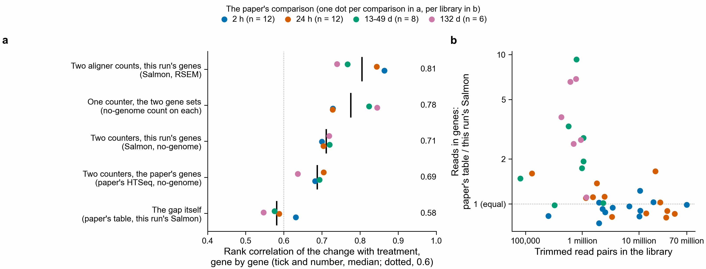

# Why do this run's counts differ from the paper's? Plan

Written 2026-11-11, before any of the tables below were compared. The result is added under
"Result" at the end; a change to the plan gets a dated note.

## Question

PR 220 showed that size factors do not explain why this run finds 183 of the paper's 782 listed
genes where the paper's own counts find 626: the counts themselves differ. Three things differ
between the two count tables. Which one matters?

1. **How reads are counted.** The paper's table (Dataset S1, sheet `Pacemaker_Counts_Table`) comes
   from its own pipeline; this run's comes from nf-core/rnaseq (STAR, then Salmon).
2. **The gene models.** The paper counts on 72,115 `g` genes; this run on 35,541 `FUN_` genes of the
   April 2024 genome.
3. **The match between the two gene sets.** `compare_paper_genes.py` pairs each `g` gene with a
   `FUN_` gene through its protein (MMseqs2, 90 % identity over 50 % of the paper's protein).

## The yardstick: one counter run on both gene sets

`pec-tools gene-counts` (PR 201, notebook 361) counts reads per gene with no genome and no
alignment: a read goes to the gene whose protein shares the most 10-amino-acid windows with the
read's translations. It was run on the same trimmed reads against both protein sets, the paper's
(`g` genes) and this run's (`FUN_` genes), for 47 libraries. So it is one counting method on two
gene sets, and it shares no code with either pipeline.

| table | gene set | how counted | file on Sherlock |
|---|---|---|---|
| paper | `g` | the paper's pipeline | Dataset S1, exported by `each-alone-checks/export_paper_counts.py` |
| salmon | `FUN_` | nf-core/rnaseq 3.27.0, STAR + Salmon (PR 207) | `$SCRATCH/botryllus-pec-young/rnaseq/star_salmon/salmon.merged.gene_counts.tsv` |
| rsem | `FUN_` | nf-core/rnaseq, STAR + RSEM (PR 201's run) | `$SCRATCH/nb361-pec/nfcore/rnaseq/star_rsem/rsem.merged.gene_counts.tsv` |
| no-genome, paper's genes | `g` | `pec-tools gene-counts` | `$SCRATCH/nb361-pec/cheap_route/all_reads/all.counts.tsv` |
| no-genome, this run's genes | `FUN_` | `pec-tools gene-counts` | `$SCRATCH/nb361-pec/cheap_route/new_proteome/all.counts.tsv` |

Libraries: those of the paper's 38 that are in every table.

## What is measured

For a pair of tables that name genes the same way:

- **Counts.** Per library, the Spearman rank correlation of the two counts over genes with a read in
  either table. Reported as the median over libraries.
- **Change with treatment.** Per comparison of the paper (2 h, 24 h, 13-49 d, 132 d), each library is
  scaled to one million reads, and a gene's change is log2((mean of treated + 1) / (mean of
  control + 1)). Over genes with 10 or more reads summed over the comparison's libraries in both
  tables, the Spearman rank correlation of the two changes. Reported per comparison and as the
  median of the four. Library totals are used on both sides so that scaling is the same; PR 220 and
  PR 201 showed the choice of scaling matters, so it is held fixed here, not tested.

Pairs:

| pair | what differs | what is the same |
|---|---|---|
| A. paper against no-genome on the paper's genes | how reads are counted | gene set |
| B. salmon against no-genome on this run's genes | how reads are counted | gene set |
| B2. salmon against rsem | two standard counters | gene set; shows how well two accepted counters agree |
| C. no-genome on the paper's genes against no-genome on this run's genes, through the gene match | gene set and match | how reads are counted |
| D. paper against salmon, through the gene match | everything | nothing; this is the gap itself |

For C and D, the counts of all `g` genes matched to one `FUN_` gene are added up. They are also
split by how the genes pair: one `g` gene to one `FUN_` gene, or several `g` genes to one `FUN_`
gene.

## Rule for reading the result, fixed now

"Agree" means a median count correlation of 0.8 or more and a median change correlation of 0.6 or
more. The cutoffs are a judgement made before looking; B2 is reported beside them so that they can
be compared with what two accepted counters reach.

| A | B | reading |
|---|---|---|
| agree | agree | Counting is not the cause. The gap comes from the gene sets or the match; go to C. |
| disagree | agree | The paper's table differs from a plain count on its own genes: the paper's counting is the cause, or part of it. |
| agree | disagree | Salmon's table differs from a plain count on its own genes: this run's counting is the cause, or part of it. |
| disagree | disagree | The no-genome counter is not a usable yardstick here, and the test says nothing. |

If the first row holds, C is read: if the change correlation is 0.6 or more for one-to-one genes and
under 0.6 for several-to-one genes, the cause is genes that the paper splits and this run joins. If
it is under 0.6 for both, the two gene sets differ beyond splitting, or the match pairs the wrong
genes; these two are not separated by this test. If it is 0.6 or more for both, the gene sets carry
the same changes and the test has not found the cause.

## Known limits, before running

- The no-genome counter places about 29 % of read pairs in a gene and cannot count a gene with no
  protein, so it is a coarser count than either pipeline.
- A rank correlation of counts is mostly set by how highly a gene is expressed, which is why the
  change with treatment is measured too.
- The change is a ratio of means with no test, so it is not the same thing as "listed genes found".

## Result (2026-11-11)

**By the rule above, the test says nothing: the no-genome counter did not reach the count
correlation of 0.8 against either pipeline (0.36 against the paper's table, 0.48 against Salmon), so
it is not a usable yardstick by that bar.** What follows was read after the rule failed, so these are
leads, not verdicts. Two of them are facts about the tables that do not depend on the yardstick.

**a.** How well two count tables agree on each gene's change with treatment, for each of the
paper's four comparisons. **b.** For each library, the reads the paper's table places in genes
divided by the reads this run's Salmon table places in genes.

| pair | what differs | count correlation, median over 38 libraries | change correlation, median of 4 comparisons (lowest to highest) |
|---|---|---|---|
| B2. salmon against rsem | two aligner counts, same genes | 0.83 | 0.81 (0.74 to 0.86) |
| C. no-genome on the paper's genes against no-genome on this run's genes | gene set and match | 0.54 | 0.78 (0.73 to 0.84) |
| B. salmon against no-genome | counter | 0.48 | 0.71 (0.70 to 0.72) |
| A. paper against no-genome | counter | 0.36 | 0.69 (0.64 to 0.70) |
| D. paper against salmon | everything | 0.45 | 0.58 (0.55 to 0.63) |

Tables: `summary.tsv`, `change_per_comparison.tsv`, `counts_per_library.tsv`,
`reads_in_genes_per_library.tsv`. Code: `compare_counts.py`, `plot_counts.py`.

### Facts about the tables

1. **The paper counted with HTSeq.** Its table has HTSeq's summary rows (`__no_feature`,
   `__ambiguous`, `__too_low_aQual`, `__not_aligned`, `__alignment_not_unique`) and a row `Sum` that
   equals the sum over genes. These six rows are not genes. They are left out here. Any fit or
   library total made from `paper_counts.tsv` as exported should leave them out too: in the median
   library `__not_aligned` alone is 43 % of the reads in the column.
2. **At 2 h and 24 h the two pipelines place the same number of reads in genes; at the later times
   this run places far fewer.** Paper's reads in genes over Salmon's, median per comparison: 0.93 at
   2 h, 1.06 at 24 h, 1.83 at 13-49 d, 3.25 at 132 d, and up to 9.3 in one library. 3 of the 8
   libraries at 13-49 d and 5 of the 6 at 132 d have a ratio of 2 or more; none of the 24 at 2 h and
   24 h do. At 132 d Salmon places a read in a gene for 16 % of trimmed read pairs, against 38 % at
   2 h; the paper's table has 66 % and 36 %. So for the two later comparisons this run starts with a
   half to a third of the paper's counts per library, from the same libraries.

### Leads

3. **The gene sets look like the smallest part.** The same counter on the two gene sets (C) agrees
   on the change with treatment almost as well as two aligner counters on one gene set (B2): 0.78
   against 0.81. Genes the paper splits and this run joins agree less than one-to-one genes (0.75
   against 0.81), a small difference.
4. **The counter matters more.** Changing the counter on one gene set (A, B) gives 0.69 and 0.71.
5. **At 2 h and 24 h, where the totals match, the gap is still there** (D: 0.63 and 0.59). With the
   same reads in genes, the two tables still rank genes' changes differently. The paper's lists are
   cut at unadjusted p <= 0.05, and the paper's own tables have 0 and 1 genes at adjusted p < 0.05
   at these two times (README above, "Compared with the paper"). Lists cut that way are sensitive to
   small differences in counts; this was not tested here.

### What this does not show

- Why this run places fewer reads in genes in the later libraries. Not tested: whether the trimmed
  read files hold fewer reads than the paper aligned, whether these libraries align worse to the
  April 2024 genome, or whether HTSeq and Salmon treat these reads differently. The no-genome counter
  also places few reads there, which argues against Salmon alone.
- Whether more reads in genes would bring back the paper's genes at 13-49 d and 132 d.
- The change with treatment here is a ratio of means after scaling every library to one million
  reads. It is not DESeq2's test, and PR 220 showed the scaling matters.

### Next test

For the 14 later libraries, count reads at each step on both sides: reads in the SRA run, reads
after trimming, reads aligned by STAR, reads Salmon places in a gene, against the paper's `Sum`,
`__not_aligned`, `__no_feature` and `__alignment_not_unique` rows. That says at which step this
run loses the reads.
