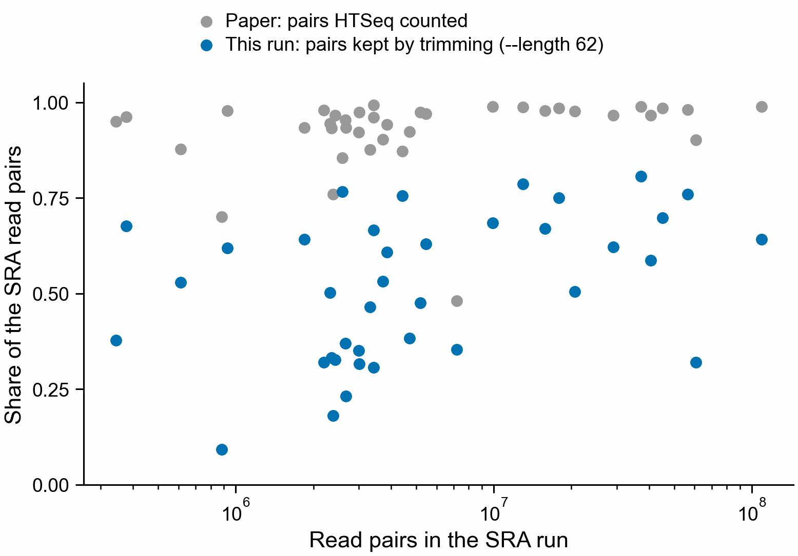

# Is the genome version why we cannot reproduce Domen et al. 2026?

The paper counted reads on an older Botryllus genome (`botznik-chr.fa`, gene models
`nc_nsi_nf.gtf`, 72,113 genes named `g1`, `g2`, ...) with HTSeq. Our runs count on the
April 2024 genome (35,541 genes named `FUN_000001`, ...) with Salmon. So two things
changed at once: the genome and gene models, and the read counter. This folder asks how
much of the gap each one explains.

The question is how many of the paper's 782 listed genes (Dataset S1, sheet
"annotated DE all groups young", four young-colony comparisons) each count table finds:
p < 0.05 with the fold change in the paper's direction. Every table is fitted the same
way, as the paper did: each comparison alone, `~ treatment`, DESeq2's default size
factors, the paper's 38 libraries.

| Listed genes found, of 782 | Counted as HTSeq does | Counted by Salmon |
|---|---:|---:|
| The paper's own table (HTSeq) | 631 | |
| Our reads, paper's genome (`g` genes) | 280 | 155 |
| Our reads, April 2024 genome (`FUN_` genes) | 187 | 183 |

"Counted as HTSeq does" is featureCounts with HTSeq's rule: a read pair counts for a gene
only when it aligns to one place and overlaps that one gene. Strand is ignored, because
the libraries are unstranded.

- **Genome version: part of the gap, not most of it.** With HTSeq-style counting,
  going back to the paper's genome finds 280 genes instead of 187, so 93 more. The gap
  between the paper's table and the new genome is 444 (631 - 187), so 93 is 21% of it.
  With Salmon the paper's genome finds 28 fewer than the new one.
- Gene by gene (panel b) the genome matters more than the net 93 shows. Of the 631
  genes the paper's table finds, 153 are found only on the paper's genome and 59 only on
  the April 2024 genome.
- **HTSeq instead of Salmon: matters only on the paper's genes.** On the paper's genome,
  HTSeq-style counting finds 125 more than Salmon (280 against 155). On the April 2024
  genome the two differ by 4 (187 against 183).
- **Most of the gap is left even with the paper's genome and the paper's way of
  counting.** The gap is still 351 genes (631 - 280), and 308 of the 631 genes the
  paper's table finds are found on neither genome. Per library, our HTSeq-style count on the
  paper's genome holds 62% as many read pairs as the paper's table (median over 38
  libraries; PR 223, `count_split_libraries.tsv`).
- Over the listed genes, the rank correlation of signed -log10 p with the paper's fit is
  0.86 on the paper's genome and 0.77 on the April 2024 genome (HTSeq-style; 0.81 and
  0.75 with Salmon). These genes were picked by the paper's p-values, so this is not a
  correlation over all genes.

## What is left: our trimming threw away about half the reads

**Counting each mate as its own read is not the cause.** PR 223 tested it (Sherlock job
52056949, finished 2026-11-12 06:17, cutoffs written before it ran). On the paper's
genome it finds 317 listed genes, below the 368 that would have made it a cause, and it
then counts 123% as many reads as the paper's table with the same rank correlation
across genes as before (0.89). So the paper's counts differ from ours gene by gene, not by
a scale factor.

**The paper counted nearly every read pair. Our trimming kept about half.**

HTSeq puts every read pair it is given into exactly one row of its table: a gene or one of
its five tallies (no gene, ambiguous, low quality, not aligned, aligned to more than one
place). So the column sum is the number of pairs the paper gave HTSeq. Per library that
is 96% of the read pairs in the SRA run (median of 38, range 48% to 99%). Our reads are
PR 203's Trim Galore output, which kept 53% of the pairs (median, range 9% to 81%). In
all 38 libraries the paper counted more pairs than our trimming kept.

The reason is one setting. PR 203's nf-core/rnaseq run (2026-10-24, on Sherlock in
`/scratch/users/olgabot/botryllus-shazam-PEC-20261023/nfcore/`) passed
`--length 62` to Trim Galore: a pair is dropped when either read is shorter than 62 bases
after the adapter is cut off. Trim Galore's own default is 20. These libraries have short
cDNA fragments: in SRR32233970 (JA100) 80% of reads contain adapter, and the 62-base rule
drops 38% of pairs. In SRR32233977 (JA154) it drops 91%.

Dropping reads by fragment length is not random over genes, which fits the 0.89 rank
correlation between our counts and the paper's on the same genome. That is an
explanation that fits the numbers, not yet a test. The test is to count the untrimmed (or
`--length 20`) reads on the paper's genome and fit as before.

The earlier "1.55 times as many counts" in PR 223 is this same gap: 28.1 million pairs
counted by the paper against 18.1 million left after trimming, from 29.0 million in SRA
for SRR32233970.

`trimming_check.py` reads Dataset S1 and PR 203's trimming record
(`../inputs/trimmed-inputs.validated.json`) and writes `trimming_check.tsv` (one row per
library: SRA pairs, pairs kept, the paper's gene counts and five tallies) and
`trimming_check.out`:
`python trimming_check.py <pnas.2610968123.sd01.xlsx>`.

## Files

- `genome_version.py`: reads `inputs/`, prints the numbers above to
  `genome_version.out`, writes the two tables and the figure.
  Run with `python genome_version.py` in the 2025-kmerseek-analysis environment.
- `inputs/count_split_*.tsv`: copied unchanged from
  `/scratch/users/olgabot/botryllus-pec-young/count-split/` on Sherlock, written by PR
  223's `count_split.R` (job 51959161, 2026-11-11). PR 223 has the code that aligned the
  reads to the paper's genome (nf-core/rnaseq 3.27.0, `params-rnaseq-paper-genome.yaml`)
  and fitted the tables.
- `genome_version_summary.tsv`: listed genes found and tested per table, and the rank
  correlation with the paper's fit.
- `genome_version_split.tsv`: the paper's 631 found genes by which genome finds them.
