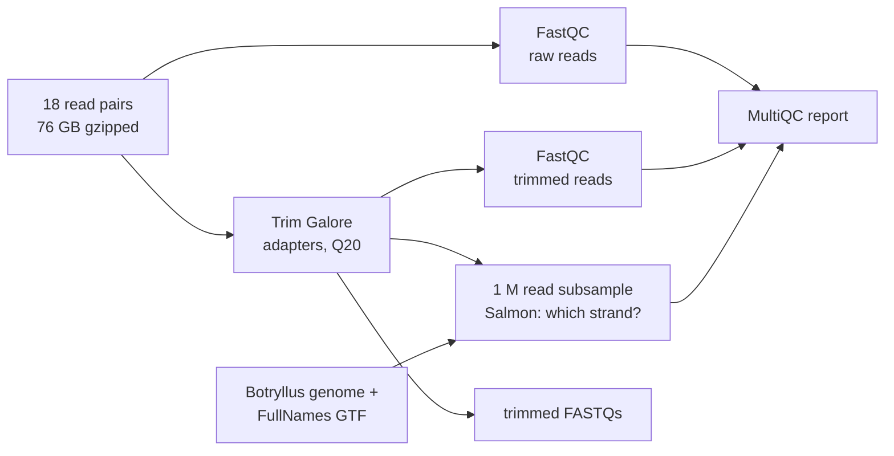
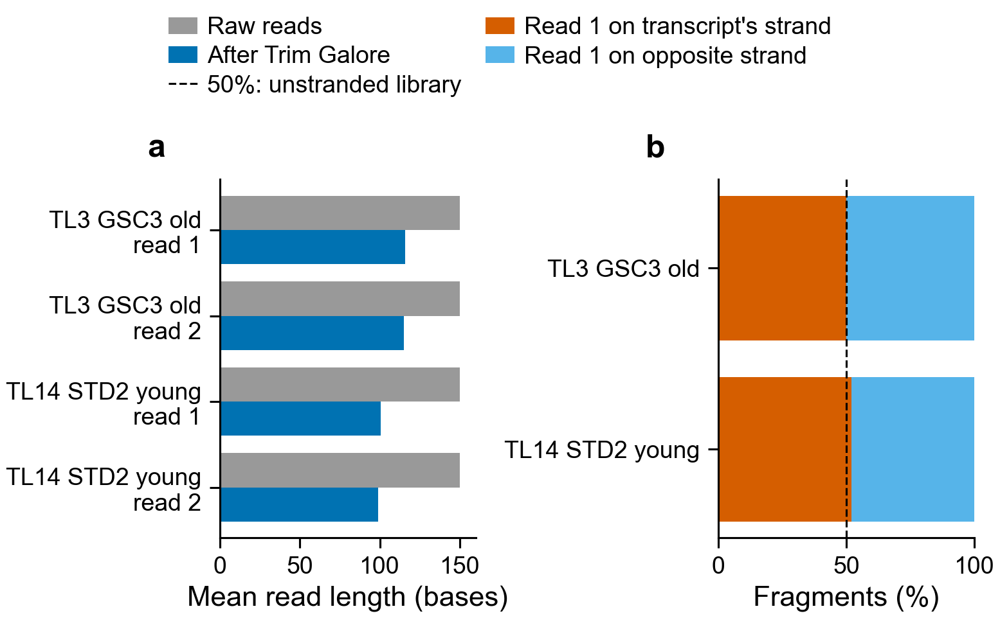

# Botryllus germline RNA-seq: pre-processing only

Runs the pre-processing part of [nf-core/rnaseq 3.27.0](https://nf-co.re/rnaseq/3.27.0) on
the bulk RNA-seq reads in
`/home/groups/ayeletv/RNASeq_Data/Botryllus_bulk_RNA_young_vs_old/`. There are 18 samples:
germline stem cells (GSC), STD and SZ, three each, from a young (207 day) and an old
(4496 day) colony. All are paired-end 2 x 150 bp from one NextSeq 2000 run, untrimmed.



Nothing is aligned to the genome and nothing is counted per gene
(`--skip_alignment --skip_pseudo_alignment`). The pipeline still requires a genome and a
GTF to start. They are used only to build the Salmon index for the strandedness check.

## Run

On Sherlock:

```bash
cd /scratch/users/olgabot/2024-kmerseek-analysis-botryllus-rnaseq/nextflow-runs/botryllus-rnaseq-preprocess
git pull
make run
```

`make test` runs the same thing on the first 200 000 read pairs of the shallowest sample
(TL3, GSC3 old) and the deepest one (TL14, STD2 young).

## Test result (2026-10-21)

`make test` finished in about 40 minutes (job 48803559), every task on its first attempt.
On the first 200 000 read pairs of TL3 (GSC3 old) and TL14 (STD2 young):



- **a.** Trim Galore found adapter in 77% (TL3) and 86-88% (TL14) of reads. The mean read
  length dropped from 150 to 115-116 bases (TL3) and 99-101 bases (TL14), so many inserts
  are shorter than 150 bases. Under 0.5% of pairs were dropped as too short (under 20 bases).
- **b.** Salmon put read 1 on the transcript's strand for 50% (TL3) and 52% (TL14) of the
  fragments it assigned. **These two samples look unstranded.** The other 16 were not
  tested, so `samplesheet.csv` keeps `strandedness: auto` for all 18 and Salmon decides
  each one in the full run. Do not hard-code `unstranded` until the full run confirms it.
- Salmon assigned 48% (TL3) and 72% (TL14) of the read pairs to a FullNames transcript.

**Open QC problems.** The trimmed reads are not clean yet. TL3 still fails FastQC adapter
content (poly-A up to 10%), all four trimmed files fail per-base sequence content, and
primer-like overrepresented sequences remain. `make run` trims all 18 samples with the same
settings, so expect the same problems. See
[`qc_review_2026-10-22/REVIEW.md`](qc_review_2026-10-22/REVIEW.md). Settle the trimming before
using the trimmed FASTQs.

Numbers are in [`test_results/test_summary.tsv`](test_results/test_summary.tsv); the figure
is drawn by `plot_test_summary.py`. The first reads of a file come from the edge of the
flow cell, so the full run may differ a little.

## Outputs

In `$SCRATCH/botryllus-rnaseq-preprocess/results/`:

| Folder | What is in it |
|---|---|
| `multiqc/multiqc_report.html` | read counts, quality, adapter content, reads lost to trimming, strandedness, per sample |
| `trimgalore/` | trimmed FASTQs (`--save_trimmed`) and Trim Galore reports |
| `fastqc/raw/`, `fastqc/trim/` | FastQC before and after trimming |
| `pipeline_info/` | software versions, run timeline, resource trace |

## Resources

Sized from the 2-sample test below. The largest pair is 13.3 GB gzipped
(TL14, about 120 million read pairs).

| Step | CPUs | Memory | Time limit | Why |
|---|---|---|---|---|
| Trim Galore | 8 | 16 GB | 12 h | test: 78 MB, 3 s run time on 200 000 pairs; x600 is about 30 min. 8 CPUs gives cutadapt 4 cores |
| FastQC | 2 | 8 GB | 6 h | test: under 1 GB, 6 s on 200 000 reads; about 1 h on 120 million |
| Salmon index | 6 | 8 GB | 2 h | test: 3.2 GB, 4 min 46 s; built once |
| Salmon quant (strandedness) | 6 | 6 GB | 2 h | test: 2.3 GB; always a 1 million read subsample |
| Nextflow head | 2 | 8 GB | 2 days | |

## Choices

- Reference: `final_purged_primary.fasta` with
  `Annotated_Merge_Botryllus.sofMask_CorrectedNames_FullNames.gtf`, from
  `/home/groups/ayeletv/Index_Genome_New_April2024/ReferenceFiles/`. `IMPORTANT_NOTE.txt`
  there names the FullNames annotation as the current one.
- Strandedness is `auto` for every sample: Salmon decides it from a 1 million read subsample.
- The pipeline needs Nextflow 25.10.4 or later. Sherlock's newest module is 25.04.7, a
  self-contained build that ignores `NXF_VER` (the first test failed on it, unable to load
  the nf-schema 2.7.2 plugin). `make` downloads the 25.10.4 self-contained build from the
  Nextflow release page into `$SCRATCH/bin/` and runs that, with the module's Java 18.
