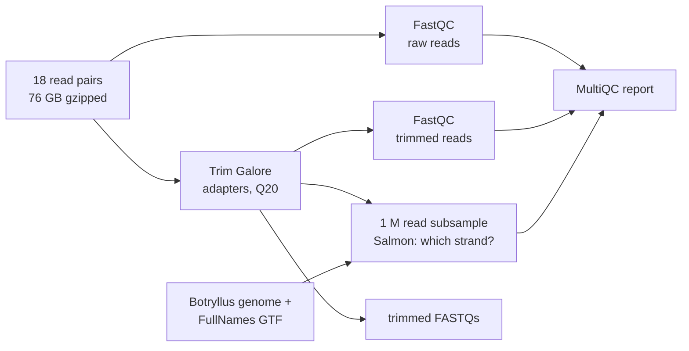

# Botryllus germline RNA-seq: pre-processing only

Runs the pre-processing part of [nf-core/rnaseq 3.27.0](https://nf-co.re/rnaseq/3.27.0) on
the bulk RNA-seq reads in
`/home/groups/ayeletv/RNASeq_Data/Botryllus_bulk_RNA_young_vs_old/`. There are 18 samples:
germline stem cells (GSC), STD and SZ, three each, from a young (207 day) and an old
(4496 day) colony. All are paired-end 2 x 150 bp from one NextSeq 2000 run, untrimmed.



Nothing is aligned to the genome and nothing is counted per gene
(`--skip_alignment --skip_pseudo_alignment`). The pipeline still requires a genome and a
GTF to start. They are used only to build the Salmon index for the strandedness check.

## Run

On Sherlock:

```bash
cd /scratch/users/olgabot/2024-kmerseek-analysis-botryllus-rnaseq/nextflow-runs/botryllus-rnaseq-preprocess
git pull
make run
```

`make test` runs the same thing on the first 200 000 read pairs of the shallowest sample
(TL3, GSC3 old) and the deepest one (TL14, STD2 young).

## Outputs

In `$SCRATCH/botryllus-rnaseq-preprocess/results/`:

| Folder | What is in it |
|---|---|
| `multiqc/multiqc_report.html` | read counts, quality, adapter content, reads lost to trimming, strandedness, per sample |
| `trimgalore/` | trimmed FASTQs (`--save_trimmed`) and Trim Galore reports |
| `fastqc/raw/`, `fastqc/trim/` | FastQC before and after trimming |
| `pipeline_info/` | software versions, run timeline, resource trace |

## Resources

No earlier run on these reads to size from. The largest pair is 13.3 GB gzipped
(TL14, about 120 million read pairs).

| Step | CPUs | Memory | Time limit | Why |
|---|---|---|---|---|
| Trim Galore | 8 | 16 GB | 12 h | cutadapt streams the reads; 8 CPUs gives it 4 cores |
| FastQC | 2 | 8 GB | 6 h | about 1 h per 7 GB file on one thread |
| Salmon index, strandedness | pipeline default (12 CPUs, 72 GB) | | | one index, built once |
| Nextflow head | 2 | 8 GB | 2 days | |

## Choices

- Reference: `final_purged_primary.fasta` with
  `Annotated_Merge_Botryllus.sofMask_CorrectedNames_FullNames.gtf`, from
  `/home/groups/ayeletv/Index_Genome_New_April2024/ReferenceFiles/`. `IMPORTANT_NOTE.txt`
  there names the FullNames annotation as the current one.
- Strandedness is `auto` for every sample: Salmon decides it from a 1 million read subsample.
- The pipeline needs Nextflow 25.10.4 or later. Sherlock's newest module is 25.04.7, a
  self-contained build that ignores `NXF_VER` (the first test failed on it, unable to load
  the nf-schema 2.7.2 plugin). `make` downloads the 25.10.4 self-contained build from the
  Nextflow release page into `$SCRATCH/bin/` and runs that, with the module's Java 18.
