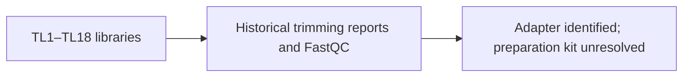

# Sherlock library-preparation search, 2026-10-22

No original sample sheet or preparation notes identifying these 18 libraries
were found in the locations searched. The exact kit remains unconfirmed.

Searched: metadata filenames to depth 3 in $GROUP_HOME/RNASeq_Data, the raw
library folder, historical trimming reports and scripts, and FastQC folders;
metadata filenames to depth 2 in $GROUP_HOME; the top-level scRNA_h5ad folder;
$GROUP_HOME/Uploaded_Data and $GROUP_SCRATCH/RNASeq_Data/Uploaded_Data (both
empty); and the current preprocessing project folder. Its samplesheet was
created for this analysis and is not original preparation documentation.
The shallow group scan could not enter _STARtmp or
botryllus_schlosseri_2022_voskoboynik. Permissions were not bypassed and other
users' personal directories were not searched.

The raw library folder contains 36 FASTQs plus submit.sh and a failed-job
log. Raw FASTQs are owned by levyt and dated March 24, 2023.

$GROUP_HOME/RNASeq_Data/Trimmed_Germline contains trimming reports with the
same TL1–TL18 library basenames. The inspected TL3 report names Trim Galore
0.5.0, Cutadapt 1.18, Q20, paired-end mode, minimum length 20 bases, and
adapter AGATCGGAAGAGC, labelled “Illumina TruSeq, Sanger iPCR; auto-detected”.
That label identifies a software adapter class, not a confirmed TruSeq kit.
Other reports show the same adapter; some reference a former Temporary
input directory with the same basenames.

Fastqc_Germline/Before_Trim contains reports for the 36 raw mate files dated
July 7–8, 2023; After_Trim also exists. This corrects the earlier statement
that trimming never ran: the initial failed script was followed by later
processing. Integrity of historical trimmed FASTQs was not checked.

The pilot primer-like sequence and poly-A signal are clues, not enough to
identify a specific SMART/Smart-seq protocol. RNA selection, tagmentation,
kit version and presence of UMIs remain unresolved. Do not assign the paper's
single-cell Smart-seq3 protocol to these 18 libraries without an original record.

The original sequencing-core sample sheet or library submission for
GermlineCells TL1–TL18 / S79–S96 is needed: young colony 7135e, 207 days;
old colony Sc109e, 4496 days. File ownership identifies levyt as a useful
contact for that record. Nobody was contacted; no processing settings changed.
