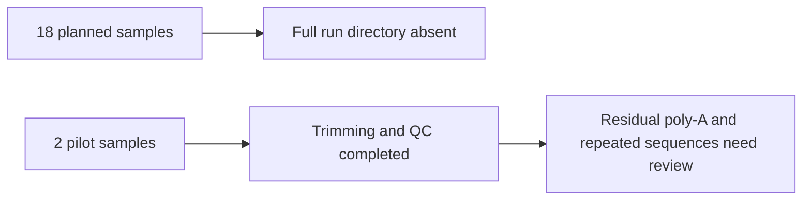

# Botryllus preprocessing QC check, 2026-10-22

The full 18-sample run cannot be marked finished. The configured run directory,
`$SCRATCH/botryllus-rnaseq-preprocess`, does not exist. Scheduler accounting from
2026-10-21 through this check has no full driver named `nf-botryllus-rnaseq`;
all matching Botryllus task working directories belong to the pilot. This does
not rule out a run launched under another name or output directory.
No jobs were launched or resumed during this review.

## Confirmed pilot results

Pilot directory: `$SCRATCH/botryllus-rnaseq-preprocess-test`.
Driver 48803559 completed; Nextflow reports success, 18 tasks succeeded, zero
failed or ignored. The pilot samplesheet contains only TL3_GSC3_old and
TL14_STD2_young, each with the first 200,000 read pairs. Four trimmed FASTQs
are published, not the 36 needed for the full dataset.

| Pilot sample | Retained pairs | Retained | Mean trimmed R1/R2 length | Reads with adapter R1/R2 |
|---|---:|---:|---:|---:|
| TL3 GSC3 old | 199,083 | 99.54% | 115.9 / 115.1 bp | 76.84 / 77.00% |
| TL14 STD2 young | 199,412 | 99.71% | 100.7 / 98.8 bp | 85.58 / 87.58% |

All four trimmed files pass per-base and per-sequence quality checks and
per-base N content. All four fail per-base sequence content. TL3 R1 fails GC
content; the other three warn. Duplication is approximately 41% in TL3 and
55–56% in TL14, estimated by FastQC; this alone does not justify removing
RNA-seq duplicates.

TL3 still fails adapter content in both mates: the plotted poly-A series
reaches 10.23% and 10.03%. TL14 passes, with poly-A reaching 4.71% and 4.92%.
The overrepresented-sequence table includes repeated sequences containing
`AAGCAGTGGTATCAACGCAGAGTAC`, sometimes followed by poly-T. These are primer-like
sequences, but their identity and the appropriate trimming settings have not
been confirmed against library-preparation records. The exported table pools
occurrences across reports; it cannot assign each sequence to a particular sample.

Salmon library-format JSON reports IU (unstranded paired-end) for both pilot
samples, with strand_mapping_bias 0.49946 and 0.51065. This supports treating
these two as unstranded; it does not establish the other 16 libraries' orientation.

## Decision and limits

Do not treat the full dataset as processed or QC-approved. Before scaling up,
confirm the library-preparation protocol and whether poly-A/poly-T or primer
removal is appropriate, then check that treatment on the pilot. No trimming
rules were changed. The prior statement that the entire library is unstranded
was broader than the two-sample evidence supports.

Checks: independently compared Trim Galore retained counts against FastQC
Total Sequences for all four files (all equal), recomputed retention and
adapter percentages from integer counts, and compared the two-row pilot
samplesheet with the four published FASTQs and successful workflow log.
The copied MultiQC tables beside this review preserve the supporting values.
Not tested: all 18 full inputs, FASTQ integrity by full decompression, biological
replicate agreement, contamination identity, or a revised trimming protocol.
