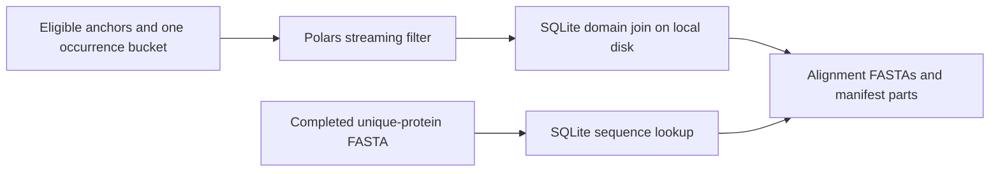

The full run stopped on 2026-10-22 after alignment preparation exhausted 16, 32 and
48 GB. The original preparer loaded all Pfam domain rows, accumulated every joined
occurrence bucket, and stored the needed protein sequences in Python dictionaries.

The replacement keeps the domain table and sequences in SQLite on node-local disk.
Polars selects columns and filters one occurrence file at a time using a streaming
join to eligible anchors. SQLite joins that bucket to domains by protein ID and
Pfam accession, sorts its rows on disk, and discards them after writing its FASTAs.
The filtered occurrence DataFrame and eligible-anchor table still occupy RAM.
SQLite's page cache is limited to 64 MiB. Disk capacity is checked before importing.

The full run's staged inputs contain 162 GB of occurrence Parquets and 1.29 TB of
protein FASTAs. The already completed dedupProteins output is 8.2 GB, so the new
preparer consumes that output. The sequence index therefore avoids rereading
hundreds of copies of each protein.

The executable is separate from clade_splash_pfam.py. That existing executable,
Pfam mapping command, and upstream scientific rules are unchanged, so the resume
can reuse the completed Pfam mapping and counting tasks. The same launch directory
and Nextflow session must be retained.

`make run` regenerates `run/measured/resources.config` and its evidence table from
retained full-run and pilot traces, then resumes with Nextflow 25.04.7. The new
preparer's first ask is 96 GB (twice the largest killed ask) and 24 hours. The time
is a conservative allowance for the new implementation, not a completion estimate.
The full input still needs runtime and memory measurement.

The real-input check (Sherlock job 48999084) completed successfully in 8 min 49 s.
It used all 946 domain files (7.45 GB), the 8.2 GB unique-protein FASTA, the complete
eligible-anchor table and one 546 MB occurrence file. It produced 44,136 manifest
rows. Slurm reported 29,430,620 KiB (28.07 GiB) peak memory for the batch;
/usr/bin/time reported 3,687,832 KiB (3.52 GiB) for the command. These readings
cover different accounting scopes; use the larger one for sizing. This was one
of 512 occurrence files, not a completed full preparation.

The resume was submitted as driver job 49000133 on 2026-10-22, using the same
launch directory, Nextflow 25.04.7 and `-resume`. Existing counts, significant
anchors, top occurrences and Pfam mappings can be inspected while alignment runs.
The node-local scratch/container wiring was also tested inside the check's Slurm
allocation: the probe completed under `/lscratch/olgabot/48999084/nxf.*` with
Polars 1.43.2.

Validation: 24 pipeline tests pass locally, including comparison of every FASTA,
manifest and manifest part against the original on fixtures with empty inputs,
unsigned anchor IDs, repeated occurrences, repeated protein FASTAs, multiple domain
envelopes and targets outside those envelopes. A malformed anchor appearing in more
than one hash bucket is rejected rather than overwriting its earlier FASTA. The
full scientific benchmark has not finished.
