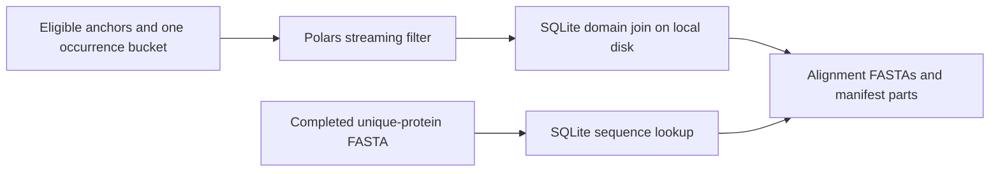

The full run stopped on 2026-10-22 after alignment preparation exhausted 16, 32 and
48 GB. The original preparer loaded all Pfam domain rows, accumulated every joined
occurrence bucket, and stored the needed protein sequences in Python dictionaries.

The replacement keeps the domain table and sequences in SQLite on node-local disk.
Polars selects columns and filters one occurrence file at a time using a streaming
join to eligible anchors. SQLite joins that bucket to domains by protein ID and
Pfam accession, sorts its rows on disk, and discards them after writing its FASTAs.
The filtered occurrence DataFrame and eligible-anchor table still occupy RAM.
SQLite's page cache is limited to 64 MiB. Disk capacity is checked before importing.

The full run's staged inputs contain 162 GB of occurrence Parquets and 1.29 TB of
protein FASTAs. The already completed dedupProteins output is 8.2 GB, so the new
preparer consumes that output. The sequence index therefore avoids rereading
hundreds of copies of each protein.

The executable is separate from clade_splash_pfam.py. That existing executable,
Pfam mapping command, and upstream scientific rules are unchanged, so the resume
can reuse the completed Pfam mapping and counting tasks. The same launch directory
and Nextflow session must be retained.

`make run` regenerates `run/measured/resources.config` and its evidence table from
retained full-run and pilot traces, then resumes with Nextflow 25.04.7. The initial
repaired run requested 96 GB and 24 hours. The 2026-10-23 relaunch
requests 128 GB and 36 hours, based on the full task's memory reading and progress
described below.
The full input still needs runtime and memory measurement.

The real-input check (Sherlock job 48999084) completed successfully in 8 min 49 s.
It used all 946 domain files (7.45 GB), the 8.2 GB unique-protein FASTA, the complete
eligible-anchor table and one 546 MB occurrence file. It produced 44,136 manifest
rows. Slurm reported 29,430,620 KiB (28.07 GiB) peak memory for the batch;
/usr/bin/time reported 3,687,832 KiB (3.52 GiB) for the command. These readings
cover different accounting scopes; use the larger one for sizing. This was one
of 512 occurrence files, not a completed full preparation.

The 2026-10-22 resume ran as driver job 49000133, with alignment preparation job
49000241. It used the same
launch directory, Nextflow 25.04.7 and `-resume`. Existing counts, significant
anchors, top occurrences and Pfam mappings can be inspected while alignment runs.
Both the Nextflow log and the new trace confirm 2,200 cached tasks, including all
946 hmmsearch tasks and the completed pfamOverlap task. The task wrapper requests
96 GB and 24 h and binds the Slurm task's node-local scratch directory.
The node-local scratch/container wiring was also tested inside the check's Slurm
allocation: the probe completed under `/lscratch/olgabot/48999084/nxf.*` with
Polars 1.43.2.

Validation: 24 pipeline tests pass locally, including comparison of every FASTA,
manifest and manifest part against the original on fixtures with empty inputs,
unsigned anchor IDs, repeated occurrences, repeated protein FASTAs, multiple domain
envelopes and targets outside those envelopes. A malformed anchor appearing in more
than one hash bucket is rejected rather than overwriting its earlier FASTA. The
full scientific benchmark has not finished.

Cancellation diagnosis, 2026-10-23
----------------------------------

The repaired run was cancelled deliberately. In chat
`01a1648a-25cc-73a3-adf5-dfd5b594aece`, Olga said at 2026-10-22 09:59:37 PDT,
“wait cancel all this, these are not the experiments I want to do”. The agent then
ran `scancel 49000133 49000241` at 09:59:47. Slurm attributes both cancellations to
UID 363520, Olga's account. The driver received TERM, its handler sent Ctrl-C to
Nextflow, and Nextflow recorded SIGINT with one aborted task. No failed task or
out-of-memory event was recorded for that resume. The earlier memory failures
belong to the original preparer, before the disk-backed replacement.

The cancellation was therefore a change of experiment direction, rather than a
pipeline error. Olga explicitly requested a resume in this chat on 2026-10-23.
This resumes the same registered protein experiment; the question and pass/fail
rules are unchanged.

The aborted child ran 2h25m37s and had a Slurm batch peak of 97,815,480 KiB
(93.28 GiB) against 96 GiB. Its log began 34 occurrence files, so 33 completed
before the interrupted file. Those 33 total 17,987,244,289 of 161,735,388,518
occurrence bytes (11.12%). Scaling elapsed time by bytes gives about 21.8 h for
preparation. This is an estimate: later files and output copying can differ.
The launch now asks for 128 GiB and 36 h, over 1.5 times that estimated runtime.
The 48 h head allocation provides additional time for the remaining alignment
and column-testing stages.

The previous 96 GiB allocation was close to the batch reading, so the provisioning
floor changes from 96 to 128 GiB; the time floor changes from 24 to 36 h. The
resource test was run before the change (failed with 96/24), then after it. The
counting, domain mapping and alignment algorithms are unchanged in this relaunch.
The 2,200 completed upstream tasks remain reusable. The cancelled task's temporary
node-local outputs were not published; its unfinished alignment preparation must
run again.

First usable outputs already exist: the pilot alignment tables and the full run's
count, significant-anchor, top-occurrence and Pfam-mapping tables. These can be
reviewed while the full alignment preparation runs. A shorter diagnostic alignment
could provide earlier examples by reducing coverage; it would not replace the
registered full result.

Renewed launch, 2026-10-23
-------------------------

Driver 49179827 started at about 05:01 PDT. It retained session UUID
0261f444-6cf6-44b0-9cdd-24280e43360c. The new log and October 23 trace independently
confirm 2,200 cached tasks, including 946 hmmsearch tasks and pfamOverlap.
Alignment preparation was submitted as 49179904 and was queued at the 05:02 check.
The resolved cluster configuration requests 128 GiB/36 h with the same node-local
scratch and container binding. The full alignment result remains incomplete.
