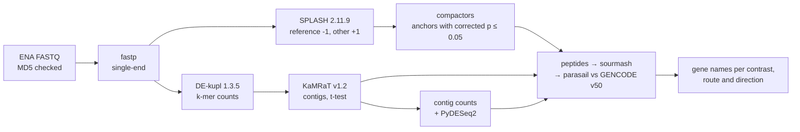

# pec-domen2026-human: notebook 361 on the human exercise series

The reference-free routes of the Botryllus pipeline (`../pec-domen2026/`) on the three human
RNA-seq series Domen et al. 2026 cite: GSE99963, GSE144304 and GSE120862. The contrasts are in
`analysis/pec-domen2026-splash/design/human/` (README there says what each one compares);
results are described in `analysis/pec-domen2026-splash/exports/human/README.md`.



## Run (on Sherlock)

```bash
ssh sherlock
cd /scratch/users/olgabot/2024-kmerseek-analysis-nb361-human/nextflow-runs/pec-domen2026-human
make run          # or: make run SERIES=GSE99963,GSE144304
make watch        # live table (read-only); Ctrl-b d to leave
make running      # every Nextflow run in the queue, then this folder's jobs
make stop         # cancel the run cleanly
```

`make pilot` runs one small contrast (gse99963_sed_post_vs_pre, 14 runs). The Nextflow head is
its own batch job (`scripts/nf-head`), so it survives logout. Every process has `storeDir` under
`$SCRATCH/nb361-pec/human`, so a relaunch in a fresh launch folder finds finished results and
does not recompute them. Trace, report and timeline are written next to the launch folder
(`pec361-human.<date>.trace.txt` and so on).

Downloads: the 108 GSE99963 and GSE144304 runs were already downloaded and MD5-checked for the
read search (`$SCRATCH/nb361-pec/sra_search/reads`); the download step hard-links them and
checks the MD5 again. GSE120862's 84 runs were downloaded by `slurm/28_human_download.sbatch`
(Slurm array 50921803, same transfer and MD5 rules) into the download step's storeDir, so the
pipeline finds them.

## Errors

A scheduler kill (exit status `Integer.MAX_VALUE`) and memory or time kills (128-143, including
137 and 140) are retried twice with doubled memory and time; after that the one task is ignored.
Downloads retry any failure 3 times. A contrast is assembled with `groupTuple(groupKey(c, n))`:
if one of its runs fails, the group never reaches its size and is dropped when the trimmed
channel closes, so no contrast runs with a sample missing and nothing waits forever.

## First resource asks and their evidence

From the Botryllus measurements (`../pec-domen2026/README.md`,
`analysis/pec-domen2026-splash/exports/paper_recovery/resources.tsv`), scaled by input size.
The largest human contrast holds 56 Gbp of reads in 41 samples (gse144304_male_old_vs_young);
the largest Botryllus one 83 Gbp in 12 samples (young 24 h).

| label | first ask | largest Botryllus measurement | scaling to human |
|---|---|---|---|
| download | 1 CPU, 2 GB, 12 h | 5 h 51 min | transfer speed sets the time |
| fastp | 4 CPU, 8 GB, 2 h | 7 min, 4.1 GB (JA102, 109 M pairs, paired) | single-end runs are at most 59 M reads |
| db (GENCODE sketches + 9 indexes) | 16 CPU, 64 GB, 6 h | Swiss-Prot, same job, 64 GB ask | GENCODE has fewer residues than Swiss-Prot |
| splash | 32 CPU, 128 GB, 12 h | 84 GB, 14 min (young 24 h, 83 Gbp) | fewer Gbp but up to 3.4x the samples |
| compactors | 32 CPU, 96 GB, 12 h | 56 GB, 25 min (old 24 h) | |
| dekupl (counting + limma) | 32 CPU, 64 GB, 24 h | 25 GB, 86 min (young 2 h, 66 Gbp) | count joining grows with samples |
| kamrat | 4 CPU, 64 GB, 12 h | 12 GB, 62 min (young 24 h, 12 samples) | index memory grows with samples, 3.4x |
| kamrat_deseq (t-test + PyDESeq2) | 16 CPU, 128 GB, 24 h | 25 GB (young 2 h, 2.0 M contigs, 12 samples) | PyDESeq2 memory grows with samples, 3.4x |
| search (GENCODE only) | 16 CPU, 96 GB, 24 h | 67 GB, 58 min (young 24 h, 3 databases) | one database here |
| small_mem | 2 CPU, 32 GB, 2 h | | gene table |

The measured human values are in `analysis/pec-domen2026-splash/exports/human/resources.tsv`
once the runs finish.
