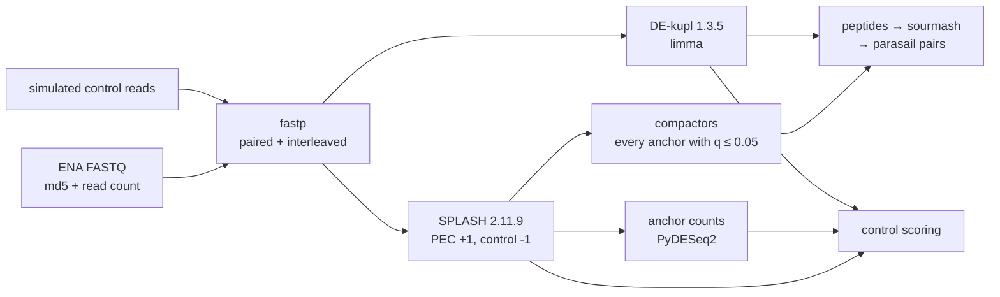

# pec-domen2026: notebook 361 pipeline

Domen et al. 2026 (PNAS) PEC RNA-seq, reproduced without a genome. The analysis plan, frozen
design and stage scripts are in `analysis/pec-domen2026-splash/`; this folder only runs them.



## Run (on Sherlock)

```bash
ssh sherlock
cd $SCRATCH/2024-kmerseek-analysis-nb361/nextflow-runs/pec-domen2026
make run
```

`make watch` shows the live table, `make stop` ends the run cleanly, `make running` lists the
queue. The Nextflow head is its own batch job (`scripts/nf-head`), so it survives logout and
login-node reboots. Launch folders: `run/` (everything), `run-test/` (young_132d + control).

## Reuse of finished results

Every process has `storeDir` under `$SCRATCH/nb361-pec`, at the same paths the earlier Slurm
stages (`analysis/pec-domen2026-splash/slurm/`) wrote. A task whose outputs are already there is
not run again. Keep a fresh launch folder: Nextflow only looks in `storeDir` when the task has
no work folder yet.

## First resource asks and their evidence

Measured on the runs so far (Slurm accounting and `/usr/bin/time -v`, 2026-10-23 to 10-30).
Retries double memory and time, up to 2 retries; after that the one task is ignored, so one
contrast cannot stop the others.

| label | first ask | largest measured so far | note |
|---|---|---|---|
| download | 2 CPU, 4 GB, 12 h | 5 h 51 min | ENA transfer speed sets the time |
| fastp | 8 CPU, 8 GB, 2 h | 7 min, 4.1 GB (JA102, 109 M pairs) | |
| splash | 32 CPU, 128 GB, 12 h | 58 s, 4.1 GB (old_41_93d, 20 M reads) | young_24h has about 20x those reads; no measurement at that size yet |
| compactors | 32 CPU, 64 GB, 12 h | 41 s, 2.7 GB | |
| anchor_counts | 16 CPU, 128 GB, 24 h | 55 min, 17 GB (control, 3.3 M anchors) | the main contrasts may test more anchors |
| dekupl | 32 CPU, 128 GB, 48 h | 17 min, 3.1 GB (control, DESeq2 test) | k-mer counting scales with reads |
| search | 16 CPU, 64 GB, 24 h | 3 min (control) | |
| small, small_mem | 4 CPU 8 GB / 2 CPU 32 GB | | simulation, control scoring |

No first attempt in the history above failed on memory or time; the only failures were two
corrupted downloads (MD5 mismatch). The download step refuses a file whose MD5 differs from
ENA's, and the `download` label retries any failure up to 3 times.
