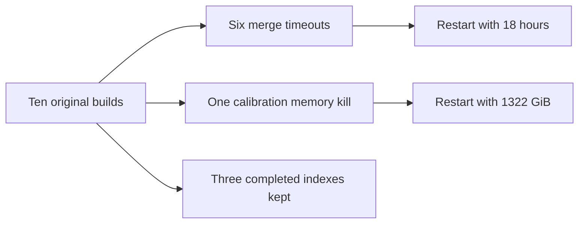

# Seven failed index builds, 23 October 2026

Six builds reached the end of the 13,859,294-protein FASTA, then exceeded their
six-hour limits while merging posting runs into the inverted index. None reached
calibration. Their recorded memory peaks therefore do not measure calibration memory.
Retain the original memory requests and triple the time allowance. This is a larger
allowance, not a measured prediction that the merge will finish in 18 hours.

sdm12 wrote its index and was killed during the 200-sequence calibration. Slurm records
661 GiB against a 661 GiB request. Double the killed request to 1322 GiB. Retain six
hours: the failed attempt reached calibration after 2 hours 14 minutes 19 seconds.

| alphabet | ksize | previous_job_id | previous_state | elapsed_seconds | batch_maxrss_gib | requested_memory_gib | requested_hours |
|---|---:|---:|---|---:|---:|---:|---:|
| protein20 | 7 | 49026084 | TIMEOUT | 21632 | 42.233 | 687 | 18 |
| dayhoff6 | 13 | 49026091 | TIMEOUT | 21607 | 24.913 | 680 | 18 |
| funcgroups8 | 11 | 49026093 | TIMEOUT | 21607 | 33.666 | 689 | 18 |
| hsdm17 | 8 | 49026095 | TIMEOUT | 21632 | 36.178 | 683 | 18 |
| mmseqs12 | 9 | 49026098 | TIMEOUT | 21607 | 42.868 | 683 | 18 |
| sdm12 | 9 | 49026102 | OUT_OF_MEMORY | 8059 | 661.000 | 1322 | 6 |
| wass14 | 8 | 49026104 | TIMEOUT | 21607 | 43.378 | 683 | 18 |

All requests use eight CPU cores and the NO_GPU constraint. The six-hour original
limit is from Slurm, not a pilot projection. KiB accounting is divided by 1024² to
produce GiB. Batch MaxRSS is a sampled peak; it is not a guaranteed upper bound.

The evidence is in `notebooks/300_data/step4/retry_2026_10_23/`: `sacct.psv`,
`evidence.txt`, and `requests.tsv`. The request script rereads Slurm at launch.

## What the evidence does and does not establish

The failure stages are confirmed by the build logs and Slurm states. RocksDB logs
show write stalls and no read compaction during the timed-out merge phase. The pinned
source disables automatic compaction during construction. Its `enable_compactions`
method constructs options without applying them, then manually compacts after the
merge. These are possible contributors, not a demonstrated cause of the long merges.
No storage or scoring code is changed in this restart. A full successful rerun is
still needed to establish that the longer limit is sufficient.

The pinned CLI has no checkpoint or calibration-only command. Metadata is written
after the full merge, and the public load paths open the database read-only. Restart
therefore means rebuilding each failed setting from FASTA, including sdm12. Preserve
the failed indexes and logs under `step4/failed_attempts/<previous_job_id>/`; never
reuse a partial RocksDB directory as a fresh index.

massspec18, uniprot18 and wwmj5 are protected by the plan's accounting and marker
checks and by a second allowlist in the job script. Their files are never moved.
An exclusive submission manifest prevents a second invocation from submitting the
same seven jobs again. There is no automatic retry.

## Time and verification

The user chose a 48-hour cluster wall-time allowance rather than 48 CPU-hours.
The new job limits are 18 hours for each timeout and 6 hours for sdm12, excluding
queue waits. They are not a promise that all seven can run simultaneously. Their
maximum requested CPU time totals 912 core-hours (six × 18 × 8 plus six × 8).
Actual CPU usage and allocated CPU-hours must be reported separately after the run.
If the merges again approach their limit, use the three completed indexes for the
first search results while investigating the remaining builds.

Tests replay the actual ten-job accounting, reject a changed state, check the exact
seven-setting selection, exercise archival on a scratch fixture, and verify that a
completed marker or protected alphabet prevents changes. These tests do not reproduce
the full-scale merge or calibration. Completion remains pending on Sherlock.

## Submitted jobs

The selective restart submitted exactly seven jobs: protein20 49183033, dayhoff6
49183035, funcgroups8 49183036, hsdm17 49183037, mmseqs12 49183038, sdm12
49183041 and wass14 49183044. All seven were pending at the recorded queue snapshot.
`jobs.tsv` records the old-to-new mapping; `after_submission.txt` records the queue.
The nine completion, fit-status and source-SHA files for the three protected indexes
have identical sizes, modification times and SHA256 hashes before and after submission.
No full-database checksum was computed.
