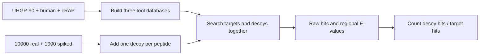

# Notebook 300, Step 4

The search database contains 13,859,294 proteins. All three tools use the FASTA made in
Step 3. Its UHGP-90 proteins that contain a real query are removed; spiked source proteins
remain. Record its SHA256 and residue count before full builds.

## Fixed settings

kmerseek uses PR 156 at commit 799272cabcb6a31ffb4b9f593ce7e3f05818612e.
This SHA is the PR head read on 2026-10-22. Its version string alone is insufficient.

| alphabet | ksize | scaled | mismatch penalty | X-drop | mask |
|---|---:|---:|---:|---:|---|
| protein20 | 7 | 1 | 2 | 8 | none |
| uniprot18 | 7 | 1 | 2 | 8 | none |
| massspec18 | 7 | 1 | 2 | 8 | none |
| hsdm17 | 8 | 1 | 2 | 8 | none |
| wass14 | 8 | 1 | 2 | 8 | none |
| mmseqs12 | 9 | 1 | 2 | 8 | none |
| sdm12 | 9 | 1 | 2 | 8 | none |
| funcgroups8 | 11 | 1 | 2 | 8 | none |
| dayhoff6 | 13 | 1 | 2 | 8 | none |
| wwmj5 | 13 | 1 | 2 | 8 | none |

One k per alphabet follows the previously committed entropy calculation. No setting is
chosen using target or decoy recovery. Regions are extended without chaining. Index-time
calibration uses database proteins and shuffled-dipeptide reference sequences, seed 300,
200 calibration queries. Pilot builds skip calibration to measure indexing alone. A
refused full-data fit is reported as unfitted; no borrowed or manually supplied K is used.
Searches use `--ka-queries 0` to prevent a hidden refit from entering query timing.

kmerseek search: `--min-shared-kmers 1 --max-query-pvalue 1 --min-region-score 0`,
`--extend-mismatch-penalty 2 --extend-xdrop 8 --chain-max-gap 0 --batch-size 8`.
The permissive filters retain candidate hits for the later E-value cut. Set
`RAYON_NUM_THREADS=8` and `OMP_NUM_THREADS=8`.

DIAMOND 2.1.23 (Sherlock module): `blastp --ultra-sensitive --threads 8 --evalue 1000
--max-target-seqs 0 --outfmt 6 qseqid sseqid evalue bitscore qstart qend sstart send
pident length qseq sseq`. Database and query time are separate. The pilot checks whether
this command accepts 9-residue queries; any tool minimum is reported.

BLAST+ 2.16.0 (Sherlock module): `blastp -task blastp-short -matrix PAM30
-comp_based_stats F -seg no -num_threads 8 -evalue 1000 -max_target_seqs 100000000`,
with the same tabular fields as DIAMOND. No one-hit cap is applied before the E-value
analysis. Protein IDs must survive database formatting.

## Timing and FDR

One FASTA contains the 10,000 real targets and their 10,000 decoys. Another contains
1,000 spikes and their 1,000 decoys. Each tool searches every sequence with the same
settings. Record 20,000-query timing for the stated speed criterion and 22,000-query
combined timing as a second measurement. Indexes and fits must already exist. Record
local staging separately from query time, and record the first invocation separately
from repeated invocations. Keep all timing replicates; do not report only the fastest.

Use the best hit E-value per peptide for counting. A peptide contributes at most one
hit at each cut. For spiked recovery, require that an accepted hit identifies the
recorded source protein and report ambiguous best-hit ties. Real peptides have no
source-based correctness assertion. For each tool and cut, FDR is decoy hits divided by
target hits. Report real, spiked and combined counts separately, including zero target
counts as undefined FDR. Never replace undefined FDR with zero.

The first measured cut with FDR <= 0.01 is not sufficient when the empirical curve is
non-monotonic: retain the full count table and report crossings and interpolation
conventions. Calibration uses raw decoy/target counts at cuts; any monotone q-value
summary is labelled separately. The pass rule and E=0.01 comparison remain fixed.

## Resources before measurement

| stage | CPUs | requested memory GB | time limit h | evidence |
|---|---:|---:|---:|---|
| compile | 8 | 24 | 1 | earlier Sherlock build 9.7 GB peak, about 5 min |
| nested index pilots | 8 | 96 | 4 | earlier Swiss-Prot builds 51-83 GB; new k values measured here |
| comparator full builds | 8 | 64 | 2 | model estimate, no matching full-database measurement |

Pilots index nested 20,000- and 100,000-protein samples. The sample is selected by a
SHA256 of each accession with a fixed prefix, so catalogue order does not select it.
GNU time records elapsed seconds and peak RSS. Spectra and index disk sizes are saved.

Full kmerseek requests are generated from pilot measurements. Extrapolation to 13.86
million proteins is uncertain; report the factor and reject a build whose predicted
memory exceeds available nodes or whose CPU-hours exceed the remaining budget. The user clarified on 2026-10-22 that the larger allowance applies: 48 hours of
cluster wall time, with CPU-hours reported alongside it. Parallel builds may therefore
use more than 48 CPU-hours.
Search memory must also be measured on short real and decoy queries; build memory alone
does not size a search. No unmeasured full search is launched from this plan.
