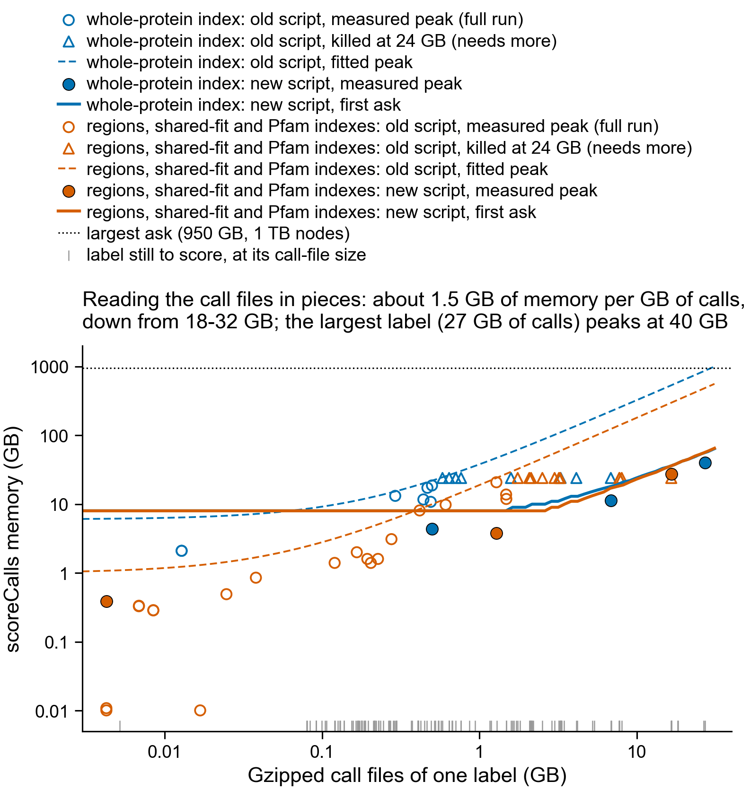

# Regions-index pilot: build report (step 2, before any search)

Built 2026-10-06 on the laptop with `make build-local` (`-profile local`), k_max = 21.
A first build at k_max = 19 (commit 87cb6cc) was replaced the same day when the two H/P
settings moved to k = 21; only the regions index changed. Swiss-Prot release
2026_03; checksums in `build_summary/inputs_and_outputs.md5`. Every number below is printed
by the pipeline into `build_summary/` unless it is marked as an estimate.

## Queries

975 reviewed human entries on chromosome 6 (UniProt 2026_03), all present in the flat file.
866 of them carry at least one feature of the nine types: 7_174 features in all.

| chromosome 6 group | proteins | features |
|---|---|---|
| MHC (HLA-*) | 18 | 107 |
| histone (H1-*, H2AC*, H2BC*, H3C*, H4C*) | 27 | 86 (26 proteins carry features) |
| olfactory receptor (OR + digits) | 17 | 119 |
| everything else | 913 | 6_862 |

HLA-DQB1, HLA-DRB3 and HLA-DRB4 are not in the list: UniProt puts them in the reference
proteome's "Unplaced" component, not "Chromosome 6".

## Truth features, by kind and evidence

| kind | rule | all evidence | experimental (ECO:0000269) | proteins | median length (aa) |
|---|---|---|---|---|---|
| folded domain | DOMAIN, REPEAT, ZN_FING of 60 aa or more | 907 | 6 | 396 | 103 |
| motif | MOTIF | 179 | 37 | 134 | 5 |
| disordered | REGION "Disordered", experimental or at least half inside DisProt disorder | 45 | 0 | 30 | 43 |
| composition-driven | TRANSMEM, INTRAMEM, COILED, COMPBIAS | 3_185 | 80 | 686 | 20 |
| other | other REGIONs, unconfirmed "Disordered", DOMAIN/REPEAT/ZN_FING under 60 aa | 2_858 | 185 | 675 | 37 |
| short (under 60 aa, any kind) | overlaps the rows above | 5_460 | 210 | 818 | 21 |

1_241 REGION "Disordered" features fail the disordered rule and sit in "other". 1_240 of
them carry ECO:0000256 alone, UniProt's code for an automatic annotation (BCL2's, for
example, cites SAM:MobiDB-lite, a disorder predictor).
62 chromosome 6 proteins have DisProt entries (96 consensus disorder regions).

Experimental evidence is rare across all of Swiss-Prot, not only on chromosome 6. The
share of features with ECO:0000269: DOMAIN 0.1%, ZN_FING 0.4%, COILED 0.6%, TRANSMEM 1.2%,
REPEAT 1.7%, REGION 2.2%, MOTIF 3.4%, INTRAMEM 6.0%, COMPBIAS 0%.

## The two indexes

| | whole-protein index | regions index |
|---|---|---|
| Swiss-Prot entries used | 507_740 (68_008 mammals removed) | the same 507_740 |
| index entries (targets) | 507_740 | 639_854 |
| residues, targets | 175_144_459 | 45_736_962 |
| residues, targets + decoys (what is searched) | 350_288_918 | 91_473_924 |

The regions index starts from 991_113 cut-outs, each feature with 20 residues on each side
(k_max − 1). 358_042 are of features of 30 aa or more; MMseqs2 18.8cc5c clusters them into
143_196 representatives. 633_071 are shorter, and 496_658 of those have distinct
sequences. 7_716 clusters mix feature types (5_543 of them COMPBIAS).

| feature type | cut-outs | index entries | multi-member clusters, one type | mixed-type clusters |
|---|---|---|---|---|
| TRANSMEM | 301_037 | 221_405 | 26_570 | 4 |
| REGION | 225_452 | 136_482 | 20_674 | 1_378 |
| COMPBIAS | 172_620 | 150_512 | 9_590 | 5_543 |
| DOMAIN | 159_554 | 41_588 | 15_322 | 433 |
| REPEAT | 66_135 | 43_815 | 6_787 | 29 |
| MOTIF | 36_946 | 27_275 | 3_767 | 81 |
| COILED | 14_301 | 9_200 | 1_344 | 218 |
| ZN_FING | 13_587 | 8_670 | 1_306 | 14 |
| INTRAMEM | 1_481 | 907 | 147 | 16 |

51% of the regions index's residues are flank: 23_213_803 of 45_736_962. A 5-residue motif
becomes a 45-residue entry.

## Bits needed to reach E = 1

log2(K·m·n), with m = 409 aa (the median query length) and K = 0.0180. K is borrowed from
kmerseek `docs/evalue.md` (a 15_000-sequence Swiss-Prot sample, hp_thomas_dill2 k = 12,
C = 2), not fitted on these indexes. The difference between the indexes does not depend
on K.

| index | n counted | bits needed | aligned positions needed at 0.157 bits each (assumed) |
|---|---|---|---|
| whole-protein | targets, 175.1 M | 30.26 | 193 |
| regions | targets, 45.7 M | 28.33 | 180 |
| whole-protein | targets + decoys, 350.3 M | 31.26 | 199 |
| regions | targets + decoys, 91.5 M | 29.33 | 187 |

The regions index lowers the bar by 1.94 bits (log2 of 3.83, the residue ratio), not the
3.3 a tenfold smaller index would give. The 0.157 bits per aligned position is the value
given in the pilot's design for the H/P alphabet at 20–30% identity. It is not measured
here. At that value an H/P hit needs about 180 aligned positions against either index, so
a feature under 60 aa cannot reach E = 1 in either one.

Other designs, estimated from the same representatives without re-clustering:

| design | entries | residues (targets) | bits saved against the whole-protein index |
|---|---|---|---|
| as built: nine types, flank 20 | 639_854 | 45_736_962 (measured) | 1.94 |
| nine types, no flank | 639_854 | 22_523_159 | 2.96 |
| without TRANSMEM, INTRAMEM, COILED, COMPBIAS, flank 20 | 257_830 | 23_582_405 | 2.89 |
| also without REGION "Disordered", flank 20 | 160_160 | 15_737_669 | 3.48 |
| also without REGION "Disordered", flank 10 | 160_160 | 12_858_706 | 3.77 |

## kmerseek settings

From olgabot/dark-set-kmerseek-0.4 `main.nf` (7913404): image
`docker.io/olgabot/kmerseek:0.4.0-rc5`, `--threshold 0.0 --min-shared-kmers 2
--max-query-pvalue 0.05 --min-region-score 1.3`, extension with the alphabet's own
mismatch penalty (`opt`, from `assets/kappa_by_alphabet.tsv` there), X-drop =
4 × penalty, `--chain-max-gap 30 --chain-max-shift 10`. Decided by Olga 2026-10-06.

| setting | alphabet | k | scaled | mask | penalty C | X-drop | why |
|---|---|---|---|---|---|---|---|
| 1 | polarity4 | 11 | 10 | off | 0.54 | 2.16 | the dark-set run |
| 2 | hp_pbotc_1st_ed2 | 21 | 1 | off | 1.59 | 6.36 | the designated H/P alphabet (nb 200) |
| 3 | hp_lehninger2 | 21 | 1 | off | 1.51 | 6.04 | Lehninger's hydrophobic/polar split (sourmash's `aa_to_hp`) |
| 4 | protein20 | 5 | 1 | off | 0.14 | 0.56 | the 2026-10-01 mini-set decoy run: at 1 false region per 10 shuffled queries, `region_evalue` kept 40% of true regions for protein20 k5, 18% for mmseqs12, 3–7% for H/P alphabets |

The H/P k = 21 matches protein20 k = 5 in bits per k-mer, with each letter's bits taken
from real amino-acid frequencies (`ortholog_analysis_utils.entropy_per_symbol`):

```text
protein20         k = 5   ->  5 × 4.176 = 20.9 bits
hp_lehninger2     20.9 / 1.000 = 20.9   ->  k = 21
hp_pbotc_1st_ed2  20.9 / 0.994 = 21.0   ->  k = 21
```

k = 21 is inside both H/P alphabets' tested range, 17 to 30
(`assets/kmerseek_ksize_range_per_alphabet.tsv` on the dark-set branch).

MMseqs2: `mmseqs search -s 7 --num-iterations 3 -e 10`, as in the dark set's mmseqs2Search,
same image.

## Decided, and still open

Decided by Olga 2026-10-06 (recorded in `PREDICTIONS.md`): go with this index; the headline
uses all evidence, with experimental-evidence features (0 disordered, 6 folded domains, 37
motifs) as a secondary split; the four settings above.

Still open:
1. **Scaled 10 for setting 1.** At scaled 10 a k-mer survives with probability 1/10. A
   20-aa feature holds 10 k-mers of k = 11, so it keeps about one on average, below
   `--min-shared-kmers 2`. Setting 1 may miss short features for that reason alone.
2. **Decoy shuffle.** 10-residue windows, as designed. A dipeptide shuffle of whole
   proteins broke up the hydrophobic stretch of transmembrane proteins (a 19-residue
   stretch at least 80% hydrophobic in 22% of 2_000 proteins, against 43% real and 37%
   for 10-residue windows; `tools/compare_decoy_shuffles.py`, output in
   `build_summary/decoy_shuffle_comparison.txt`), which would make the two indexes'
   decoys unequal.
3. **MMseqs2 version.** The local clustering used MMseqs2 18.8cc5c. The pinned container's
   version has not been checked; the Sherlock build may cluster slightly differently.

## 20-query local run (2026-10-07)

`make test-local`: the whole pipeline on 20 queries spread over the accession list (100
truth features: 14 folded domains, 7 motifs, 1 disordered, 35 composition-driven, 43
other), every index at full size, on the laptop with kmerseek v0.4.0 (0aed5ca) built from
source and MMseqs2 18.8cc5c. 57 tasks, 2 h 15 min, 33.3 CPU-hours. Tables in
`test_20_queries/`. This is a test of the pipeline; the sample is too small for any
conclusion, and it has one disordered feature.

What the test changed in the pipeline:
- The composition classifier ties every target with its own decoy (a window-shuffled
  decoy has the same composition as its source): 929 of 931 windows tied, decoys won 482,
  and 1 call passed the 5% rule. Ties are broken at random; how to compare kmerseek with
  composition is an open decision.
- The landing rule decides which index wins (PREDICTIONS.md, second landing rule).
- The identity split was circular and now comes from its own MMseqs2 search.
- The regions index's Karlin-Altschul fit uses 2_500 entries; with 500, protein20 k5 was
  refused on one decoy window.

Regions-index fits are unstable: for the same setting, the fitted slope differs up to
tenfold between the two decoy windows (hp_lehninger2 k21: 0.81 with 10-residue decoys,
0.078 with 20-residue decoys). The 5% decoy threshold ranks calls within one set, so it is
not affected; the E <= 10_000 filter inside the search keeps very different numbers of
calls (protein20 k5 on the regions index: 1_754 against 57_907), and prediction 1, a fixed
1.94-bit shift in E-values, cannot hold with fits that move this much.

## Resources

Measured on the laptop with `/usr/bin/time -l` (Nextflow reports no memory on macOS);
peak resident memory. Per-task tables in `test_20_queries/index_build_costs.txt` and
`test_20_queries/search_costs_20_queries.txt`.

| task | largest | which | all 16 together |
|---|---|---|---|
| kmerseek index + fit | 31 min, 5.4 CPU-h, 84 GB | polarity4 k11, whole-protein index | 20.1 CPU-h |
| kmerseek search, 20 queries | 6.2 min, 0.12 CPU-h, 89 GB | polarity4 k11, whole-protein index | 0.50 CPU-h |
| MMseqs2 search, 20 queries | 23 s, 0.04 CPU-h, 3.6 GB | whole-protein index | 0.11 CPU-h |

Prediction for the full run (975 queries, 10 chunks of 100), each line from the measured
task above:

| task | count | first ask | expected per task | total CPU-h |
|---|---|---|---|---|
| kmerseek index + fit | 16 | 120 GB, 2 h | up to 31 min, 84 GB | 20 |
| kmerseek search | 160 | 120 GB, 2 h | up to 31 min, 89 GB (5x the 20-query time, an upper bound: much of it is loading the index) | at most 24 |
| MMseqs2 search | 4 | 32 GB, 3 h | up to 19 min | about 5 |
| feature-identity search, composition, scoring, comparison | 26 | 16-24 GB, 4 h | minutes | about 2 |
| **total** | | | | **about 50** |

No task has a history of being killed: these are first measurements, on macOS. Peak memory
on Linux under a cgroup may read higher, because RocksDB's file pages count there; the
asks carry 1.4x the measured peaks and stay under a normal-partition node's 125 GB.

## Rebuild at k_max 22, and the 19-setting run (2026-10-13)

The 19 settings (PREDICTIONS.md) reach k = 22, so the regions index was rebuilt with
21-residue flanks: 640_927 entries and 46_921_644 target residues (the whole-protein index
is unchanged at 175_144_459), a ratio of 3.73, so 1.90 bits. 497_734 distinct short
cut-outs; 7_820 clusters mix feature types. Regions-index decoy md5
1dd147349181efd1df7f3990b0883d5f (10-residue windows).

A local test with two settings (protein20 k5, hp_lehninger2 k21), 20 queries and
10-residue decoys ran every path (35 tasks): the shared-fit searches report "--ka-k and
--ka-r-database" with the whole-protein index's K and slope. The regions index's own fit for
hp_lehninger2 has slope 0.058 (the whole-protein index's is 0.847); its E-values are so
large that the E <= 10_000 filter keeps 2_525 calls and no 5% threshold exists, against
60_862 calls and 5 features found with the shared fit.

### Memory for the 19 settings

Index builds ask the first-ask table (`assets/kmerseek_index_first_ask.tsv`), else 120 GB;
each search asks 1.5 x (36 + 2.34 x sqrt(load)) GB from its own index's k-mer spectrum (the
dark set's model), at least 24 GB. Both double on a retry, up to 500 GB; a setting whose
search model asks more than 500 GB is skipped and named in the log. On the laptop the model
asked 114 GB for the protein20 whole-protein search that peaked at 89 GB.

| setting | index first ask | evidence | search ask |
|---|---|---|---|
| hp_lehninger2, hp_lehninger_c_nonpolar2, hp_pbotc_1st_ed2 k21 | 120 GB | laptop: 77-78 GB (whole + decoys) | from spectrum |
| hp_thomas_dill2, hp_thomas_dill_no_c2 k22 | 120 GB | none at k22 | from spectrum |
| hp_kyte_doolittle2 k22 | 220 GB | dark set k21 search 218 GB, without decoys | from spectrum |
| hp_lehninger_hpc3 k19, wwmj5 k10, funcgroups8 k8, sdm12 k7, wass14 k6, uniprot18 k5 | 120 GB | none | from spectrum |
| gbmr4 k14 | 300 GB | dark set search 304-320 GB | from spectrum |
| polarity4 k11 | 120 GB | laptop: 84 GB | from spectrum |
| dayhoff6 k9 | 250 GB | dark set search 245-260 GB | from spectrum |
| gbmr7 k16 | 210 GB | dark set search 205 GB | from spectrum |
| mmseqs12 k6 | 270 GB | dark set search 265 GB | from spectrum |
| hsdm17 k6 | 300 GB | dark set k5 search 394 GB | from spectrum |
| protein20 k5 | 120 GB | laptop: 81 GB | from spectrum (laptop: model 114, measured 89) |

The dark set's numbers are for Swiss-Prot minus Mammalia without decoys; this index is
twice as large, so these first asks may still be short for the skewed alphabets. Nine
settings have no measurement at their k; they run on the default or the model.

Task counts: 76 index builds (19 settings x 2 indexes x 2 decoy windows); 1_140 kmerseek
searches (19 x 3 searched indexes, counting the shared-fit regions search, x 2 windows x 10
chunks); 4 MMseqs2 searches. CPU time, scaled from the 4-setting laptop run (20 CPU-hours
for 16 builds, at most 24 for 160 searches): about 100-200 CPU-hours of builds and at most
about 170 of searches, so roughly 300 CPU-hours. The skewed alphabets' fits may cost more
than the laptop's alphabets did.

## scoreCalls memory (2026-10-16)

The full run stopped on 2026-10-15 at 22:18 with every index and search done and 117 of
the 159 scoring tasks (scoreCalls) left. 19 of them had been killed for memory: they ran
under the flat 24 GB ask that every Python task gets, and a retry asks the same 24 GB, so
it could not succeed. The task that stopped the run is a different bug, fixed in aa9a81e
(a call file with only a header was read as text).

`bin/score_calls.py` read every call of a label into memory, alignment strings included,
before keeping the few it needed. Its peak was about 18 GB per GB of gzipped calls, and 32
GB per GB on the whole-protein index, where the second run (annotated targets only) joins
every call with the features of its target protein. A label keeps very few calls: 230 of
56 million for regions hp_thomas_dill2 k22, 8,644 of 11 million for whole-protein
hp_pbotc_1st_ed2 k21. Fitted to the 27 tasks that finished, the 8 largest labels (6.9 to
27 GB of calls) would have needed 280 to 1,090 GB, and the two whole-protein polarity4 k11
labels more than the 950 GB that the largest nodes allow.

The script now reads each call file in pieces of 256 MB of text, in two passes:

1. Check every call and keep only its E-value, apart for target and decoy calls (8 bytes a
   call). The 5% decoy threshold is found from those two sorted lists.
2. Read the files again and keep only the target calls at or below the threshold, in the
   same order as before. Everything after that is unchanged.

**Same outputs.** On Sherlock, the old and the new script were run on the same call files
of three finished labels: whole-protein hp_pbotc_1st_ed2 k21 w10 (both runs of that task),
regions hp_thomas_dill2 k22 w20, and the composition classifier (which writes
`call_hits.parquet`). All 9 output files are the same as the old script's and as the full
run's own outputs. `call_hits.parquet` is compared after sorting its rows: the old script
writes it after `.unique()`, so its row order changes from run to run.

**Memory, before and after**, peak resident memory on a Sherlock compute node (the larger
of Python's own count and the SLURM step's), SLURM jobs 48116363 and 48119285:

| label | calls (GB, gzipped) | old script | new script |
|---|--:|--:|--:|
| whole-protein hp_pbotc_1st_ed2 k21 w10 (task: 2 runs) | 0.50 | 19.0 GB | 4.4 GB |
| regions hp_thomas_dill2 k22 w20 | 1.28 | 21.0 GB | 3.8 GB |
| whole-protein gbmr7 k16 w20 (task: 2 runs) | 6.82 | killed at 24 GB | 11.2 GB |
| regions polarity4 k11 w10 | 16.5 | killed at 24 GB | 27.3 GB |
| whole-protein polarity4 k11 w10 (task: 2 runs) | 27.1 | killed at 24 GB | 40.1 GB |

What is left grows with the number of calls (1.2 billion for the largest label), because
every E-value is held, then joined and sorted. The new script is slower: 2.2 minutes
instead of 38 seconds for the regions label, and 1.7 hours for the largest task (both
runs). It decompresses each file twice, in one thread.

**New asks.** Peak = 4 GB + 1.5 GB per GB of calls on the whole-protein index, 2 GB + 1.6
GB per GB on the others. The first ask is 1.25 times that, at least 8 GB; the smallest
first ask is 1.32 times its measured peak. The largest first ask is now 56 GB (it was 950),
and the sum over all 159 labels is 1,647 GB. The measured labels include the largest, so no
ask is extrapolated past the data. Walltime is unchanged (1 h + 0.2 h per GB of calls); the
slowest measured task used a quarter of its ask.

These asks fit only the new script. `bin/` is read when a task starts, and the asks when a
run is launched, so pull both together before relaunching. Tasks that already finished stay
cached: a change in `bin/` does not change a task's hash.



| first ask | labels |
|---|--:|
| 8 GB | 129 |
| 9-18 GB | 21 |
| 19-40 GB | 7 |
| 55-56 GB | 2 |

Per label: `build_summary/score_calls_memory.tsv` (first and second ask, walltime) from
`build_summary/score_calls_measured.tsv` (the full run, old script) and
`build_summary/score_calls_streaming_measured.tsv` (old and new script, measured as above),
by `python tools/score_calls_memory.py`, which reads its constants from `nextflow.config`.
