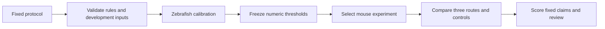

# RNA-seq kill test

The fixed protocol is saved before any biological run. This PR implements checks
and scoring helpers. The biological workflows are not implemented or launchable.
All five claims in [report.md](report.md) remain not measured.

[decision_rules.md](decision_rules.md) contains the full supplied request with its
recording date. Never edit it. [implementation_choices.md](implementation_choices.md)
records the calibration-file clarification Olga approved and choices made before
development. Its SHA-256 file records its original bytes too.

The helpers reject missing eligibility evidence, duplicate biological samples,
incomplete label-swap results, missing calibration and held-out proteins listed in
index membership records. The index audit derives ancestors from a supplied NCBI
nodes.dmp snapshot and checks that member lineage records agree. It cannot establish
that an index contains only the audited sequences. A biological index builder must
establish that correspondence and verify the snapshot's source and version.

## Local checks

From this directory, `make test` runs the standard-library unit tests and checks
the frozen file fingerprints. It does not process sequencing data.
The helpers use Python's standard library and need Python 3.9 or later.
`make running` calls the repository's Sherlock run-status helper.

`protocol.py` supports these read-only operations:

| Operation | Input | Output |
| --- | --- | --- |
| check-rules | Saved protocol and fingerprints | Unchanged or error |
| preflight | Biological sample manifest, species and calibration for mouse | Eligibility checks or error |
| assignments | Same inputs as preflight | All balanced labelled assignments |
| audit-index | Member records, NCBI nodes.dmp and excluded ancestor taxon | Member rows checked or error |
| check-limits | JSON with supplied metric values | Provisional arithmetic verdicts, not evidence |

Run an operation's `--help` to see its arguments. `check-limits` does not validate
measurement provenance and cannot populate the scientific report.
The functions `score_swaps` and `overlap_curve` reject incomplete assignments and
count distinct answer-key genes. They require parsed, validated result tables.

## Inputs that must still be obtained

No mouse experiment has been selected or downloaded. No zebrafish experiment has
been selected. Metadata searches are recorded in the report; no DE output was read.
The next data step is to finish the zebrafish metadata selection and save the full
sample-to-run manifest. Mouse selection follows the committed calibration file.

A sample manifest is tab-separated and has one row per biological sample:
`sample`, `condition`, `biological_replicate`, `taxid`, `study`, `runs`, `layout`,
`strandedness`, `read_pairs`, `library_evidence`, `published_de`, `selection_date`.
Put multiple sequencing-run accessions in `runs`, separated by semicolons.
Strandedness is `forward` or `reverse`; `auto` is insufficient eligibility evidence.
Read pairs are counted across all lanes of that sample, not total sequenced reads.
Evidence fields must identify public source records; presence checks alone do not
prove their contents. A metadata acquisition step must verify and snapshot them.

An index-member table has columns `protein`, `family`, `taxid`, `lineage_taxids`,
`sequence_sha256`. The lineage is a semicolon-separated list of NCBI ancestor taxon
IDs including root 1 and the sequence's species. Unknown lineage is an error.
The main exclusion is taxon 7742; the closer-distance exclusion is taxon 40674.

## Implementation still required before a biological launch

1. Retrieve and snapshot development metadata, reads, taxonomy, proteins, Pfam-A,
   pfam2go, UniProt GO annotations and contaminant references, with versions and hashes.
   Use resumable downloads and verify every checksum.
2. Build one pinned conda environment per Nextflow process. Pin the workflow engine
   and the kmerseek binary, and validate every tool with real small inputs on Linux.
   Verify the SPLASH condition-aware test and corrected p-value column in the binary.
3. Implement fastp, sourmash screening, SPLASH anchors, condition testing, compactors,
   stop-count strand inference, family-specific k-mer calling and GO enrichment.
   Capture sequence, family, matched proteins, GO terms, event class, counts and
   supporting reads for every output unit. No mouse annotation can enter these steps.
4. Implement the zebrafish-only threshold calibration, seal calibration.json and its
   fingerprint, commit both, then select and snapshot the mouse experiment metadata.
5. Implement the pinned nf-core reference route and the Trinity, TransDecoder,
   DIAMOND, hmmscan, Salmon and differentialabundance no-reference route.
   Use the same filtered protein database in DIAMOND and the family index.
6. Implement the synthetic protein, UTR and substitution controls; all label swaps;
   post-completion hidden-reference mapping; domain and non-protein scoring; and
   three-class classification. Keep the hidden reference inaccessible to the caller.
7. Instrument complete route wall time and stage GNU time/Nextflow traces, CPU-hours,
   peak memory, index construction and manual interventions. Collect the same-node
   and 16 GB allocation results separately. Include failed stages and cold-build cost.
8. Read prior cluster resource traces, predict first-attempt memory and time, resolve
   the cluster configuration, and test the launch path. No biological launch command
   is provided until these checks pass. Use single-dash `-resume` for every launch.
9. Add the figure notebook with collapsed code cells and a figure for every claim.
   Populate report.md from measured output files and obtain the independent review.

These are missing implementations, not assumed working dependencies.

## Verified upstream references

| Tool | Requested or checked version | Verified commit or release |
| --- | --- | --- |
| nf-core/rnaseq | 3.27.0 | a1fcdddd3b826fe46eb46f0479f2ff8a7815af05 |
| nf-core/differentialabundance | 2.0.0 | 30ed7741fc392127156c2fb10cfa3d69d216b54b |
| SPLASH | v2.11.9 | Release exists; source interface inspected |
| kmerseek | v0.4.0 | 0aed5ca4a81d0e1028db82dfed19a1a74eac06fa |

The nf-core refs were read from GitHub's tag API. A verified ref is not an installed
or tested environment. No conda solve, Nextflow execution or cluster run was performed.
