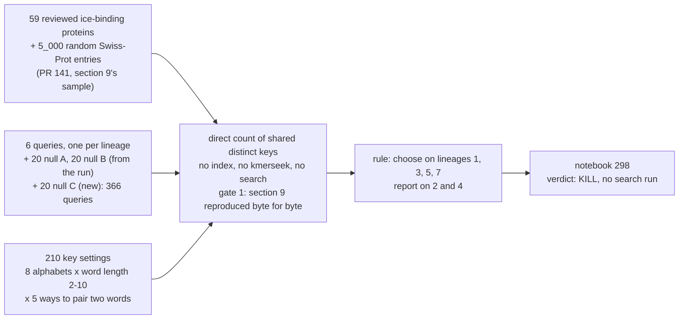

> [!NOTE]
> Written by Claude Code (claude-opus-5-5) at olgabot's request. Posted from her account, so replies here are to Claude, not to her.

Base: `convergence-afp` (PR 141) until it merges.



## In plain English

Notebook 295 (PR 141) found that, in the hydrophobic-polar alphabets, an ice-binding protein shares exact k-mers with ice-binding proteins of other lineages no more often than with random proteins. kmerseek needs 2 shared k-mers to report anything, so no k-mer setting could reach them. This PR asks whether a different kind of search key could: two short exact words plus the number of residues between them, the key DNA tools call a strobemer. If such a key reached ice-binding proteins of other lineages more often than random proteins, it would be worth building into kmerseek.

It does not. The key chosen on four lineages (the 20 amino acids, 4-letter words) reaches 4 of 55 ice-binding proteins of other lineages from the held-out AFGP query, fewer than the best exact k-mer's 6 of 55, and 0 of 40 from the held-out fish type III query. Under the bar of at most 1% of random proteins, no hydrophobic-polar key shares 2 or more keys with more than 1 protein of another lineage, from any query. The few matches the chosen key makes are proteins that share an ancestor (a bacterial and five fungal proteins of one UniProt family) or runs of alanine and threonine that shuffled copies of the query match more often.

The PR also gives PR 143 the number it listed as untested: notebook 294's key is shared 2 or more times by 95% of random Swiss-Prot entries, so as a filter it removes almost nothing.

## Figures


**F1.** Each coloured point is one key setting; grey points are notebook 295's exact k-mers. A useful key would sit high and left of the dashed 1% line. On every query the pair keys fall on the same curve as the exact k-mers. The ring is the setting the rule chose.


**SF4.** To pass, the cross had to reach the black bar on both held-out lineages. AFGP: 0.073 against a bar of 0.209. Fish type III: 0 against 0.10.


**SF1.** Only the bacterial query beats its shuffled copies, and its targets share its ancestry. AFGP's residue-shuffled copies reach more than the real query.


**SF2.** How many keys a random Swiss-Prot entry shares with the query (top) and the share of random entries sharing 2 or more (bottom). Notebook 294's key (ringed) sits at 95%. Table: `data/convergence_afp/298_strobemer_chance_cost.tsv`.

## Checks after the verdict

- **Spacings above 40.** A key stores a repeat of period P if P minus the word length is within its spacing range: up to 50 residues with 10-letter words, 44 for the chosen key. The published periods (3, 11, 15) and the periods used for null B (3 to 29) fit. With the period search run to half the protein length, 17 of 59 ice-binding proteins peak above 40 (A0ZT93 at 54, H7FWB6 at 105 among the queries), on weak autocorrelation (0.14 to 0.40). Not tested.
- **Too short to reach.** In the worst setting at most 3 of a query's targets are too short to hold 2 distinct keys; in the best, none.
- **thr2 (threonine against everything else).** No thr2 setting stays under 1% random share on all six queries (0 of 25). Under the bar, the best on any one query is 1 of 55 (AFGP, 8-letter words, spacing // 3, 0.3%).
- **Null C cannot test AFGP.** The AFGP query is a perfect 31-residue Ala-Ala-Thr repeat, so all 20 null C draws equal it. Part (ii) of the rule cannot pass for AFGP whatever the key; the rule was kept as written.
- **Looking at the held-out queries does not rescue it.** The best setting under 1% on AFGP, chosen by looking at AFGP, reaches 10 of 55, 7.3 points over the best exact k-mer, still short of 10.

## Technical detail

### Verdict numbers (section 4 of the notebook)

| Held-out lineage | Chosen key reach | Best exact k-mer under 1% | Margin (needs >= 0.10) | Null A / B / C median |
|---|---|---|---|---|
| 2 fish, AFGP (P02732) | 4/55 = 0.073 | 6/55 = 0.109 (protein20, k = 4) | -0.036 | 0.145 / 0.073 / 0.073 |
| 4 fish, type III (P07457) | 0/40 = 0.000 | 0/40 (protein20, k = 5) | 0.000 | 0 / 0 / 0 |

- Chosen setting: 20 amino acids, 4-letter words, every pair within 40 residues, spacing // 3 in the key. Mean reach 0.033 on lineages 1, 3, 5 and 7 (1/47, 0/56, 0/51, 6/55), largest random share 0.5%.
- That mean comes almost entirely from the bacterial query, and 5 of its 6 targets are fungal ice-binding proteins of its own UniProt family that the truth set labels "8 other". The rule chose a setting by how well it finds relatives of the query. The verdict does not change; a later truth set should not count the query's own family as another lineage.
- 11 of 210 settings kept the random share at or under 1% on all four selection queries: 6 with the 20 amino acids, 1 Dayhoff, 4 hydrophobic-polar (all 10-letter words, one pair per position, spacing in the key).

### Keys

| Family | Pairs | Key |
|---|---|---|
| `pair_gap` | every pair, spacing 1-40 | word 1, spacing, word 2 |
| `pair_gapbin3` | the same | word 1, spacing // 3, word 2 |
| `pair_nogap` | every pair, spacing 0-32 | word 1, word 2 (notebook 294's key at word length 6) |
| `randstrobe_gap` | one partner per position, notebook 294's hash rule, spacing 0-32 | word 1, spacing, word 2 |
| `randstrobe_nogap` | the same | word 1, word 2 (notebook 294's randstrobe) |

Alphabets: the 8 of `scripts/convergence_kmer_reach_ceiling.py` (protein20, dayhoff6, 6 hydrophobic-polar) plus `thr2`. The plan, notebook 295's text and PR 141 say 7 hydrophobic-polar alphabets; the script has 6, so this PR has 42 alphabet and word-length pairs and 210 settings, not 47 and 235. Word codes and randstrobe partners come from notebook 294's `linked_pairs_utils.py`, copied unchanged from PR 143 (commit dea19e6).

### Inputs

| File | Source | md5 |
|---|---|---|
| `~/data/uniprot/uniprot_sprot.2026_03.fasta.gz` | Swiss-Prot 2026_03, 575_748 entries, on disk from PR 141 | `bc9d398533e6df582b563c6c03093bd0` |
| `data/convergence_afp/298_inputs/draws.tsv` | convergence-afp run, `results/inputs/draws.tsv` on Sherlock, written 14 Oct 2026 | `586bfbc1c3bf437a49f72913e7f2e1ff` |
| `data/convergence_afp/298_inputs/null_c_draws.{tsv,fasta}` | new, seed 20261018 | `8c92a9fc12d13378cb1e7461acdf3ca2` (tsv) |
| `data/convergence_afp/298_random_swissprot_5000.txt` | section 9's sample (`random.Random(0)`); section 9 kept only the seed, so the list is saved here | `244c96e61a6ffb812bb522b6a49c7ca2` |

Null C's period is the `unit_length` the pipeline used for null B (`bin/prep_inputs.py`): the published repeat for AFGP, fish type I and spruce budworm, otherwise the hydrophobic-polar autocorrelation peak over lags 2-30. The plan named `scans.py`'s period scan; the period that made null B is in `prep_inputs.py`.

### Outputs

- `data/convergence_afp/298_strobemer_reach.tsv.gz`: 230_580 rows, one per query, draw, setting and bar (1, 2, 3 shared keys).
- `data/convergence_afp/298_grid_real_queries_2_shared_keys.tsv`: the full grid for the real queries.
- `data/convergence_afp/298_strobemer_chance_cost.tsv`: SF2's table.
- `data/convergence_afp/298_chosen_setting_shared_keys.tsv`: where each shared key of the chosen setting sits, for the residue printout.
- `data/convergence_afp/298_gate1.txt`: gate 1's md5 comparison.

### Stage 2 and the score.py fix

Stage 2 (ranked lists over Swiss-Prot) and the `score.py` fix for lists with no false positive were planned to run only on a stage 1 pass, so neither was done here. The rescoring of the two bacterial-query kmerseek lists PR 141 names is also not done.

## Tested

- `pytest tests/test_linked_pairs_utils.py`: 23 passed (copied unchanged from PR 143).
- `pytest tests/test_strobemer_reach_utils.py`: 29 passed. Brute-force checks of `pair_gap`, `pair_gapbin3`, `pair_nogap`, the concatenated counter against one sequence at a time, the shared-key matrix, the general word codes and randstrobe against notebook 294's on two letters, hashed long k-mers, and null C. Two deliberate breaks (spacing range 1-39, a shifted null C) each made tests fail.
- Gate 1: section 9's 304 exact k-mer settings through the new code reproduce `kmer_reach_ceiling.tsv` byte for byte.
- `scripts/check_notebooks.py`: passes. pre-commit (black-jupyter, nbqa-ruff, 256-colour PNGs) ran on commit.
- The notebook runs top to bottom with the 2025-kmerseek-analysis kernel.
- Adversarial pass: a second agent that had not seen the notebook tried to disprove 10 claims against the code and data, with its own brute-force key builder (its own word codes and randstrobe loop). Held: the counter (0 mismatches over 7 settings x 6 queries x 3 bars, all 5_000 random entries for 2 settings, 300 fuzz trials with X/U/B/Z), gate 1 (4 rows spot-checked), the random sample, the selection (11 of 210, same setting), the held-out numbers, null C, notebook 294's chance cost (0.948), no key spanning two sequences. Failed as first worded, now fixed: "no hydrophobic-polar key reaches more than 1 target" holds at 2 shared keys, not at 1 (one setting reaches 3); and the bacterial query's targets include a sixth, P05140, outside its family, and the 5 relatives drive the selection score.
- `/analysis-review` on the branch head: three numbers in the text had no printed source (identity medians, autocorrelation range, the Dayhoff single-key rows); prints added. Headline recomputed from plain strings without the module: 4/55 AFGP, 0/40 type III, random 0/5000 and 0/5000, the same as the table.
- Not run: stage 2, any kmerseek call, any Sherlock job.

## Running it

```bash
cd /Users/olga/code/2024-kmerseek-analysis-298
/Users/olga/anaconda3/envs/2025-kmerseek-analysis/bin/python3 scripts/convergence_strobemer_reach.py --gate --nullc
/Users/olga/anaconda3/envs/2025-kmerseek-analysis/bin/python3 scripts/convergence_strobemer_reach.py --run --workers 4
/Users/olga/anaconda3/envs/2025-kmerseek-analysis/bin/python3 scripts/convergence_strobemer_reach.py --residues
/Users/olga/anaconda3/envs/2025-kmerseek-analysis/bin/python3 scripts/make_nb298.py
```

The count took 32 minutes on 4 processes on the laptop, with the largest single process at 10.5 GB; gate 1 took 2.5 minutes and 7.4 GB.

🤖 Generated with [Claude Code](https://claude.com/claude-code)
