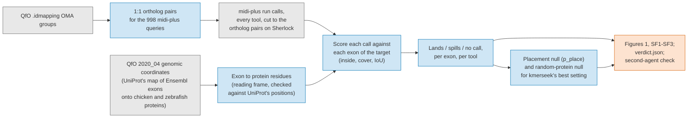

# Notebook 356 pre-registration: does a search call land on one exon's residues?

Status: pre-registration. Written 2026-10-20, before any run. No result yet.

The draft named this notebook 351. That number, and 352 to 355, were already taken
(351 was PR 181, now notebook 301), so it is 356.

Grey = input. Blue = computation. Orange = output.

## The question

An exon codes a short stretch of a protein (a human coding exon codes about 40 to 50 amino
acids at the median). Notebook 244 showed this on 182 short Swiss-Prot features under 60
aa. kmerseek's call lands on the feature in 176 of 182. Structure tools cover the whole
protein instead (Foldseek 2 of 182, ProstT5 3 of 182). Sequence tools land less often and
less tightly (phmmer 82, MMseqs2 32).

This notebook asks the same question with the truth changed from Swiss-Prot features to
exon-coded residue intervals: when a tool searches one protein against another, does its
call land on the residues one exon codes, or spill across the whole protein?

"Lands" is nb 244's word (the code column is `n_landed`). A call lands on an interval when
at least 80% of the call sits inside the interval and the call covers at least 30% of it.
IoU is the intersection of the two intervals over their union. "Spills" is nb 244's word
too: less than half the call sits inside the interval.

## What is new, and what is reused

* New: exon-coded intervals as the truth, carried from nucleotide to protein coordinates
  through each exon's reading frame.
* Reused, no new search: the per-tool calls already written by the midi-plus run (998
  human queries from chromosome 6 plus B2M, CD1A-E, MR1, KIR and LILR, searched against
  the 9 Quest-for-Orthologs proteomes, 1-8 Sept 2026, image
  `olgabot/kmerseek:2026-08-24-reduced-alphabets`; the same run nb 244 scores). This
  notebook re-scores those calls. It does not run kmerseek or any comparator again.

## Direction and sets

A human query protein searched against a target proteome; the truth intervals are the
target protein's exon-coded residues.

* Targets with exon truth: chicken (UP000000539) and zebrafish (UP000000437). Human is
  the query side only, so no human exon table is needed.
* Pairs: a query's 1:1 ortholog in the target species, so each query has one target
  protein whose exon structure is known.
* Pilot (Stop 0): 200 ortholog pairs. Full (Stop 1): every 1:1 pair with exon truth.

## Comparators

The nb 244 set, so the two notebooks read side by side:

* kmerseek (see amendment 3 for the setting).
* phmmer, MMseqs2, MMseqs2 iterative.
* Foldseek, Reseek and ProstT5 (structure tools; ProstT5's calls exist in the run).
* The Kyte-Doolittle hydropathy scan (window 19, threshold 1.6, as nb 231 and nb 244),
  run on the target protein: the no-search control to beat.

## Stratify by

1. Exon length, in residues: <= 20, 21-40, 41-60, 61-120, > 120.
2. Disorder of the exon-coded stretch, from the AlphaFold pLDDT of those residues on the
   target (ordered >= 70, disordered < 70).

## Decision rule, fixed before the run

Restrict to internal coding exons of 60 residues or fewer (first and last coding exons
carry the start and stop and are not comparable). Pass needs all three:

1. kmerseek lands on at least 50% of these exons.
2. Every structure tool lands on under 15% of them.
3. kmerseek's landing rate is at least twice the Kyte-Doolittle scan's landing rate on the
   same exons, counting a kmerseek landing only when it beats the placement null at
   p_place < 0.05 for that exon.

Thresholds are set from nb 244's short-feature result (kmerseek 176 of 182; structure tools
2 to 3 of 182; the scan fired on 4 of 182) and are looser on purpose. If the rule turns out
wrong after the run, say so and still report the answer under it.

Placement null. For each exon and call, p_place is the share of start positions on the
target protein at which a window the same length as the call would also land on the exon,
counted exactly as in the ELM work (PR 51, `reduce_elm_cover.py`). For a call of length L
on a protein of length N and an exon [a, b) of length E, a window [s, s + L) lands when its
overlap with the exon is at least need = max(ceil(0.8 L), ceil(0.3 E)), which holds for s
from a + need - L to b - need, clipped to [0, N - L]. p_place = that count / (N - L + 1).

Kill condition. If the Kyte-Doolittle scan lands on short exons at kmerseek's rate, the
result is a composition effect, not a search result, and the notebook says so.

## Amendments, 2026-10-20, before any run

Written after reading the inputs and before any call was scored.

1. **Placement null level: 0.05 per exon, not 0.001.** The smallest p_place possible is
   1 / (N - L + 1), because the call's own position always lands. A 30-residue exon on a
   500-residue protein has about 20 landing positions, so p_place is about 0.04, and 0.001
   would need a protein of about 20,000 residues. Olga chose 0.05 per exon.
2. **"Lands" in rules 1-3 is nb 244's rule** (inside >= 0.8 and cover >= 0.3). The draft's
   rule 1 said "IoU >= 0.5"; Olga chose the nb 244 rule so the numbers read against its
   176 of 182. IoU is still reported for every call.
3. **kmerseek setting: the best of every setting in the run, with a random-protein null.**
   The draft's "setting Stage 0 chose per feature type" has no meaning for exons. kmerseek
   lands on an exon when any of the run's settings (every alphabet, k and mask) lands on
   it. Because the best of about 400 tries lands more often by chance, the same best-of-all
   rule is scored on decoys: each exon's interval is moved, at the same coordinates, onto
   the target protein of a randomly drawn other pair (a protein long enough to hold it),
   and scored against that pair's calls. 1,000 draws give the null distribution of the
   landing rate. kmerseek's best-of-all landing rate is reported with its null; the
   verdict notes whether it is above the null's 99.9th percentile. The best single setting
   is reported beside it.
4. **Ortholog pairs rebuilt for the midi-plus queries.** `assets/elm_cover_orthologs.tsv`
   holds the ELM queries, and only 18 (chicken) and 24 (zebrafish) of them are midi-plus
   queries, too few for a 200-pair pilot. Pairs are rebuilt by the same method (1:1 OMA
   groups from the QfO 2020_04 `.idmapping` files, as `scripts/elm_stage0_flanks.py`
   builds them) for the 998 midi-plus queries.
5. **Exon truth from UniProt's genomic coordinates file, not a fresh Ensembl download.**
   The QfO release ships `UP000000539_9031_gcoord.xml` and `UP000000437_7955_gcoord.xml`:
   UniProt's mapping of each protein onto its Ensembl transcript's exons, for the exact
   sequences the run searched (md5 of the target FASTAs checked against the run's copy on
   Sherlock). A current Ensembl release is on a newer chicken assembly and would lose
   proteins whose sequence changed. The reading frame step is still done here, from each
   exon's coding length, and checked against UniProt's protein positions.
6. **Exons on target proteins with no AlphaFold model in the run are left out of the
   verdict, for every tool.** A structure tool cannot make a call on a protein with no
   model, so counting those exons would pass rule 2 for a reason that has nothing to do
   with how structure tools place calls (the nb 253 Foldseek/Reseek mistake). Rates over
   all exons are reported beside.
7. **One transcript per protein, each exon once.** When UniProt maps a protein to several
   transcripts, the first one (by transcript ID) whose exons cover the whole sequence is
   kept. Identical protein intervals are counted once.
8. **Coordinates.** Everything is converted to 0-based, end-exclusive: kmerseek's own
   coordinates are already; the comparator tables and UniProt's positions are 1-based
   inclusive and their starts move down by one. Reseek's target positions for TrEMBL
   accessions starting F<digit> are corrected for the known fragment-offset bug.
9. **Getting the calls.** The kmerseek call tables are 70 GB (chicken) and 89 GB
   (zebrafish) on Sherlock, so one Sherlock CPU job first cuts every call table to the
   ortholog pairs. Stop 0 then runs on the laptop on 200 of those pairs, and Stop 1 on all.

## Figures

* Figure 1. Landing rate against exon length, one line per tool, short exons on the left.
  The pass lines (50%, 15%) drawn in.
* Figure SF1. Median IoU where each tool lands, by exon-length bin.
* Figure SF2. The funnel: how many exons survive each criterion, in the nb 244 style.
* Figure SF3. Landing rate split by exon disorder (ordered vs disordered), per tool.
* Hero case. One short, disordered internal exon where kmerseek lands and every other tool
  spills, drawn in the nb 244 pair style, with the aligned residues and the identical count.

## Outputs

* `notebooks/356_exon_landing_midi_plus_chicken_zebrafish.ipynb`, executed.
* `tables/356/`: one row per (ortholog pair, exon, tool) with IoU, inside, cover, lands,
  spills, no call, exon length, exon pLDDT; and a per-tool, per-length-bin summary.
* `figures/356/`: Figure 1, SF1-SF3, the hero pair.
* `notebooks/356_data/verdict.json`: pass or fail against the three rules, with the number
  behind each.

## Second-agent adversarial check

After the notebook runs, one agent that has not seen it tries to disprove the headline:

* Recompute the landing rate for kmerseek and for one structure tool a second way, from the
  raw calls and exon intervals, and check they match `tables/356/`.
* Check the exon-to-protein coordinate step on 20 hand-picked exons (phase 0, 1 and 2),
  against the protein sequence.
* Check that no exon interval is double-counted when two transcripts share it.
* Confirm the placement null is computed per exon, not pooled.

## What could make this not worth doing

* If almost no internal exon codes a stretch that differs from the rest of its protein,
  no search lands on single exons and the question is empty. Stop 0 answers this: if
  kmerseek lands on under 10% of short exons in the pilot, stop and write down why.
* A homology search aligns to similar regions, which often span several exons. Only the
  short exons that differ from the rest of their protein (a disordered insert, a single
  short domain, an alternatively included exon) are ones any tool could land on.
  Figure 1, split by length, shows whether that set exists.

## Stops

* Stop 0: Sherlock job cuts the calls to the ortholog pairs; exon truth for the 200-pair
  pilot; re-score; check the kill condition and the "empty question" condition. Laptop.
* Stop 1: all pairs. Figures and verdict.
* Stop 2: second-agent check; hero case; report.
