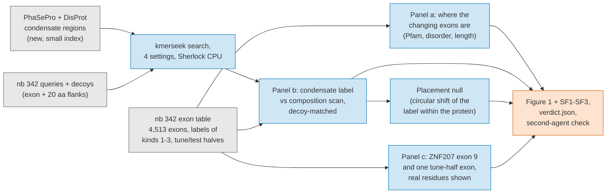

# Notebook 357 pre-registration: the lead figure. Can a condensate alphabet read what fold-and-align tools cannot see in alternative exons?

Status: pre-registration. Written 2026-10-20, before any run. No result yet.

Number: 357. Numbers 301, 340 to 347 and 349 to 356 are taken on branches of seanome/2024-kmerseek-analysis as of 2026-10-20. 348 has no file on any branch, but the branch `olgabot/venom-retrieval-348` carries the number, so it is not reused either. The exon-landing spec drafted as 351 is nb 356, branch `olgabot/nb356-exon-landing`.

Depends on: nb 341 (branch `olgabot/condensate-exons-341`, [PR 140](https://github.com/seanome/2024-kmerseek-analysis/pull/140)) for the set A exon table, the `aro_hyd_chg_pol4` alphabet, κ, Ω_aro and IUPred; nb 342 (branch `olgabot/exon-function-342`, [PR 152](https://github.com/seanome/2024-kmerseek-analysis/pull/152) in this repo; seanome/kmerseek also has a PR 152, which nb 342's text cites for index keys, so the two are different PRs) for the 4,513-exon table with labels of kinds 1 to 3, the tune/test halves, the decoy queries, and its Stop 3 search once it has run. This notebook adds one small index and one search of the same 4,513 queries plus decoys against it. No GPU. No new isoform data.

Grey = input. Blue = computation. Orange = output.

## The claim this figure has to carry, or kill

Alternative exons that a neuron includes and a progenitor skips are enriched in short, disordered, motif-bearing stretches (Buljan et al. 2012; Romero et al. 2006). For those stretches the function-annotation tools used by SQANTI3 and tappAS (InterProScan, Pfam) say nothing, because there is no fold to align. For a disordered stretch the arrangement of aromatic, charged and polar residues is itself what sets condensate behaviour (Martin et al. 2020; Das and Pappu 2013). So a search in an aromatic/charged/polar alphabet reads that arrangement directly.

Figure 1 claim, if the rules below hold: **In the neocortex, exons that neurons switch on sit in the blind spot of domain annotation, and a search in a condensate alphabet puts a condensate-region label on them that composition alone does not.**

If the rules fail, the figure becomes: **Exons that neurons switch on are disordered (P1 of nb 342, already holds), and a composition scan reads them as well as any k-mer search.** That is still a figure, with kmerseek absent from it.

## What nb 341 and nb 342 have already shown (seen before these rules were written)

* nb 342 Stop 1: 4,513 exons in 2,781 genes pass every filter; 203 are included more in neurons (111 tune, 92 test), 96 skipped more (48 tune, 48 test), 3,245 unchanged.
* nb 342 Stop 2, P1 holds on the tune half: changed exons have mean IUPred 0.182 higher than unchanged (95% interval +0.144 to +0.219, 10,000 resamples of 1,181 genes). 71% of all 4,513 exons have residues in a Pfam domain; median aromatic share of tune-half exons 6.7%.
* nb 341 section 3: ZNF207 (BuGZ) exon 9 is `MGTPVTSSSTASSNSESLSASSKALFPSTAQ`, 31 residues, 11 serines, one aromatic (F302), two charged, IUPred 0.78, no Ω_aro (3% aromatic, under the 10% floor). Its ΔΨ is 0.036, 0.063 and 0.059 in the three donors, so **it is below nb 342's 0.10 threshold and is in no outcome class.** It is the worked example, not a data point in any test here.
* nb 342 Stop 3 (the kmerseek search against the Swiss-Prot regions index) has not run. Its four settings are `aro_hyd_chg_pol4` k11, `aro_hyd_arg_chg_pol5` k9, `hp_pbotc_1st_ed2` k21, `protein20` k5, each with the decoy-matched cutoff set on the tune half at 5% decoy hit rate.

Not seen: any Pfam coverage number split by outcome class; any condensate-region label on any exon; any Ω_aro or κ distribution by class.

## Panel a. Where the changing exons are (no search)

From the nb 342 tables only. For each outcome class (included more, skipped more, unchanged), on tune and test halves pooled since nothing is fit here:

* a1. Share of exons with **no** residue inside a Pfam domain (kind 1 = 0).
* a2. Share with mean IUPred ≥ 0.5.
* a3. Exon length in residues, as a distribution.

Prediction P2 (fixed now): the share with no Pfam residue is higher in the two changed classes than in the unchanged class, and the 95% interval of the difference (10,000 resamples of genes, as nb 342 does) is above 0. If P2 fails, the "blind spot" sentence is cut from the figure and the paper, and panel a shows what was found.

## Panel b. The condensate label against the composition scan

### The new index

Every region in PhaSePro (release at run time, recorded) and every DisProt region whose ontology term is under "phase separation" or "liquid-liquid phase separation" (DisProt release recorded), cut out of its UniProt sequence with 10-residue flanks, with **human and mouse entries removed** (set A is human; mouse is the nearest model and the nb 244 filter excluded it too). Built at the same four settings as nb 342 Stop 3, with the same 10-residue decoy windows from PR 114's script and seed, and the whole-protein index of nb 342 for the E-value fit. Expected size: a few hundred regions. This is the "second index" nb 342's introduction promised.

### The search

The nb 342 query file (`tables/342/342_setA_exon_queries_with_decoys.fasta`, 9,026 records, md5 fb388f253f1026d4e9a77acf37e86870 as printed in nb 342 section 3; both checked against branch `olgabot/exon-function-342` on 2026-10-20): every exon with 20 residues of flank each side, plus its dipeptide-shuffled decoy. Four settings. Same cutoff rule as nb 342: per setting, the E below which at most 5% of tune-half decoy queries have a call on a real target, own-gene targets removed. A call must land on the exon's residues by the nb 356 rule (at least 80% of the call inside the exon, covering at least 30% of it); a call only on the flanks does not count.

### The scan to beat

Composition-and-pattern features of the exon alone, no search: IUPred mean, κ, Ω_aro (missing below 10% aromatic, as Martin et al. require), FCR, NCPR, the four `aro_hyd_chg_pol4` class shares, SEG fraction, length. All already in nb 342's kind 3 table.

### The test (rule fixed now)

Outcome: included more in neurons vs unchanged, on the test half (92 vs 1,572 exons). The skipped-more class (48 test exons) is reported but is not the decision.

Model A: logistic regression on the kind 3 features. Model B: model A plus one binary feature, "has a condensate-region call at the cutoff", for the best setting chosen on the tune half. Fit on tune, score on test. Statistic: AUC(B) − AUC(A) on the test half, 95% interval from 10,000 gene resamples.

Pass: the interval is above 0 **and** the point gain is at least 0.02 (the same floor nb 342 uses).
Fail: otherwise. On fail, kmerseek is not in Figure 1 and the condensate sentence is cut.

Decoy check, run first: the share of decoy queries with a call at the cutoff must be at most 5% on the test half too. If it is above 5% the cutoff is wrong and the test does not run until it is fixed.

### The placement null

For every exon with a call: shift the called interval by a random offset within the same protein (circular), 1,000 times, and ask how often the shifted interval sits on a stretch with IUPred ≥ 0.5 and ≥ 10% aromatic residues. p_place is the share of shifts at least as condensate-looking as the real exon. This tells whether the label points at the exon or at any disordered stretch of the protein. Reported as a distribution; no pass/fail rides on it, but a median p_place above 0.5 is written into the figure legend as a caveat.

## Panel c. Two exons, residues shown

* c1. ZNF207 exon 9, as in nb 341 section 3: the 31 residues, the same residues in `aro_hyd_chg_pol4`, the best condensate-region call if any (target, E, the aligned residues of both sequences with a match line and "n of 31 identical"), or the sentence "no call at the cutoff" if none.
* c2. The tune-half "included more in neurons" exon with the smallest E on the condensate index, shown the same way. Chosen from the tune half so the test half stays untouched.

Both panels show the real aligned residues, both sequences, coordinates, match line. No panel describes a window without showing it.

## Stops

* Stop 0 (laptop, no search): panel a and prediction P2; the PhaSePro/DisProt region table with its release numbers; the decoy md5 check. Report P2 before anything else runs.
* Stop 1 (Sherlock CPU, one job per setting): build the four condensate indexes; search. Memory and time asks copied from nb 342 Stop 3's table for the same alphabets; the index is a few hundred regions, so the run is minutes.
* Stop 2 (laptop): cutoffs, decoy check, models A and B, the placement null, panels b and c, verdict.json.
* Stop 3: second-agent check (below), then the figure.

## Figure 1 layout

One figure, three panels, lettered a, b, c as above. Supplementary: SF1 the `aro_hyd_chg_pol4` alphabet table (nb 341 SF1, reused); SF2 the per-setting decoy hit rates and cutoffs; SF3 the placement null distribution. Numbers in the text use the same letters.

Legend before the marks. One colour per outcome class, the same three colours in every panel: included more, skipped more, unchanged. Pfam coverage, disorder and the condensate call are never encoded by colour, only by axis or by a filled/open mark.

## What this does not claim

* A condensate-region call is a hypothesis about the exon, not a measured function. The figure says "label", never "function".
* Nothing here tests translation. Set A is long-read RNA. The AS-as-noise objection (Tress, Abascal and Valencia 2017) is answered in the paper by Weatheritt et al. 2016 (≥ 75% of exon-skipping events in medium-to-high-abundance transcripts are ribosome-engaged) and, if the figure survives, by a later notebook pairing set A with ribo-seq or MS. It is not answered by this notebook.
* ZNF207 exon 9 is not in the test. If c1 shows no call, that is reported as such.

## Second-agent check

A separate agent that has not seen this spec or the notebook reads the committed tables and tries to disprove each of: the counts in panel a; P2's interval; the decoy rate at the cutoff on both halves; AUC(A), AUC(B) and the interval; the own-gene filter on every call shown in panel c; the aligned residues in c1 and c2 against the FASTA. Its held/failed report is committed next to verdict.json and quoted in the PR body.

## Data

| what | source | version |
|---|---|---|
| Exon table, labels, halves, queries, decoys | nb 342 `tables/342/` | md5s as nb 342 section 0 |
| Condensate regions | PhaSePro; DisProt phase-separation terms | releases recorded at Stop 0 |
| Regions decoy script and seed | PR 114 | md5 1dd147349181efd1df7f3990b0883d5f for the Swiss-Prot build; new md5 recorded for this index |
| kmerseek | tag `nb342-kmerseek-9ce5865` | same as nb 342 Stop 3 |
| Whole-protein index for the E-value fit | nb 342 Stop 3 build | per setting |

## References

Buljan, Marija, Guilhem Chalancon, Sebastian Eustermann, Gunter P. Wagner, Monika Fuxreiter, Alex Bateman, and M. Madan Babu. "Tissue-Specific Splicing of Disordered Segments That Embed Binding Motifs Rewires Protein Interaction Networks." *Molecular Cell* 46, no. 6 (2012): 871–83. https://doi.org/10.1016/j.molcel.2012.05.039

Das, Rahul K., and Rohit V. Pappu. "Conformations of Intrinsically Disordered Proteins Are Influenced by Linear Sequence Distributions of Oppositely Charged Residues." *Proceedings of the National Academy of Sciences* 110, no. 33 (2013): 13392–97. https://doi.org/10.1073/pnas.1304749110

Martin, Erik W., Alex S. Holehouse, Ivan Peran, Mina Farag, J. Jeremias Incicco, Anne Bremer, Christy R. Grace, Andrea Soranno, Rohit V. Pappu, and Tanja Mittag. "Valence and Patterning of Aromatic Residues Determine the Phase Behavior of Prion-like Domains." *Science* 367, no. 6478 (2020): 694–99. https://doi.org/10.1126/science.aaw8653

Romero, Pedro R., Saima Zaidi, Ya Yin Fang, Vladimir N. Uversky, Predrag Radivojac, Christopher J. Oldfield, Marc S. Cortese, et al. "Alternative Splicing in Concert with Protein Intrinsic Disorder Enables Increased Functional Diversity in Multicellular Organisms." *Proceedings of the National Academy of Sciences* 103, no. 22 (2006): 8390–95. https://doi.org/10.1073/pnas.0507916103

Tress, Michael L., Federico Abascal, and Alfonso Valencia. "Alternative Splicing May Not Be the Key to Proteome Complexity." *Trends in Biochemical Sciences* 42, no. 2 (2017): 98–110. https://doi.org/10.1016/j.tibs.2016.08.008

Weatheritt, Robert J., Timothy Sterne-Weiler, and Benjamin J. Blencowe. "The Ribosome-Engaged Landscape of Alternative Splicing." *Nature Structural & Molecular Biology* 23, no. 12 (2016): 1117–23. https://doi.org/10.1038/nsmb.3317

All six DOIs resolve to a PubMed record (PubMed ID converter, 2026-10-20; PMIDs in `357_citations_verified_2026-10-20.md`).
