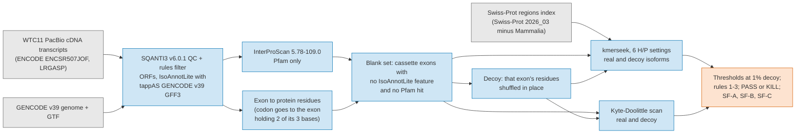

# Notebook 359 pre-registration: does kmerseek land on alternative exons that IsoAnnotLite leaves blank?

Status: pre-registration. Written 2026-10-20, before any download or run. No result yet.

The draft named this notebook 352 and its exon-to-protein method "nb 351". Notebook 352 is
taken (PR 183, index timing), and the exon-landing notebook is 356 (PR 190; the draft that
became it was also called 351). This notebook is 359, the next free number on GitHub and
on Sherlock, and it reuses notebook 356's codon arithmetic, checked again here.

Grey = input. Blue = computation. Orange = output.

## The question

When a long-read isoform holds an alternative exon in a stretch of protein with no Pfam
domain, IsoAnnotLite copies nothing onto it, because it copies features from a
precomputed per-species database by genomic position. Does kmerseek land a reproducible,
named Swiss-Prot region on those exons, more often than on the same exons shuffled, where
a hydropathy scan does not?

The decision it informs: if yes, Seanome has a tool that says something where SQANTI3 +
IsoAnnotLite + tappAS say nothing, and the next step is Botryllus. If no, the idea stops
here and the PR records why.

## The rule, as written in the task, fixed now

Blank set: alternative exons (present in at least one isoform of the gene and absent from
at least one, both isoforms surviving the SQANTI3 filter) whose protein segment has no
IsoAnnotLite feature overlapping it and no InterProScan Pfam hit overlapping it.

Landing: a kmerseek region call from the Swiss-Prot regions index whose landed interval
covers at least 50% of the exon's protein segment.

Decoy rate: the landing rate on the same exons after residue shuffling (composition kept,
order destroyed), one shuffle per exon, same kmerseek settings, same thresholds.

PASS if all three hold at one threshold chosen so that the decoy landing rate is at most
1% of the blank set:

1. kmerseek lands on at least 10% of the blank set, counted as real landings minus decoy
   landings.
2. The landed Swiss-Prot features have names (a feature type and a description, not
   "REGION: Disordered" alone) for at least half of the landings.
3. The Kyte-Doolittle scan, at a threshold matched to the same 1% decoy rate, picks the
   same exons for fewer than half of kmerseek's landings.

KILL otherwise. A kill is a result.

Sanity gate, before rules 1-3 are scored: InterProScan recovers at least 90% of
IsoAnnotLite's Pfam features by an interval overlap of at least 50%. If it fails, the run
stops (build.sbatch exits) and the coordinate mapping is reported as broken.

The 10%, 1% and 50% are not changed after the run.

## How each part of the rule is read, fixed before the run

Each point below is a choice the task text leaves open. Olga can change any of them
before the run starts; none changes after.

1. **Alternative exon = a cassette exon.** An exon (gene, chromosome, strand, genomic start
   and end) of a coding isoform that passed the filter, and another isoform of the same
   gene that passed the filter (coding or not) whose first and last exons lie on either
   side of it, and that has no exon overlapping it. The "on either side" part matters: a
   long-read isoform that starts or ends inside the gene (5' truncation is common) lacks
   the exon without skipping it. An exon with a moved splice site (it overlaps an exon of
   the other isoform) is not counted.
2. **Each exon is counted once.** The unit is the genomic exon. When several coding
   isoforms hold it, it is blank only if none of them has an IsoAnnotLite feature or a Pfam
   hit on its segment. The isoform searched for it (real and decoy) is the first of them
   by isoform ID.
3. **Which IsoAnnotLite lines are features.** Every line of IsoAnnotLite's GFF3 with a
   position, except the lines that describe the transcript itself (source "tappAS":
   transcript, gene, CDS, exon, splice junction, protein, UTR lengths) and NMD (a flag on the
   whole transcript). Protein-position lines (PosType P) are compared with the exon's
   protein segment, transcript-position lines (T) with the bases of the segment's codons,
   genomic-position lines (G) with the genomic pieces of those codons. Any overlap of one
   residue or base counts. Lines without a position (PosType N: GO terms, pathways) are not
   features of a region.
4. **Pfam hit**: an InterProScan Pfam match on the same isoform's ORF overlapping the
   segment by at least one residue.
5. **Exon to protein residues** (notebook 356's arithmetic): codon i of the ORF covers
   transcript bases CDS_start - 1 + 3i to + 2. A codon split by a splice junction goes to
   the exon holding two of its three bases. An exon holding no codon this way has no
   protein segment and is left out. Checked before the run on SQANTI3's own test data:
   for all 22 coding isoforms, translating through these exons gives SQANTI3's ORF
   exactly, exon by exon (`checks/check_codon_mapping_output.txt`).
6. **Landing coverage is of the exon segment**: residues of the call inside the segment
   divided by the segment's length, at least 0.5. A call longer than the exon can land on
   it. The decoy keeps the rest of the isoform unchanged, so a call that covers the exon
   only because it spans the whole protein lands on the decoy too, and the 1% decoy cap
   accounts for it.
7. **Decoy**: one copy of the searched isoform per blank exon, with only that exon's
   residues shuffled (Python `random.Random(20261020)`, exons taken in ID order). A segment
   of one residue, or of one repeated residue, shuffles to itself; those are counted, and
   the number is reported (`decoy_segments_identical_to_real`).
8. **Threshold**: per setting, on region_evalue. A blank exon counts as landed at
   threshold t when its strongest landing call has E <= t. t is the loosest value at which
   decoy landings are at most floor(0.01 x blank set). Ties at the cap are left out.
9. **Union of the six settings**: an exon is landed when any setting lands on it. Each
   setting gets the threshold at a shared per-setting cap q (the loosest at which that
   setting alone lands on at most floor(q x blank set) decoys), with q the largest value on
   a grid of 2,000 steps from 0 to 1% at which the union's decoy landings stay at most
   floor(0.01 x blank set). So the union is held to the same 1% as each setting.
10. **Which rows can pass.** Seven rows are scored: each of the six settings and the
    union. The verdict is PASS if any row passes all three rules, and the PR names which.
    Each row is held to its own 1% decoy cap, but picking the best of seven still raises
    the chance that some row passes by luck, so all seven rows are reported side by side.
11. **Named (rule 2)**: for each landed exon, its strongest landing call. Named when the
    regions-index entry it hits has a feature type and a description, the pair is not
    REGION "Disordered", and at least half of the call's target interval lies inside the
    feature's own residues rather than its 21-residue flanks. A call that sits only on a
    flank did not land on that feature. In the union, the call is the one with the smallest
    E among the settings that land on the exon.
12. **Scan (rule 3)**: the Kyte-Doolittle scan of notebooks 231 and 244
    (`swissprot_control_utils.kd_transmem_calls`, 19-residue window, a call = a run of
    windows with mean above the threshold), run on the same real and decoy isoforms. It
    lands by the same 50% rule. Its score per exon is the highest threshold at which it
    still lands; its threshold is set at 1% decoy landings exactly as kmerseek's. Rule 3
    compares kmerseek's real landed exons (not net) with the scan's real landed exons.
13. **Stratum (step 9)**: an exon is "in a GENCODE basic isoform with a CCDS tag" when its
    genomic start and end are those of an exon of a GENCODE v39 transcript tagged both
    "basic" and "CCDS". Thresholds are not re-picked per stratum. No ribo-seq or
    mass-spec evidence for WTC11 is on disk, so there is no second stratum.
14. **Sanity gate**: the unit is each IsoAnnotLite PFAM DOMAIN line (PosType P) on a coding
    isoform that passed the filter. Recovered when an InterProScan Pfam hit on the same
    isoform covers at least 50% of it, any Pfam accession (as the task states it). The
    same-accession rate is reported beside it.
15. **No fit**: if a setting's index refuses the E-value fit, it has no region_evalue to
    threshold. It is reported as "no fit" and left out of the union; nothing is changed to
    rescue it.

## Data, all public, all on disk before any search

Checked on 2026-10-20; the download job checks every file against its published md5 and
writes `manifest.tsv` with the download date.

* **Long-read transcripts.** LRGASP's own copy is on Synapse and needs a login, so the
  ENCODE copy of the same data is used: experiment ENCSR507JOF ("LRGASP WTC11", PacBio
  Sequel II cDNA, Mortazavi lab), its three "transcriptome annotations" GTFs from TALON,
  one per replicate (GRCh38, built on GENCODE V29): ENCFF370SDY (md5
  45e7f7a314038b09829065defeb86263), ENCFF798DWV (6f981bcacedcf9d2843ae3f1dceeebca),
  ENCFF422CGK (2e50f7e5b95a6c505d8ddbcb00d17a9c). They are joined by transcript ID (TALON
  gives a transcript one ID across the replicates of an experiment; the join stops if a
  transcript's exons differ between replicates). SQANTI3 re-classifies them against
  GENCODE v39.
* **Reference: GENCODE v39**, the release of tappAS's `Homo_sapiens_Gencode_v39.zip`:
  `GRCh38.primary_assembly.genome.fa.gz` (6e8f6b77ec0c31e6ccf0d0856619d209),
  `gencode.v39.primary_assembly.annotation.gtf.gz` (35607b24b85b16b75ad9fab0a44a01a6),
  `gencode.v39.metadata.SwissProt.gz` (7203dd678d8a4efe386c222d615b9e44). tappAS's file
  header is saved (`header.txt`) to confirm the release.
* **IsoAnnotLite GFF3**: http://app.tappas.org/resources/downloads/gffs/Homo_sapiens_Gencode_v39.zip
  (87,895,814 bytes, dated 2023-01-16; no md5 published, ours recorded).
* **SQANTI3 v6.0.1** (Docker image `anaconesalab/sqanti3:v6.0.1`, the newest image; the
  GitHub tag v6.1 has none). IsoAnnotLite 2.7.4 inside it.
* **InterProScan 5.78-109.0** (md5 3bb9a0794e9d69a0418a5298cdb04445), the version
  `nextflow-runs/proteome-interproscan/Makefile` pins.
* **Swiss-Prot regions index**: the regions-index pilot's `regions_index.fasta` (PR 114,
  branch olgabot/regions-index-pilot; md5 8dca1949648e1e179cde22f5b665a856, 640,927
  entries, 45,736,962 residues): every DOMAIN, REGION, MOTIF, REPEAT, ZN_FING, COMPBIAS,
  COILED, TRANSMEM and INTRAMEM feature of Swiss-Prot 2026_03 with every Mammalia entry
  removed (the held-out clade, as in the chromosome 6 pilot), cut out with 21 residues on
  each side, clustered. Searched without its decoy entries.
* **kmerseek settings**: the six H/P settings of the dark-set run that notebooks 279 and
  290 read: hp_lehninger2 k17 and k25, hp_lehninger_c_nonpolar2 k19, hp_pbotc_1st_ed2
  k19, k21 and k23; scaled 1, mask off, extension at the alphabet's own mismatch penalty,
  the dark-set run's search filters (`scripts/359_isoform_blank_exons/settings.tsv`). Image
  `olgabot/kmerseek:0.4.1-rc1` (kmerseek 0.4.1-rc.1), the regions-index pilot's.

No GPU. Sherlock CPU only. If the six settings' searches would take more than 48
job-hours (planned from the query count and measured rates), `build.sbatch` stops and
writes the estimate instead.

## Figures

* SF-A: sanity gate, InterProScan recall of IsoAnnotLite Pfam features, one bar.
* SF-B: landing rate on the blank set, real versus decoy versus scan, one group per
  setting plus the union (a); the union split by the CCDS stratum (b). Blue = kmerseek on
  real exons, grey = kmerseek on shuffled exons, orange = the scan; legend above the bars.
* SF-C: five surviving landings picked at random (seed 359), residues shown.

## Second-agent check, after the run

An agent that has seen neither the task text nor the notebook's prose gets only the
output tables, the code and the rule section above. It recomputes the blank-set size, the
decoy rate, the three rule numbers and the scan overlap from the raw outputs, and tries
to break each: is the 50% coverage of the exon or of the call, are decoy and real
thresholds the same, does an exon appear twice through two isoforms, is the scan
threshold really at 1% decoy. What held and what failed goes in the PR, with numbers.

## Stops

* Stop 0 (this PR, now): the rule and the code; the mapping checked on SQANTI3 test data.
* Stop 1: Olga runs `scripts/359_isoform_blank_exons/submit.sh` on Sherlock; the sanity
  gate is read first.
* Stop 2: the tables are copied into `notebooks/359_data/run/`, the notebook is run, the
  verdict is written, the second agent checks it.
