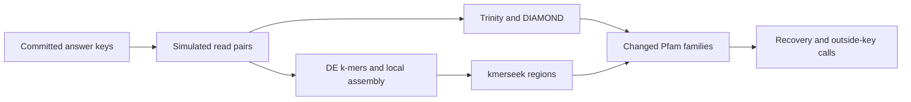

# Notebook 360 data and provenance

Drosophila melanogaster decides the verdict (from 2026-11-01). Zebrafish and Ciona are
reported beside it. `preregistered.md` is the frozen design and records both species changes:
Codex's switch to zebrafish (2026-10-22, `species_change_2026-10-22.md`) and Olga's switch to
Drosophila (2026-11-01). Every setting has now run in all three organisms, gbmr7 k11 included.

- `key/<organism>/`: the answer keys, built and committed before any read was simulated.
- `results/summary.tsv` and each `*.summary.tsv`: recovered and outside counts for every
  setting, label split and E-value cut-off, as the pipeline wrote them.
- `results/<organism>/landings/*.primary_landings.tsv.gz`: landed regions with
  `region_evalue` at most 1, all scores kept. They are exact subsets of the full landing
  tables, whose sha256, size and row counts are in `source_manifest.tsv`. Made on Sherlock by
  `scripts/nb360_prepare_notebook_tables.py <run>/results <staging dir>`.
- `raw_input_manifest.tsv`: checksums of the Ciona and zebrafish raw tables Codex audited.
- `adversarial_review.md`: Codex's independent recount for Ciona and zebrafish (2026-10-22).
- `adversarial_review_drosophila.md`: an independent recount for Drosophila (2026-11-01).
- `approved_claims.md`: the claims Olga approved, by date.

The full tables (count matrices, DESeq2 results, landing tables, queries) stay on Sherlock:

```
/scratch/users/olgabot/360-de-kmer-landing/run/results
```

The landing step reads 25,000 search rows at a time, joins Pfam intervals within that batch
and keeps unique family sets per cut-off and label split. This changes memory use, not the
landing rule.

Two places where the method differs from the claim's wording: the k-mer path assembles
changed k-mers into short contigs (local assembly, not whole-transcriptome assembly), and the
kmerseek index fits its E-values against shuffled sequences. The answer keys and label swaps
use no shuffling.

First written by Codex (GPT-6) at Olga's request; updated by Claude Code (Opus 5.5), 2026-11-01.
