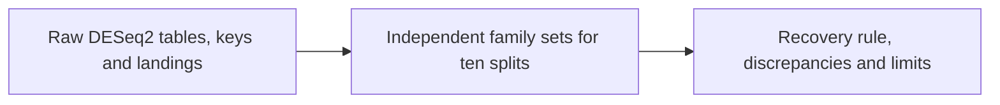

# Independent adversarial review of notebook 360

Written by Codex. Audit date: 2026-10-22. No notebook builder was read or executed.

Inputs: `/private/tmp/nb360-delivery/notebooks/360_data`. Pipeline source: `/private/tmp/nb360-independent-review/nextflow-runs/de-kmer-landing`.

Reproduce with Python 3: `python3 scripts/nb360/adversarial_check.py --delivery /private/tmp/nb360-delivery/notebooks/360_data --report notebooks/360_data/adversarial_review.md`.

The script uses the standard library, reads every raw DESeq2 row and every landed region row, and reconstructs unique family sets before opening any summary. It never uses summary recovery counts as inputs. Outside means a unique Pfam family outside the 100 changed families; unchanged key families count as outside. Such counts are errors against the simulated changed-family key, not proof that every outside homolog is biologically unrelated.

## Labels and frozen rule

HELD: all ten distinct balanced splits occur once, with sample 1 fixed in A to remove complementary duplicates. All nine swaps mix two original samples with one from the other condition. This is a balanced relabelling control, not independent no-signal data.

The frozen document makes Ciona the deciding organism and zebrafish a distance control. The user now prefers zebrafish because of annotations. Its result below is a follow-up species result; it does not replace the original frozen Ciona verdict.

## ciona

HELD: 200 distinct genes, transcripts, peptides, Pfam families and clans; 50 up, 50 down, 100 unchanged. The changed-family denominator is 100. Fold-change labels, cDNA length limits, FASTA identifiers and true-count identifiers agree. Both FASTAs use transcript identifiers, including the protein FASTA. Every protein MD5 and both sequence lengths match the key.

Median simulated B/A count ratio by true status: down 0.2517, unchanged 0.9804, up 3.9191.

### Raw DESeq2 counts

| path | labels | features | padj NA | pvalue NA | changed | up/down | LFC correlation with real |
| --- | --- | --- | --- | --- | --- | --- | --- |
| kmers | real | 238546 | 0 | 0 | 124446 | 65349/59097 | reference |
| kmers | swap1 | 238546 | 0 | 0 | 0 | 0/0 | 0.8222 |
| kmers | swap2 | 238546 | 0 | 0 | 0 | 0/0 | 0.8384 |
| kmers | swap3 | 238546 | 0 | 0 | 0 | 0/0 | 0.8446 |
| kmers | swap4 | 238546 | 0 | 0 | 0 | 0/0 | 0.8201 |
| kmers | swap5 | 238546 | 0 | 0 | 0 | 0/0 | 0.8207 |
| kmers | swap6 | 238546 | 0 | 0 | 0 | 0/0 | 0.8300 |
| kmers | swap7 | 238546 | 0 | 0 | 0 | 0/0 | -0.8323 |
| kmers | swap8 | 238546 | 0 | 0 | 0 | 0/0 | -0.8330 |
| kmers | swap9 | 238546 | 0 | 0 | 0 | 0/0 | -0.8265 |
| transcripts | real | 215 | 0 | 0 | 110 | 58/52 | reference |
| transcripts | swap1 | 215 | 0 | 0 | 0 | 0/0 | 0.9183 |
| transcripts | swap2 | 215 | 0 | 0 | 0 | 0/0 | 0.9351 |
| transcripts | swap3 | 215 | 0 | 0 | 0 | 0/0 | 0.9408 |
| transcripts | swap4 | 215 | 0 | 0 | 0 | 0/0 | 0.9330 |
| transcripts | swap5 | 215 | 0 | 0 | 0 | 0/0 | 0.9317 |
| transcripts | swap6 | 215 | 0 | 0 | 0 | 0/0 | 0.9338 |
| transcripts | swap7 | 215 | 0 | 0 | 1 | 1/0 | -0.9448 |
| transcripts | swap8 | 215 | 0 | 0 | 0 | 0/0 | -0.9328 |
| transcripts | swap9 | 215 | 0 | 0 | 0 | 0/0 | -0.9311 |

All features were read; no p-adjusted NA value was treated as significant. Feature identifiers and order match across labels. The LFC column is log2(B/A). Correlations compare each swapped table against the real table over finite LFC pairs. Different LFCs establish that the swapped output is not merely a copy with a new label. They cannot establish that the count matrices were assigned correctly without the missing matrices.

### Changed k-mers and assembly

| labels | changed k-mers | unique peptide queries | runs represented in peptide map |
| --- | --- | --- | --- |
| real | 124446 | 10971 | 420 |
| swap1 | 0 | 0 | 0 |
| swap2 | 0 | 0 | 0 |
| swap3 | 0 | 0 | 0 |
| swap4 | 0 | 0 | 0 |
| swap5 | 0 | 0 | 0 |
| swap6 | 0 | 0 | 0 |
| swap7 | 0 | 0 | 0 |
| swap8 | 0 | 0 | 0 |
| swap9 | 0 | 0 | 0 |

The peptide map represents 420 distinct runs: lengths 31–4034 nt, median 36 nt; 332 exceed one 31-mer. The complete runs table and exact sequence coverage are checked in the additional raw-input audit below.

FAILED as a literal claim: “without assembly”. The source constructs a graph of changed 31-mers and reverse complements, joins same-sign 30-nt overlaps into maximal unbranched sequences, then translates them. This is local assembly of significant k-mers. “Without whole-transcriptome assembly” is supported by this code path. The long runs in the delivered peptide map confirm that joining was used. The newly delivered runs and query FASTA now permit exact sequence and six-frame translation checks below.

### Recovery independently counted from calls and landed regions

Each pair below is recovered key families / outside-key families. Divide the first number by 100 for the recovery fraction. Only landed intervals with recomputed overlap at least half the target interval and E-value at most 1 enter the counts. Counts use sets of accessions, not numbers of rows, and ignore the supplied in_key flag except to check it.

| setting | summary status (direct files checked below) | real | swap1 | swap2 | swap3 | swap4 | swap5 | swap6 | swap7 | swap8 | swap9 |
| --- | --- | --- | --- | --- | --- | --- | --- | --- | --- | --- | --- |
| standard | calls present | 87/82 | 0/0 | 0/0 | 0/0 | 0/0 | 0/0 | 0/0 | 0/0 | 0/0 | 0/0 |
| protein20.k7 | fitted | 40/1 | 0/0 | 0/0 | 0/0 | 0/0 | 0/0 | 0/0 | 0/0 | 0/0 | 0/0 |
| uniprot18.k7 | fitted | 50/7 | 0/0 | 0/0 | 0/0 | 0/0 | 0/0 | 0/0 | 0/0 | 0/0 | 0/0 |
| hsdm17.k7 | fitted | 61/17 | 0/0 | 0/0 | 0/0 | 0/0 | 0/0 | 0/0 | 0/0 | 0/0 | 0/0 |
| wass14.k8 | fitted | 34/4 | 0/0 | 0/0 | 0/0 | 0/0 | 0/0 | 0/0 | 0/0 | 0/0 | 0/0 |
| sdm12.k8 | fitted | 59/28 | 0/0 | 0/0 | 0/0 | 0/0 | 0/0 | 0/0 | 0/0 | 0/0 | 0/0 |
| mmseqs12.k8 | fitted | 61/11 | 0/0 | 0/0 | 0/0 | 0/0 | 0/0 | 0/0 | 0/0 | 0/0 | 0/0 |
| funcgroups8.k10 | fitted | 10/0 | 0/0 | 0/0 | 0/0 | 0/0 | 0/0 | 0/0 | 0/0 | 0/0 | 0/0 |
| dayhoff6.k12 | unfitted | 0/0 | 0/0 | 0/0 | 0/0 | 0/0 | 0/0 | 0/0 | 0/0 | 0/0 | 0/0 |
| wwmj5.k13 | fitted | 36/3 | 0/0 | 0/0 | 0/0 | 0/0 | 0/0 | 0/0 | 0/0 | 0/0 | 0/0 |
| gbmr4.k15 | fitted | 11/145 | 0/0 | 0/0 | 0/0 | 0/0 | 0/0 | 0/0 | 0/0 | 0/0 | 0/0 |
| polarity4.k15 | fitted | 9/0 | 0/0 | 0/0 | 0/0 | 0/0 | 0/0 | 0/0 | 0/0 | 0/0 | 0/0 |
| hp_lehninger_hpc3.k19 | fitted | 10/239 | 0/0 | 0/0 | 0/0 | 0/0 | 0/0 | 0/0 | 0/0 | 0/0 | 0/0 |
| hp_pbotc_1st_ed2.k30 | fitted | 23/8 | 0/0 | 0/0 | 0/0 | 0/0 | 0/0 | 0/0 | 0/0 | 0/0 | 0/0 |
| hp_thomas_dill2.k30 | fitted | 22/1 | 0/0 | 0/0 | 0/0 | 0/0 | 0/0 | 0/0 | 0/0 | 0/0 | 0/0 |
| hp_thomas_dill_no_c2.k30 | unfitted | 0/0 | 0/0 | 0/0 | 0/0 | 0/0 | 0/0 | 0/0 | 0/0 | 0/0 | 0/0 |
| hp_lehninger2.k30 | fitted | 24/3 | 0/0 | 0/0 | 0/0 | 0/0 | 0/0 | 0/0 | 0/0 | 0/0 | 0/0 |
| hp_lehninger_c_nonpolar2.k30 | fitted | 19/1 | 0/0 | 0/0 | 0/0 | 0/0 | 0/0 | 0/0 | 0/0 | 0/0 | 0/0 |
| hp_kyte_doolittle2.k30 | fitted | 19/5 | 0/0 | 0/0 | 0/0 | 0/0 | 0/0 | 0/0 | 0/0 | 0/0 | 0/0 |

| setting | raw landed rows | rows excluded at E > 1 | retained rows |
| --- | --- | --- | --- |
| protein20.k7 | 4242 | 3594 | 648 |
| uniprot18.k7 | 7966 | 6976 | 990 |
| hsdm17.k7 | 38958 | 37210 | 1748 |
| wass14.k8 | 4428 | 3994 | 434 |
| sdm12.k8 | 72212 | 70818 | 1394 |
| mmseqs12.k8 | 22241 | 20317 | 1924 |
| funcgroups8.k10 | 390770 | 390685 | 85 |
| dayhoff6.k12 | 0 | 0 | 0 |
| wwmj5.k13 | 47149 | 46685 | 464 |
| gbmr4.k15 | 7241834 | 7240138 | 1696 |
| polarity4.k15 | 1484680 | 1484575 | 105 |
| hp_lehninger_hpc3.k19 | 2440585 | 2440054 | 531 |
| hp_pbotc_1st_ed2.k30 | 2048 | 1723 | 325 |
| hp_thomas_dill2.k30 | 2477 | 2184 | 293 |
| hp_thomas_dill_no_c2.k30 | 0 | 0 | 0 |
| hp_lehninger2.k30 | 2092 | 1850 | 242 |
| hp_lehninger_c_nonpolar2.k30 | 2745 | 2492 | 253 |
| hp_kyte_doolittle2.k30 | 8548 | 8331 | 217 |

### Fixed-rule result

A second implementation using SQLite COUNT(DISTINCT) and integer overlap arithmetic agrees with all ten scores for the selected best setting.

Best delivered reduced setting: `mmseqs12.k8`; recovered 61/100 (0.61), outside 11. Standard: 87/100 (0.87). Settings tied on recovery: hsdm17.k7, mmseqs12.k8. Ties are resolved by fewer outside families, then alphabet name.

Nine swapped key recoveries for that setting: [0, 0, 0, 0, 0, 0, 0, 0, 0]; median 0. Part 1 (61 >= 87): False. Part 2 (61 >= 5 × 0): True. Delivered-settings result: FAIL.

Coverage: 18/19 settings delivered; missing: gbmr7.k11. The full best-of-all reduced-setting verdict is UNTESTABLE: an absent setting could change the winner. Missing gbmr7 landings are not zero recovery: its INDEX and SEARCH completed; the supplied trace confirms LANDINGS exit 137. See the additional raw-input audit below.

Reported unfitted settings: dayhoff6.k12, hp_thomas_dill_no_c2.k30. Their empty landed tables are observed; direct .status files now corroborate the recorded unfitted outcomes. Search logs remain absent. An unfitted search has no calibrated result; it must remain distinct from a fitted search with no hits.

CONFIRMED control limitation: all nine swapped k-mer DESeq2 tables have zero changed k-mers and the peptide map has no swapped queries. Thus zero swapped landings arise before kmerseek is called. The fixed inequality is numerically satisfied at a zero median, even by zero real recovery. The ratio to that median is undefined. This tests the combined DE-selection pipeline, but does not test whether protein landing distinguishes real queries from null queries of comparable number, length and composition. It cannot support a strong claim about landing specificity or a measured finite five-fold enrichment.

### Missing evidence

UPDATED 2026-10-23: the new count, sequence, blastx and status checks below supersede the earlier missing-input limits. Search annotations, raw search regions, logs and original reads remain absent.

## zebrafish

HELD: 200 distinct genes, transcripts, peptides, Pfam families and clans; 50 up, 50 down, 100 unchanged. The changed-family denominator is 100. Fold-change labels, cDNA length limits, FASTA identifiers and true-count identifiers agree. Both FASTAs use transcript identifiers, including the protein FASTA. Every protein MD5 and both sequence lengths match the key.

Median simulated B/A count ratio by true status: down 0.2550, unchanged 1.0082, up 4.0086.

### Raw DESeq2 counts

| path | labels | features | padj NA | pvalue NA | changed | up/down | LFC correlation with real |
| --- | --- | --- | --- | --- | --- | --- | --- |
| kmers | real | 345069 | 0 | 0 | 173665 | 87807/85858 | reference |
| kmers | swap1 | 345069 | 0 | 0 | 0 | 0/0 | 0.8464 |
| kmers | swap2 | 345069 | 0 | 0 | 0 | 0/0 | 0.8408 |
| kmers | swap3 | 345069 | 0 | 0 | 0 | 0/0 | 0.8438 |
| kmers | swap4 | 345069 | 0 | 0 | 0 | 0/0 | 0.8410 |
| kmers | swap5 | 345069 | 0 | 0 | 0 | 0/0 | 0.8406 |
| kmers | swap6 | 345069 | 0 | 0 | 0 | 0/0 | 0.8413 |
| kmers | swap7 | 345069 | 0 | 0 | 0 | 0/0 | -0.8320 |
| kmers | swap8 | 345069 | 0 | 0 | 0 | 0/0 | -0.8441 |
| kmers | swap9 | 345069 | 0 | 0 | 0 | 0/0 | -0.8407 |
| transcripts | real | 253 | 4 | 4 | 131 | 67/64 | reference |
| transcripts | swap1 | 253 | 5 | 5 | 0 | 0/0 | 0.9119 |
| transcripts | swap2 | 253 | 4 | 4 | 0 | 0/0 | 0.9126 |
| transcripts | swap3 | 253 | 4 | 4 | 0 | 0/0 | 0.9219 |
| transcripts | swap4 | 253 | 4 | 4 | 0 | 0/0 | 0.9194 |
| transcripts | swap5 | 253 | 4 | 4 | 0 | 0/0 | 0.9011 |
| transcripts | swap6 | 253 | 4 | 4 | 0 | 0/0 | 0.9045 |
| transcripts | swap7 | 253 | 4 | 4 | 0 | 0/0 | -0.8180 |
| transcripts | swap8 | 253 | 4 | 4 | 0 | 0/0 | -0.8149 |
| transcripts | swap9 | 253 | 4 | 4 | 0 | 0/0 | -0.8177 |

All features were read; no p-adjusted NA value was treated as significant. Feature identifiers and order match across labels. The LFC column is log2(B/A). Correlations compare each swapped table against the real table over finite LFC pairs. Different LFCs establish that the swapped output is not merely a copy with a new label. They cannot establish that the count matrices were assigned correctly without the missing matrices.

### Changed k-mers and assembly

| labels | changed k-mers | unique peptide queries | runs represented in peptide map |
| --- | --- | --- | --- |
| real | 173665 | 15273 | 662 |
| swap1 | 0 | 0 | 0 |
| swap2 | 0 | 0 | 0 |
| swap3 | 0 | 0 | 0 |
| swap4 | 0 | 0 | 0 |
| swap5 | 0 | 0 | 0 |
| swap6 | 0 | 0 | 0 |
| swap7 | 0 | 0 | 0 |
| swap8 | 0 | 0 | 0 |
| swap9 | 0 | 0 | 0 |

The peptide map represents 662 distinct runs: lengths 31–4124 nt, median 36 nt; 509 exceed one 31-mer. The complete runs table and exact sequence coverage are checked in the additional raw-input audit below.

FAILED as a literal claim: “without assembly”. The source constructs a graph of changed 31-mers and reverse complements, joins same-sign 30-nt overlaps into maximal unbranched sequences, then translates them. This is local assembly of significant k-mers. “Without whole-transcriptome assembly” is supported by this code path. The long runs in the delivered peptide map confirm that joining was used. The newly delivered runs and query FASTA now permit exact sequence and six-frame translation checks below.

### Recovery independently counted from calls and landed regions

Each pair below is recovered key families / outside-key families. Divide the first number by 100 for the recovery fraction. Only landed intervals with recomputed overlap at least half the target interval and E-value at most 1 enter the counts. Counts use sets of accessions, not numbers of rows, and ignore the supplied in_key flag except to check it.

| setting | summary status (direct files checked below) | real | swap1 | swap2 | swap3 | swap4 | swap5 | swap6 | swap7 | swap8 | swap9 |
| --- | --- | --- | --- | --- | --- | --- | --- | --- | --- | --- | --- |
| standard | calls present | 98/14 | 0/0 | 0/0 | 0/0 | 0/0 | 0/0 | 0/0 | 0/0 | 0/0 | 0/0 |
| protein20.k7 | fitted | 72/2 | 0/0 | 0/0 | 0/0 | 0/0 | 0/0 | 0/0 | 0/0 | 0/0 | 0/0 |
| uniprot18.k7 | fitted | 59/0 | 0/0 | 0/0 | 0/0 | 0/0 | 0/0 | 0/0 | 0/0 | 0/0 | 0/0 |
| hsdm17.k7 | fitted | 77/5 | 0/0 | 0/0 | 0/0 | 0/0 | 0/0 | 0/0 | 0/0 | 0/0 | 0/0 |
| wass14.k8 | fitted | 59/0 | 0/0 | 0/0 | 0/0 | 0/0 | 0/0 | 0/0 | 0/0 | 0/0 | 0/0 |
| sdm12.k8 | fitted | 75/9 | 0/0 | 0/0 | 0/0 | 0/0 | 0/0 | 0/0 | 0/0 | 0/0 | 0/0 |
| mmseqs12.k8 | fitted | 74/1 | 0/0 | 0/0 | 0/0 | 0/0 | 0/0 | 0/0 | 0/0 | 0/0 | 0/0 |
| funcgroups8.k10 | fitted | 36/0 | 0/0 | 0/0 | 0/0 | 0/0 | 0/0 | 0/0 | 0/0 | 0/0 | 0/0 |
| dayhoff6.k12 | unfitted | 0/0 | 0/0 | 0/0 | 0/0 | 0/0 | 0/0 | 0/0 | 0/0 | 0/0 | 0/0 |
| wwmj5.k13 | fitted | 65/4 | 0/0 | 0/0 | 0/0 | 0/0 | 0/0 | 0/0 | 0/0 | 0/0 | 0/0 |
| gbmr4.k15 | fitted | 40/1441 | 0/0 | 0/0 | 0/0 | 0/0 | 0/0 | 0/0 | 0/0 | 0/0 | 0/0 |
| polarity4.k15 | fitted | 33/1 | 0/0 | 0/0 | 0/0 | 0/0 | 0/0 | 0/0 | 0/0 | 0/0 | 0/0 |
| hp_lehninger_hpc3.k19 | fitted | 18/719 | 0/0 | 0/0 | 0/0 | 0/0 | 0/0 | 0/0 | 0/0 | 0/0 | 0/0 |
| hp_pbotc_1st_ed2.k30 | fitted | 33/0 | 0/0 | 0/0 | 0/0 | 0/0 | 0/0 | 0/0 | 0/0 | 0/0 | 0/0 |
| hp_thomas_dill2.k30 | unfitted | 0/0 | 0/0 | 0/0 | 0/0 | 0/0 | 0/0 | 0/0 | 0/0 | 0/0 | 0/0 |
| hp_thomas_dill_no_c2.k30 | unfitted | 0/0 | 0/0 | 0/0 | 0/0 | 0/0 | 0/0 | 0/0 | 0/0 | 0/0 | 0/0 |
| hp_lehninger2.k30 | fitted | 33/0 | 0/0 | 0/0 | 0/0 | 0/0 | 0/0 | 0/0 | 0/0 | 0/0 | 0/0 |
| hp_lehninger_c_nonpolar2.k30 | fitted | 29/0 | 0/0 | 0/0 | 0/0 | 0/0 | 0/0 | 0/0 | 0/0 | 0/0 | 0/0 |
| hp_kyte_doolittle2.k30 | fitted | 31/0 | 0/0 | 0/0 | 0/0 | 0/0 | 0/0 | 0/0 | 0/0 | 0/0 | 0/0 |

| setting | raw landed rows | rows excluded at E > 1 | retained rows |
| --- | --- | --- | --- |
| protein20.k7 | 7818 | 5985 | 1833 |
| uniprot18.k7 | 9494 | 8652 | 842 |
| hsdm17.k7 | 38679 | 36203 | 2476 |
| wass14.k8 | 4630 | 3820 | 810 |
| sdm12.k8 | 80781 | 78131 | 2650 |
| mmseqs12.k8 | 22728 | 20634 | 2094 |
| funcgroups8.k10 | 619144 | 618824 | 320 |
| dayhoff6.k12 | 0 | 0 | 0 |
| wwmj5.k13 | 103314 | 102328 | 986 |
| gbmr4.k15 | 8201754 | 8194938 | 6816 |
| polarity4.k15 | 2870624 | 2870301 | 323 |
| hp_lehninger_hpc3.k19 | 3545898 | 3544192 | 1706 |
| hp_pbotc_1st_ed2.k30 | 1329 | 994 | 335 |
| hp_thomas_dill2.k30 | 0 | 0 | 0 |
| hp_thomas_dill_no_c2.k30 | 0 | 0 | 0 |
| hp_lehninger2.k30 | 1937 | 1648 | 289 |
| hp_lehninger_c_nonpolar2.k30 | 3715 | 3460 | 255 |
| hp_kyte_doolittle2.k30 | 24133 | 23880 | 253 |

### Fixed-rule result

A second implementation using SQLite COUNT(DISTINCT) and integer overlap arithmetic agrees with all ten scores for the selected best setting.

Best delivered reduced setting: `hsdm17.k7`; recovered 77/100 (0.77), outside 5. Standard: 98/100 (0.98). Settings tied on recovery: hsdm17.k7. Ties are resolved by fewer outside families, then alphabet name.

Nine swapped key recoveries for that setting: [0, 0, 0, 0, 0, 0, 0, 0, 0]; median 0. Part 1 (77 >= 98): False. Part 2 (77 >= 5 × 0): True. Delivered-settings result: FAIL.

Coverage: 18/19 settings delivered; missing: gbmr7.k11. The full best-of-all reduced-setting verdict is UNTESTABLE: an absent setting could change the winner. Missing gbmr7 landings are not zero recovery: its INDEX and SEARCH completed; the supplied trace confirms LANDINGS exit 137. See the additional raw-input audit below.

Reported unfitted settings: dayhoff6.k12, hp_thomas_dill2.k30, hp_thomas_dill_no_c2.k30. Their empty landed tables are observed; direct .status files now corroborate the recorded unfitted outcomes. Search logs remain absent. An unfitted search has no calibrated result; it must remain distinct from a fitted search with no hits.

CONFIRMED control limitation: all nine swapped k-mer DESeq2 tables have zero changed k-mers and the peptide map has no swapped queries. Thus zero swapped landings arise before kmerseek is called. The fixed inequality is numerically satisfied at a zero median, even by zero real recovery. The ratio to that median is undefined. This tests the combined DE-selection pipeline, but does not test whether protein landing distinguishes real queries from null queries of comparable number, length and composition. It cannot support a strong claim about landing specificity or a measured finite five-fold enrichment.

### Missing evidence

UPDATED 2026-10-23: the new count, sequence, blastx and status checks below supersede the earlier missing-input limits. Search annotations, raw search regions, logs and original reads remain absent.

## Summary discrepancies

The combined summary has 2180 rows and exactly matches the per-setting summaries, including statuses, all cutoffs and all label splits. Those primary counts were checked against the independent raw-table counts above.

No discrepancies in primary-cutoff family recovery, recovery fractions, outside counts, changed-family totals, query counts or retained landing-row counts in the per-setting summaries. Standard family counts also agree.

## Preparing for an Adversarial Reviewer 2: Stress-testing the findings

- Checks run: Python compilation, full raw-data audit, and boundary fixtures for duplicate families, half-overlap, below-half overlap, E=1, E>1, missing E-values, zero-length intervals and empty swaps. All passed.
- A second SQL implementation agrees on every label for the selected setting. A separate SQL count of standard calls also gave Ciona 87 key / 82 outside and zebrafish 98 key / 14 outside. Protein MD5s and cDNA/protein lengths match every key row.
- Recomputed the full population of landed rows, every raw DESeq2 table, and all standard calls. Recomputed overlap from coordinates and key membership from answer keys; checked every supplied flag and peptide label.
- Asserted distinct features, identical feature sets/order across relabellings, 200 unique keys/clans and exact 50/50/100 statuses. Checked true-count sample direction independently of DESeq2.
- Tried to refute the assembly finding: the implementation and long represented run lengths both show joining. The supported narrower statement is absence of whole-transcriptome assembly.
- Tried to refute the weak-control finding: inspected raw swapped DESeq2 tables before inspecting peptide maps or landing summaries. A zero-query control never reaches the landing step.
- Not tested: the upstream checks listed under Missing evidence; the notebook prose, saved outputs and builder, by instruction. The audit concerns the fixed rule and supplied pipeline sources, not an unseen notebook narrative.

## Additional raw-input audit, 2026-10-23

No DESeq2 reruns, scheduler queries or jobs were started. Counts, runs, peptide sequences, blastx rows and search status files were read directly. These checks extend the earlier family recount. With --extend-only, earlier family scores are retained, not refreshed. The extension does not claim that re-scoring has completed; the family-score tables exclude gbmr7.

### gbmr7 failure stage and scoring repair

CORRECTION: the user reports that INDEX and SEARCH completed for gbmr7.k11; LANDINGS failed with exit 137 on 16, 32 and 48 GB attempts. Re-scoring job 49179534 (landings jobs 49179865/49179866) is user-reported and was not polled. The fitted status files below directly support search completion as recorded by the pipeline. The supplied historical trace now independently verifies the failure stages, attempts and requested memory; see below. Missing landings are a failed scoring stage, not a missing or unfitted search.

CORRECTION: the existing searches were already filtered to E<=100. That filter does not solve the memory failure. The user reports that the actual repair processes bounded batches of 25,000 input rows and writes gzip output directly. The scorer was not reviewed here. Retaining the same per-row overlap test, E-value thresholds, scores and family-set aggregation would preserve the fixed scoring rule; repaired output equivalence remains unverified until output arrives. The full best-of-all verdict remains pending the repaired gbmr7 scoring.

### ciona: counts and sample assignment

| path | features | rows needing rounding | sample 1–6 totals (rounded) | independent size factors | maximum baseMean error |
| --- | --- | --- | --- | --- | --- |
| kmers | 238546 | 0 | 5950749,6008434,6005611,9598234,9779788,9724222 | 0.98984324, 0.98687626, 1.00328242, 1.01435534, 1.05032101, 1.03997424 | 5.12e-13 |
| transcripts | 215 | 31 | 49539,49998,49980,79794,81316,80817 | 0.98366841, 1.01312154, 1.00912436, 0.98380839, 1.03838666, 1.00263790 | 4.77e-12 |

HELD: matrix sample headers are exactly sample_01 through sample_06; identifiers are unique and feature sets match all ten DESeq2 tables. Every k-mer is a canonical DNA 31-mer with integer counts and summed count >=10. This verifies the delivered retained table, not whether the upstream dump omitted eligible k-mers. Transcript counts were rounded to nearest even, matching R round.

DESeq2 default median-ratio normalization was independently reconstructed from features positive in all six samples: geometric mean per feature, then exp(median(log count minus log geometric mean)) per sample. Normalized row means agree with every baseMean in all ten tables. This checks the delivered matrix against the fitted tables without refitting.

| path | labels | LFC signs agreeing with normalized B-A | finite nonzero comparisons | fraction |
| --- | --- | --- | --- | --- |
| kmers | real | 238383 | 238546 | 0.999317 |
| kmers | swap1 | 238477 | 238546 | 0.999711 |
| kmers | swap2 | 238411 | 238546 | 0.999434 |
| kmers | swap3 | 238390 | 238546 | 0.999346 |
| kmers | swap4 | 238422 | 238546 | 0.999480 |
| kmers | swap5 | 238489 | 238546 | 0.999761 |
| kmers | swap6 | 238337 | 238546 | 0.999124 |
| kmers | swap7 | 238368 | 238546 | 0.999254 |
| kmers | swap8 | 238473 | 238546 | 0.999694 |
| kmers | swap9 | 238430 | 238546 | 0.999514 |
| transcripts | real | 215 | 215 | 1.000000 |
| transcripts | swap1 | 215 | 215 | 1.000000 |
| transcripts | swap2 | 215 | 215 | 1.000000 |
| transcripts | swap3 | 215 | 215 | 1.000000 |
| transcripts | swap4 | 215 | 215 | 1.000000 |
| transcripts | swap5 | 215 | 215 | 1.000000 |
| transcripts | swap6 | 215 | 215 | 1.000000 |
| transcripts | swap7 | 215 | 215 | 1.000000 |
| transcripts | swap8 | 215 | 215 | 1.000000 |
| transcripts | swap9 | 215 | 215 | 1.000000 |

The contrast-sign check uses the actual A/B assignment for each relabelling. DESeq2 fits a negative-binomial model, so agreement with normalized arithmetic means is a diagnostic, not an identity required of every feature. These checks support the column assignment used in the outputs; they cannot authenticate FASTQ identities or salmon quantification without those files.

### ciona: runs and translated queries

HELD: 420 runs cover every significant canonical k-mer exactly once, with matching labels and fold-change sign. All run lengths and n_kmers agree with the sequences; 124026 successive 30-nt joins were checked for unique predecessor/successor within the changed-k-mer graph. This checks internal unbranched transitions and complete nonduplicated coverage, not a second implementation of maximal endpoint/cycle choices.

HELD: all 10971 distinct query sequences and 11020 peptide-map rows match independent six-frame translation, stop splitting and minimum peptide length 5. Exact sequence evidence now confirms local assembly, beyond the earlier run-length metadata.

### ciona: translation-code limitations in the answer key

199/200 annotated key proteins occur intact in standard-code six-frame translations of their cDNAs. The exceptions are:

| transcript | gene | family | true status |
| --- | --- | --- | --- |
| ENSCINT00000037364.1 | NADH2 | PF00361 | unchanged |

For ENSCINT00000037364.1, the explicit codon overrides {'TGA': 'W', 'ATA': 'M', 'AGA': 'G', 'AGG': 'G'}, plus an initiating M, reproduce the annotated protein exactly. The default standard-code translation does not.

The Ciona exception is unchanged, so it does not alter the 100 changed-family denominator.

### ciona: blastx and search statuses

HELD: every one of 178 standard call rows takes the highest-bit-score eligible hit in the delivered blastx table (184 query identifiers), with matching target, identity, E-value and bit score. All standard-call baseMean, fold changes and P-values match the labelled raw transcript DESeq2 rows. Family annotations cannot be rejoined without the search-domain table. Because blastx was run with -k 1, equal-score targets omitted upstream remain untestable.

| setting | direct .status |
| --- | --- |
| dayhoff6.k12 | unfitted |
| funcgroups8.k10 | fitted |
| gbmr4.k15 | fitted |
| gbmr7.k11 | fitted |
| hp_kyte_doolittle2.k30 | fitted |
| hp_lehninger2.k30 | fitted |
| hp_lehninger_c_nonpolar2.k30 | fitted |
| hp_lehninger_hpc3.k19 | fitted |
| hp_pbotc_1st_ed2.k30 | fitted |
| hp_thomas_dill2.k30 | fitted |
| hp_thomas_dill_no_c2.k30 | unfitted |
| hsdm17.k7 | fitted |
| mmseqs12.k8 | fitted |
| polarity4.k15 | fitted |
| protein20.k7 | fitted |
| sdm12.k8 | fitted |
| uniprot18.k7 | fitted |
| wass14.k8 | fitted |
| wwmj5.k13 | fitted |

All 19 .status files per organism were checked and agree with every available per-setting summary. They directly record fitted/unfitted outcomes, including fitted gbmr7.k11. They replace the earlier summary-only evidence. They do not reproduce the fit or establish the reason for an unfitted result without search logs.

### zebrafish: counts and sample assignment

| path | features | rows needing rounding | sample 1–6 totals (rounded) | independent size factors | maximum baseMean error |
| --- | --- | --- | --- | --- | --- |
| kmers | 345069 | 0 | 8556287,8505411,8599176,13299825,13454256,13463126 | 1.00652496, 1.00716093, 1.00790702, 1.00816234, 1.02042129, 1.02586590 | 4.55e-12 |
| transcripts | 253 | 75 | 70786,70402,71144,109741,111044,111061 | 0.98567916, 1.00157971, 0.99116800, 1.00257056, 1.01318422, 1.01478701 | 4.77e-12 |

HELD: matrix sample headers are exactly sample_01 through sample_06; identifiers are unique and feature sets match all ten DESeq2 tables. Every k-mer is a canonical DNA 31-mer with integer counts and summed count >=10. This verifies the delivered retained table, not whether the upstream dump omitted eligible k-mers. Transcript counts were rounded to nearest even, matching R round.

DESeq2 default median-ratio normalization was independently reconstructed from features positive in all six samples: geometric mean per feature, then exp(median(log count minus log geometric mean)) per sample. Normalized row means agree with every baseMean in all ten tables. This checks the delivered matrix against the fitted tables without refitting.

| path | labels | LFC signs agreeing with normalized B-A | finite nonzero comparisons | fraction |
| --- | --- | --- | --- | --- |
| kmers | real | 344883 | 345069 | 0.999461 |
| kmers | swap1 | 345026 | 345069 | 0.999875 |
| kmers | swap2 | 344925 | 345069 | 0.999583 |
| kmers | swap3 | 344845 | 345069 | 0.999351 |
| kmers | swap4 | 345046 | 345069 | 0.999933 |
| kmers | swap5 | 344861 | 345069 | 0.999397 |
| kmers | swap6 | 344792 | 345069 | 0.999197 |
| kmers | swap7 | 344789 | 345069 | 0.999189 |
| kmers | swap8 | 344836 | 345069 | 0.999325 |
| kmers | swap9 | 345037 | 345069 | 0.999907 |
| transcripts | real | 249 | 249 | 1.000000 |
| transcripts | swap1 | 249 | 249 | 1.000000 |
| transcripts | swap2 | 249 | 249 | 1.000000 |
| transcripts | swap3 | 249 | 249 | 1.000000 |
| transcripts | swap4 | 249 | 249 | 1.000000 |
| transcripts | swap5 | 249 | 249 | 1.000000 |
| transcripts | swap6 | 249 | 249 | 1.000000 |
| transcripts | swap7 | 249 | 249 | 1.000000 |
| transcripts | swap8 | 249 | 249 | 1.000000 |
| transcripts | swap9 | 249 | 249 | 1.000000 |

The contrast-sign check uses the actual A/B assignment for each relabelling. DESeq2 fits a negative-binomial model, so agreement with normalized arithmetic means is a diagnostic, not an identity required of every feature. These checks support the column assignment used in the outputs; they cannot authenticate FASTQ identities or salmon quantification without those files.

### zebrafish: runs and translated queries

HELD: 662 runs cover every significant canonical k-mer exactly once, with matching labels and fold-change sign. All run lengths and n_kmers agree with the sequences; 173003 successive 30-nt joins were checked for unique predecessor/successor within the changed-k-mer graph. This checks internal unbranched transitions and complete nonduplicated coverage, not a second implementation of maximal endpoint/cycle choices.

HELD: all 15273 distinct query sequences and 15500 peptide-map rows match independent six-frame translation, stop splitting and minimum peptide length 5. Exact sequence evidence now confirms local assembly, beyond the earlier run-length metadata.

### zebrafish: translation-code limitations in the answer key

198/200 annotated key proteins occur intact in standard-code six-frame translations of their cDNAs. The exceptions are:

| transcript | gene | family | true status |
| --- | --- | --- | --- |
| ENSDART00000084598.6 | selenos | PF06936 | down |
| ENSDART00000093606.3 | mt-co1 | PF00115 | up |

For ENSDART00000093606.3, the explicit codon overrides {'TGA': 'W', 'ATA': 'M', 'AGA': '*', 'AGG': '*'}, plus an initiating M, reproduce the annotated protein exactly. The default standard-code translation does not.

For selenos, substituting the annotated U with a stop reproduces a substring of the standard translation; the pipeline splits at that stop. This demonstrates recoding sensitivity from the provided sequences.

The two changed exceptions are PF00115 and PF06936. Both occur in the delivered hsdm17.k7 E<=1 real-label families and standard calls (checked directly). They do not explain the current 77 vs 98 family gap, but the six-frame code does not reproduce every annotated key protein intact.

### zebrafish: blastx and search statuses

HELD: every one of 113 standard call rows takes the highest-bit-score eligible hit in the delivered blastx table (196 query identifiers), with matching target, identity, E-value and bit score. All standard-call baseMean, fold changes and P-values match the labelled raw transcript DESeq2 rows. Family annotations cannot be rejoined without the search-domain table. Because blastx was run with -k 1, equal-score targets omitted upstream remain untestable.

| setting | direct .status |
| --- | --- |
| dayhoff6.k12 | unfitted |
| funcgroups8.k10 | fitted |
| gbmr4.k15 | fitted |
| gbmr7.k11 | fitted |
| hp_kyte_doolittle2.k30 | fitted |
| hp_lehninger2.k30 | fitted |
| hp_lehninger_c_nonpolar2.k30 | fitted |
| hp_lehninger_hpc3.k19 | fitted |
| hp_pbotc_1st_ed2.k30 | fitted |
| hp_thomas_dill2.k30 | unfitted |
| hp_thomas_dill_no_c2.k30 | unfitted |
| hsdm17.k7 | fitted |
| mmseqs12.k8 | fitted |
| polarity4.k15 | fitted |
| protein20.k7 | fitted |
| sdm12.k8 | fitted |
| uniprot18.k7 | fitted |
| wass14.k8 | fitted |
| wwmj5.k13 | fitted |

All 19 .status files per organism were checked and agree with every available per-setting summary. They directly record fitted/unfitted outcomes, including fitted gbmr7.k11. They replace the earlier summary-only evidence. They do not reproduce the fit or establish the reason for an unfitted result without search logs.

### Remaining limits after the new inputs

No expensive DESeq2 rerun was needed or performed. Original reads, per-sample salmon/jellyfish dumps, search-domain annotations/database, full raw search regions and search logs remain unavailable in this delivery. Count normalization and contrast direction are tested; original read provenance, dispersion estimation, Wald tests, adjusted P-values and completeness of upstream counts are not. gbmr7 landing recovery remains unscored until the scoring repair delivers its output. Earlier zero-query control and local-assembly findings still hold.

### Literal “no sequence shuffling” limitation: internal E-value calibration

CONFIRMED from pinned source and pipeline arguments: a literal claim that no sequence shuffling occurs anywhere in the workflow is false. The answer-key and label-swap design does not shuffle sequences, but index-time E-value calibration uses a shuffled internal reference by default.

[Pinned main.rs, index defaults, lines 99–107](https://github.com/seanome/kmerseek/blob/3c353d4/src/rust/main.rs#L99-L107) sets ka_null to Database and ka_reference to ShuffledDipeptide. The accompanying source comments (lines 102–105) say that this reference decides where the fit stops and preserves adjacent residue-pair counts. [Lines 530–539](https://github.com/seanome/kmerseek/blob/3c353d4/src/rust/main.rs#L530-L539) pass both values into the index calibration settings.

Exact index-default excerpt, retrieved from GitHub at ref 3c353d4 on 2026-10-23:

```rust
        #[arg(long, value_enum, default_value_t = DecoyNull::Database)]
        ka_null: DecoyNull,

        /// For `--ka-null database`: how the reference queries that decide where the fit
        /// stops are made. `shuffled-dipeptide` keeps each pair of neighbouring residues as
        /// often as in the original, so hydrophobic runs survive and only relatives and
        /// periodicity lift the real curve above it; `shuffled` keeps composition only.
        #[arg(long, value_enum, default_value_t = DecoyNull::ShuffledDipeptide)]
        ka_reference: DecoyNull,
```

Downloaded main.rs text SHA256: 56844bcd3982ca88acf0fccd05626ca5eb4d91cdc7b18041332c54d7cbee81b6. The source-verified excerpt is embedded in the audit script so this check needs no network on rerun.

The audited local index process supplies positive calibration-query counts and overrides neither --ka-null nor --ka-reference. Thus database sequences are the calibration queries, while a dipeptide-shuffled reference participates in choosing the fit range. This is a source-backed configuration inference; index logs were not supplied to observe the run directly. Search uses the stored fit with zero new calibration queries. The limitation concerns internal calibration, not a newly introduced shuffled experimental control.

The user reports that the scoring-only repair entry contains landings and collectSummaries only. That entry was not inspected or launched by this checker. Re-scoring alone neither removes the internal shuffled calibration reference nor changes the original fixed E-value thresholds.


### Independent historical trace check

Source: `/private/tmp/nb360-extra/de_kmer_landing.2026-10-21.trace.txt`. All 147 trace rows were read; the ten gbmr7 rows are below. Both organisms completed INDEX and SEARCH; LANDINGS failed with exit 137 at requested 16, 32 and 48 GB. Exit 137 alone does not independently prove an OOM kill; no scheduler accounting or stderr was supplied. The current repair job IDs are user-reported, not historical trace results. No repaired outputs were supplied; original scores remain provisional.

| organism/setting | process | job | status | exit | requested memory | attempt |
| --- | --- | --- | --- | --- | --- | --- |
| ciona.gbmr7.k11 | kmerseekIndex | 48807874 | COMPLETED | 0 | 500 GB | 1 |
| zebrafish.gbmr7.k11 | kmerseekIndex | 48807974 | COMPLETED | 0 | 500 GB | 1 |
| ciona.gbmr7.k11 | kmerseekSearch | 48836207 | COMPLETED | 0 | 500 GB | 1 |
| ciona.gbmr7.k11 | landings | 48856929 | FAILED | 137 | 16 GB | 1 |
| ciona.gbmr7.k11 | landings | 48857683 | FAILED | 137 | 32 GB | 2 |
| ciona.gbmr7.k11 | landings | 48858269 | FAILED | 137 | 48 GB | 3 |
| zebrafish.gbmr7.k11 | kmerseekSearch | 48846391 | COMPLETED | 0 | 500 GB | 1 |
| zebrafish.gbmr7.k11 | landings | 48868134 | FAILED | 137 | 16 GB | 1 |
| zebrafish.gbmr7.k11 | landings | 48869177 | FAILED | 137 | 32 GB | 2 |
| zebrafish.gbmr7.k11 | landings | 48869897 | FAILED | 137 | 48 GB | 3 |
