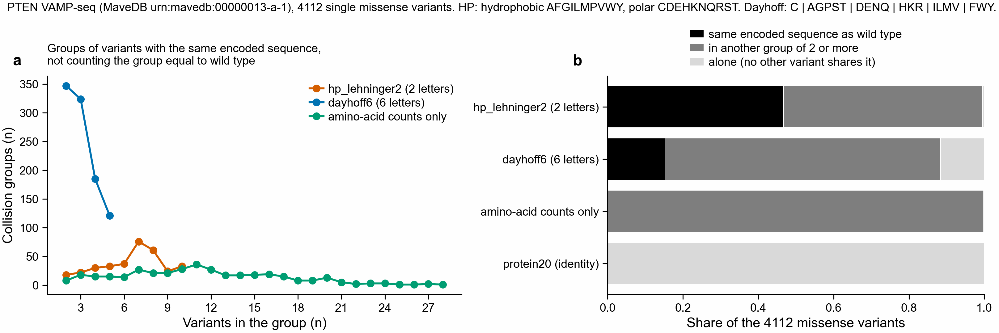
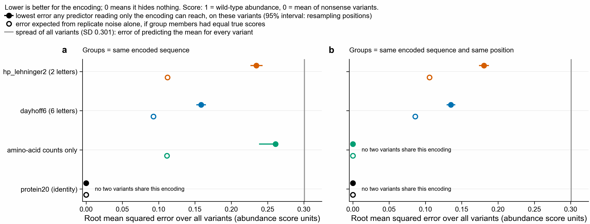
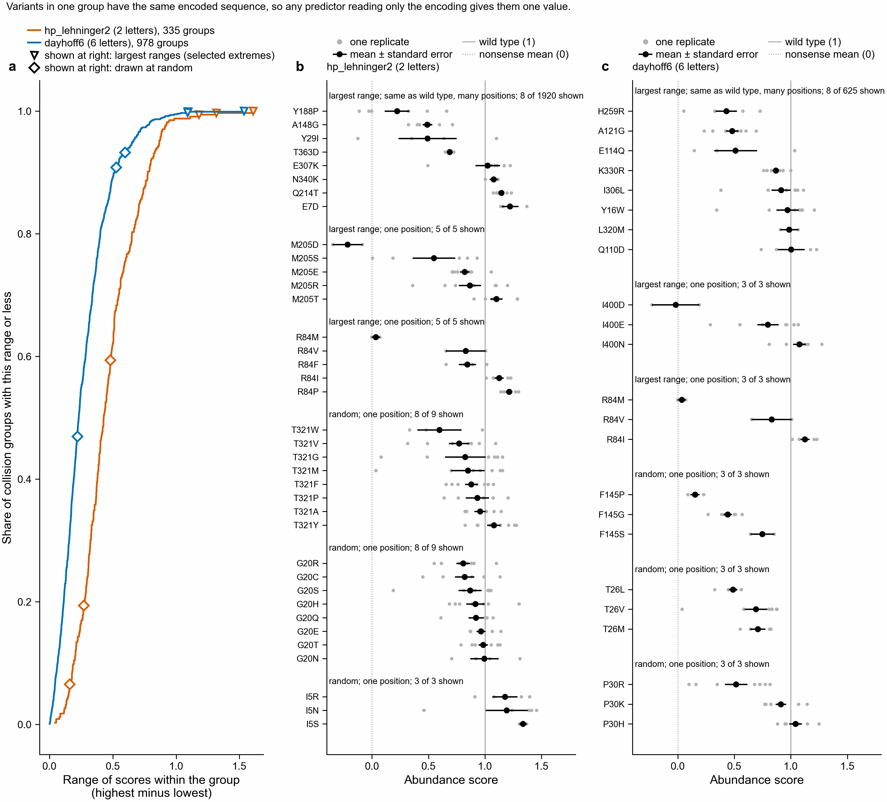
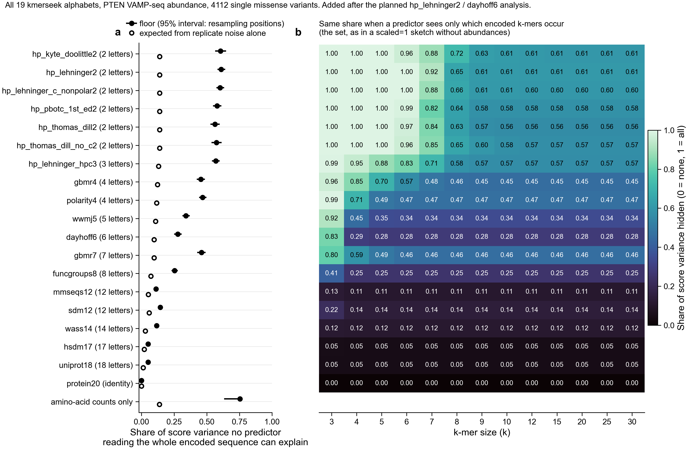

# Mutations a reduced alphabet cannot see: PTEN abundance (notebook 347)

Written by `scripts/run_nb347_invisible_mutations.py`. Rules were fixed in `scripts/nb347_invisible_mutations_config.json` before the run (git history shows the order).

## Question

If two PTEN variants have the same sequence after encoding with a reduced alphabet, any predictor that reads only the encoded sequence must give them the same value. Their reduced k-mer sets and sketches are then identical too. How much of the measured abundance variation sits inside such groups? This report answers that for one assay, one protein and the single substitutions that were measured. It says nothing about other proteins, other functions, or homology search.

## Data

- Assay: PTEN VAMP-seq, MaveDB score set `urn:mavedb:00000013-a-1` (CC0 1.0 (public domain), as stated in the MaveDB record). Matreyek et al. 2018, Multiplex assessment of protein variant abundance by massively parallel sequencing, Nature Genetics, doi:10.1038/s41588-018-0122-z.
- What is measured: VAMP-seq: each PTEN variant is fused to EGFP; cells are sorted into bins by the EGFP to mCherry ratio; a score is a weighted average of the variant's bin frequencies (MaveDB method text).
- Outcome: `score`, a unitless abundance score: wild type = 1, mean of nonsense variants = 0 (min-max normalised by the authors). Higher means more PTEN protein in the cell.
- Reference: PTEN, UniProt P60484, 403 aa. The MaveDB target DNA translates to exactly the UniProt sequence (checked by the script).
- Replicates: 2 to 8 per variant (`score1`..`score8`). The script checked that `score` is their mean (largest difference 7.8e-15), `sd` their sample standard deviation and `se` = `sd`/sqrt(n).
- Files and SHA-256 checksums: see the config; downloaded 2026-10-19.

### Rows kept and left out

4112 single missense variants were kept, one per distinct protein sequence (no sequence was measured twice), at 360 of 403 positions.

| Reason left out | Rows |
|---|---|
| stop | 140 |
| wild_type_anchor | 1 |
| synonymous (summarised separately) | 156 |

### Alphabets (repository mappings)

Copied from `ALPHABET_AA_GROUPS` in `notebooks/ortholog_analysis_utils.py`, which transcribes sourmash's `encodings.rs`, the tables kmerseek calls for `dayhoff6` and `hp_lehninger2`. `tests/test_invisible_mutations_utils.py` checks every residue pair against sourmash's own hashes. Full table: `tables/347_invisible_mutations_alphabet_mappings.tsv`.

| Alphabet | Classes |
|---|---|
| hp_lehninger2 | hydrophobic `AFGILMPVWY`, polar `CDEHKNQRST` (G and P count as hydrophobic, C as polar) |
| dayhoff6 | `C`, `AGPST`, `DENQ`, `HKR`, `ILMV`, `FWY` |
| protein20 (control) | the 20 residues themselves |
| amino-acid counts (control) | the count of each residue, order ignored |

kmerseek's other 16 alphabets (added 2026-10-20, see below) are copied from kmerseek's `src/rust/alphabets.rs` into `KMERSEEK_CLUSTERS` in `notebooks/invisible_mutations_utils.py`; a test compares the two.

## Where the variants fall



For single substitutions, two variants share an encoded sequence in only two ways: both change the same position to residues of the same class, or both swap a residue for another of its own class, which leaves the encoded sequence equal to wild type's. That second group spans many positions. With only two HP classes, almost every substitution shares its class with another substitution at the same position, so almost every variant is in some group.

| Encoding | Collision groups | Variants in them | Share | In the wild-type-sequence group | Other groups |
|---|---|---|---|---|---|
| hp_lehninger2 | 335 | 4095 | 99.6% | 1920 | 2175 in 334 groups |
| dayhoff6 | 978 | 3636 | 88.4% | 625 | 3011 in 977 groups |
| amino-acid counts | 363 | 4102 | 99.8% | 0 | 4102 in 363 groups |
| protein20 (identity) | 0 | 0 | 0.0% | 0 | 0 in 0 groups |

Amino-acid counts put two substitutions together when they make the same swap (say L to V) at different positions, so this control groups variants that no reduced sequence groups, and the reverse. It is neither coarser nor finer.

## Error floors



For a group g of n_g variants with mean scores y_i, the best single value is the group mean. Over all N variants, each counted once:

```text
floor_MSE = sum over groups, sum over members (y_i - mean_g)^2 / N
```

Variants alone in their group add 0. The collision-only numbers divide the same sum by the number of variants in groups of 2 or more instead of N. Intervals are 95% percentile intervals from 2000 resamples of the 360 positions (all variants at a position drawn together); they describe other positions of PTEN measured like these, not other proteins. A resample holds about 63% of the distinct positions (the rest are repeats), so groups that span positions, the wild-type-sequence group and the amino-acid-count groups, get fewer distinct members and their intervals sit low next to the full-data value.

All 4112 variants have a spread (SD) of 0.301 score units (variance 0.0904). That is the error of predicting the overall mean for every variant.

| Encoding | Grouping | Floor RMSE (95% interval) | Floor MSE / total variance (95% interval) | Collision-only RMSE | Noise-only RMSE |
|---|---|---|---|---|---|
| hp_lehninger2 | same encoded sequence | 0.235 (0.227-0.242) | 0.61 (0.59-0.64) | 0.235 | 0.112 |
| hp_lehninger2 | same sequence and position | 0.181 (0.175-0.187) | 0.36 (0.33-0.39) | 0.182 | 0.106 |
| dayhoff6 | same encoded sequence | 0.158 (0.153-0.164) | 0.28 (0.26-0.30) | 0.168 | 0.093 |
| dayhoff6 | same sequence and position | 0.135 (0.130-0.140) | 0.20 (0.18-0.22) | 0.145 | 0.086 |
| amino-acid counts | same encoded sequence | 0.261 (0.239-0.260) | 0.75 (0.64-0.74) | 0.261 | 0.111 |
| amino-acid counts | same sequence and position | 0.000 (0.000-0.000) | 0.00 (0.00-0.00) | n/a | 0.000 |
| protein20 (identity) | same encoded sequence | 0.000 (n/a-n/a) | 0.00 (n/a-n/a) | n/a | 0.000 |
| protein20 (identity) | same sequence and position | 0.000 (n/a-n/a) | 0.00 (n/a-n/a) | n/a | 0.000 |

The protein20 control has no collisions and a floor of exactly 0, as it must after one record per sequence.

### Does the wild-type-sequence group dominate?

| Encoding | Floor MSE, all groups | from the wild-type-sequence group | from the other groups |
|---|---|---|---|
| hp_lehninger2 | 0.0550 | 0.0392 (71.3%) | 0.0158 |
| dayhoff6 | 0.0251 | 0.0101 (40.4%) | 0.0149 |
| amino-acid counts | 0.0681 | 0.0000 (0.0%) | 0.0681 |

Splitting groups by position as well (second row of each encoding in the table above) removes the cross-position part of the wild-type-sequence group.

## Measurement noise

Each variant's score is a mean over n_i replicates, with estimated variance se_i^2 = sd_i^2 / n_i. If every member of a group had the same true score and errors were independent between variants, the expected within-group sum of squares around the fitted group mean is

```text
expected_noise_SS_g = sum_i se_i^2 - sum_i se_i^2 / n_g = (1 - 1/n_g) * sum_i se_i^2
```

The 1/n_g term is there because the group mean is fitted from the same noisy scores (each y_i pulls the mean toward itself). The noise ratio is the observed within-group sum of squares divided by this; 1 means the spread is what replicate noise alone predicts, more than 1 means more spread than that.

| Encoding | Grouping | Noise ratio (95% interval) | Noise-adjusted floor MSE (estimate) |
|---|---|---|---|
| hp_lehninger2 | same encoded sequence | 4.39 (3.95-4.84) | 0.0425 |
| hp_lehninger2 | same sequence and position | 2.93 (2.65-3.23) | 0.0215 |
| dayhoff6 | same encoded sequence | 2.92 (2.63-3.24) | 0.0165 |
| dayhoff6 | same sequence and position | 2.48 (2.24-2.74) | 0.0109 |
| amino-acid counts | same encoded sequence | 5.50 (4.94-6.18) | 0.0557 |

Assumptions behind the noise term:

- Replicates of one variant are independent. Errors shared by all replicates of a variant (a wrong barcode-to-variant link in the shared library, for example) are not in se, so they would appear as spread between variants.
- Errors of different variants are independent. MaveDB gives no covariance, so none is used. Each replicate was normalised to its own wild type and nonsense mean, which can shift all variants of that replicate together.
- se from 2 replicates is very uncertain; it is unbiased for the variance, which is what the sum uses.

### Check of the noise model with synonymous variants

The 156 synonymous variants all make wild-type protein. Their scores vary 2.66 times more (variance 0.0342) than their replicate se predicts (mean se^2 0.0129). So either se misses part of the noise, or the DNA change itself alters abundance (for example through mRNA), or both. The data cannot tell these apart.

If se understates the noise by that whole factor of 2.66 for every variant (an assumption, not a measurement; this check was planned, dividing by it was not), the noise ratios become:

| Encoding | Grouping | Noise ratio / synonymous factor (lower end of interval / factor) |
|---|---|---|
| hp_lehninger2 | same encoded sequence | 1.65 (1.48) |
| hp_lehninger2 | same sequence and position | 1.10 (1.00) |
| dayhoff6 | same encoded sequence | 1.10 (0.99) |
| dayhoff6 | same sequence and position | 0.93 (0.84) |

The noise-adjusted floor is left out of the figure for this reason: it depends on se being right, and this check says it may not be.

## Do these differences matter in practice?

No tolerance for prediction error is established for this assay and none was supplied, so there is no pass/fail line. As a description only: the authors put each variant in an abundance class. Collision groups holding both a 'low' and a 'wt-like' variant:

| Encoding | Collision groups | With both 'low' and 'wt-like' | Variants in those groups |
|---|---|---|---|
| amino-acid counts | 363 | 271 | 3475 |
| dayhoff6 | 978 | 78 | 929 |
| funcgroups8 | 1165 | 67 | 654 |
| gbmr4 | 353 | 58 | 1892 |
| gbmr7 | 300 | 51 | 1883 |
| hp_kyte_doolittle2 | 327 | 53 | 2495 |
| hp_lehninger2 | 335 | 80 | 2496 |
| hp_lehninger_c_nonpolar2 | 336 | 72 | 2456 |
| hp_lehninger_hpc3 | 344 | 73 | 2303 |
| hp_pbotc_1st_ed2 | 333 | 70 | 2417 |
| hp_thomas_dill2 | 329 | 58 | 2377 |
| hp_thomas_dill_no_c2 | 324 | 60 | 2442 |
| hsdm17 | 348 | 17 | 159 |
| mmseqs12 | 976 | 15 | 247 |
| polarity4 | 710 | 83 | 1632 |
| sdm12 | 741 | 37 | 427 |
| uniprot18 | 271 | 31 | 109 |
| wass14 | 794 | 51 | 213 |
| wwmj5 | 957 | 88 | 1186 |

## Examples



Panel a shows the range of every collision group, so the three largest (selected extremes) can be seen against the rest. Panels b and c show those three and three groups drawn at random, per encoding. All 12 are in `tables/347_invisible_mutations_examples.tsv`.

Residues 195-215 of PTEN, the two ends of the hp_lehninger2 group at position 205 (5 variants, range 1.32):

```text
protein20      FHKMMFETIPDFSGGTCNPQF   p.Met205Asp (score -0.22 ± 0.13 s.e., n=2)
               |||||||||| ||||||||||   20 of 21 identical
protein20      FHKMMFETIPTFSGGTCNPQF   p.Met205Thr (score 1.10 ± 0.05 s.e., n=7)

hp_lehninger2  hpphhhpphhphphhppphph
               |||||||||||||||||||||   21 of 21 identical
hp_lehninger2  hpphhhpphhphphhppphph
```

Residues 390-403 of PTEN, the two ends of the dayhoff6 group at position 400 (3 variants, range 1.09):

```text
protein20      EPFDEDQHTQDTKV   p.Ile400Asp (score -0.02 ± 0.21 s.e., n=2)
               |||||||||| |||   13 of 14 identical
protein20      EPFDEDQHTQNTKV   p.Ile400Asn (score 1.07 ± 0.06 s.e., n=7)

dayhoff6       cbfccccdbccbde
               ||||||||||||||   14 of 14 identical
dayhoff6       cbfccccdbccbde
```

## K-mers and sketches

For 120 variant pairs from the 12 example groups at k = 5, 10, 20, the encoded k-mer sets were identical in every case, and sourmash MinHash sketches (scaled=1, seed 42, `hp` or `dayhoff`, the hashing kmerseek uses for these alphabets) were identical in every case. The 20-letter k-mer sets differed in 120 of 120. Table: `tables/347_invisible_mutations_kmer_check.tsv`.

## Sensitivity: adding wild type as a variant

Adding one wild-type record (outcome = mean of the synonymous scores, 0.964) to the wild-type-sequence group:

| Encoding | Floor RMSE without | with |
|---|---|---|
| hp_lehninger2 | 0.23462 | 0.23461 |
| dayhoff6 | 0.15839 | 0.15839 |

## All kmerseek alphabets and k-mer sizes (not planned)

Added 2026-10-20, at Olga's request, after the first results (hp_lehninger2, dayhoff6) had been seen. Not planned; the primary encodings, the stop rule and their verdicts are unchanged. The same statistics and stop rule are reported for every added alphabet, labelled as not planned.



### Whole encoded sequence

Same statistics as above, groups = same encoded sequence, coarsest alphabet first. The verdict uses the planned rule, but was not planned for these alphabets.

The last column divides the lower end of the noise-ratio interval by the synonymous factor 2.66 (see "Check of the noise model"); below 1 means the loss is no longer detectable if replicate se understates the noise that much.

| Alphabet | Letters | Variants in a group of 2+ | Floor RMSE (95% interval) | Floor / total variance (95% interval) | Noise ratio (95% interval) | Verdict | Lower end / synonymous factor |
|---|---|---|---|---|---|---|---|
| hp_kyte_doolittle2 | 2 | 99.5% | 0.234 (0.225-0.242) | 0.61 (0.57-0.64) | 4.39 (3.93-4.87) | Detectable information loss | 1.48 |
| hp_lehninger2 | 2 | 99.6% | 0.235 (0.227-0.242) | 0.61 (0.59-0.64) | 4.39 (3.95-4.84) | Detectable information loss | 1.48 |
| hp_lehninger_c_nonpolar2 | 2 | 99.6% | 0.233 (0.226-0.241) | 0.60 (0.58-0.63) | 4.32 (3.90-4.77) | Detectable information loss | 1.47 |
| hp_pbotc_1st_ed2 | 2 | 99.6% | 0.229 (0.221-0.236) | 0.58 (0.55-0.61) | 4.17 (3.76-4.61) | Detectable information loss | 1.41 |
| hp_thomas_dill2 | 2 | 99.5% | 0.226 (0.218-0.233) | 0.56 (0.53-0.59) | 4.07 (3.66-4.50) | Detectable information loss | 1.37 |
| hp_thomas_dill_no_c2 | 2 | 99.4% | 0.228 (0.219-0.236) | 0.57 (0.54-0.61) | 4.15 (3.71-4.61) | Detectable information loss | 1.39 |
| hp_lehninger_hpc3 | 3 | 95.2% | 0.227 (0.219-0.234) | 0.57 (0.54-0.59) | 4.34 (3.91-4.79) | Detectable information loss | 1.47 |
| gbmr4 | 4 | 86.1% | 0.203 (0.195-0.210) | 0.45 (0.43-0.48) | 3.69 (3.31-4.10) | Detectable information loss | 1.24 |
| polarity4 | 4 | 94.1% | 0.206 (0.198-0.213) | 0.47 (0.45-0.49) | 4.05 (3.63-4.48) | Detectable information loss | 1.36 |
| wwmj5 | 5 | 92.4% | 0.175 (0.169-0.182) | 0.34 (0.32-0.36) | 3.17 (2.85-3.52) | Detectable information loss | 1.07 |
| dayhoff6 | 6 | 88.4% | 0.158 (0.153-0.164) | 0.28 (0.26-0.30) | 2.92 (2.63-3.24) | Detectable information loss | 0.99 |
| gbmr7 | 7 | 68.9% | 0.204 (0.195-0.212) | 0.46 (0.43-0.49) | 4.80 (4.27-5.38) | Detectable information loss | 1.60 |
| funcgroups8 | 8 | 80.7% | 0.151 (0.145-0.157) | 0.25 (0.23-0.27) | 3.52 (3.16-3.90) | Detectable information loss | 1.19 |
| mmseqs12 | 12 | 56.5% | 0.100 (0.095-0.105) | 0.11 (0.10-0.12) | 2.17 (1.94-2.42) | Detectable information loss | 0.73 |
| sdm12 | 12 | 55.5% | 0.114 (0.109-0.119) | 0.14 (0.13-0.16) | 2.50 (2.22-2.80) | Detectable information loss | 0.83 |
| wass14 | 14 | 41.3% | 0.102 (0.096-0.107) | 0.12 (0.10-0.13) | 3.89 (3.35-4.44) | Detectable information loss | 1.26 |
| hsdm17 | 17 | 22.6% | 0.067 (0.062-0.072) | 0.05 (0.04-0.06) | 2.40 (2.03-2.87) | Detectable information loss | 0.76 |
| uniprot18 | 18 | 14.3% | 0.067 (0.061-0.073) | 0.05 (0.04-0.06) | 3.93 (3.07-4.99) | Detectable information loss | 1.15 |
| protein20 (identity) | 20 | 0.0% | 0.000 (n/a-n/a) | 0.00 (n/a-n/a) | n/a (n/a-n/a) | no collisions | n/a |

### Only the set of encoded k-mers

Variants grouped by their set of encoded k-mers at one k (which k-mers occur, not how often or where): what a scaled=1 sketch without abundances keeps. A group of the same encoded sequence always has the same k-mer set, so these floors are at least the whole-sequence floor. Two single substitutions can have the same k-mer set without the same sequence when every k-mer they change also occurs elsewhere in PTEN, which happens at small k and with few letters. Value: floor / total variance (share of score variance hidden). Every alphabet and k, with intervals: `tables/347_invisible_mutations_kmer_set_floors.tsv`.

| Alphabet | Whole sequence | k=3 | k=5 | k=10 | k=20 | k=30 | From this k on, exactly the whole-sequence value |
|---|---|---|---|---|---|---|---|
| hp_kyte_doolittle2 | 0.61 | 1.00 | 1.00 | 0.61 | 0.61 | 0.61 | 15 |
| hp_lehninger2 | 0.61 | 1.00 | 1.00 | 0.61 | 0.61 | 0.61 | 12 |
| hp_lehninger_c_nonpolar2 | 0.60 | 1.00 | 1.00 | 0.61 | 0.60 | 0.60 | 12 |
| hp_pbotc_1st_ed2 | 0.58 | 1.00 | 1.00 | 0.58 | 0.58 | 0.58 | 12 |
| hp_thomas_dill2 | 0.56 | 1.00 | 1.00 | 0.56 | 0.56 | 0.56 | 15 |
| hp_thomas_dill_no_c2 | 0.57 | 1.00 | 1.00 | 0.58 | 0.57 | 0.57 | 15 |
| hp_lehninger_hpc3 | 0.57 | 0.99 | 0.88 | 0.57 | 0.57 | 0.57 | 12 |
| gbmr4 | 0.45 | 0.96 | 0.70 | 0.45 | 0.45 | 0.45 | 9 |
| polarity4 | 0.47 | 0.99 | 0.49 | 0.47 | 0.47 | 0.47 | 6 |
| wwmj5 | 0.34 | 0.92 | 0.35 | 0.34 | 0.34 | 0.34 | 6 |
| dayhoff6 | 0.28 | 0.83 | 0.28 | 0.28 | 0.28 | 0.28 | 5 |
| gbmr7 | 0.46 | 0.80 | 0.49 | 0.46 | 0.46 | 0.46 | 9 |
| funcgroups8 | 0.25 | 0.41 | 0.25 | 0.25 | 0.25 | 0.25 | 5 |
| mmseqs12 | 0.11 | 0.13 | 0.11 | 0.11 | 0.11 | 0.11 | 4 |
| sdm12 | 0.14 | 0.22 | 0.14 | 0.14 | 0.14 | 0.14 | 4 |
| wass14 | 0.12 | 0.12 | 0.12 | 0.12 | 0.12 | 0.12 | 4 |
| hsdm17 | 0.05 | 0.05 | 0.05 | 0.05 | 0.05 | 0.05 | 4 |
| uniprot18 | 0.05 | 0.05 | 0.05 | 0.05 | 0.05 | 0.05 | 4 |
| protein20 (identity) | 0.00 | 0.00 | 0.00 | 0.00 | 0.00 | 0.00 | 4 |


## Conclusion

Rule (from the config): inconclusive if fewer than 30 collision groups or 100 variants in them; detectable if the lower end of the noise-ratio interval is above 1; no tolerance, so a detectable result cannot be called practically important.

- **hp_lehninger2**, PTEN VAMP-seq abundance, 4112 single missense variants at 360 positions: Detectable information loss, but practical importance is not established. Noise ratio 4.39 (3.95-4.84); floor RMSE 0.235 against an SD of 0.301.
- **dayhoff6**, PTEN VAMP-seq abundance, 4112 single missense variants at 360 positions: Detectable information loss, but practical importance is not established. Noise ratio 2.92 (2.63-3.24); floor RMSE 0.158 against an SD of 0.301.

- hp_lehninger2, if replicate se understates all noise by the synonymous factor 2.66 (not planned; see the noise section): lower end of the noise-ratio interval 1.48 for groups by encoded sequence, 1.00 for groups by sequence and position.
- dayhoff6, if replicate se understates all noise by the synonymous factor 2.66 (not planned; see the noise section): lower end of the noise-ratio interval 0.99 for groups by encoded sequence, 0.84 for groups by sequence and position.

So the dayhoff6 result, and the same-position part of the hp_lehninger2 result, rest on trusting the replicate se; the hp_lehninger2 result with groups spanning positions still holds under that assumption.

- Not planned (added 2026-10-20): 16 of kmerseek's 16 other reduced alphabets show detectable information loss by the same rule; see the table in "All kmerseek alphabets and k-mer sizes".

What this does not show:

- The floor uses the measured scores themselves to set each group mean. It is an exact floor on squared error for these variants and this encoding, not a trained predictor, and not a bound for unmeasured variants or other proteins.
- The floor includes measurement noise. The synonymous check above says the replicate se may understate it.
- The variants are the single substitutions this library happened to measure. Sparser sampling leaves more variants alone in their group, which makes the floor look smaller.
- Reduced k-mer sets and sketches keep less than the full reduced sequence, so a small floor here would not have validated them, and a large one does not show that reduced-alphabet search fails. It also does not bear on the convergence searches that were stopped earlier.

## Reproduce

```bash
/Users/olga/anaconda3/envs/2025-kmerseek-analysis/bin/python3 scripts/run_nb347_invisible_mutations.py
```

Tests:

```bash
/Users/olga/anaconda3/envs/2025-kmerseek-analysis/bin/python3 -m pytest -q tests/test_invisible_mutations_utils.py
```

Outputs: `tables/347_invisible_mutations_*.tsv` (variants, collision groups, summary with intervals, exclusions, class counts, examples, k-mer check, sensitivity), `tables/347_invisible_mutations_provenance.json` (config, checksums, versions, git commit), `tables/347_invisible_mutations_kmer_set_floors.tsv` (every alphabet and k), `figures/347_SF1-4_*`.
