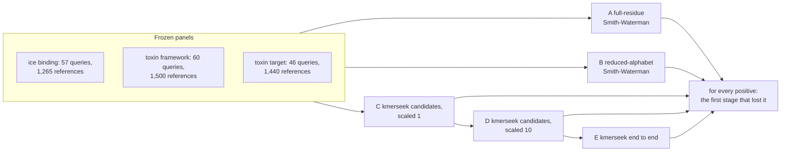

# Notebook 350: where kmerseek loses a true hit

kmerseek 05b4131 (image `2026-10-17-cys-frameworks-05b4131`), config
`scripts/stage_diagnostic/config/stage_diagnostic_v1.yaml`, run 2026-10-19 on Sherlock
(`srun -p dev`, 4 CPUs, 16 GB). Every number here is from held-out queries at 1 negative
allowed above a positive per query, with a 95% interval from resampling origins,
frameworks or toxin families, unless the text says otherwise.

## Decision

| Dataset | Conclusion supported | Why |
|---|---|---|
| Ice binding, protein of another origin | **No useful signal demonstrated under the tested conditions** | Even full-residue alignment against every reference finds 0.004 of positives (0.00-0.01). kmerseek's seeds keep 25% of positives and 23% of negatives, so they select nothing. |
| Toxin, same cysteine framework | **Improve ranking/calibration**, then **restrict the claim to a supported subgroup** | Rescoring kmerseek's scaled-1 candidates with the reduced alignment finds 0.23 (0.09-0.38); kmerseek's own ranking of the same search finds 0.08 (0.03-0.15). One held-out framework, C-C-C-C-CC, reaches 0.66 under A and 0.51 under B. |
| Toxin, same target class | **No useful signal demonstrated under the tested conditions** | Full-residue alignment finds 0.085 (0.01-0.17), below the 0.10 floor. What it finds is homology: over all 46 queries, 0.59 of same-family positive pairs and 0.011 of pairs from different families. |

Across the datasets, three findings repeat:

1. **Ranking loses what the seeds found.** On the ice-binding sanity check (same-origin
   homologs, which any working search should find), A finds 0.97 and kmerseek's
   scaled-1 candidates rescored by A find 0.97. kmerseek's own end-to-end ranking finds
   0.15. Over all queries, of 590 same-origin pairs, kmerseek reports 537 but gives 369 of them an infinite
   E-value: their regions have `region_ka_bits` = 0. These Ala/Thr-rich proteins have a
   high match probability under Dayhoff6, which sends the per-pair lambda to 0. Ranking
   the same output by best region Poisson score gives 0.61. Rescoring only the pairs
   kmerseek reports, with B, gives 0.91 (`exploratory_e2e_ranking.tsv`; exploratory,
   not one of the pre-registered rules).
2. **Reduction is not where the signal goes.** A minus B is 0.05 for frameworks (interval
   -0.11 to 0.24), 0.05 for targets (-0.01 to 0.11) and 0.00 for ice binding. On
   frameworks, B finds 65 held-out positive pairs that A misses, and A finds 107 that B
   misses.
3. **Seeds are not the bottleneck.** Of the positives B finds, kmerseek's scaled-1 seeds
   miss 10% (frameworks, 223 pairs), 0% (targets, 48 pairs) and 1 of 6 (ice binding).
   The rule for "improve candidate generation" (20% or more) does not fire.

The sketch rule fires in all three datasets: scaled 10 keeps fewer positives than scaled 1,
by 0.24 (frameworks), 0.15 (targets) and 0.22 (ice binding). For ice binding this is not a loss of signal, because at scaled
1 the seeds keep positives at the same rate as negatives. The cys-frameworks pipeline
already runs at scaled 1. Use scaled 1 for any search where recall matters; scaled 10
is a cost setting.

**Optional seed experiment: not run.** The config allows it only if B finds positives
that C misses. That share is 10%, 0% and 1 of 6, under the 20% the rule asks for. A
spaced-seed or strobemer index would be fixing a stage that loses little here.

## The antifreeze self-hit failure

All 57 ice-binding queries are in the reference panel with the same sequence (SHA-1 of
the residues) and the same Swiss-Prot sequence version as the query. The mask is off for
every ice-binding setting. 54 find their own entry at every stage. Three do not, all
antifreeze glycoproteins:

| Query | Length | Distinct Dayhoff 9-mers | Scaled 1 | Scaled 10 |
|---|---|---|---|---|
| P02732 | 31 | 1 | a candidate, then removed by `--min-shared-kmers 2` | empty sketch |
| P11920 | 19 | 3 | reported, E-value infinite | empty sketch |
| P11921 | 16 | 3 | reported, E-value infinite | empty sketch |

P02732 is AATAAT...A. Dayhoff6 puts A and T in one class, so the whole protein is one
9-mer repeated. One distinct k-mer cannot pass a two-shared-k-mer filter, and a sketch at scaled
10 keeps a given k-mer with probability 1 in 10. This is a property of the setting, not of the
database or the protein's biology.

## Checks of the implementation

- Fixtures: 56 of 56 checks pass (`fixtures.tsv`). They cover an exact duplicate, a
  substitution, an insertion between conserved blocks, two sequences with the same
  reduced letters and different residues, a low-complexity decoy, a query shorter than
  k, and a query with an empty sketch at scaled 10. These test the code, not biology.
- Our seed counts against kmerseek's `n_intersecting_hashes`: equal on every pair at
  scaled 1 (11,876 / 54,251 / 47,584 pairs) and at scaled 10 (2,708 / 35,276 / 41,488),
  and kmerseek emits every pair that shares a retained k-mer. The scaled-10 check caught
  a bug in the first run: our cys2 table wrote the non-cysteine class as `a`, kmerseek
  writes `x`. Counts at scaled 1 cannot catch that, because the relabelling is one to one.
- Setting choice: on the dev split only, by candidate recall at scaled 1. dayhoff6 k9 for
  ice binding (0.12; sdm12 k7 0.02, hp_lehninger2 k17 0.07), cys2 k12 masked for both
  toxin sets (0.71 and 0.84; dayhoff6 and sdm12 at most 0.15).
- Cost: on these panels every stage takes seconds. For ice binding, A takes 13 s and B 12 s
  of CPU over all queries; the largest kmerseek step takes 2.7 s, the largest peak memory
  is 378 MB (toxin target candidate search at scaled 1).

## Limitations

- The panels are small: 57, 60 and 46 queries, 4 to 12 held-out groups. Intervals are
  wide (frameworks: A 0.14-0.51).
- A versus B compares two scoring systems: BLOSUM62 with gaps 11/1, and BLOSUM62
  collapsed onto each alphabet with the same gaps. It is not a statement about every
  possible model of either representation.
- No dataset has experimentally confirmed negatives. Background is random Swiss-Prot,
  unannotated. A toxin of another target class is an annotated negative, not one shown
  not to bind.
- The ice-binding truth set's lineage labels decide what counts as another origin;
  P02733 and P86268 were left out for B/X residues.
- The cys2 matrix has an expected score of -0.055 per aligned pair, close to zero, so B
  under cys2 rewards long alignments of non-cysteine residues only slightly less than
  nothing.
- Stage E for the toxin sets uses kmerseek defaults, as the cys-frameworks pipeline did;
  no extension, no E-value.

## Smallest next experiment

Change only how kmerseek ranks the pairs it already reports, on these same frozen panels:
(a) give a region whose per-pair lambda is 0 a finite score instead of an infinite
E-value, and (b) rank reported pairs by a gapped reduced-alphabet alignment of the
matched region. Success: the ice-binding homolog sanity check rises from 0.15 toward the
0.91 that B gets on the same reported pairs, and frameworks from 0.08 toward 0.21. Both
can be scored with `stage_diagnostic.py evaluate` as a new stage, with no new index.

## Numbers

Every number below is read from `tables/350_stage_diagnostic/v1/`.

### kmerseek setting chosen on the dev split

Highest candidate recall at scaled 1 on dev queries; ties to fewer candidates. Only the chosen setting is evaluated on held-out queries.

| dataset | setting | dev_candidate_recall | dev_candidates_per_query | chosen |
|---|---|---|---|---|
| ice_binding | dayhoff6.k9 | 0.12 | 163.32 | True |
| ice_binding | sdm12.k7 | 0.02 | 45.38 | False |
| ice_binding | hp_lehninger2.k17 | 0.07 | 128.70 | False |
| toxin_scaffold | cys2.k12.mask | 0.71 | 959.10 | True |
| toxin_scaffold | dayhoff6.k9 | 0.15 | 7.53 | False |
| toxin_scaffold | sdm12.k7 | 0.15 | 7.53 | False |
| toxin_target | cys2.k12.mask | 0.84 | 1102.79 | True |
| toxin_target | dayhoff6.k9 | 0.03 | 6.25 | False |
| toxin_target | sdm12.k7 | 0.05 | 5.67 | False |

### Decision rules (held-out queries, 1 negative allowed per query)

Rules from `config/stage_diagnostic_v1.yaml`, written before any kmerseek result.

| dataset | setting | rule | value | ci | fires |
|---|---|---|---|---|---|
| ice_binding | dayhoff6.k9 | no_signal | 0.00 | 0.00-0.01 | True |
| ice_binding | dayhoff6.k9 | richer_representation | -0.00 | -0.00-0.00 | False |
| ice_binding | dayhoff6.k9 | candidate_generation | 0.17 | n=6 B-found positives | False |
| ice_binding | dayhoff6.k9 | sketch | 0.22 | 0.05-0.28 | True |
| ice_binding | dayhoff6.k9 | ranking | 0.01 | C_B-E1 0.01 (0.00-0.01); C_A-C_B -0.01 (-0.01-0.00) | False |
| ice_binding | dayhoff6.k9 | subgroup | 0.00 |  | False |
| toxin_scaffold | cys2.k12.mask | no_signal | 0.30 | 0.14-0.51 | False |
| toxin_scaffold | cys2.k12.mask | richer_representation | 0.05 | -0.11-0.24 | False |
| toxin_scaffold | cys2.k12.mask | candidate_generation | 0.10 | n=223 B-found positives | False |
| toxin_scaffold | cys2.k12.mask | sketch | 0.24 | 0.09-0.37 | True |
| toxin_scaffold | cys2.k12.mask | ranking | 0.15 | C_B-E1 0.15 (0.03-0.32); C_A-C_B 0.08 (-0.06-0.24) | True |
| toxin_scaffold | cys2.k12.mask | subgroup | 2.00 | C-C-C-C-CC B 0.51 (n=6); C-C-C-C-CC A 0.66 (n=6) | True |
| toxin_target | cys2.k12.mask | no_signal | 0.08 | 0.01-0.17 | True |
| toxin_target | cys2.k12.mask | richer_representation | 0.05 | -0.01-0.11 | False |
| toxin_target | cys2.k12.mask | candidate_generation | 0.00 | n=48 B-found positives | False |
| toxin_target | cys2.k12.mask | sketch | 0.15 | 0.07-0.26 | True |
| toxin_target | cys2.k12.mask | ranking | 0.05 | C_B-E1 0.02 (-0.00-0.05); C_A-C_B 0.05 (-0.01-0.11) | False |
| toxin_target | cys2.k12.mask | subgroup | 0.00 |  | False |

### ice_binding

Recall on held-out queries (mean over queries; 95% interval from resampling origins):

| method | budget | recall | ci | n_queries | n_groups |
|---|---|---|---|---|---|
| A full-residue alignment, every reference | 0 | 0.00 | 0.0-0.01 | 20 | 4 |
| A full-residue alignment, every reference | 1 | 0.00 | 0.0-0.01 | 20 | 4 |
| A full-residue alignment, every reference | 5 | 0.01 | 0.0-0.01 | 20 | 4 |
| B reduced alignment, every reference | 0 | 0.00 | 0.0-0.0 | 20 | 4 |
| B reduced alignment, every reference | 1 | 0.01 | 0.0-0.01 | 20 | 4 |
| B reduced alignment, every reference | 5 | 0.02 | 0.0-0.02 | 20 | 4 |
| C kmerseek candidates (scaled 1), reduced alignment | 0 | 0.00 | 0.0-0.0 | 20 | 4 |
| C kmerseek candidates (scaled 1), reduced alignment | 1 | 0.01 | 0.0-0.01 | 20 | 4 |
| C kmerseek candidates (scaled 1), reduced alignment | 5 | 0.02 | 0.0-0.02 | 20 | 4 |
| C kmerseek candidates (scaled 1), full-residue alignment | 0 | 0.00 | 0.0-0.0 | 20 | 4 |
| C kmerseek candidates (scaled 1), full-residue alignment | 1 | 0.00 | 0.0-0.0 | 20 | 4 |
| C kmerseek candidates (scaled 1), full-residue alignment | 5 | 0.00 | 0.0-0.01 | 20 | 4 |
| D kmerseek candidates (scaled 10), reduced alignment | 0 | 0.00 | 0.0-0.0 | 20 | 4 |
| D kmerseek candidates (scaled 10), reduced alignment | 1 | 0.00 | 0.0-0.0 | 20 | 4 |
| D kmerseek candidates (scaled 10), reduced alignment | 5 | 0.00 | 0.0-0.01 | 20 | 4 |
| E kmerseek end to end, scaled 1 | 0 | 0.00 | 0.0-0.0 | 20 | 4 |
| E kmerseek end to end, scaled 1 | 1 | 0.00 | 0.0-0.0 | 20 | 4 |
| E kmerseek end to end, scaled 1 | 5 | 0.00 | 0.0-0.0 | 20 | 4 |
| E kmerseek end to end, scaled 10 | 0 | 0.00 | 0.0-0.0 | 20 | 4 |
| E kmerseek end to end, scaled 10 | 1 | 0.00 | 0.0-0.0 | 20 | 4 |
| E kmerseek end to end, scaled 10 | 5 | 0.00 | 0.0-0.0 | 20 | 4 |

Candidate recall (share of positives kmerseek emits as candidates):

| split | stage | candidate_recall | ci_low | ci_high | negatives_kept | n_queries |
|---|---|---|---|---|---|---|
| dev | C | 0.12 | 0.04 | 0.24 | 0.12 | 37 |
| dev | D | 0.01 | 0.00 | 0.03 | 0.02 | 37 |
| heldout | C | 0.25 | 0.05 | 0.30 | 0.23 | 20 |
| heldout | D | 0.02 | 0.00 | 0.04 | 0.04 | 20 |
| all | C | 0.17 | 0.07 | 0.26 | 0.16 | 57 |
| all | D | 0.02 | 0.00 | 0.03 | 0.03 | 57 |

Positive pairs by the stage they were lost at:

| split | stage | len | path |
|---|---|---|---|
| dev | filter | 126 | scaled 1 |
| dev | rank | 84 | scaled 1 |
| dev | seed | 1392 | scaled 1 |
| dev | filter | 18 | scaled 10 |
| dev | rank | 1 | scaled 10 |
| dev | seed | 1392 | scaled 10 |
| dev | sketch | 191 | scaled 10 |
| dev | A found, B not | 15 | scorers |
| dev | B found, A not | 3 | scorers |
| heldout | filter | 152 | scaled 1 |
| heldout | rank | 92 | scaled 1 |
| heldout | seed | 756 | scaled 1 |
| heldout | filter | 22 | scaled 10 |
| heldout | rank | 1 | scaled 10 |
| heldout | seed | 756 | scaled 10 |
| heldout | sketch | 221 | scaled 10 |
| heldout | A found, B not | 3 | scorers |
| heldout | B found, A not | 5 | scorers |

Candidate pairs at scaled 1 by whether they also share a full-residue k-mer of the same length (false = the reduced alphabet alone made the seed match):

| relation | shares_full_residue_kmer | len | dataset | setting |
|---|---|---|---|---|
| background | False | 8754 | ice_binding | dayhoff6.k9 |
| background | True | 1 | ice_binding | dayhoff6.k9 |
| negative_hard | False | 2017 | ice_binding | dayhoff6.k9 |
| negative_hard | True | 9 | ice_binding | dayhoff6.k9 |
| positive | False | 448 | ice_binding | dayhoff6.k9 |
| positive | True | 6 | ice_binding | dayhoff6.k9 |

### toxin_scaffold

Recall on held-out queries (mean over queries; 95% interval from resampling frameworks):

| method | budget | recall | ci | n_queries | n_groups |
|---|---|---|---|---|---|
| A full-residue alignment, every reference | 0 | 0.28 | 0.12-0.49 | 30 | 5 |
| A full-residue alignment, every reference | 1 | 0.30 | 0.14-0.51 | 30 | 5 |
| A full-residue alignment, every reference | 5 | 0.36 | 0.19-0.54 | 30 | 5 |
| B reduced alignment, every reference | 0 | 0.19 | 0.04-0.36 | 30 | 5 |
| B reduced alignment, every reference | 1 | 0.26 | 0.09-0.43 | 30 | 5 |
| B reduced alignment, every reference | 5 | 0.39 | 0.24-0.51 | 30 | 5 |
| C kmerseek candidates (scaled 1), reduced alignment | 0 | 0.19 | 0.04-0.36 | 30 | 5 |
| C kmerseek candidates (scaled 1), reduced alignment | 1 | 0.23 | 0.09-0.38 | 30 | 5 |
| C kmerseek candidates (scaled 1), reduced alignment | 5 | 0.36 | 0.24-0.49 | 30 | 5 |
| C kmerseek candidates (scaled 1), full-residue alignment | 0 | 0.29 | 0.12-0.49 | 30 | 5 |
| C kmerseek candidates (scaled 1), full-residue alignment | 1 | 0.31 | 0.15-0.52 | 30 | 5 |
| C kmerseek candidates (scaled 1), full-residue alignment | 5 | 0.37 | 0.2-0.56 | 30 | 5 |
| D kmerseek candidates (scaled 10), reduced alignment | 0 | 0.14 | 0.01-0.34 | 30 | 5 |
| D kmerseek candidates (scaled 10), reduced alignment | 1 | 0.17 | 0.03-0.35 | 30 | 5 |
| D kmerseek candidates (scaled 10), reduced alignment | 5 | 0.28 | 0.1-0.46 | 30 | 5 |
| E kmerseek end to end, scaled 1 | 0 | 0.07 | 0.01-0.14 | 30 | 5 |
| E kmerseek end to end, scaled 1 | 1 | 0.08 | 0.03-0.15 | 30 | 5 |
| E kmerseek end to end, scaled 1 | 5 | 0.11 | 0.05-0.17 | 30 | 5 |
| E kmerseek end to end, scaled 10 | 0 | 0.01 | 0.0-0.04 | 30 | 5 |
| E kmerseek end to end, scaled 10 | 1 | 0.01 | 0.0-0.04 | 30 | 5 |
| E kmerseek end to end, scaled 10 | 5 | 0.02 | 0.0-0.05 | 30 | 5 |

Candidate recall (share of positives kmerseek emits as candidates):

| split | stage | candidate_recall | ci_low | ci_high | negatives_kept | n_queries |
|---|---|---|---|---|---|---|
| dev | C | 0.71 | 0.46 | 0.94 | 0.64 | 30 |
| dev | D | 0.59 | 0.29 | 0.87 | 0.41 | 30 |
| heldout | C | 0.79 | 0.55 | 0.97 | 0.56 | 30 |
| heldout | D | 0.55 | 0.24 | 0.83 | 0.36 | 30 |
| all | C | 0.75 | 0.57 | 0.90 | 0.60 | 60 |
| all | D | 0.57 | 0.36 | 0.77 | 0.39 | 60 |

Positive pairs by the stage they were lost at:

| split | stage | len | path |
|---|---|---|---|
| dev | filter | 116 | scaled 1 |
| dev | found | 270 | scaled 1 |
| dev | rank | 236 | scaled 1 |
| dev | seed | 248 | scaled 1 |
| dev | filter | 428 | scaled 10 |
| dev | found | 74 | scaled 10 |
| dev | rank | 10 | scaled 10 |
| dev | seed | 248 | scaled 10 |
| dev | sketch | 110 | scaled 10 |
| dev | A found, B not | 24 | scorers |
| dev | B found, A not | 113 | scorers |
| heldout | filter | 66 | scaled 1 |
| heldout | found | 71 | scaled 1 |
| heldout | rank | 549 | scaled 1 |
| heldout | seed | 184 | scaled 1 |
| heldout | filter | 460 | scaled 10 |
| heldout | found | 13 | scaled 10 |
| heldout | rank | 7 | scaled 10 |
| heldout | seed | 184 | scaled 10 |
| heldout | sketch | 206 | scaled 10 |
| heldout | A found, B not | 107 | scorers |
| heldout | B found, A not | 65 | scorers |

Candidate pairs at scaled 1 by whether they also share a full-residue k-mer of the same length (false = the reduced alphabet alone made the seed match):

| relation | shares_full_residue_kmer | len | dataset | setting |
|---|---|---|---|---|
| background | False | 36086 | toxin_scaffold | cys2.k12.mask |
| negative_annotated | False | 8228 | toxin_scaffold | cys2.k12.mask |
| negative_annotated | True | 1 | toxin_scaffold | cys2.k12.mask |
| negative_hard | False | 8571 | toxin_scaffold | cys2.k12.mask |
| positive | False | 1246 | toxin_scaffold | cys2.k12.mask |
| positive | True | 62 | toxin_scaffold | cys2.k12.mask |

### toxin_target

Recall on held-out queries (mean over queries; 95% interval from resampling familys):

| method | budget | recall | ci | n_queries | n_groups |
|---|---|---|---|---|---|
| A full-residue alignment, every reference | 0 | 0.05 | 0.01-0.09 | 22 | 12 |
| A full-residue alignment, every reference | 1 | 0.08 | 0.01-0.17 | 22 | 12 |
| A full-residue alignment, every reference | 5 | 0.13 | 0.03-0.24 | 22 | 12 |
| B reduced alignment, every reference | 0 | 0.02 | 0.0-0.03 | 22 | 12 |
| B reduced alignment, every reference | 1 | 0.04 | 0.01-0.07 | 22 | 12 |
| B reduced alignment, every reference | 5 | 0.06 | 0.01-0.11 | 22 | 12 |
| C kmerseek candidates (scaled 1), reduced alignment | 0 | 0.02 | 0.0-0.03 | 22 | 12 |
| C kmerseek candidates (scaled 1), reduced alignment | 1 | 0.04 | 0.01-0.07 | 22 | 12 |
| C kmerseek candidates (scaled 1), reduced alignment | 5 | 0.06 | 0.01-0.11 | 22 | 12 |
| C kmerseek candidates (scaled 1), full-residue alignment | 0 | 0.05 | 0.01-0.09 | 22 | 12 |
| C kmerseek candidates (scaled 1), full-residue alignment | 1 | 0.08 | 0.01-0.17 | 22 | 12 |
| C kmerseek candidates (scaled 1), full-residue alignment | 5 | 0.13 | 0.02-0.24 | 22 | 12 |
| D kmerseek candidates (scaled 10), reduced alignment | 0 | 0.02 | 0.01-0.04 | 22 | 12 |
| D kmerseek candidates (scaled 10), reduced alignment | 1 | 0.04 | 0.01-0.07 | 22 | 12 |
| D kmerseek candidates (scaled 10), reduced alignment | 5 | 0.06 | 0.01-0.11 | 22 | 12 |
| E kmerseek end to end, scaled 1 | 0 | 0.01 | 0.0-0.02 | 22 | 12 |
| E kmerseek end to end, scaled 1 | 1 | 0.02 | 0.0-0.03 | 22 | 12 |
| E kmerseek end to end, scaled 1 | 5 | 0.03 | 0.01-0.05 | 22 | 12 |
| E kmerseek end to end, scaled 10 | 0 | 0.00 | 0.0-0.0 | 22 | 12 |
| E kmerseek end to end, scaled 10 | 1 | 0.00 | 0.0-0.0 | 22 | 12 |
| E kmerseek end to end, scaled 10 | 5 | 0.00 | 0.0-0.0 | 22 | 12 |

Candidate recall (share of positives kmerseek emits as candidates):

| split | stage | candidate_recall | ci_low | ci_high | negatives_kept | n_queries |
|---|---|---|---|---|---|---|
| dev | C | 0.84 | 0.78 | 0.90 | 0.76 | 24 |
| dev | D | 0.62 | 0.51 | 0.72 | 0.68 | 24 |
| heldout | C | 0.73 | 0.54 | 0.87 | 0.66 | 22 |
| heldout | D | 0.58 | 0.36 | 0.74 | 0.57 | 22 |
| all | C | 0.79 | 0.70 | 0.86 | 0.72 | 46 |
| all | D | 0.60 | 0.48 | 0.70 | 0.63 | 46 |

Positive pairs by the stage they were lost at:

| split | stage | len | path |
|---|---|---|---|
| dev | filter | 395 | scaled 1 |
| dev | found | 58 | scaled 1 |
| dev | rank | 737 | scaled 1 |
| dev | seed | 226 | scaled 1 |
| dev | filter | 841 | scaled 10 |
| dev | found | 2 | scaled 10 |
| dev | rank | 32 | scaled 10 |
| dev | seed | 226 | scaled 10 |
| dev | sketch | 315 | scaled 10 |
| dev | A found, B not | 101 | scorers |
| dev | B found, A not | 11 | scorers |
| heldout | filter | 408 | scaled 1 |
| heldout | found | 22 | scaled 1 |
| heldout | rank | 523 | scaled 1 |
| heldout | seed | 345 | scaled 1 |
| heldout | filter | 739 | scaled 10 |
| heldout | found | 2 | scaled 10 |
| heldout | rank | 12 | scaled 10 |
| heldout | seed | 345 | scaled 10 |
| heldout | sketch | 200 | scaled 10 |
| heldout | A found, B not | 77 | scorers |
| heldout | B found, A not | 15 | scorers |

Candidate pairs at scaled 1 by whether they also share a full-residue k-mer of the same length (false = the reduced alphabet alone made the seed match):

| relation | shares_full_residue_kmer | len | dataset | setting |
|---|---|---|---|---|
| background | False | 31842 | toxin_target | cys2.k12.mask |
| negative_annotated | False | 6036 | toxin_target | cys2.k12.mask |
| negative_hard | False | 7520 | toxin_target | cys2.k12.mask |
| positive | False | 2119 | toxin_target | cys2.k12.mask |
| positive | True | 24 | toxin_target | cys2.k12.mask |

Positive pairs of the same toxin family against different families (share found at 1 negative allowed):

| same_family | method | n_positive_pairs | share_found |
|---|---|---|---|
| True | A | 443 | 0.59 |
| True | B | 443 | 0.26 |
| True | C_B | 443 | 0.26 |
| True | C_A | 443 | 0.59 |
| True | D_B | 443 | 0.25 |
| True | E1 | 443 | 0.15 |
| True | E10 | 443 | 0.00 |
| False | A | 2271 | 0.01 |
| False | B | 2271 | 0.01 |
| False | C_B | 2271 | 0.01 |
| False | C_A | 2271 | 0.01 |
| False | D_B | 2271 | 0.01 |
| False | E1 | 2271 | 0.01 |
| False | E10 | 2271 | 0.00 |

### Self-hit check

Each query against its own entry in the reference panel.

| dataset | setting | self_status | len |
|---|---|---|---|
| ice_binding | dayhoff6.k9 | empty sketch at scaled 10 | 2 |
| ice_binding | dayhoff6.k9 | filtered at scaled 1 | 1 |
| ice_binding | dayhoff6.k9 | found at every stage | 54 |
| toxin_scaffold | cys2.k12.mask | empty sketch at scaled 10 | 8 |
| toxin_scaffold | cys2.k12.mask | filtered at scaled 10 | 38 |
| toxin_scaffold | cys2.k12.mask | found at every stage | 11 |
| toxin_scaffold | cys2.k12.mask | shorter than k=12 | 3 |
| toxin_target | cys2.k12.mask | empty sketch at scaled 10 | 2 |
| toxin_target | cys2.k12.mask | filtered at scaled 1 | 2 |
| toxin_target | cys2.k12.mask | filtered at scaled 10 | 27 |
| toxin_target | cys2.k12.mask | found at every stage | 12 |
| toxin_target | cys2.k12.mask | no seed left after the low-complexity mask | 1 |
| toxin_target | cys2.k12.mask | shorter than k=12 | 2 |

Ice-binding queries whose own entry is lost at some stage:

| query | length | seeds_available | seeds_retained_s1 | seeds_retained_s10 | C_cand | D_cand | E1_reported | E10_reported | self_status |
|---|---|---|---|---|---|---|---|---|---|
| P02732 | 31 | 1 | 1 | 0 | True | False | False | False | filtered at scaled 1 |
| P11920 | 19 | 3 | 3 | 0 | True | False | True | False | empty sketch at scaled 10 |
| P11921 | 16 | 3 | 3 | 0 | True | False | True | False | empty sketch at scaled 10 |

### Fixtures

56 of 56 checks pass. They test the implementation, not biology.

| setting | query | reference | stage | expected | observed | passed |
|---|---|---|---|---|---|---|
| cys2.k12.mask | fx_base | fx_exact_duplicate | A | top | score 420.0, duplicate 420.0 | True |
| cys2.k12.mask | fx_base | fx_exact_duplicate | C | hit | candidate | True |
| cys2.k12.mask | fx_base | fx_substitution | C | hit | candidate | True |
| cys2.k12.mask | fx_base | fx_insertion | A | hit | score 401.0, duplicate 420.0 | True |
| cys2.k12.mask | fx_base | fx_insertion | C | hit | candidate | True |
| cys2.k12.mask | fx_base | fx_reduced_twin | B | ties_duplicate | score 37.7, duplicate 37.7 | True |
| cys2.k12.mask | fx_base | fx_reduced_twin | A | below_duplicate | score 30.0, duplicate 420.0 | True |
| cys2.k12.mask | fx_base | fx_reduced_twin | C | hit | candidate | True |
| cys2.k12.mask | fx_base | fx_short | C | miss | not a candidate | True |
| cys2.k12.mask | fx_short_query | fx_exact_duplicate | C | miss | not a candidate | True |
| cys2.k12.mask | fx_empty_sketch_query | fx_empty_sketch | C | hit | candidate | True |
| cys2.k12.mask | fx_empty_sketch_query | fx_empty_sketch | D | miss | not a candidate | True |
| cys2.k12.mask | fx_base | fx_exact_duplicate | seed count, scaled 1 | 24 | 24.0 | True |
| cys2.k12.mask | fx_base | fx_exact_duplicate | seed count, scaled 10 | 4 | 4.0 | True |
| dayhoff6.k9 | fx_base | fx_exact_duplicate | A | top | score 420.0, duplicate 420.0 | True |
| dayhoff6.k9 | fx_base | fx_exact_duplicate | C | hit | candidate | True |
| dayhoff6.k9 | fx_base | fx_substitution | C | hit | candidate | True |
| dayhoff6.k9 | fx_base | fx_insertion | A | hit | score 401.0, duplicate 420.0 | True |
| dayhoff6.k9 | fx_base | fx_insertion | C | hit | candidate | True |
| dayhoff6.k9 | fx_base | fx_reduced_twin | B | ties_duplicate | score 230.6, duplicate 230.6 | True |
| dayhoff6.k9 | fx_base | fx_reduced_twin | A | below_duplicate | score 85.0, duplicate 420.0 | True |
| dayhoff6.k9 | fx_base | fx_reduced_twin | C | hit | candidate | True |
| dayhoff6.k9 | fx_base | fx_short | C | miss | not a candidate | True |
| dayhoff6.k9 | fx_short_query | fx_exact_duplicate | C | miss | not a candidate | True |
| dayhoff6.k9 | fx_empty_sketch_query | fx_empty_sketch | C | hit | candidate | True |
| dayhoff6.k9 | fx_empty_sketch_query | fx_empty_sketch | D | miss | not a candidate | True |
| dayhoff6.k9 | fx_base | fx_exact_duplicate | seed count, scaled 1 | 64 | 64.0 | True |
| dayhoff6.k9 | fx_base | fx_exact_duplicate | seed count, scaled 10 | 3 | 3.0 | True |
| hp_lehninger2.k17 | fx_base | fx_exact_duplicate | A | top | score 420.0, duplicate 420.0 | True |
| hp_lehninger2.k17 | fx_base | fx_exact_duplicate | C | hit | candidate | True |
| hp_lehninger2.k17 | fx_base | fx_substitution | C | hit | candidate | True |
| hp_lehninger2.k17 | fx_base | fx_insertion | A | hit | score 401.0, duplicate 420.0 | True |
| hp_lehninger2.k17 | fx_base | fx_insertion | C | hit | candidate | True |
| hp_lehninger2.k17 | fx_base | fx_reduced_twin | B | ties_duplicate | score 80.8, duplicate 80.8 | True |
| hp_lehninger2.k17 | fx_base | fx_reduced_twin | A | below_duplicate | score 18.0, duplicate 420.0 | True |
| hp_lehninger2.k17 | fx_base | fx_reduced_twin | C | hit | candidate | True |
| hp_lehninger2.k17 | fx_base | fx_short | C | miss | not a candidate | True |
| hp_lehninger2.k17 | fx_short_query | fx_exact_duplicate | C | miss | not a candidate | True |
| hp_lehninger2.k17 | fx_empty_sketch_query | fx_empty_sketch | C | hit | candidate | True |
| hp_lehninger2.k17 | fx_empty_sketch_query | fx_empty_sketch | D | miss | not a candidate | True |
| hp_lehninger2.k17 | fx_base | fx_exact_duplicate | seed count, scaled 1 | 56 | 56.0 | True |
| hp_lehninger2.k17 | fx_base | fx_exact_duplicate | seed count, scaled 10 | 7 | 7.0 | True |
| sdm12.k7 | fx_base | fx_exact_duplicate | A | top | score 420.0, duplicate 420.0 | True |
| sdm12.k7 | fx_base | fx_exact_duplicate | C | hit | candidate | True |
| sdm12.k7 | fx_base | fx_substitution | C | hit | candidate | True |
| sdm12.k7 | fx_base | fx_insertion | A | hit | score 401.0, duplicate 420.0 | True |
| sdm12.k7 | fx_base | fx_insertion | C | hit | candidate | True |
| sdm12.k7 | fx_base | fx_reduced_twin | B | ties_duplicate | score 341.0, duplicate 341.0 | True |
| sdm12.k7 | fx_base | fx_reduced_twin | A | below_duplicate | score 275.0, duplicate 420.0 | True |
| sdm12.k7 | fx_base | fx_reduced_twin | C | hit | candidate | True |
| sdm12.k7 | fx_base | fx_short | C | miss | not a candidate | True |
| sdm12.k7 | fx_short_query | fx_exact_duplicate | C | miss | not a candidate | True |
| sdm12.k7 | fx_empty_sketch_query | fx_empty_sketch | C | hit | candidate | True |
| sdm12.k7 | fx_empty_sketch_query | fx_empty_sketch | D | miss | not a candidate | True |
| sdm12.k7 | fx_base | fx_exact_duplicate | seed count, scaled 1 | 66 | 66.0 | True |
| sdm12.k7 | fx_base | fx_exact_duplicate | seed count, scaled 10 | 9 | 9.0 | True |

### Runtime, memory, candidate volume

| dataset | kind | setting | n_candidate_pairs | n_seed_count_agree | n_pairs_sharing_a_seed_not_emitted | n_candidate_pairs_s10 | n_seed_count_agree_s10 | stage | cpu_seconds | peak_mb | candidates_per_query | exit | ka_fit_refused |
|---|---|---|---|---|---|---|---|---|---|---|---|---|---|
| ice_binding | adapter_check | dayhoff6.k9 | 11876 | 11876 | 0 | 2708 | 2708 |  |  |  |  |  |  |
| ice_binding | stage | dayhoff6.k9 |  |  |  |  |  | A | 13.334 | 82.000 | 1258.000 |  |  |
| ice_binding | stage | dayhoff6.k9 |  |  |  |  |  | B | 12.108 | 85.062 | 1258.000 |  |  |
| ice_binding | kmerseek | dayhoff6.k9 |  |  |  |  |  | index s1 | 2.750 | 229.141 |  | 0 | False |
| ice_binding | kmerseek | dayhoff6.k9 |  |  |  |  |  | candidates s1 | 1.160 | 291.125 |  | 0 | False |
| ice_binding | kmerseek | dayhoff6.k9 |  |  |  |  |  | e2e s1 | 0.970 | 260.285 |  | 0 | False |
| ice_binding | kmerseek | dayhoff6.k9 |  |  |  |  |  | index s10 | 1.110 | 49.387 |  | 0 | False |
| ice_binding | kmerseek | dayhoff6.k9 |  |  |  |  |  | candidates s10 | 0.290 | 31.707 |  | 0 | False |
| ice_binding | kmerseek | dayhoff6.k9 |  |  |  |  |  | e2e s10 | 0.300 | 28.414 |  | 0 | False |
| ice_binding | volume | dayhoff6.k9 |  |  |  |  |  | C |  |  | 208.351 |  |  |
| ice_binding | volume | dayhoff6.k9 |  |  |  |  |  | D |  |  | 47.509 |  |  |
| ice_binding | volume | dayhoff6.k9 |  |  |  |  |  | E1 |  |  | 101.965 |  |  |
| ice_binding | volume | dayhoff6.k9 |  |  |  |  |  | E10 |  |  | 12.053 |  |  |
| toxin_scaffold | adapter_check | cys2.k12.mask | 54251 | 54251 | 0 | 35276 | 35276 |  |  |  |  |  |  |
| toxin_scaffold | stage | cys2.k12.mask |  |  |  |  |  | B | 4.085 | 78.141 | 1500.000 |  |  |
| toxin_scaffold | stage | cys2.k12.mask |  |  |  |  |  | A | 4.469 | 78.141 | 1500.000 |  |  |
| toxin_scaffold | kmerseek | cys2.k12.mask |  |  |  |  |  | index s1 | 0.570 | 31.352 |  | 0 | False |
| toxin_scaffold | kmerseek | cys2.k12.mask |  |  |  |  |  | candidates s1 | 1.570 | 282.699 |  | 0 | False |
| toxin_scaffold | kmerseek | cys2.k12.mask |  |  |  |  |  | e2e s1 | 0.730 | 108.910 |  | 0 | False |
| toxin_scaffold | kmerseek | cys2.k12.mask |  |  |  |  |  | index s10 | 2.220 | 23.867 |  | 0 | False |
| toxin_scaffold | kmerseek | cys2.k12.mask |  |  |  |  |  | candidates s10 | 1.010 | 177.168 |  | 0 | False |
| toxin_scaffold | kmerseek | cys2.k12.mask |  |  |  |  |  | e2e s10 | 0.310 | 26.430 |  | 0 | False |
| toxin_scaffold | volume | cys2.k12.mask |  |  |  |  |  | C |  |  | 904.183 |  |  |
| toxin_scaffold | volume | cys2.k12.mask |  |  |  |  |  | D |  |  | 587.933 |  |  |
| toxin_scaffold | volume | cys2.k12.mask |  |  |  |  |  | E1 |  |  | 237.167 |  |  |
| toxin_scaffold | volume | cys2.k12.mask |  |  |  |  |  | E10 |  |  | 5.667 |  |  |
| toxin_target | adapter_check | cys2.k12.mask | 47584 | 47584 | 0 | 41488 | 41488 |  |  |  |  |  |  |
| toxin_target | stage | cys2.k12.mask |  |  |  |  |  | B | 4.798 | 76.891 | 1440.000 |  |  |
| toxin_target | stage | cys2.k12.mask |  |  |  |  |  | A | 6.180 | 76.250 | 1440.000 |  |  |
| toxin_target | kmerseek | cys2.k12.mask |  |  |  |  |  | index s1 | 0.680 | 30.500 |  | 0 | False |
| toxin_target | kmerseek | cys2.k12.mask |  |  |  |  |  | candidates s1 | 2.130 | 378.359 |  | 0 | False |
| toxin_target | kmerseek | cys2.k12.mask |  |  |  |  |  | e2e s1 | 1.010 | 158.680 |  | 0 | False |
| toxin_target | kmerseek | cys2.k12.mask |  |  |  |  |  | index s10 | 0.470 | 23.965 |  | 0 | False |
| toxin_target | kmerseek | cys2.k12.mask |  |  |  |  |  | candidates s10 | 1.530 | 272.508 |  | 0 | False |
| toxin_target | kmerseek | cys2.k12.mask |  |  |  |  |  | e2e s10 | 0.400 | 35.785 |  | 0 | False |
| toxin_target | volume | cys2.k12.mask |  |  |  |  |  | C |  |  | 1034.435 |  |  |
| toxin_target | volume | cys2.k12.mask |  |  |  |  |  | D |  |  | 901.913 |  |  |
| toxin_target | volume | cys2.k12.mask |  |  |  |  |  | E1 |  |  | 280.935 |  |  |
| toxin_target | volume | cys2.k12.mask |  |  |  |  |  | E10 |  |  | 11.630 |  |  |

### Figures

- [350_candidate_recall_heldout](../figures/350/350_candidate_recall_heldout.png)
- [350_positives_by_stage_lost_heldout](../figures/350/350_positives_by_stage_lost_heldout.png)
- [350_precision_recall_heldout](../figures/350/350_precision_recall_heldout.png)
- [350_recall_at_false_hit_budget_heldout](../figures/350/350_recall_at_false_hit_budget_heldout.png)
- [350_recall_by_origin_framework_class](../figures/350/350_recall_by_origin_framework_class.png)
- [350_reduced_only_seed_matches](../figures/350/350_reduced_only_seed_matches.png)
- [350_runtime_memory_candidates](../figures/350/350_runtime_memory_candidates.png)
