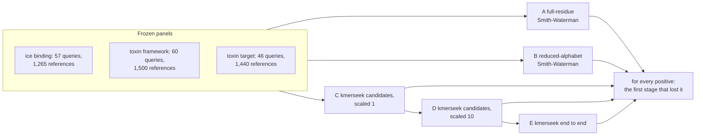

# Notebook 350: where kmerseek loses a true hit

kmerseek 05b4131 (image `2026-10-17-cys-frameworks-05b4131`), config
`scripts/stage_diagnostic/config/stage_diagnostic_v1.yaml`, run 2026-10-19 on Sherlock
(`srun -p dev`, 4 CPUs, 16 GB). Every number here is from held-out queries at 1 negative
allowed above a positive per query, with a 95% interval from resampling origins,
frameworks or toxin families, unless the text says otherwise.

## Decision

| Dataset | Conclusion supported | Why |
|---|---|---|
| Ice binding, protein of another origin | **No useful signal demonstrated under the tested conditions** | Even full-residue alignment against every reference finds 0.004 of positives (0.00-0.01). kmerseek's seeds keep 25% of positives and 23% of negatives, so they select nothing. |
| Toxin, same cysteine framework | **Improve ranking/calibration**, then **restrict the claim to a supported subgroup** | Rescoring kmerseek's scaled-1 candidates with the reduced alignment finds 0.23 (0.09-0.38); kmerseek's own ranking of the same search finds 0.08 (0.03-0.15). One held-out framework, C-C-C-C-CC, reaches 0.66 under A and 0.51 under B. |
| Toxin, same target class | **No useful signal demonstrated under the tested conditions** | Full-residue alignment finds 0.085 (0.01-0.17), below the 0.10 floor. What it finds is homology: over all 46 queries, 0.59 of same-family positive pairs and 0.011 of pairs from different families. |

Across the datasets, three findings repeat:

1. **Ranking loses what the seeds found.** On the ice-binding sanity check (same-origin
   homologs, which any working search should find), A finds 0.97 and kmerseek's
   scaled-1 candidates rescored by A find 0.97. kmerseek's own end-to-end ranking finds
   0.15. Over all queries, of 590 same-origin pairs, kmerseek reports 537 but gives 369 of them an infinite
   E-value: their regions have `region_ka_bits` = 0. These Ala/Thr-rich proteins have a
   high match probability under Dayhoff6, which sends the per-pair lambda to 0. Ranking
   the same output by best region Poisson score gives 0.61. Rescoring only the pairs
   kmerseek reports, with B, gives 0.91 (`exploratory_e2e_ranking.tsv`; exploratory,
   not one of the pre-registered rules).
2. **Reduction is not where the signal goes.** A minus B is 0.05 for frameworks (interval
   -0.11 to 0.24), 0.05 for targets (-0.01 to 0.11) and 0.00 for ice binding. On
   frameworks, B finds 65 held-out positive pairs that A misses, and A finds 107 that B
   misses.
3. **Seeds are not the bottleneck.** Of the positives B finds, kmerseek's scaled-1 seeds
   miss 10% (frameworks, 223 pairs), 0% (targets, 48 pairs) and 1 of 6 (ice binding).
   The rule for "improve candidate generation" (20% or more) does not fire.

The sketch rule fires in all three datasets: scaled 10 keeps fewer positives than scaled 1,
by 0.24 (frameworks), 0.15 (targets) and 0.22 (ice binding). For ice binding this is not a loss of signal, because at scaled
1 the seeds keep positives at the same rate as negatives. The cys-frameworks pipeline
already runs at scaled 1. Use scaled 1 for any search where recall matters; scaled 10
is a cost setting.

**Optional seed experiment: not run.** The config allows it only if B finds positives
that C misses. That share is 10%, 0% and 1 of 6, under the 20% the rule asks for. A
spaced-seed or strobemer index would be fixing a stage that loses little here.

## The antifreeze self-hit failure

All 57 ice-binding queries are in the reference panel with the same sequence (SHA-1 of
the residues) and the same Swiss-Prot sequence version as the query. The mask is off for
every ice-binding setting. 54 find their own entry at every stage. Three do not, all
antifreeze glycoproteins:

| Query | Length | Distinct Dayhoff 9-mers | Scaled 1 | Scaled 10 |
|---|---|---|---|---|
| P02732 | 31 | 1 | a candidate, then removed by `--min-shared-kmers 2` | empty sketch |
| P11920 | 19 | 3 | reported, E-value infinite | empty sketch |
| P11921 | 16 | 3 | reported, E-value infinite | empty sketch |

P02732 is AATAAT...A. Dayhoff6 puts A and T in one class, so the whole protein is one
9-mer repeated. One distinct k-mer cannot pass a two-shared-k-mer filter, and a sketch at scaled
10 keeps a given k-mer with probability 1 in 10. This is a property of the setting, not of the
database or the protein's biology.

## Checks of the implementation

- Fixtures: 56 of 56 checks pass (`fixtures.tsv`). They cover an exact duplicate, a
  substitution, an insertion between conserved blocks, two sequences with the same
  reduced letters and different residues, a low-complexity decoy, a query shorter than
  k, and a query with an empty sketch at scaled 10. These test the code, not biology.
- Our seed counts against kmerseek's `n_intersecting_hashes`: equal on every pair at
  scaled 1 (11,876 / 54,251 / 47,584 pairs) and at scaled 10 (2,708 / 35,276 / 41,488),
  and kmerseek emits every pair that shares a retained k-mer. The scaled-10 check caught
  a bug in the first run: our cys2 table wrote the non-cysteine class as `a`, kmerseek
  writes `x`. Counts at scaled 1 cannot catch that, because the relabelling is one to one.
- Setting choice: on the dev split only, by candidate recall at scaled 1. dayhoff6 k9 for
  ice binding (0.12; sdm12 k7 0.02, hp_lehninger2 k17 0.07), cys2 k12 masked for both
  toxin sets (0.71 and 0.84; dayhoff6 and sdm12 at most 0.15).
- Cost: on these panels every stage takes seconds. For ice binding, A takes 13 s and B 12 s
  of CPU over all queries; the largest kmerseek step takes 2.7 s, the largest peak memory
  is 378 MB (toxin target candidate search at scaled 1).

## Limitations

- The panels are small: 57, 60 and 46 queries, 4 to 12 held-out groups. Intervals are
  wide (frameworks: A 0.14-0.51).
- A versus B compares two scoring systems: BLOSUM62 with gaps 11/1, and BLOSUM62
  collapsed onto each alphabet with the same gaps. It is not a statement about every
  possible model of either representation.
- No dataset has experimentally confirmed negatives. Background is random Swiss-Prot,
  unannotated. A toxin of another target class is an annotated negative, not one shown
  not to bind.
- The ice-binding truth set's lineage labels decide what counts as another origin;
  P02733 and P86268 were left out for B/X residues.
- The cys2 matrix has an expected score of -0.055 per aligned pair, close to zero, so B
  under cys2 rewards long alignments of non-cysteine residues only slightly less than
  nothing.
- Stage E for the toxin sets uses kmerseek defaults, as the cys-frameworks pipeline did;
  no extension, no E-value.

## Smallest next experiment

Change only how kmerseek ranks the pairs it already reports, on these same frozen panels:
(a) give a region whose per-pair lambda is 0 a finite score instead of an infinite
E-value, and (b) rank reported pairs by a gapped reduced-alphabet alignment of the
matched region. Success: the ice-binding homolog sanity check rises from 0.15 toward the
0.91 that B gets on the same reported pairs, and frameworks from 0.08 toward 0.21. Both
can be scored with `stage_diagnostic.py evaluate` as a new stage, with no new index.
