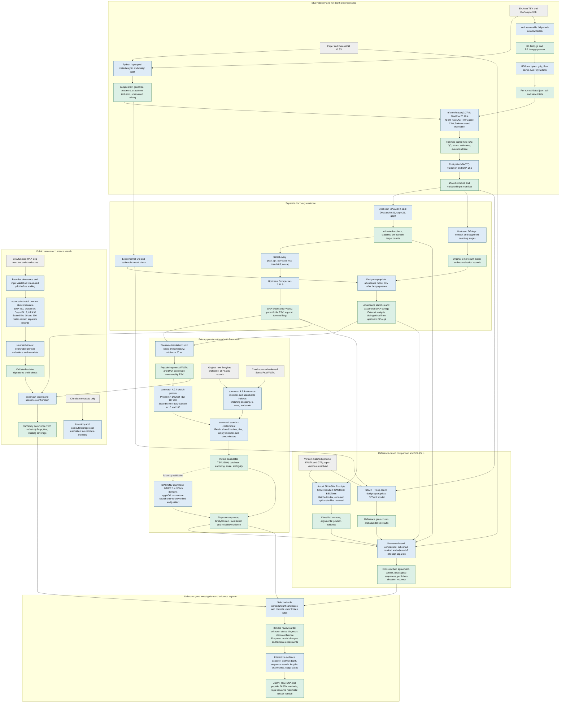

# Programs, inputs, and outputs

Grey = input files. Blue = programs. Green = output files.
This diagram describes the intended full analysis, not completed full-depth results.
Current completion records are in README.md and HANDOFF.md.

All significant SPLASH anchors, not just the old top-300 subset, are extended in new runs.
SPLASH composition significance is not treatment-associated abundance.
Sourmash is primary protein retrieval; alignment and domains check candidate assignments.
Six-frame read translations are not complete predicted proteins.
Archive sequence occurrence is not independent biological validation or a function label.
