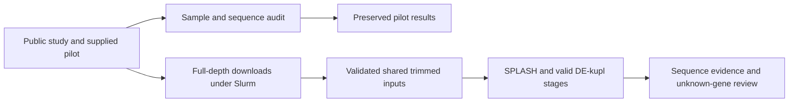

# Botryllus Shazam for Biology

The active study is Domen et al. 2026, electrical stimulation, PRJNA1219309.
The older 2018 blood-cell and 2021 developmental studies remain separate.
Their handoff describes earlier work, not instructions to substitute those experiments.
The supplied Shazam HTML contains oyster results and is a design reference.

## Checked pilot checkpoint

The audit ran on a Sherlock compute node. It reconciled 85,627 tested anchors,
13,669 significant composition anchors, and the selected top 300 anchors.
Compactors emitted 339 records for 227 selected anchors; 243 records are terminal.
All 1,632 recorded translations agree with their DNA coordinates and strand.
The peptide FASTA contains 987 unique fragments. Every one of 3,984 real-peptide
Botryllus sketch hits was recomputed using actual sourmash.

All 45,339 supplied proteome sequences and stable record IDs were reconciled to
the original FASTA, including repeated original identifiers.
The input proteome and independently retrieved supplementary workbook have the
same SHA-256 values as the pilot provenance.

The 1,200,000 input pairs and 763,424 retained pairs reconcile to supplied QC
tables. Raw pilot FASTQs are absent from the package, so trimming and discovery
were not rerun. These results test across-sample composition, not treatment abundance.
The checked values and limits are in [pilot-audit.json](pilot-audit.json).

The curves show the proportion of records at or below each observed length.
The wide blue curve includes all emitted DNA records; the dashed orange curve
includes terminal records only. The green curve represents unique peptide fragments.
Most peptide fragments are short. They are not validated complete coding sequences.
The figure uses Arial with editable TrueType text in [PDF](pilot-lengths.pdf).

## Samples and design

[samples.tsv](samples.tsv) maps all 64 public runs to BioSamples, vial IDs,
genotypes, treatment labels, collection times, and published group membership.
The six published comparison groups include 47 libraries. All 64 runs remain in
the recovery manifest, including low-depth and published-excluded libraries.
Listed complete FASTQs total 77,990,548,476 compressed bytes.

The workbook's stage labels and archive labels often have different specificity,
such as A versus A1A2. Both are retained; unequal strings are not automatically
biological contradictions. Within-group stage differences need design review.
The later published groups include different exact collection times.
Do not pool those times into a new treatment test.

Each public run has a distinct BioSample accession. This does not prove independent
biological replication. Young groups repeat genotypes; the old group has one genotype.
Treatment inference remains blocked until the experimental unit and design are resolved.

## Current execution and interactive explorer

[Open the private evidence explorer](https://botryllus-shazam-evidence.brawnyspoon2048.chatgpt.site).
It includes the original supplied report, independently audited pilot records,
searchable peptides/DNA/reference proteins, separate file downloads, a timestamped
job table, and the complete [metro-map SVG](metro-map.svg).
The default nf-metro Seqera overview shows inputs, read processing, SPLASH,
strict adjusted P selection, Compactors, translation, Branchwater search, and results.
Detailed panels separate each file type. Blue is focal discovery, purple is protein
search, and dashed orange is public SRA occurrence in the overview. Each detailed
panel has its own legend. Planned branches are not completion claims.

The 17:14 UTC snapshot contains 41/64 validated raw runs; see [status.json](status.json).
No automatic monitoring is configured. Healthy downloads remain running.
Transfer recovery 49211401 handles failed batch 4. Preprocessing 49211406 waits for
surviving download tasks and recovery arrays; full-depth discovery 49211416 waits
for validated preprocessing. Every anchor with adjusted P < 0.05 is extended,
without a cap; anchors with no emitted extension are explicitly recorded.

Historical full-run sketch pilot 49192465 completed in 1:53:13 at 11,448,104 KB peak
RSS. Its SBT outputs are historical, not the production archive architecture.
Public SRA uses per-run, per-alphabet signatures combining both mates, at scaled
10 and 100. Branchwater manysearch streams signature ZIPs or searches shared
RocksDB directories. Storage/index correctness benchmark 49212645 is running;
it reuses raw focal pilot sketches and cannot establish external occurrence.

Primary Sourmash/Branchwater protein pilot 49206896 completed in 11:59. It searched
987 pilot peptides against 45,339 Botryllus and 575,748 Swiss-Prot proteins.
Execution is complete; new match interpretation remains gated on independent
validation. Production Swiss-Prot uses scaled 5. Scales 10 and 100 here are a
requested storage comparison, not a changed production setting.
DIAMOND/Pfam 49191037 completed as separate annotation evidence; biological
interpretation is not yet audited. Original references remain unchanged.

[Measured Swiss-Prot sizes](swissprot-size-comparison.json) include 575,748 separate
protein signatures per alphabet. Even scaled-100 ZIPs occupy 458–465 MB versus
93.8 MB for FASTA.gz; they do not meet the storage target. For full run SRR32233926,
compressed FASTQs total 555,604,961 bytes. Scaled-100 protein alone is 10,984,061
bytes (98.0% smaller); all four alphabets total 57,844,280 bytes (89.6% smaller),
excluding indexes. Keep signature bytes and index bytes separate. Merging Swiss-Prot
proteins can remove record overhead but loses protein identity; the benchmark is
an experiment, not an approved replacement for per-protein retrieval.

The tunicate metadata inventory is complete: 5,776 runs, 195 studies, 5,467 BioSamples,
94 taxon IDs and 9.43 TB of listed compressed FASTQs. Eight runs lack FASTQ metadata.
All-tunicate indexing remains authorized but the full collection is not indexed.
Chordates remain metadata/cost inventory only. Full-depth discovery, SPLASH+,
valid abundance inference, and deep candidate review remain incomplete.

## Frozen rules and restart

[PROTOCOL.md](PROTOCOL.md) fixes the evidence layers, candidate selection rules,
controls, inference gates, sketch settings, and limits before new results.
[HANDOFF.md](HANDOFF.md) records paths, jobs, and remaining work.
[PIPELINE.md](PIPELINE.md) shows the complete input/program/output diagram.

The main paper is available through [PubMed](https://pubmed.ncbi.nlm.nih.gov/42190017/).
The complete public sample metadata came from ENA and Dataset S1.
Dataset S1 was retrieved through the Europe PMC supplementary-files API.
Source URLs and retrieved-file fingerprints are in [sources/retrieval.json](sources/retrieval.json).

New full-depth extension rule, requested by Olga on 2026-10-23: send every SPLASH
anchor with `pval_opt_corrected < 0.05` to upstream Compactors. No top-300 cap.
The existing top-300 pilot remains unchanged.

The completed chordate inventory contains 6,311,627 runs across 145,871 studies.
Listed FASTQs total 13,149,391,201,931,341 bytes (13.15 PB); 419,631 runs have no
listed FASTQ URLs or sizes. Missing file sizes are not counted as measured zero.
These are metadata totals, not downloaded sequence data. Continue with tunicates
and consider selected independent chordate studies rather than indexing the full
chordate collection. No chordate sequence indexing was launched.
