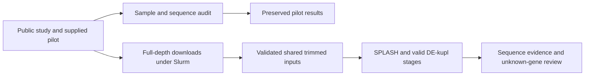
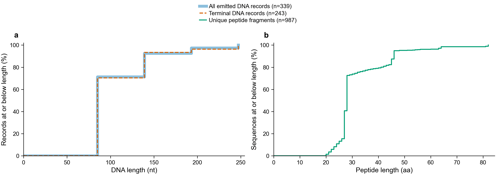

# Botryllus Shazam for Biology

The active study is Domen et al. 2026, electrical stimulation, PRJNA1219309.
The older 2018 blood-cell and 2021 developmental studies remain separate.
Their handoff describes earlier work, not instructions to substitute those experiments.
The supplied Shazam HTML contains oyster results and is a design reference.

## Checked pilot checkpoint

The audit ran on a Sherlock compute node. It reconciled 85,627 tested anchors,
13,669 significant composition anchors, and the selected top 300 anchors.
Compactors emitted 339 records for 227 selected anchors; 243 records are terminal.
All 1,632 recorded translations agree with their DNA coordinates and strand.
The peptide FASTA contains 987 unique fragments. Every one of 3,984 real-peptide
Botryllus sketch hits was recomputed using actual sourmash.

All 45,339 supplied proteome sequences and stable record IDs were reconciled to
the original FASTA, including repeated original identifiers.
The input proteome and independently retrieved supplementary workbook have the
same SHA-256 values as the pilot provenance.

The 1,200,000 input pairs and 763,424 retained pairs reconcile to supplied QC
tables. Raw pilot FASTQs are absent from the package, so trimming and discovery
were not rerun. These results test across-sample composition, not treatment abundance.
The checked values and limits are in [pilot-audit.json](pilot-audit.json).

The curves show the proportion of records at or below each observed length.
The wide blue curve includes all emitted DNA records; the dashed orange curve
includes terminal records only. The green curve represents unique peptide fragments.
Most peptide fragments are short. They are not validated complete coding sequences.
The figure uses Arial with editable TrueType text in [PDF](pilot-lengths.pdf).

## Samples and design

[samples.tsv](samples.tsv) maps all 64 public runs to BioSamples, vial IDs,
genotypes, treatment labels, collection times, and published group membership.
The six published comparison groups include 47 libraries. All 64 runs remain in
the recovery manifest, including low-depth and published-excluded libraries.
Listed complete FASTQs total 77,990,548,476 compressed bytes.

The workbook's stage labels and archive labels often have different specificity,
such as A versus A1A2. Both are retained; unequal strings are not automatically
biological contradictions. Within-group stage differences need design review.
The later published groups include different exact collection times.
Do not pool those times into a new treatment test.

Each public run has a distinct BioSample accession. This does not prove independent
biological replication. Young groups repeat genotypes; the old group has one genotype.
Treatment inference remains blocked until the experimental unit and design are resolved.

## Work running or queued

The download array is 49188713, with eight batches and four concurrent tasks.
Task 0 stopped on a checksum and gzip-integrity failure in one downloaded mate.
The bad partial file was retained under its failed MD5. Recovery job 49192201
reuses validated runs and retrieves that failed mate again. Other tasks were preserved.
Queued tasks 4–7 have 24-hour limits after measured transfer rates slowed.
SRR32233926 is validated at full depth: 4,418,415 paired records and 1,325,524,500 bases.

The initial annotation job 49189184 completed the pilot audit and a 500-protein
DIAMOND pilot, then stopped on a dot in one supplied protein sequence.
Job 49191037 uses a separate search copy with unsupported characters masked to X,
with a positional map. Original reference sequences remain unchanged.
DIAMOND is follow-up alignment evidence. Sourmash is primary protein retrieval.

The tunicate inventory completed: 5,776 runs, 195 studies, 5,467 BioSamples,
94 taxon IDs, and 9,432,590,269,958 listed compressed FASTQ bytes.
Eight runs lack ENA FASTQ URLs. Taxon IDs are not a species count.
The chordate inventory stopped on a title containing an unmatched quotation mark.
The parser regression check passed; job 49191136 continues that inventory separately.
The completed tunicate inventory was not rerun.

A small real-input Sourmash check built and searched all four encodings at all
three scales for SRR32233927. It contains only 692 paired records, so it is a
correctness check rather than a representative resource measurement.
The 4,418,415-pair indexing pilot is job 49192465.
All-tunicate indexing waits for measured resource and disk requirements.
Broader chordates are metadata/cost inventory only.

Full-depth nf-core preprocessing is job 49191258. Its dependencies require the
seven preserved array tasks and recovery job 49192201 to complete successfully.
Trimming outputs are not exposed until paired-file validation passes.
Full-depth discovery, SPLASH+, valid external abundance models, deep candidate
review, and the interactive explorer remain incomplete.

## Frozen rules and restart

[PROTOCOL.md](PROTOCOL.md) fixes the evidence layers, candidate selection rules,
controls, inference gates, sketch settings, and limits before new results.
[HANDOFF.md](HANDOFF.md) records paths, jobs, and remaining work.
[PIPELINE.md](PIPELINE.md) shows the complete input/program/output diagram.

The main paper is available through [PubMed](https://pubmed.ncbi.nlm.nih.gov/42190017/).
The complete public sample metadata came from ENA and Dataset S1.
Dataset S1 was retrieved through the Europe PMC supplementary-files API.
Source URLs and retrieved-file fingerprints are in [sources/retrieval.json](sources/retrieval.json).

New full-depth extension rule, requested by Olga on 2026-10-23: send every SPLASH
anchor with `pval_opt_corrected < 0.05` to upstream Compactors. No top-300 cap.
The existing top-300 pilot remains unchanged.
