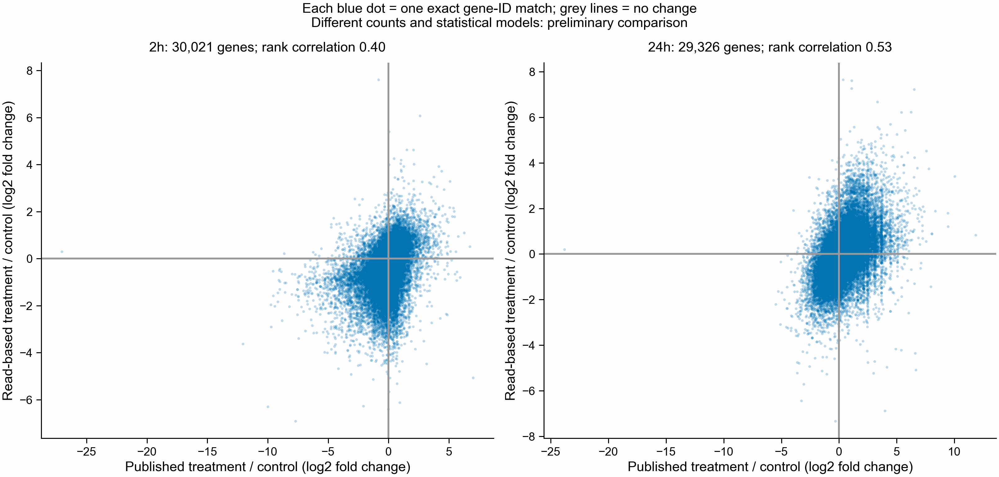

# First read-based Figure 4 comparisons

The 64-library workflow finished its three genotype-adjusted gene models on
2026-10-27, before Compactors exceeded its memory request. These saved models are
usable independently of the remaining sequence-analysis stages.

| Young cohort | Eligible genes tested | Genes with adjusted P < 0.05 | Finite paired effects versus published table | Spearman rank correlation |
|---|---:|---:|---:|---:|
| 2 hours | 32,446 | 0 | 30,021 | 0.3973 |
| 24 hours | 31,668 | 0 | 29,326 | 0.5312 |
| 312 hours | 2,724 | 0 | Not compared | Not measured |

There were no missing P values among eligible genes. Zero significant genes does
not establish that treatment has no effect. There are four genotype units at 2 and
24 hours and three at 312 hours. All tables keep the full eligible population;
these are not tests restricted to sequence-selected or immune genes.

For the 2-hour comparison, 20,471/30,021 finite nonzero effects have the same sign;
for 24 hours, 20,778/29,326 do. All eligible read-model gene IDs occur in the published
tables. The published tables contain 72,113 rows each, so 39,667 and 40,445 IDs,
respectively, have no eligible read-model row. Another 2,425 and 2,342 matched rows
lack a finite published effect and are absent from the scatter plots, not from the
saved comparison tables.

The published 24-hour table has one adjusted-P significant gene, g8782:
log2 fold change -23.8026 and adjusted P 1.18e-10. Its read-based estimate is +0.1923,
with adjusted P 0.999947. This discrepancy remains unresolved. The supplied 2-hour
table has no genes below adjusted P 0.05.

These are preliminary gene-effect comparisons supporting the Figure 4 goal, not
completed reproductions of its panels. Kallisto estimates converted to integer
counts, the genotype-blocked design, eligibility filter and normalization differ
from the paper's published analysis. The published group 4 combines 13 and 49 days;
our 312-hour contrast covers 13 days only, so it is not treated as a matched comparison.
The panel E score definition and reference/annotation equivalence remain unresolved.

## Provenance and verification

The `models` directory contains unchanged published outputs of controller 49811553,
runtime commit d20ae2b74ad8d1f83a5634d705801eed99e5f115, from
`$SCRATCH/botryllus-shazam-PEC-nextflow-20261027/results/models` on Sherlock.
SHA-256 hashes in `summary.json` match the remote files. Completion markers record
DESeq2 1.42.0, design ranks and residual degrees of freedom. All three corresponding
tasks completed with exit 0 in the preserved production trace.

`compare_figure4_gene_models.py` independently recomputes Benjamini-Hochberg adjusted
P values over each complete eligible population and checks them against the saved
values. It checks unique IDs and uses one-to-one exact-ID joins. It does not refit
models, change labels, infer missing results, or use the unfinished plotting edits.
The figure was rendered and inspected; all finite matched effects are included.
