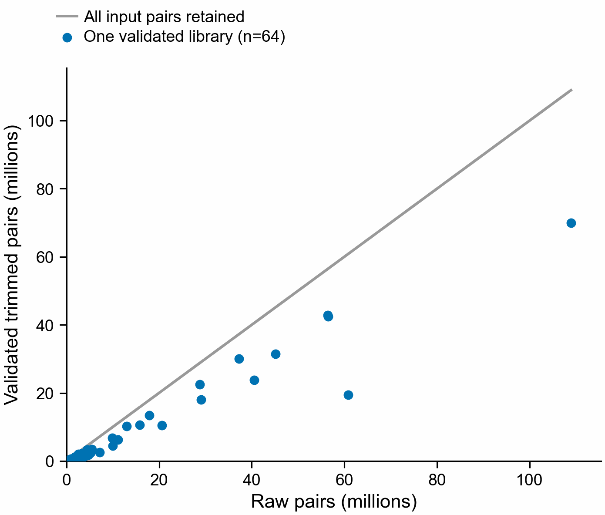

# Trimmed-read recovery and Nextflow migration

Written by Codex at Olga's request. Checked 2026-10-25 Pacific.

## Recovered experimental inputs

The preserved workflow log records 64 distinct Trim Galore tasks completing with exit
zero. The nf-core head failed later because Salmon could not infer strandedness for
SRR32233927. The six dependent discovery/abundance/search jobs were cancelled before
execution. No full-depth discoveries or expression results were imported from them.

Recovery job 49512151 completed with Slurm exit 0:0. It validated all 128 gzip files,
synchronized identifiers, sequence/quality lengths and pair counts, then computed
SHA-256 and created the shared trimmed-read links. It retained 405,240,058 pairs from
654,672,879 raw pairs across 64 libraries. These are read-validation counts, not
biological results. Every library remains in the denominator, including tiny outputs.

Each point is one library. The grey line shows equal raw and retained counts. All
64 libraries passed validation; trimming retained fewer reads in every library.

`trimmed-inputs.validated.json` records each file and checksum. The validation command
ran for 5:31.39; the Slurm job elapsed 5:44. The command's maximum RSS was 36,760 KB,
whereas Slurm reported 8,388,036 KB for the batch step. Use the larger scheduler
measurement for future allocation sizing; these are different accounting scopes.

Original FASTQ files, nf-core logs, failed-run work directories, historical query
protocols and old results were preserved. The modified Figure 4 plotting script,
exercise-source directory and historical search-driver edits remain unfinished.

## Migration implementation and gates

The workflow is `pipelines/botryllus-shazam/main.nf`. It calls pinned counting tools
directly, keeps separate per-library tasks, and reuses the established pooling and
blocked-model code. Both SPLASH and DE-kupl sequences reach translation, target
preparation, per-setting searches and the gene-evidence join.

The protocol is six frames, stop-only splitting, internal X retained, minimum 30 aa.
Target sketches are rebuilt into new versioned outputs. Search candidates remain
candidates; exact seed-to-gene containment does not prove full-context alignment,
orthology, function or splicing. Optional genome alignment and query Pfam stages
require explicit reference assets and executables.

Local tests passed for strict adjusted-P selection, missing contrasts, duplicate
FASTA IDs, unresolved transcript mapping, native count truncation and empty selection.
Translation boundary, X and six-frame tests passed in the analysis environment.
Pinned Nextflow 25.10.4 resolved the Sherlock configuration and compiled the graph.
Real-tool workflow testing is still in progress. Production resources and a real-data
comparison remain unvalidated. The resource preparation script records trace-derived requests
and stops when supplied traces contain failures needing diagnosis.

The app remains the historical snapshot. No experimental output from this migration
has been published to it. Archive-wide tunicate preparation still needs explicit
input batches; a manifest containing four prepared runs is a four-run search.
