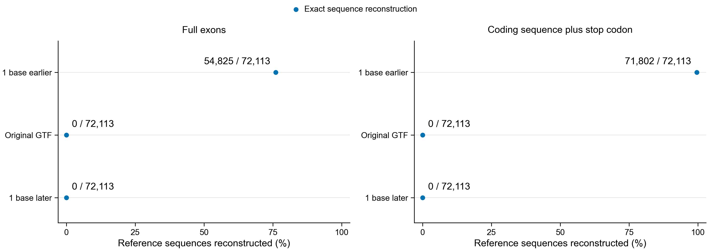

# Production launch checks, 2026-10-25

The full graph completed 127 tasks in fixture job 49521200, with independent
count and statistical checks. The direct genome/Pfam controls completed six tasks
in job 49521127. Its separate coordinate-equivalence check failed; the unresolved
311 coding sequences remain documented in REFERENCE-CHECKS.md.

The largest-library measurement is job 49520541, using all 69,938,926 recovered
pairs in SRR32233964. Production must wait for its successful completion and use
its final resource measurements. Other full-scale stage estimates remain provisional.

Two production submissions were rejected before jobs were created. The mixed
normal/hns request exceeded normal QOS walltime; adding long QOS was incompatible
with hns. Current partition inspection and the Sherlock documentation show that
owner partitions support seven days with normal QOS. The seven-day controller now
uses hns only. Tasks over 48 hours also use hns; shorter tasks retain normal,hns.
A scheduler test-only submission accepted the seven-day hns request. No job was
created by that test.

Reference: https://www.sherlock.stanford.edu/docs/user-guide/running-jobs/

The app archived the previous local checkout during this turn. All eleven unfinished
files were recovered byte-for-byte from snapshot 58bf1f74 into the managed
botryllus-production worktree. They remain uncommitted and were not included in
production source. Historical Sherlock outputs and caches were retained.

The scientific objective remains Figure 4 reproduction. This workflow's completion
will require comparison with the paper's panel-specific inputs, rules and values.

## Submitted production controller

Job 49523163 was accepted with dependency afterok:49520541. At 20:36 UTC it was
PENDING for Dependency; production Nextflow had not started. The job uses immutable
source 4da3d169 and a new directory, `$SCRATCH/botryllus-shazam-PEC-nextflow-20261025`.
Its log is `$SCRATCH/botryllus-64-nextflow-49523163.log`. If the preflight fails, the
dependent job is cancelled instead of processing unvalidated inputs. Final requests
are computed inside the controller from completed command and scheduler measurements.
A submitted job is not a completed production result.

Each point uses all 72,113 reference sequences. Moving both GTF interval endpoints
one base earlier matches 71,802 coding sequences; 311 remain unresolved. Full exons
also contain untranslated regions. Original files remain unchanged.
