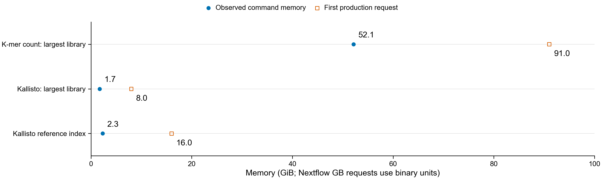

# Resource-preflight follow-up, 2026-10-25

The original preflight 49520541 finished after 58:12 with exit 1:0. Counting,
Kallisto index construction, quantification, genome alignment, and Pfam searches
all exited zero. Gene mapping failed because the helper required a single GTF
isoform even when the reference FASTA already had one sequence per exact gene ID.
All 72,113 FASTA IDs are present as GTF gene IDs; 450 have multiple annotated isoforms.

The corrected helper accepts an exact gene ID independently of annotated isoform
count. Ambiguous gene/transcript names and multiple quantified sequences assigned
to one gene still fail. Ten helper tests passed with the analysis Python environment.
The system Python lacked Biopython; its dependency error was not a passed test.

Recovery 49525580 uses successful measurements and quantifications through symlinks
in a new directory, reruns the failed mapping and checksums, then runs the full
Nextflow fixture. The failed allocation remains recorded, including its 60.4 GiB
peak. Production 49525592 depends on successful recovery; previous pending
controllers 49523163 and 49525229 never ran. No existing result or work cache was removed.

## Requests supported by measured inputs

The blue circles are GNU time command peaks. The open squares are first production
requests. The count request also uses the larger 60.4 GiB Slurm allocation peak,
which includes the parent and other allocation memory. These scopes differ.

| Operation | Measured wall time | First request |
|---|---:|---:|
| Largest-library count, 69,938,926 pairs | 32:49.60 | 91 GB, 12 h |
| Largest-library Kallisto quantification | 19:55.77 | 8 GB, 12 h |
| Full reference index | 1:09.70 | 16 GB, 4 h |

Other count requests scale by library read pairs with a provisional 32 GB floor.
Other full-scale stages retain their documented provisional budgets. Gene models
request four hours, from the 12.2-second 100-gene fixture scaled conservatively to
72,113 reference genes with a 1.5 multiplier. K-mer models retain 96 hours.

Gene pooling no longer waits for the combined k-mer matrix. Separate and combined
pooling produced identical counts, partitions, unit metadata, and eligibility records
in the regression check. The statistical design, filters, and adjustment are unchanged.

## First Figure 4 comparisons

Published-count redraws and supplied-count refits are available now under
`reports/botryllus-shazam/figure4/`. They are not independent reproduction from reads.

For new gene-level comparisons, plan for 2–6 hours after the production controller
starts, plus queue delays. This estimate combines the measured largest-library
quantification with validation, queueing, pooling and conservative gene-model time.
It is not a measured full-workflow duration. A reliable calendar ETA requires the
controller and its child tasks to start. The gene models can publish before k-mer
models, sequence recruitment, Pfam and the final evidence join complete.

Exact Figure 4 reproduction still requires the paper's reference and score-method
choices. The earlier coordinate audit merged intervals by gene; multi-isoform genes
need an isoform-specific check before its 311 mismatches can be interpreted as
reference discrepancies. The original genome, GTF and coding FASTA remain unchanged.

## Recovery acceptance

Recovery job 49525580 completed with exit 0:0 in 8:10, using 2,276,844 KB peak
allocation RSS. Its fresh full workflow completed all 128 tasks. Independent checks
reproduced 29,459 canonical k-mer rows across 18 synthetic libraries and all six
multiple-testing corrections. All six model tables were byte-identical after
compression was removed to the preceding fixture 49525137.

The real-library output retained all 72,113 genes. Every integer-converted count
matched its Kallisto input. The source quantification processed 69,938,926 pairs.
Generated resources resolve under pinned Nextflow 25.10.4 on Sherlock; all 64
library requests are present and span 32–91 GB for counting.

## Latest scheduler state

Production job 49525592 remains PENDING for Priority. Its recovery dependency has
completed successfully. Sherlock briefly estimated a start around 14:17–14:18
Pacific, then withdrew that estimate. No production log exists yet, so the full
64-library workflow is not reported as started. There is no firm calendar ETA.
The planning window remains 2–6 hours after startup, plus child-job queue delays.
See current-state.json for the check timestamp. No duplicate production job was submitted.
