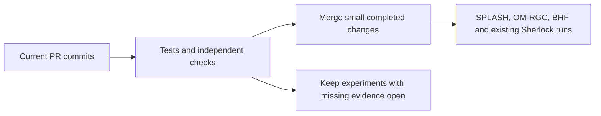

# Merge recommendations, 2026-10-23

These recommendations apply to the commits below. GitHub reported each candidate
mergeable into main with successful current-head checks at the final check. No PR
was merged during this review. Recheck the commit and CI before merging; later
commits do not inherit this recommendation.

| Merge now | Commit | Reason and limit |
|---|---|---|
| [PR 138](https://github.com/seanome/2024-kmerseek-analysis/pull/138) | `c6754372` | Dipeptide shuffling utility: 107 tests and an independent exhaustive check of 9,840 short-sequence/seed combinations preserve length, ends and dipeptide counts. |
| [PR 153](https://github.com/seanome/2024-kmerseek-analysis/pull/153) | `7ced2521` | Colour-map changes and tested protection against reducing continuous colour bars to a few bands. Eight focused tests pass. |
| [PR 115](https://github.com/seanome/2024-kmerseek-analysis/pull/115) | `e38fca58` | DisProt parser rejects missing/duplicate entry IDs and repeated pages. Ten tests pass; cached human residue totals reproduce. No new live API or benchmark run. |
| [PR 117](https://github.com/seanome/2024-kmerseek-analysis/pull/117) | `6b76956a` | Merge the stopped BCL2 plan and corrected query inventory. Fresh notebook execution, 28 tests and an independent Swiss-Prot parse pass. This does not authorize the stopped experiment or establish an E-value calibration. |
| [PR 120](https://github.com/seanome/2024-kmerseek-analysis/pull/120) | `59aeb872` | Repaired completed-run summaries, hashed provenance and corrected comparisons. All 11,270 summary files exported; 60 species/settings/cutoff comparisons independently reproduce. All five species pass the stated rule at E-value cutoffs of 1 and 10. This is the recorded rule, not independent biological validation. |

Merge these individually and recheck tests after main changes. PR 91's merge conflict
has also been fixed, but its shared plotting helper affects downstream notebooks;
its focused tests and cached example do not constitute a scientific rerun of them.

## Keep these claims unresolved

- **Benchmark independence:** PR 53's frozen split shares 53 atomic HGNC family
  labels between halves among 476 scored queries. Changing only the prose cannot
  produce an independent evaluation. Preserve the frozen result and design a new
  family-disjoint evaluation before claiming held-out performance.
- **Missing source data:** PR 65's accuracy inputs, original midi-plus inputs in
  PRs 49/51/58, and several later benchmark inputs are unavailable. The per-PR
  comments state which counts could be checked. Historical notebook content is
  not approved merely because a PR mostly reformats it.
- **Meaning of a seed:** An aligned identical run is not the longest word shared
  anywhere between two proteins. Corrected PRs 54/106/113 and 143 state this limit;
  they cannot establish search reachability from the aligned-run calculation.
- **Region scores:** PR 57's conclusion depends on counting duplicated calls.
  After counting each domain instance once, phmmer has a higher maximum F1 score,
  which balances precision and recall, in all four
  species examined. Do not reuse the earlier unmerged-call conclusion as a
  biological advantage. PRs 30/52/57/114 still need relevant pipeline validation.
- **BHF/Botryllus:** PRs 83/124/132 now expose query provenance, composition controls,
  ties and observed counts. Small selected panels and shared sequences do not
  establish a general discovery rate. The chained rescore remains pending.
- **Broad figure changes:** PR 123's transparency bug is fixed and its focused
  tests pass; all 321 changed figures have not received visual approval. PR 139
  is exploratory and targets PR 128's branch, so it is not a direct main merge.
- **New SPLASH work:** PR 201's intake, restart guards, count validation and
  multiple-testing correction are fixed and tested. No notebook or biological
  result exists yet. Study pairing and the full PyDESeq2 workflow remain
  unverified. The owner has since marked it ready for review.

## Focus after the small merges

1. Continue the current SPLASH application in PR 201. Preserve PR 196 as a stopped
   experiment; its controls and corrected statistics do not turn it into a pass.
2. Continue OM-RGC applications from the existing work, rather than reopening
   every historical benchmark. PR 170 was already merged before this final review.
3. Finish the BHF/Botryllus controls and chained rescoring before strengthening
   claims in PRs 83/124/132. Keep RNA-seq preprocessing distinct from a biological
   result.
4. Use completed Sherlock outputs now: the repaired summaries used in PR 120 are
   available. This report does not claim that today's remaining queue has finished.
   No new searches, Nextflow jobs, cancellations or environment changes were made.

The other-repository inventory does not approve all 24 kmerseek or 31 leaderboard
PRs. [Focused checks of ten PRs](OTHER_REPOSITORY_REVIEWS.md) add these findings:

- kmerseek PR 159 now rejects corrupt index boundaries; six module tests and current
  CI pass. It targets PR 158's branch. Land or reconcile that dependency first;
  the historical speed measurement predates the added validation scan.
- kmerseek PR 143's documentation conflict is fixed; wait for its current checks.
  PR 137 still has merge conflicts. PR 155's coverage process segfaulted; this
  is not evidence of a coverage percentage below the threshold.
- Leaderboard PRs 12 and 32 are conditional merge candidates as dated descriptive
  and retrospective records after repository checks. Their local source checks
  pass, but no GitHub checks are configured on these current heads. PR 32's broad
  prediction claim and unsupported power claim have been narrowed.
- Leaderboard PR 33 now distinguishes seven reported transfer claims from
  independently supported transfers. Four source assertions fail; hold scientific
  approval. PRs 7/8 pass focused browser checks but depend on PR 6. PR 2 needs
  the correctness fixes already present in later PR 9 before a standalone merge.

PRs 202 and 203 received focused checks of extensions, search guards, anchor
selection and saved pilot outputs. PR 203's local audit reproduces the recorded
pilot; it does not establish full-depth completion or a treatment effect. Which
samples are independent biological replicates remains unresolved.

The continuously edited SPLASH branches can advance after a recorded review.
A changed head is shown as needing another check; this report does not approve
changes made after that review commit.

No new notebook source was found in the final 22 analysis PRs. Their helpers,
scorers, output conversion and pipeline tests received focused checks. Missing
raw-data validation remains stated in their per-PR comments. PRs 166 and 198 now
reject missing-score and ambiguous-manifest cases that previously passed.

Written by Codex at olgabot's request.
