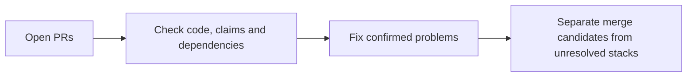

# Focused checks in other active repositories

These checks supplement the notebook-first review. Most PRs below have only a
dependency and CI inventory. A successful check is not scientific approval.
No PR was merged and no website was published.

## seanome/kmerseek

| PR | Current head | Base | Current CI | Review and remaining work |
|---|---|---|---|---|
| [PR 113](https://github.com/seanome/kmerseek/pull/113) | `dbe2634c` | `olgabot/run-evalue-v2` | SUCCESS | candidate for focused review; green CI alone is not approval |
| [PR 114](https://github.com/seanome/kmerseek/pull/114) | `d837c12e` | `olgabot/extend-without-fit-v2` | SUCCESS | candidate for focused review; green CI alone is not approval |
| [PR 130](https://github.com/seanome/kmerseek/pull/130) | `5904bf9f` | `olgabot/extend-10-default-extension-v2` | SUCCESS | candidate for focused review; green CI alone is not approval |
| [PR 133](https://github.com/seanome/kmerseek/pull/133) | `a93a06d2` | `main` | SUCCESS | candidate for focused review; green CI alone is not approval |
| [PR 134](https://github.com/seanome/kmerseek/pull/134) | `212e5240` | `olgabot/run-evalue-columns` | SUCCESS | candidate for focused review; green CI alone is not approval |
| [PR 137](https://github.com/seanome/kmerseek/pull/137) | `1e9c53a6` | `main` | SUCCESS | [Review](https://github.com/seanome/kmerseek/pull/137#issuecomment-6367384373). Hold: merge conflicts; needs fresh merge-head CI |
| [PR 141](https://github.com/seanome/kmerseek/pull/141) | `431f9d01` | `olgabot/release-0.4.0` | SUCCESS | candidate for focused review; green CI alone is not approval |
| [PR 142](https://github.com/seanome/kmerseek/pull/142) | `2b284984` | `main` | SUCCESS | candidate for focused review; green CI alone is not approval |
| [PR 143](https://github.com/seanome/kmerseek/pull/143) | `b739c7a3` | `main` | PENDING | [Review](https://github.com/seanome/kmerseek/pull/143#issuecomment-6367383721). Docs candidate after current CI passes |
| [PR 144](https://github.com/seanome/kmerseek/pull/144) | `3f008b50` | `main` | SUCCESS | candidate for focused review; green CI alone is not approval |
| [PR 145](https://github.com/seanome/kmerseek/pull/145) | `8f0c489e` | `main` | FAILURE | hold: failed or cancelled checks |
| [PR 146](https://github.com/seanome/kmerseek/pull/146) | `57846430` | `main` | SUCCESS | candidate for focused review; green CI alone is not approval |
| [PR 147](https://github.com/seanome/kmerseek/pull/147) | `14d5078b` | `olgabot/release-0.4.0` | SUCCESS | candidate for focused review; green CI alone is not approval |
| [PR 148](https://github.com/seanome/kmerseek/pull/148) | `87b319d1` | `olgabot/cys2-alphabet` | SUCCESS | hold: conflicts |
| [PR 149](https://github.com/seanome/kmerseek/pull/149) | `685efdee` | `main` | FAILURE | hold: failed or cancelled checks |
| [PR 150](https://github.com/seanome/kmerseek/pull/150) | `bd3b1883` | `olgabot/cys-hp3-alphabet` | SUCCESS | candidate for focused review; green CI alone is not approval |
| [PR 152](https://github.com/seanome/kmerseek/pull/152) | `0809ca10` | `main` | SUCCESS | candidate for focused review; green CI alone is not approval |
| [PR 153](https://github.com/seanome/kmerseek/pull/153) | `039524fc` | `main` | SUCCESS | candidate for focused review; green CI alone is not approval |
| [PR 154](https://github.com/seanome/kmerseek/pull/154) | `a326711e` | `main` | SUCCESS | candidate for focused review; green CI alone is not approval |
| [PR 155](https://github.com/seanome/kmerseek/pull/155) | `644f541b` | `main` | FAILURE | [Review](https://github.com/seanome/kmerseek/pull/155#issuecomment-6367384020). Hold: unresolved coverage test-process segfault |
| [PR 156](https://github.com/seanome/kmerseek/pull/156) | `799272ca` | `main` | SUCCESS | candidate for focused review; green CI alone is not approval |
| [PR 157](https://github.com/seanome/kmerseek/pull/157) | `3d5f8216` | `olgabot/run-evalue-checks` | SUCCESS | hold: conflicts |
| [PR 158](https://github.com/seanome/kmerseek/pull/158) | `1a12c331` | `main` | SUCCESS | candidate for focused review; green CI alone is not approval |
| [PR 159](https://github.com/seanome/kmerseek/pull/159) | `d5292c84` | `olgabot/search-step-timing` | SUCCESS | [Review](https://github.com/seanome/kmerseek/pull/159#issuecomment-6367383404). Conditional candidate after current CI passes; current startup performance after offset validation unmeasured |

### Evidence for the focused reviews

- PR 159: Full Rust crate build/tests were not run locally; see exact scoped tooling in read-back review comment.
- PR 155: Full Rust crate build/tests were not run locally; see exact scoped tooling in read-back review comment.
- PR 143: Full Rust crate build/tests were not run locally; see exact scoped tooling in read-back review comment.
- PR 137: Full Rust crate build/tests were not run locally; see exact scoped tooling in read-back review comment.

## seanome/protein-function-annotation-leaderboard

| PR | Current head | Base | Current CI | Review and remaining work |
|---|---|---|---|---|
| [PR 2](https://github.com/seanome/protein-function-annotation-leaderboard/pull/2) | `22545c3a` | `main` | No checks | [Review](https://github.com/seanome/protein-function-annotation-leaderboard/pull/2#issuecomment-6367309701). Hold standalone publication/merge decision until later PR9 correctness fixes reconciled; root of site stack |
| [PR 3](https://github.com/seanome/protein-function-annotation-leaderboard/pull/3) | `65bb7e0c` | `olgabot/leaderboard-v1` | SUCCESS | Resolve conflict before assessing checks |
| [PR 4](https://github.com/seanome/protein-function-annotation-leaderboard/pull/4) | `3d7876d3` | `olgabot/region-pileup` | No checks | Stack dependency must land or be reconciled first |
| [PR 5](https://github.com/seanome/protein-function-annotation-leaderboard/pull/5) | `97e41d18` | `olgabot/long-tables` | SUCCESS | Stack dependency must land or be reconciled first |
| [PR 6](https://github.com/seanome/protein-function-annotation-leaderboard/pull/6) | `153b1ca3` | `olgabot/claims-card` | SUCCESS | Stack dependency must land or be reconciled first |
| [PR 7](https://github.com/seanome/protein-function-annotation-leaderboard/pull/7) | `8b7ac003` | `olgabot/leaderboard-first` | SUCCESS | [Review](https://github.com/seanome/protein-function-annotation-leaderboard/pull/7#issuecomment-6367214437). No confirmed issue in focused review; reconcile/land PR6 stack dependency first |
| [PR 8](https://github.com/seanome/protein-function-annotation-leaderboard/pull/8) | `862b4cf0` | `olgabot/leaderboard-first` | SUCCESS | [Review](https://github.com/seanome/protein-function-annotation-leaderboard/pull/8#issuecomment-6367214913). No confirmed issue in focused review; reconcile/land PR6 stack dependency first |
| [PR 9](https://github.com/seanome/protein-function-annotation-leaderboard/pull/9) | `086cef60` | `olgabot/leaderboard-first` | SUCCESS | Stack dependency must land or be reconciled first |
| [PR 10](https://github.com/seanome/protein-function-annotation-leaderboard/pull/10) | `ffd3c0cd` | `olgabot/fix-correctness` | SUCCESS | Stack dependency must land or be reconciled first |
| [PR 11](https://github.com/seanome/protein-function-annotation-leaderboard/pull/11) | `ead7951c` | `olgabot/lower-load` | SUCCESS | Stack dependency must land or be reconciled first |
| [PR 12](https://github.com/seanome/protein-function-annotation-leaderboard/pull/12) | `81c1a18c` | `main` | No checks | [Review](https://github.com/seanome/protein-function-annotation-leaderboard/pull/12#issuecomment-6367309991). Merge candidate as dated descriptive data snapshot after repository checks; no CI on initial head, current CI not yet established. Pending kmerseek search not complete; full raw SwissProt/taxonomy/API revalidation not run |
| [PR 13](https://github.com/seanome/protein-function-annotation-leaderboard/pull/13) | `7c1a9271` | `olgabot/plain-metric-words` | SUCCESS | Stack dependency must land or be reconciled first |
| [PR 16](https://github.com/seanome/protein-function-annotation-leaderboard/pull/16) | `a1b5dc15` | `olgabot/plain-metric-words` | SUCCESS | Stack dependency must land or be reconciled first |
| [PR 17](https://github.com/seanome/protein-function-annotation-leaderboard/pull/17) | `100878db` | `olgabot/plain-metric-words` | SUCCESS | Stack dependency must land or be reconciled first |
| [PR 18](https://github.com/seanome/protein-function-annotation-leaderboard/pull/18) | `b9f04812` | `olgabot/plain-metric-words` | SUCCESS | Stack dependency must land or be reconciled first |
| [PR 19](https://github.com/seanome/protein-function-annotation-leaderboard/pull/19) | `c39547d8` | `olgabot/plain-metric-words` | SUCCESS | Stack dependency must land or be reconciled first |
| [PR 20](https://github.com/seanome/protein-function-annotation-leaderboard/pull/20) | `1c32dbca` | `olgabot/plain-metric-words` | SUCCESS | Stack dependency must land or be reconciled first |
| [PR 21](https://github.com/seanome/protein-function-annotation-leaderboard/pull/21) | `1c0cddf9` | `olgabot/more-figures` | SUCCESS | Stack dependency must land or be reconciled first |
| [PR 22](https://github.com/seanome/protein-function-annotation-leaderboard/pull/22) | `4a33f5b5` | `olgabot/plain-metric-words` | SUCCESS | Stack dependency must land or be reconciled first |
| [PR 23](https://github.com/seanome/protein-function-annotation-leaderboard/pull/23) | `157d0d32` | `olgabot/scatter-axes` | SUCCESS | Stack dependency must land or be reconciled first |
| [PR 24](https://github.com/seanome/protein-function-annotation-leaderboard/pull/24) | `7d47e434` | `olgabot/plain-metric-words` | SUCCESS | Stack dependency must land or be reconciled first |
| [PR 25](https://github.com/seanome/protein-function-annotation-leaderboard/pull/25) | `e2a09d9e` | `olgabot/plain-metric-words` | SUCCESS | Stack dependency must land or be reconciled first |
| [PR 26](https://github.com/seanome/protein-function-annotation-leaderboard/pull/26) | `ab7de005` | `olgabot/why-numbers` | No checks | Stack dependency must land or be reconciled first |
| [PR 27](https://github.com/seanome/protein-function-annotation-leaderboard/pull/27) | `77f3c9bb` | `olgabot/why-numbers` | No checks | Stack dependency must land or be reconciled first |
| [PR 28](https://github.com/seanome/protein-function-annotation-leaderboard/pull/28) | `31fcdfff` | `olgabot/why-numbers` | No checks | Stack dependency must land or be reconciled first |
| [PR 29](https://github.com/seanome/protein-function-annotation-leaderboard/pull/29) | `7feeb97d` | `olgabot/no-search-baselines` | SUCCESS | Stack dependency must land or be reconciled first |
| [PR 30](https://github.com/seanome/protein-function-annotation-leaderboard/pull/30) | `576d824f` | `olgabot/contribute` | SUCCESS | Stack dependency must land or be reconciled first |
| [PR 31](https://github.com/seanome/protein-function-annotation-leaderboard/pull/31) | `0bb72330` | `olgabot/why-numbers` | No checks | Stack dependency must land or be reconciled first |
| [PR 32](https://github.com/seanome/protein-function-annotation-leaderboard/pull/32) | `553fb63c` | `main` | No checks | [Review](https://github.com/seanome/protein-function-annotation-leaderboard/pull/32#issuecomment-6367310321). Merge candidate as bounded retrospective result after repository checks; new head has no CI result yet. External original source/blinding/selection not independently recertified |
| [PR 33](https://github.com/seanome/protein-function-annotation-leaderboard/pull/33) | `51b16138` | `main` | No checks | [Review](https://github.com/seanome/protein-function-annotation-leaderboard/pull/33#issuecomment-6367310646). Hold for resolution of4failed human-target source assertions before treating as verified transfer evidence. Original screen counts retained explicitly; no external literature fetch |
| [PR 34](https://github.com/seanome/protein-function-annotation-leaderboard/pull/34) | `e1911d19` | `olgabot/no-search-baselines` | SUCCESS | Stack dependency must land or be reconciled first |

### Evidence for the focused reviews

- PR 33: 62x11 atlas cells and235queries rebuild exactly; independent funnels60/42/29/7/0and60/7/7/3/0 PASS; rebuilt figure visually inspected
- PR 32: Independent counting reproduces an area under the receiver operating characteristic curve of 0.569078947 and median scores of 5 and 3.5. The 43-row recheck script passes twice; the frozen scientific success rule fails.
- PR 12: Current checkout verifier path test; raw MMseqs streaming hit/nonself membership50924 proteins/0mismatches;108 source metadata rows and24 label count/percent entries PASS
- PR 8: 179 explainer numbers, claims checker, prose checker PASS
- PR 7: 2976 filter combinations, 233208 numbers, 9408 plot renders, 84045 markers, 8 axis pairs PASS
- PR 2: Fresh browser:2976 combinations,235808 numbers,8928 plots,77971 markers PASS

Written by Codex at olgabot's request.
