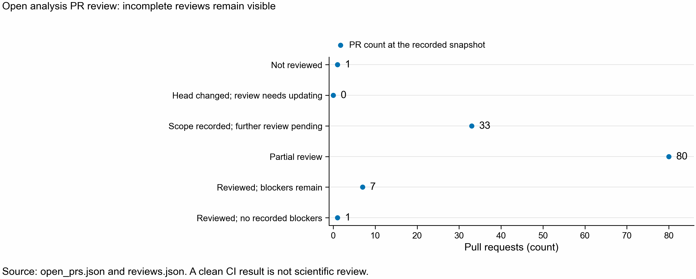

# Open notebook PR reviews, 2026-10-23

This records checks and fixes for every open analysis PR in the snapshot. A mechanical check
does not establish that a scientific claim is correct. A review only applies
to its recorded commit; a newer head needs another check.

Snapshot taken: 2026-10-23T14:22:42.350888+00:00.

The initial scope contained 120 open PRs. Newly opened PRs 201 and 202 are included;
PR 200 contains this report and is excluded from its own review counts.
See [merge recommendations](MERGE_QUEUE.md) and the
[other public PR inventory](OTHER_REPOSITORIES.md). The latter is not a code review.

| Review coverage | PRs |
|---|---:|
| Not reviewed | 1 |
| Partial review | 80 |
| Reviewed; blockers remain | 7 |
| Reviewed; no recorded blockers | 1 |
| Scope recorded; further review pending | 33 |

## Each PR

CI and conflicts are GitHub's state at the snapshot time. Neither is
a substitute for reviewing the notebook's conclusions. An incomplete
experiment can merge as documented preparation without establishing its result.

| PR | Title | Head | GitHub state | Review | Remaining work |
|---|---|---|---|---|---|
| [PR 202](https://github.com/seanome/2024-kmerseek-analysis/pull/202) | Extend all significant trimmed oyster SPLASH anchors | `3e58019a` | CLEAN | Not reviewed | Full review pending |
| [PR 201](https://github.com/seanome/2024-kmerseek-analysis/pull/201) | nb361: Domen et al. 2026 PEC RNA-seq without a genome (SPLASH, anchor counts, proteome matches) | `442f2d01` | CLEAN | [Partial review](https://github.com/seanome/2024-kmerseek-analysis/pull/201#issuecomment-6367005357) | No notebook, frozen samples.tsv or biological results yet; Actual SI pairing and contrast membership unverified; paper/SI inaccessible; Full PyDESeq2 and cluster/search stages not executed by reviewer; Owner added DE-kupl/stable-ID/pair-alignment helpers: read but not executed or biologically certified |
| [PR 199](https://github.com/seanome/2024-kmerseek-analysis/pull/199) | nb300: peptide lookup gate, query set, and measured index-build plan | `ee243b38` | CLEAN | [Partial review](https://github.com/seanome/2024-kmerseek-analysis/pull/199#issuecomment-6364886216) | Recovery, empirical calibration, runtime and fresh-kernel rerun pending; New selective index-retry implementation/job evidence added after notebook review; pipeline and live Sherlock status unreviewed |
| [PR 198](https://github.com/seanome/2024-kmerseek-analysis/pull/198) | Freeze RNA-seq kill-test rules and add pre-run checks | `f55f4f45` | CLEAN | [Scope recorded; further review pending](https://github.com/seanome/2024-kmerseek-analysis/pull/198#issuecomment-6366088440) |  |
| [PR 197](https://github.com/seanome/2024-kmerseek-analysis/pull/197) | Botryllus RNA-seq: nf-core/rnaseq pre-processing only, on Sherlock | `6eb203a3` | UNSTABLE | [Scope recorded; further review pending](https://github.com/seanome/2024-kmerseek-analysis/pull/197#issuecomment-6366089181) |  |
| [PR 196](https://github.com/seanome/2024-kmerseek-analysis/pull/196) | Notebook 357: clade-grouped SPLASH experiment stopped; results preserved | `8a3cf7f3` | CLEAN | [Partial review](https://github.com/seanome/2024-kmerseek-analysis/pull/196#issuecomment-6365335031) | Stopped at user request; no completed final notebook; not restarted; PR191 and PR196 own the same notebook357 preregistration/builder paths for different experiments; scope decision required before merge |
| [PR 195](https://github.com/seanome/2024-kmerseek-analysis/pull/195) | nb 359: kill test, region calls on alternative exons that IsoAnnotLite leaves blank (pre-registered, not run yet) | `e83bbaa3` | CLEAN | [Partial review](https://github.com/seanome/2024-kmerseek-analysis/pull/195#issuecomment-6364973018) | Preregistered WTC11 experiment not run; no application result |
| [PR 194](https://github.com/seanome/2024-kmerseek-analysis/pull/194) | 241: search hp_lehninger_hpc3 k21 with exact regions, as recorded, and rebuild the tables | `4c29bb9a` | UNSTABLE | [Partial review](https://github.com/seanome/2024-kmerseek-analysis/pull/194#issuecomment-6365246072) | Historical whole-protein metrics predate kmerseek136; current rerun needed; Complete fresh-kernel notebook and family nulls not rerun |
| [PR 193](https://github.com/seanome/2024-kmerseek-analysis/pull/193) | Notebook 354: kill test, kmerseek massspec18 source lookup for de novo peptide calls: FAIL | `1347c334` | CLEAN | [Partial review](https://github.com/seanome/2024-kmerseek-analysis/pull/193#issuecomment-6365103012) | parasail1.3.4 native tests unavailable; isolated autotools build failed |
| [PR 192](https://github.com/seanome/2024-kmerseek-analysis/pull/192) | Notebook 358: peptide source lookup, reduced vs full alphabet; NovoBoard (PXD055277) job; INSUFFICIENT_EVIDENCE until it runs | `098ca112` | UNSTABLE | [Scope recorded; further review pending](https://github.com/seanome/2024-kmerseek-analysis/pull/192#issuecomment-6366090031) |  |
| [PR 191](https://github.com/seanome/2024-kmerseek-analysis/pull/191) | nb 357: pre-registration, Stop 0 (P2 holds) and Stop 1 scripts, condensate alphabet lead figure | `f82b3d66` | CLEAN | [Partial review](https://github.com/seanome/2024-kmerseek-analysis/pull/191#issuecomment-6365145228) | Stop1 biological application not measured; PR191 and PR196 own the same notebook357 preregistration/builder paths for different experiments; scope decision required before merge |
| [PR 190](https://github.com/seanome/2024-kmerseek-analysis/pull/190) | Notebook 356: kmerseek lands on short exons ~3 points above a matched null; the structure-tool rule could not fail | `f8cf7039` | UNSTABLE | [Partial review](https://github.com/seanome/2024-kmerseek-analysis/pull/190#issuecomment-6365373497) | Structure-tool residue-level mapping not tested; full bootstrap not rerun |
| [PR 189](https://github.com/seanome/2024-kmerseek-analysis/pull/189) | Notebook 355: construct-check kill test is NOT RUN, the 200 facility submissions do not exist here | `2b58c0af` | CLEAN | [Partial review](https://github.com/seanome/2024-kmerseek-analysis/pull/189#issuecomment-6365030064) | Actual 200 facility submissions missing, NOT RUN |
| [PR 188](https://github.com/seanome/2024-kmerseek-analysis/pull/188) | Notebook 353: does kmerseek find existing measurements faster? Pipeline built; no analyst queue, so INSUFFICIENT_EVIDENCE | `74eaecbb` | CLEAN | [Scope recorded; further review pending](https://github.com/seanome/2024-kmerseek-analysis/pull/188#issuecomment-6366090878) |  |
| [PR 186](https://github.com/seanome/2024-kmerseek-analysis/pull/186) | Construct insert check: frozen plan, templates, pipeline, INSUFFICIENT_EVIDENCE | `c46680c4` | CLEAN | [Scope recorded; further review pending](https://github.com/seanome/2024-kmerseek-analysis/pull/186#issuecomment-6366091702) |  |
| [PR 185](https://github.com/seanome/2024-kmerseek-analysis/pull/185) | 344 gate rerun on kmerseek PR 157 (Pr(same) from each region) | `b8cb80fe` | CLEAN | [Scope recorded; further review pending](https://github.com/seanome/2024-kmerseek-analysis/pull/185#issuecomment-6366092478) |  |
| [PR 184](https://github.com/seanome/2024-kmerseek-analysis/pull/184) | Notebook 353: short-stretch evidence lookup kill test: not run (no real queries); Stage 0 finds a self-match blind spot and E-values off 2-24x | `11861c5e` | CLEAN | [Partial review](https://github.com/seanome/2024-kmerseek-analysis/pull/184#issuecomment-6365571990) | Stage1 real review queue incomplete |
| [PR 183](https://github.com/seanome/2024-kmerseek-analysis/pull/183) | Notebook 352: time kmerseek's index build and 1,000 queries at 1, 10 and up to 100 billion UniParc residues (preregistered, not run yet) | `270c7caa` | CLEAN | [Partial review](https://github.com/seanome/2024-kmerseek-analysis/pull/183#issuecomment-6365029550) | No measured scaling experiment yet |
| [PR 182](https://github.com/seanome/2024-kmerseek-analysis/pull/182) | Notebook 301: three short-feature settings give partial DROP; resume 16 memory failures | `c85c20fe` | UNSTABLE | [Partial review](https://github.com/seanome/2024-kmerseek-analysis/pull/182#issuecomment-6365572546) | 16 recovery settings and required timing pending |
| [PR 180](https://github.com/seanome/2024-kmerseek-analysis/pull/180) | Venom-peptide retrieval: cysteine framework, fold and target are three questions | `3c7ed635` | CLEAN | [Scope recorded; further review pending](https://github.com/seanome/2024-kmerseek-analysis/pull/180#issuecomment-6366093260) |  |
| [PR 179](https://github.com/seanome/2024-kmerseek-analysis/pull/179) | Notebook 350: kmerseek loses toxin-framework hits in ranking, not in seeds; ice binding and toxin target show no signal | `08acd38b` | CLEAN | [Scope recorded; further review pending](https://github.com/seanome/2024-kmerseek-analysis/pull/179#issuecomment-6366094018) |  |
| [PR 178](https://github.com/seanome/2024-kmerseek-analysis/pull/178) | Notebook 349: seedless alignment does not separate ice-binding proteins of separate origins from controls | `9fdd7898` | CLEAN | [Partial review](https://github.com/seanome/2024-kmerseek-analysis/pull/178#issuecomment-6365678933) | Origin literature and full independent alignment not audited |
| [PR 177](https://github.com/seanome/2024-kmerseek-analysis/pull/177) | nb347: mutations a reduced alphabet cannot see, PTEN abundance (VAMP-seq) | `663766dd` | UNSTABLE | [Scope recorded; further review pending](https://github.com/seanome/2024-kmerseek-analysis/pull/177#issuecomment-6366094782) |  |
| [PR 176](https://github.com/seanome/2024-kmerseek-analysis/pull/176) | nb346: linked HP word pairs at database scale on known pairs: KILL | `cecdc35d` | UNSTABLE | [Partial review](https://github.com/seanome/2024-kmerseek-analysis/pull/176#issuecomment-6365853056) | Full experiment not independently rerun |
| [PR 175](https://github.com/seanome/2024-kmerseek-analysis/pull/175) | Notebook 298: linked word pairs do not reach ice-binding proteins of other lineages | `07143577` | CLEAN | [Partial review](https://github.com/seanome/2024-kmerseek-analysis/pull/175#issuecomment-6365785879) | Full experiment not independently rerun |
| [PR 174](https://github.com/seanome/2024-kmerseek-analysis/pull/174) | 344: kmerseek 0.4.0 region E-values fail calibration on 309,000 decoys (NO-GO) | `56596430` | CLEAN | [Partial review](https://github.com/seanome/2024-kmerseek-analysis/pull/174#issuecomment-6365409999) | Historical NO-GO unchanged |
| [PR 173](https://github.com/seanome/2024-kmerseek-analysis/pull/173) | Notebook 343: same reduced k-mers, new order is possible only at short k | `6a05dd10` | UNSTABLE | [Partial review](https://github.com/seanome/2024-kmerseek-analysis/pull/173#issuecomment-6365713593) | Full experiment not independently rerun |
| [PR 172](https://github.com/seanome/2024-kmerseek-analysis/pull/172) | nb345: does one more proteome add new sequence? Pipeline and pre-registered rule | `78894d26` | UNSTABLE | [Partial review](https://github.com/seanome/2024-kmerseek-analysis/pull/172#issuecomment-6365744153) | Full experiment not independently rerun |
| [PR 171](https://github.com/seanome/2024-kmerseek-analysis/pull/171) | Weekly PR status, 2026-W42 (Oct 12-18) | `c6cab9fb` | CLEAN | [Scope recorded; further review pending](https://github.com/seanome/2024-kmerseek-analysis/pull/171#issuecomment-6366735041) | Historical prs.json snapshot absent; old counts and figure not independently reproduced |
| [PR 169](https://github.com/seanome/2024-kmerseek-analysis/pull/169) | eDNA market: who pays, where DNA naming fails, would protein naming help (Prompt 3) | `369a51d3` | UNSTABLE | [Scope recorded; further review pending](https://github.com/seanome/2024-kmerseek-analysis/pull/169#issuecomment-6365790238) |  |
| [PR 168](https://github.com/seanome/2024-kmerseek-analysis/pull/168) | Notebook 297: cys_hp3 phylum run, kmerseek vs phmmer and the cysteine regex | `bd109897` | CLEAN | [Partial review](https://github.com/seanome/2024-kmerseek-analysis/pull/168#issuecomment-6365130411) | Full notebook execution, new raw-hit reduction/searches, family-aware intervals, all bootstrap bounds, every subsidiary statistic and the still-running cys2 full run. |
| [PR 167](https://github.com/seanome/2024-kmerseek-analysis/pull/167) | Notebook 296: cysteine-framework pilot, Cnidaria, kmerseek vs phmmer and regex | `5e2bacf4` | UNSTABLE | [Partial review](https://github.com/seanome/2024-kmerseek-analysis/pull/167#issuecomment-6365129755) | Full notebook execution, new160GB raw-hit reductions/searches, family-aware intervals, complete phmmer/regex recount and all subsidiary statistics. |
| [PR 166](https://github.com/seanome/2024-kmerseek-analysis/pull/166) | SCOPe40 hit lists for every Table 1 tool, scored per query with Foldseek's rules | `898d4e03` | CLEAN | [Scope recorded; further review pending](https://github.com/seanome/2024-kmerseek-analysis/pull/166#issuecomment-6365791044) |  |
| [PR 165](https://github.com/seanome/2024-kmerseek-analysis/pull/165) | Pfam-N recall: count only regions on the proteins each run searched | `e29efee4` | CLEAN | [Scope recorded; further review pending](https://github.com/seanome/2024-kmerseek-analysis/pull/165#issuecomment-6365791886) |  |
| [PR 164](https://github.com/seanome/2024-kmerseek-analysis/pull/164) | Leaderboard query strata: eight subsets an annotator can compute, for the 998 midi-plus queries | `275e195e` | CLEAN | [Scope recorded; further review pending](https://github.com/seanome/2024-kmerseek-analysis/pull/164#issuecomment-6365792711) |  |
| [PR 163](https://github.com/seanome/2024-kmerseek-analysis/pull/163) | Dark set: is a weak best hit right? Every tool and kmerseek setting, by E-value band | `cc33016e` | CLEAN | [Scope recorded; further review pending](https://github.com/seanome/2024-kmerseek-analysis/pull/163#issuecomment-6365793596) |  |
| [PR 162](https://github.com/seanome/2024-kmerseek-analysis/pull/162) | Annotator tools 3: TM-Vec and PLMSearch embedding search rows | `db747e42` | UNSTABLE | [Scope recorded; further review pending](https://github.com/seanome/2024-kmerseek-analysis/pull/162#issuecomment-6365794390) |  |
| [PR 161](https://github.com/seanome/2024-kmerseek-analysis/pull/161) | Annotator tools 2: InterProScan and eggNOG-mapper as reference-database rows | `715275a8` | UNSTABLE | [Scope recorded; further review pending](https://github.com/seanome/2024-kmerseek-analysis/pull/161#issuecomment-6365795256) |  |
| [PR 160](https://github.com/seanome/2024-kmerseek-analysis/pull/160) | Annotator tools 1: DIAMOND and MMseqs2 best-hit transfer as leaderboard rows | `f0802ebe` | CLEAN | [Scope recorded; further review pending](https://github.com/seanome/2024-kmerseek-analysis/pull/160#issuecomment-6365796090) |  |
| [PR 159](https://github.com/seanome/2024-kmerseek-analysis/pull/159) | make leaderboard-alphabets: tables for the leaderboard's alphabet page | `c2f15149` | CLEAN | [Scope recorded; further review pending](https://github.com/seanome/2024-kmerseek-analysis/pull/159#issuecomment-6365796970) |  |
| [PR 158](https://github.com/seanome/2024-kmerseek-analysis/pull/158) | No-search baselines as leaderboard rows: Kyte-Doolittle, IUPred, metapredict, SEG, Pfam family frequency | `5b644dc8` | CLEAN | [Scope recorded; further review pending](https://github.com/seanome/2024-kmerseek-analysis/pull/158#issuecomment-6365797865) |  |
| [PR 156](https://github.com/seanome/2024-kmerseek-analysis/pull/156) | Submission guide: CONTRIBUTING.md for host-run tool modules, and a hits-format check | `cd2bc2f6` | CLEAN | [Scope recorded; further review pending](https://github.com/seanome/2024-kmerseek-analysis/pull/156#issuecomment-6365798685) |  |
| [PR 155](https://github.com/seanome/2024-kmerseek-analysis/pull/155) | Dark set: Foldseek and ProstT5 on every query, rules and scoring written before the run | `02ba2be7` | CLEAN | [Scope recorded; further review pending](https://github.com/seanome/2024-kmerseek-analysis/pull/155#issuecomment-6365799519) |  |
| [PR 154](https://github.com/seanome/2024-kmerseek-analysis/pull/154) | Leaderboard: read the Pfam pair benchmark, DisProt cost and k-mer counts; record what cannot be read | `08a099b5` | CLEAN | [Scope recorded; further review pending](https://github.com/seanome/2024-kmerseek-analysis/pull/154#issuecomment-6365800375) |  |
| [PR 153](https://github.com/seanome/2024-kmerseek-analysis/pull/153) | Figure style: mako colour map by default (Seanome style guide) | `7ced2521` | CLEAN | [Reviewed; blockers remain](https://github.com/seanome/2024-kmerseek-analysis/pull/153#issuecomment-6365312436) | Did not regenerate every notebook figure using the changed default map. |
| [PR 152](https://github.com/seanome/2024-kmerseek-analysis/pull/152) | nb342: exon function kill test, Stops 0-4: KILL on three kmerseek settings | `99ce8af7` | CLEAN | [Partial review](https://github.com/seanome/2024-kmerseek-analysis/pull/152#issuecomment-6365766688) | Full execution of all four notebooks; new searches; independent reproduction of every nb291 cached evidence statistic or bootstrap interval; new held-out data. The broader modeling study remains conditional on its existing inputs and task definition. |
| [PR 150](https://github.com/seanome/2024-kmerseek-analysis/pull/150) | PR template: Olga's Why and What I learned, checked before merge | `8cfada34` | UNSTABLE | [Scope recorded; further review pending](https://github.com/seanome/2024-kmerseek-analysis/pull/150#issuecomment-6365801243) |  |
| [PR 149](https://github.com/seanome/2024-kmerseek-analysis/pull/149) | Script to rewrite history so past figures are 256-colour PNGs | `f7e0946d` | CLEAN | [Scope recorded; further review pending](https://github.com/seanome/2024-kmerseek-analysis/pull/149#issuecomment-6365802116) |  |
| [PR 148](https://github.com/seanome/2024-kmerseek-analysis/pull/148) | leaderboard-tables: one long table of every finished benchmark | `7eca428b` | DIRTY | [Scope recorded; further review pending](https://github.com/seanome/2024-kmerseek-analysis/pull/148#issuecomment-6365802879) |  |
| [PR 147](https://github.com/seanome/2024-kmerseek-analysis/pull/147) | Research: what a protein function annotation leaderboard needs | `49a889af` | CLEAN | [Scope recorded; further review pending](https://github.com/seanome/2024-kmerseek-analysis/pull/147#issuecomment-6365803749) |  |
| [PR 146](https://github.com/seanome/2024-kmerseek-analysis/pull/146) | make leaderboard-pileup: tables for the region pile-up figure | `0bfe25a7` | DIRTY | [Scope recorded; further review pending](https://github.com/seanome/2024-kmerseek-analysis/pull/146#issuecomment-6365804470) |  |
| [PR 145](https://github.com/seanome/2024-kmerseek-analysis/pull/145) | cys-frameworks: cysteine-framework peptide pipeline; pilot runs on Sherlock | `e985f7d4` | CLEAN | [Scope recorded; further review pending](https://github.com/seanome/2024-kmerseek-analysis/pull/145#issuecomment-6365806118) |  |
| [PR 144](https://github.com/seanome/2024-kmerseek-analysis/pull/144) | make leaderboard-tables: the tables the leaderboard site reads | `82555489` | CLEAN | [Scope recorded; further review pending](https://github.com/seanome/2024-kmerseek-analysis/pull/144#issuecomment-6365807433) |  |
| [PR 143](https://github.com/seanome/2024-kmerseek-analysis/pull/143) | nb294: linked HP word pairs (strobemers) kill test: KILL; gain comes from a second segment | `d5b6c873` | CLEAN | [Partial review](https://github.com/seanome/2024-kmerseek-analysis/pull/143#issuecomment-6365763171) | Full notebook execution,new score generation,new Sherlock searches,all bootstrap bounds and a family-held-out reanalysis. |
| [PR 142](https://github.com/seanome/2024-kmerseek-analysis/pull/142) | nb 292: translated k-mer keep/eject rule for adaptive sampling, tarantula venom | `48adc4f8` | CLEAN | [Partial review](https://github.com/seanome/2024-kmerseek-analysis/pull/142#issuecomment-6365294010) | Full notebook execution, newly generated read scores, new DIAMOND/minimap2 searches, every control statistic, independent reads/family uncertainty or real nanopore hardware timing. |
| [PR 141](https://github.com/seanome/2024-kmerseek-analysis/pull/141) | Convergence search kill test: ice-binding proteins FAIL, truth sets for three more classes | `1b00d6f1` | UNSTABLE | [Partial review](https://github.com/seanome/2024-kmerseek-analysis/pull/141#issuecomment-6365350145) | Full notebook execution,new searches,external full metrics rescore and independent raw-ranked-hit replay. Existing AP columns are not certified. |
| [PR 140](https://github.com/seanome/2024-kmerseek-analysis/pull/140) | nb 341: condensate exons, day 1 (data access, aro_hyd_chg_pol4, BuGZ exon 9) | `60185878` | UNSTABLE | [Partial review](https://github.com/seanome/2024-kmerseek-analysis/pull/140#issuecomment-6365293236) | Full notebook execution, localCIDER/IUPred revalidation, every full-set exon event and new dataset downloads. |
| [PR 139](https://github.com/seanome/2024-kmerseek-analysis/pull/139) | Notebook 284: what an exact k-mer counts that BLOSUM62 does not, on Pfam seed pairs | `3e397a00` | CLEAN | [Reviewed; blockers remain](https://github.com/seanome/2024-kmerseek-analysis/pull/139#issuecomment-6365928156) | Exploratory 24-bit threshold lacks independent calibration; no external benchmark validation. |
| [PR 138](https://github.com/seanome/2024-kmerseek-analysis/pull/138) | Shared dipeptide shuffle for decoy queries: nextflow-runs/shared/decoys.py | `c6754372` | CLEAN | [Reviewed; no recorded blockers](https://github.com/seanome/2024-kmerseek-analysis/pull/138#issuecomment-6365309484) |  |
| [PR 135](https://github.com/seanome/2024-kmerseek-analysis/pull/135) | make running: a task under its head's launch folder goes with that head | `11181944` | DIRTY | [Scope recorded; further review pending](https://github.com/seanome/2024-kmerseek-analysis/pull/135#issuecomment-6365808184) |  |
| [PR 134](https://github.com/seanome/2024-kmerseek-analysis/pull/134) | 290: dark proteins kmerseek reaches against shuffled copies (Stop 1) | `f1018ecd` | CLEAN | [Partial review](https://github.com/seanome/2024-kmerseek-analysis/pull/134#issuecomment-6365129127) | Sherlock run completion, actual shuffled search outcomes, original nb279 source counts and resource measurements. |
| [PR 133](https://github.com/seanome/2024-kmerseek-analysis/pull/133) | Dark set: summary page for the 0.4 midi run (five species, any cutoff, gene groups) | `c11c5b05` | CLEAN | [Partial review](https://github.com/seanome/2024-kmerseek-analysis/pull/133#issuecomment-6365827723) | Independent headline reproduction, helper behavior, all joins and ties, bootstrap assumptions, current outputs, figure style and complete merge readiness. |
| [PR 132](https://github.com/seanome/2024-kmerseek-analysis/pull/132) | 289: reverse search: the BCL-2 family ranks Ced9 30th of 19,792 worm proteins; CD47 ranks P66 381st of 1,291 | `5ea72d4d` | UNKNOWN | [Partial review](https://github.com/seanome/2024-kmerseek-analysis/pull/132#issuecomment-6366160194) | No new searches were run. The upstream search programs and biological annotations were not independently regenerated. Notebook 283 was not re-executed in this propagation; its prior focused review remains the evidence for its corrections. Historical plots outside the new publication figures retain older layouts. Full notebook 289 and its chained rescoring were not repeated; pending chained results must not inherit the gapless verdict. |
| [PR 131](https://github.com/seanome/2024-kmerseek-analysis/pull/131) | Notebook 287: sum statistics do not rescue Ced9 → BCL2 or P66 → CD47 | `09eb2f14` | CLEAN | [Partial review](https://github.com/seanome/2024-kmerseek-analysis/pull/131#issuecomment-6365453148) | Full notebook execution,new raw-call chain generation,all shuffled-control/Pfam998figures and independent upstream citation revalidation. |
| [PR 130](https://github.com/seanome/2024-kmerseek-analysis/pull/130) | 286: can kmerseek reach BCL2 from Ced9 through a human protein? (scripts ready; waits on 283's indexes) | `a2db7d80` | CLEAN | [Partial review](https://github.com/seanome/2024-kmerseek-analysis/pull/130#issuecomment-6365452371) | Sherlock job status,actual two-step output,path null calibration,full notebook execution and driver runtime. |
| [PR 129](https://github.com/seanome/2024-kmerseek-analysis/pull/129) | 288: Ced9 → BCL2 and P66 → CD47 as pairwise questions, and a two-step search | `8ee9cc60` | CLEAN | [Partial review](https://github.com/seanome/2024-kmerseek-analysis/pull/129#issuecomment-6365451651) | New index/search runs,full raw-region rescoring,all two-step summary values and every plotting output. |
| [PR 128](https://github.com/seanome/2024-kmerseek-analysis/pull/128) | Notebook 285: pooling kmerseek calls across the BCL-2 family ranks it 39th of 7_212 human groups for Ced9 | `1896ef68` | CLEAN | [Partial review](https://github.com/seanome/2024-kmerseek-analysis/pull/128#issuecomment-6365451088) | Full notebook execution,full pooling from original region calls,shuffled-query rescore and all secondary tables. |
| [PR 127](https://github.com/seanome/2024-kmerseek-analysis/pull/127) | Progress summary for readers without the local chats (2026-10-13) | `09abbb4c` | CLEAN | [Scope recorded; further review pending](https://github.com/seanome/2024-kmerseek-analysis/pull/127#issuecomment-6365809050) |  |
| [PR 126](https://github.com/seanome/2024-kmerseek-analysis/pull/126) | Notebook 281: Botryllus links to MHC, histocompatibility and self/non-self proteins | `c217915c` | CLEAN | [Partial review](https://github.com/seanome/2024-kmerseek-analysis/pull/126#issuecomment-6364897146) | Full execution and every subsidiary statistic not tested; binomial family-independence limitation disclosed |
| [PR 125](https://github.com/seanome/2024-kmerseek-analysis/pull/125) | Notebook 284: do the 19 alphabets agree on BCL2's region? Only 4 do, and 4_848 proteins get more | `30388f44` | CLEAN | [Partial review](https://github.com/seanome/2024-kmerseek-analysis/pull/125#issuecomment-6365180965) | Interactive rendering/click behavior, absent284_explainer_files JavaScript/CSV test, full raw-region recomputation and shuffled-query searches. |
| [PR 124](https://github.com/seanome/2024-kmerseek-analysis/pull/124) | 283: does BHF beat copies that keep its low-complexity stretches? (and the E-value qualifier for 256) | `d5dd2a6a` | UNKNOWN | [Partial review](https://github.com/seanome/2024-kmerseek-analysis/pull/124#issuecomment-6366158690) | No new searches were run. The upstream search programs and biological annotations were not independently regenerated. Notebook 283 was not re-executed in this propagation; its prior focused review remains the evidence for its corrections. Historical plots outside the new publication figures retain older layouts. |
| [PR 123](https://github.com/seanome/2024-kmerseek-analysis/pull/123) | Figures as 256-colour PNGs: pf.save, shrink_png, and 321 committed PNGs | `c2943fe3` | CLEAN | [Reviewed; blockers remain](https://github.com/seanome/2024-kmerseek-analysis/pull/123#issuecomment-6365311758) | Not every changed scientific figure was inspected visually; notebook scientific results were not rerun. |
| [PR 122](https://github.com/seanome/2024-kmerseek-analysis/pull/122) | Notebook 282: set up the ohnolog split-or-narrow test with Botryllus (Stages 0-1, Stage 2 plan) | `f89fdfdf` | CLEAN | [Partial review](https://github.com/seanome/2024-kmerseek-analysis/pull/122#issuecomment-6365037445) | New OrthoFinder run, unavailable Stage2 cell-type expression, independent retrieval of cited papers, complete Stage0 reconstruction from original per-gene expression (not publicly present per notebook). |
| [PR 121](https://github.com/seanome/2024-kmerseek-analysis/pull/121) | nb 280: time-split test, Pfam 33.1 to 38.2 (P4 fails; kmerseek adds no unique finds) | `43d6526a` | CLEAN | [Partial review](https://github.com/seanome/2024-kmerseek-analysis/pull/121#issuecomment-6365043480) | Full scorer on695GB search outputs, new searches/Sherlock execution, independent bootstrap interval recreation, all subsidiary figures, Pfam-seed reference search (explicitly not run). |
| [PR 120](https://github.com/seanome/2024-kmerseek-analysis/pull/120) | Notebook 279: dark proteins kmerseek reaches at E < 1 and E < 10 | `59aeb872` | CLEAN | [Partial review](https://github.com/seanome/2024-kmerseek-analysis/pull/120#issuecomment-6365970277) | New selected winners not all independently checked after masking |
| [PR 119](https://github.com/seanome/2024-kmerseek-analysis/pull/119) | Notebook 278: no alphabet beats BLOSUM62, but H/P leads exact matching at the fold level | `19f45af9` | UNSTABLE | [Partial review](https://github.com/seanome/2024-kmerseek-analysis/pull/119#issuecomment-6365157276) |  |
| [PR 118](https://github.com/seanome/2024-kmerseek-analysis/pull/118) | 276: structure does not support P66 mimicking CD47 | `cf19eaa2` | CLEAN | [Partial review](https://github.com/seanome/2024-kmerseek-analysis/pull/118#issuecomment-6364920571) | upstream structural calculations not independently regenerated; review scope stated |
| [PR 117](https://github.com/seanome/2024-kmerseek-analysis/pull/117) | Notebook 247: BCL-2 query panel vs CED-9 alone (stopped: 2 non-chordate queries in Swiss-Prot) | `6b76956a` | CLEAN | [Reviewed; blockers remain](https://github.com/seanome/2024-kmerseek-analysis/pull/117#issuecomment-6366403687) | The experiment remains stopped: insufficient candidates and unresolved valid ranking plan. |
| [PR 115](https://github.com/seanome/2024-kmerseek-analysis/pull/115) | parse_disprot.py: read every DisProt page, and only consensus disorder | `e38fca58` | CLEAN | [Reviewed; blockers remain](https://github.com/seanome/2024-kmerseek-analysis/pull/115#issuecomment-6365310228) | No live API request, Nextflow benchmark rerun, or full execution of notebooks 081/251. The cached release is pinned evidence, not a claim about the current live release. |
| [PR 114](https://github.com/seanome/2024-kmerseek-analysis/pull/114) | Regions-index pilot: three indexes, full run, Pfam result | `8c60f594` | CLEAN | [Partial review](https://github.com/seanome/2024-kmerseek-analysis/pull/114#issuecomment-6366278888) | Full 313-file pipeline and biological truth audit, container/search execution and full cached rescoring not completed. |
| [PR 113](https://github.com/seanome/2024-kmerseek-analysis/pull/113) | Notebook 246: seeds that allow mismatches, on CED-9/BCL2 and P66/CD47 | `113ca7f8` | CLEAN | [Partial review](https://github.com/seanome/2024-kmerseek-analysis/pull/113#issuecomment-6365257373) | seed-scanner unit suite requires missingnumba |
| [PR 107](https://github.com/seanome/2024-kmerseek-analysis/pull/107) | SCOPe40 family and superfamily sensitivity with kmerseek 0.4: 19 alphabets, k_min to k_max, six settings | `aa1e30d9` | DIRTY | [Partial review](https://github.com/seanome/2024-kmerseek-analysis/pull/107#issuecomment-6365406544) | perqueryAUCnotindependentlyrebuilt fromrawpairs; reviewscope explicit |
| [PR 106](https://github.com/seanome/2024-kmerseek-analysis/pull/106) | Supplementary Figure 1 (alphabets, bits, k-sizes to test) and seed reach at k* | `d3790304` | DIRTY | [Partial review](https://github.com/seanome/2024-kmerseek-analysis/pull/106#issuecomment-6366107878) | SCOPe shared-target dependence not fully accounted; Raw alignments not reconstructed |
| [PR 104](https://github.com/seanome/2024-kmerseek-analysis/pull/104) | Notebook 264: the three combiners, the single best pair, phmmer and a Kyte-Doolittle scan on test | `657770e7` | DIRTY | [Partial review](https://github.com/seanome/2024-kmerseek-analysis/pull/104#issuecomment-6366120982) | Original full truth unavailable; complete independent scientific audit of inherited244/250/260 not finished; Full fresh-kernel notebook execution not run; PR103 newer consensus results differ from104 frozen snapshot; reconcile before landing stack |
| [PR 103](https://github.com/seanome/2024-kmerseek-analysis/pull/103) | Notebook 263: combiner C, a consensus vote across alphabet-ksize pairs | `1dc6ec2e` | DIRTY | [Partial review](https://github.com/seanome/2024-kmerseek-analysis/pull/103#issuecomment-6366120638) | Original full truth unavailable; complete independent scientific audit of inherited244/250/260 not finished; Full fresh-kernel notebook execution not run |
| [PR 102](https://github.com/seanome/2024-kmerseek-analysis/pull/102) | Notebook 262: combiner B, best of n alphabet-ksize pairs | `1871f457` | UNSTABLE | [Partial review](https://github.com/seanome/2024-kmerseek-analysis/pull/102#issuecomment-6366118035) | Original full truth unavailable; complete independent scientific audit of inherited244/250/260 not finished; Full fresh-kernel notebook execution not run |
| [PR 101](https://github.com/seanome/2024-kmerseek-analysis/pull/101) | 274: the k-sizes to test per alphabet, from k_min to k_max (print version of explainer Figure 12) | `7b3f2bfd` | DIRTY | [Partial review](https://github.com/seanome/2024-kmerseek-analysis/pull/101#issuecomment-6366129210) | Original seed statistics and composition not independently regenerated |
| [PR 98](https://github.com/seanome/2024-kmerseek-analysis/pull/98) | Notebook 261: combiner A, intersection of a fixed panel of alphabet-ksize pairs | `2d4d949b` | DIRTY | [Partial review](https://github.com/seanome/2024-kmerseek-analysis/pull/98#issuecomment-6366117649) | Original full truth unavailable; complete independent scientific audit of inherited244/250/260 not finished; Full fresh-kernel notebook execution not run |
| [PR 97](https://github.com/seanome/2024-kmerseek-analysis/pull/97) | Experiment inventory, claims page, and its GitHub Pages site | `1ffec5b9` | CLEAN | [Scope recorded; further review pending](https://github.com/seanome/2024-kmerseek-analysis/pull/97#issuecomment-6366095428) |  |
| [PR 96](https://github.com/seanome/2024-kmerseek-analysis/pull/96) | 245: where the P66/CD47 shared k-mers sit, and whether they touch the SIRP-alpha residues | `3531f388` | DIRTY | [Partial review](https://github.com/seanome/2024-kmerseek-analysis/pull/96#issuecomment-6365920460) | New searches, independent reconstruction of original coordinate/reference annotations, each of300control sequences, full notebook execution, publication-style redraw of existingfigures and inherited241/242/243 notebooks. |
| [PR 93](https://github.com/seanome/2024-kmerseek-analysis/pull/93) | Nb 271: which kmerseek region score to filter on (mini set, Pfam truth) | `92a590d1` | CLEAN | [Partial review](https://github.com/seanome/2024-kmerseek-analysis/pull/93#issuecomment-6365919714) | Full notebook execution, every plotted distribution, all raw Pfam coordinate labels independently, shuffled-null biological exchangeability, held-out cutoff selection, inherited244/250 notebooks. |
| [PR 92](https://github.com/seanome/2024-kmerseek-analysis/pull/92) | Figure: bits of information per letter for all 19 alphabets | `017d49e7` | DIRTY | [Partial review](https://github.com/seanome/2024-kmerseek-analysis/pull/92#issuecomment-6365983167) | Independent reconstruction of Swiss-Prot source composition, new kmerseek seed-count measurements, plotting/export-style recertification and inherited244/250 notebook science. |
| [PR 91](https://github.com/seanome/2024-kmerseek-analysis/pull/91) | Shared figure helpers: header placement, alphabet axis, missing-value mark | `da211eb3` | CLEAN | [Reviewed; blockers remain](https://github.com/seanome/2024-kmerseek-analysis/pull/91#issuecomment-6365310904) | Full downstream notebook executions, every layout and scientific conclusions not certified |
| [PR 88](https://github.com/seanome/2024-kmerseek-analysis/pull/88) | midi-plus 0.4 with extension, and its shuffled-query twin (nb 260) | `5b311aac` | DIRTY | [Partial review](https://github.com/seanome/2024-kmerseek-analysis/pull/88#issuecomment-6365982497) | Full reduction/annotation joins, all split/provenance semantics, complete run, shuffled run, every cached plot and inherited244/250 notebooks. |
| [PR 87](https://github.com/seanome/2024-kmerseek-analysis/pull/87) | Notebook 270: --scaled 1-10 on the mini set, with decoy queries | `be4f2e91` | UNSTABLE | [Partial review](https://github.com/seanome/2024-kmerseek-analysis/pull/87#issuecomment-6366032476) | Complete raw reconstruction of all feature-overlap and landed-instance calls, full notebook execution, every trace-derived resource number, new searches, publication-style redraw of older plots, and inherited244/250notebooks. |
| [PR 85](https://github.com/seanome/2024-kmerseek-analysis/pull/85) | 257: rerun the 998-protein search with a newer kmerseek (every row gets an E-value) | `68cc4fb9` | DIRTY | [Partial review](https://github.com/seanome/2024-kmerseek-analysis/pull/85#issuecomment-6365981696) | New index/search, successful full preview run, current binary provenance of historical outputs, scientific recertification of inherited241/242/243 notebooks. |
| [PR 84](https://github.com/seanome/2024-kmerseek-analysis/pull/84) | Notebook 255: kmerseek ranking metrics against human Pfam, with region length as the control | `523b986d` | CLEAN | [Partial review](https://github.com/seanome/2024-kmerseek-analysis/pull/84#issuecomment-6365854839) | Full notebook execution, 152-arm reductions, every bootstrap interval, query-ranking tie expectations, plotting style and all helper boundary cases. No blanket merge approval. |
| [PR 83](https://github.com/seanome/2024-kmerseek-analysis/pull/83) | 256: BHF against 300 dipeptide-shuffled copies of itself | `3d0232bd` | DIRTY | [Partial review](https://github.com/seanome/2024-kmerseek-analysis/pull/83#issuecomment-6365050342) | inherited241/243 independent audit incomplete (shared versions under other review) |
| [PR 82](https://github.com/seanome/2024-kmerseek-analysis/pull/82) | 244: two bonus cases, Ced-9/BCL2 and BHF | `7acf5705` | DIRTY | [Partial review](https://github.com/seanome/2024-kmerseek-analysis/pull/82#issuecomment-6366480908) | Fresh searches, original BHF/null biological validity, actual244gene-group overlap count, independent cached kmerseek pair calculations, complete inherited244review or export browser rendering. |
| [PR 80](https://github.com/seanome/2024-kmerseek-analysis/pull/80) | Case gallery: reference pairs, other tools, and every shared k-mer | `1d9c6889` | DIRTY | [Partial review](https://github.com/seanome/2024-kmerseek-analysis/pull/80#issuecomment-6366480088) | Full BHF raw-rank reproduction, candidate/isoform arm multiplicity, original pair searches, formal gene-level null validation, inherited244fullscientificrecertification and browser layout. |
| [PR 78](https://github.com/seanome/2024-kmerseek-analysis/pull/78) | Notebook 244: figures, call coordinates, kmerseek pair and hits pages for all 183 cases | `ceb28507` | DIRTY | [Partial review](https://github.com/seanome/2024-kmerseek-analysis/pull/78#issuecomment-6366479047) | Full raw landing reduction, actual244atomic-group overlap count (query map unavailable), all candidate selection joins, all six272rules, old plot-style redraw and new family-held-out evaluation. |
| [PR 77](https://github.com/seanome/2024-kmerseek-analysis/pull/77) | Notebook 254: seed extension loses notebook 244's short placements | `9028608a` | UNSTABLE | [Partial review](https://github.com/seanome/2024-kmerseek-analysis/pull/77#issuecomment-6366249714) | Fresh searches, full notebook execution, every raw region filter and coordinate calculation, independent claim that the rule predates searches, publication-style redraw of old plots and inherited244 notebook. |
| [PR 76](https://github.com/seanome/2024-kmerseek-analysis/pull/76) | Search ten random 2-letter partitions beside the six H/P alphabets under kmerseek 0.4 (notebook 246, experiment A) | `28b6db73` | CLEAN | [Partial review](https://github.com/seanome/2024-kmerseek-analysis/pull/76#issuecomment-6366248919) | Full notebook execution, fresh searches, every plot, all historical inherited notebook versions and complete pipeline behavior. |
| [PR 75](https://github.com/seanome/2024-kmerseek-analysis/pull/75) | Notebook 238 on the full midi-plus run | `05cdbec5` | CLEAN | [Partial review](https://github.com/seanome/2024-kmerseek-analysis/pull/75#issuecomment-6366248143) | Full notebook execution, fresh searches, every plot, all historical inherited notebook versions and complete pipeline behavior. |
| [PR 72](https://github.com/seanome/2024-kmerseek-analysis/pull/72) | ELM cover on seven more species: 19 arms chosen on chicken, lists cut to 1_000 | `cde8ae42` | CLEAN | [Partial review](https://github.com/seanome/2024-kmerseek-analysis/pull/72#issuecomment-6366247380) | Full notebook execution, fresh searches, every plot, all historical inherited notebook versions and complete pipeline behavior. |
| [PR 71](https://github.com/seanome/2024-kmerseek-analysis/pull/71) | kmerseek search: keep each query's best N targets, and pin one arm per alphabet | `50314bc8` | CLEAN | [Partial review](https://github.com/seanome/2024-kmerseek-analysis/pull/71#issuecomment-6366246502) | Full large-table streaming reduction, hash collisions, all pipeline integrations and inherited244/250 notebook science. |
| [PR 69](https://github.com/seanome/2024-kmerseek-analysis/pull/69) | Notebook 253: are ELM motifs put on position on the chicken ortholog? | `613a323c` | UNSTABLE | [Partial review](https://github.com/seanome/2024-kmerseek-analysis/pull/69#issuecomment-6366245697) | Fresh searches, independent truth/projection reconstruction, every structure-model exclusion and ranking statistic, all inherited244/250 notebook claims or older plot style. |
| [PR 67](https://github.com/seanome/2024-kmerseek-analysis/pull/67) | Notebook 220: BCL2/Bcl-xL vs Ced9 across all six HP alphabets, k=15-25 | `d48f0267` | CLEAN | [Partial review](https://github.com/seanome/2024-kmerseek-analysis/pull/67#issuecomment-6366789302) | New searches, original full-database significance calculations, independent functional validation of chosen window, publication-style redraw of old plots or scientific review of renamed MHC362. |
| [PR 66](https://github.com/seanome/2024-kmerseek-analysis/pull/66) | Pfam subdomain benchmark: split positive pairs into DIAMOND-hard and DIAMOND-easy | `7bcfc0e7` | DIRTY | [Partial review](https://github.com/seanome/2024-kmerseek-analysis/pull/66#issuecomment-6366474048) | Full strata rebuild, affected-pair prevalence, all64historical notebook versions, fresh MHC execution and broad benchmark recalculation. |
| [PR 65](https://github.com/seanome/2024-kmerseek-analysis/pull/65) | Notebook 24: k-mer spectra across all alphabets, with nine saved figures | `0a236dac` | DIRTY | [Partial review](https://github.com/seanome/2024-kmerseek-analysis/pull/65#issuecomment-6366952192) | New kmerseek index/search; exact canonical-only vocabulary counts from raw words; accuracy-versus-gap analysis because original RBH inputs are unavailable; independent provenance of the original spectrum-generation binary; every visual panel individually. |
| [PR 64](https://github.com/seanome/2024-kmerseek-analysis/pull/64) | Run the family-AUC, RBH-F1 and leaderboard sweeps on Sherlock | `9187c8d6` | DIRTY | [Partial review](https://github.com/seanome/2024-kmerseek-analysis/pull/64#issuecomment-6366473103) | Complete scientific recomputation of206, full72notebook source coverage, large sweep execution, all outputs and publication-style plot refresh. Those require further work; no laptop-heavy sweep launched. |
| [PR 63](https://github.com/seanome/2024-kmerseek-analysis/pull/63) | E3 detection-gap benchmark: notebook 340 and a pipeline for the missing baseline arms | `898e6c8a` | UNSTABLE | [Partial review](https://github.com/seanome/2024-kmerseek-analysis/pull/63#issuecomment-6366447475) | Missing baseline arms and additional alphabets unrun; Held-out calibration/equivalence and matched-recall cost test absent |
| [PR 59](https://github.com/seanome/2024-kmerseek-analysis/pull/59) | Give the Swiss-Prot identity axis a Pfam anchor | `4b65ac0a` | DIRTY | [Partial review](https://github.com/seanome/2024-kmerseek-analysis/pull/59#issuecomment-6366447079) | Inherited historical013–217 scientific audit incomplete; Original full extraction/scoring and live Sherlock status not rechecked |
| [PR 58](https://github.com/seanome/2024-kmerseek-analysis/pull/58) | Score the ELM cover search: motif cover per arm, placement null, chicken dry run | `7e1ee5c3` | DIRTY | [Partial review](https://github.com/seanome/2024-kmerseek-analysis/pull/58#issuecomment-6366548626) | Inherited244 rawmidi-plus inputs missing; all downstream prototype builder cells not executed |
| [PR 57](https://github.com/seanome/2024-kmerseek-analysis/pull/57) | Dark set with kmerseek 0.4: the midi run, and a failed index no longer stops it | `bf65a1b9` | DIRTY | [Partial review](https://github.com/seanome/2024-kmerseek-analysis/pull/57#issuecomment-6366446627) | Inherited historical013–217 scientific audit incomplete; Original full extraction/scoring and live Sherlock status not rechecked |
| [PR 54](https://github.com/seanome/2024-kmerseek-analysis/pull/54) | Notebook 245: bits an exact reduced-alphabet seed carries against bits a proteome search needs | `385267cc` | UNSTABLE | [Partial review](https://github.com/seanome/2024-kmerseek-analysis/pull/54#issuecomment-6366183469) | original fit and structural alignments not independently rebuilt |
| [PR 53](https://github.com/seanome/2024-kmerseek-analysis/pull/53) | DisProt functional-region transfer benchmark: data, scoring with controls, notebook 251 | `4cd6caad` | UNSTABLE | [Partial review](https://github.com/seanome/2024-kmerseek-analysis/pull/53#issuecomment-6366327043) | 53 individual HGNC labels cross original choose/report split; not a strict paralog holdout |
| [PR 52](https://github.com/seanome/2024-kmerseek-analysis/pull/52) | Region pipeline: ungapped kmerseek extension with an E-value, opened comparator filters | `aedd739e` | CLEAN | [Reviewed; blockers remain](https://github.com/seanome/2024-kmerseek-analysis/pull/52#issuecomment-6365687196) | Actual container/search/storeDir execution requires a small Sherlock run. |
| [PR 51](https://github.com/seanome/2024-kmerseek-analysis/pull/51) | Add the ELM motif benchmark (notebook 250): Stage 0, target labels, seed lengths, provenance | `ee79b792` | CLEAN | [Partial review](https://github.com/seanome/2024-kmerseek-analysis/pull/51#issuecomment-6366547819) | Inherited244 rawmidi-plus inputs missing; all downstream prototype builder cells not executed |
| [PR 49](https://github.com/seanome/2024-kmerseek-analysis/pull/49) | Add notebook 244: hero example candidates on the Swiss-Prot feature key | `e35fbbff` | CLEAN | [Partial review](https://github.com/seanome/2024-kmerseek-analysis/pull/49#issuecomment-6366483082) | Absent midi-plus directory prevents full raw truth/call/group reconstruction |
| [PR 47](https://github.com/seanome/2024-kmerseek-analysis/pull/47) | Add Pfam profile annotations to the dark set | `93b5ecda` | UNSTABLE | [Partial review](https://github.com/seanome/2024-kmerseek-analysis/pull/47#issuecomment-6366716012) | Production Pfam summaries need recomputation under corrected default; actual HMMER and inherited historical notebook science not revalidated. |
| [PR 30](https://github.com/seanome/2024-kmerseek-analysis/pull/30) | Measure the dark set: what conventional sequence search misses on an invertebrate proteome | `f66a0c34` | UNSTABLE | [Partial review](https://github.com/seanome/2024-kmerseek-analysis/pull/30#issuecomment-6366637281) | Inherited historical notebook science not independently audited; Full search/task execution and result-file completeness beyond coverage checks unverified |

## Scope and evidence

The user selected every open PR first, rather than all historical notebooks
on main. Independent reviewers use separate worktrees. Each review comment
states its tests, independent recounts, fixes, and unavailable inputs.

The initial notebook inventory deduplicates identical Git blobs across PRs.
Formatting-only changes can repeat old notebook defects across many PRs;
they are recorded separately from changes to the scientific analysis.

Written by Codex at olgabot's request.
