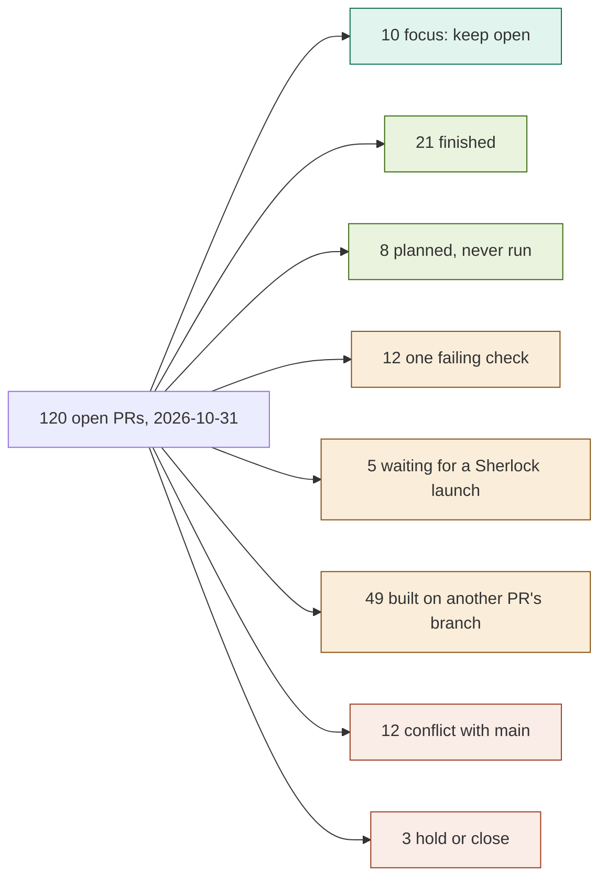

# Open PR triage, 2026-11-01

Written by Claude Code (Opus 5.5) at Olga's request. Goal: clear the list and keep open
only the current focus: SPLASH applications, OM-RGC, Botryllus RNA-seq preprocessing, and
the runs still going on Sherlock.

Built from GitHub on 2026-10-31: each PR's check runs at its head commit, whether it
merges cleanly into main, and Codex review comments. It follows the Codex review of
2026-10-23 (`reports/notebook-pr-review/2026-10-23/MERGE_QUEUE.md`). None of these PRs
had Olga's own review; she approved the merges below in chat on 2026-11-01.

Teal = keep open, green = merged today, amber = one step first, coral = close or hold.

## Merged on 2026-11-01

Each PR was merged only after a fresh check that it was open, based on main, merged
cleanly, and had every check run green at its head commit. The merge was pinned to that
commit.

- Finished (21): 67, 75, 76, 84, 93, 113, 118, 120, 121, 125, 126, 143, 177, 179, 193,
  166, 160, 97, 171, 206, and 158. PR 158 conflicted with main after PR 160 merged
  (both added targets to one `.PHONY` list in
  `nextflow-runs/qfo-pfam-region-benchmark/Makefile`); main was merged into it keeping
  both, then it was merged.
- Planned but never run, merged as a record (8): 122, 183, 186, 188, 189, 191, 199,
  and 195. PR 195 failed black on `notebooks/isoform_blank_exons_359.py`; that one file
  was reformatted, then it was merged.

Main's black and lint checks passed after the merges.

## PNG fixes merged on 2026-11-01

Olga asked for the 11 PRs that failed only the 256-colour PNG check to be fixed and
merged. On each branch: main merged in, `scripts/shrink_png.py` (main's copy) run on the
PNGs and notebooks the PR adds or changes, then merged once every check passed. Merged:
141, 172, 173, 176, 190, 192, 194, 54, 63, 140, 169. 48 analysis PRs remain open.

- 190 and 54 also failed the notebooks job; that job runs the same PNG hook, and the
  shrink fixed it. 54 also needed black on its notebook and `bits_ceiling_utils.py`.
- 176 conflicted with main in notebook 294, which PR 143 had merged. Main's copy is
  newer (it has the finished kmerseek chaining results), so both nb294 files were set
  to main's copy. PR 176 is about notebook 346 and no longer changes notebook 294.
- 54 then conflicted with main in notebook 245, because 176 carried an older copy of it
  with one review wording pass. In each conflicting block 54's own text was kept: PR 54
  owns notebook 245 and its latest wording edit was reviewed at its head commit.

## Bases changed to main on 2026-11-01

Olga asked for every open PR whose base branch belongs to a merged or closed PR to point
at main instead. 21 such PRs; 19 changed. GitHub refused 83 and 146 ("part of a stack"),
so they still point at their old bases.

- Merge cleanly into main (10): 128, 129, 130, 131, 134, 139, 145, 156, 184, and 161.
  161 merges but its "scoring, metrics and report" check failed. The check results on
  all ten are from before the base changed; GitHub does not rerun them for a base change,
  so each needs a new push or rerun before it can merge.
  Rerun against main the same day (each PR closed and reopened, which starts fresh
  `pull_request` runs): 8 pass every check: 128, 129, 130, 131, 134, 145, 156, 184.
  139 fails the 256-colour check, in both the PNG workflow and the notebooks job:
  `notebooks/284_exact_run_vs_blosum62_segment_pfam_seed.ipynb` would shrink from 890 KB
  to 503 KB. 161 fails one test, `test_refdb_calls.py::test_both_parsers_reproduce_the_committed_fixture`:
  one score differs in the last digit (`4.481486060122112` against `...113`, ZNF99 PF00096).
- Conflict with main (9): 52, 85, 96, 106, 119, 148, 149, 152, 175.
- 85, 96, 106, 148 and 149 sat on branches that had commits after their PR merged, or
  whose PR was closed. Those commits are now part of their diffs.

## Closed on 2026-11-01

Olga approved these in chat. Each got a comment saying why; every branch was kept, so
any of them can be reopened. 33 closed, which leaves 59 analysis PRs open. The 11 PNG merges above came
after this step, which takes the count to 48.

- ELM motif and combiner chain (12): 51, 58, 92, 69, 71, 72, 87, 88, 98, 102, 103, 104.
- Notebook 244 example-case chain (5): 49, 77, 78, 80, 82.
- Dark-set kmerseek 0.4 chain (6): 30, 57, 47, 133, 155, 163.
- Conflicting with main, outside the focus (9 more): 59, 64, 65, 66, 101, 107, 123, 135,
  144. (49 and 51 are counted in their chains above. 174 stays open.)
- Out-of-date progress summary: 127.

PRs built on a closed PR's branch stay open: 149 (on 123) and 146, 148, 154, 164, 165
(the leaderboard chain on 144).

## Still open (as of the merges, before the closures)

**Focus, keep open (10).** SPLASH and RNA-seq: 201 (nb361 PEC, running), 207, 197, 198,
203. Oyster and Shazam: 202, 205 (built on 202), 204. Sketching at scale: 208, 209.
No OM-RGC PR is open: PR 170 (pilot, stopped at step 3) merged on 10-23, so the next
OM-RGC step needs a new PR.

**One failing check (11 left).** 141, 172, 173, 176, 190, 192, 194, 54, 63, 140, 169 fail
the 256-colour PNG check. 196 failed black at triage time.

**Waiting for a Sherlock launch (5).** 182 (resume 16 tasks that ran out of memory),
185 (344 gate rerun on kmerseek PR 157), 124 and 132 (BHF chained rescore), 130 (needs
283's indexes). Each needs a decision: launch or park.

**Built on another PR's branch (49).** 30, 47, 52, 53, 57, 58, 69, 71, 72, 77, 78, 80, 82,
83, 85, 87, 88, 92, 96, 98, 102, 103, 104, 106, 119, 128, 129, 131, 133, 134, 139, 145,
146, 148, 149, 152, 154, 155, 156, 161, 162, 163, 164, 165, 167, 168, 175, 180, 184.

- 30, 52, 83, 85, 96, 106, 119, 139, 145, 184 point at a branch that is already merged;
  their base should change to main first.
- With 120 and 125 merged today, 134 and 128, 129, 131 now sit on merged branches too.
- Old chains proposed for closing: ELM and combiners (51 → 58, 92, 69, 71 → 72 → 87 → 88
  → 98 → 102 → 103 → 104), the nb244 gallery (49 → 77, 78 → 80, 82), and the dark-set
  0.4 chain (30 → 57 → 47, 133, 155; 133 → 163). The Codex review found their source
  data missing, and that 57's conclusion counts duplicated calls.

**Conflict with main (12).** 49, 51, 59, 64, 65, 66, 101, 107, 123, 135, 144, 174. Only 174
(the 344 NO-GO result, which 185 depends on) is worth rebasing; the rest are proposed
for closing.

**Hold or close (3).** Hold 114 (pipeline not yet checked). Close 127 (progress summary
from 10-13, out of date). 150 (PR notes template): Olga's call.

## Sherlock, 2026-10-31

- `nf-pec361`, nb361 PEC SPLASH (PR 201): one task left, `search (young_24h compactors)`.
- `nfdrv-annotation-full`, Botryllus annotation: 20 S4PRED tasks.
- `kss-floor`, Botryllus against Swiss-Prot (botryllus-mhc PR 14): 199 kmerseek searches,
  58 running and 161 waiting.

## Other repos (not changed)

- seanome/kmerseek (25 open): the tool itself; Olga's review is the gate.
- Leaderboard (34 open): a separate project, parked.
- olgabot/claude-skills (7 open): 13 conflicts with main.
- Proposed for closing as stale (2024 to April 2026): botryllus-mhc 4, 6, 8, 9;
  arctic-clam 4, 6; nf-core-kmerseek 3; seanome.org 17; refresh-bio/SPLASH 22.
