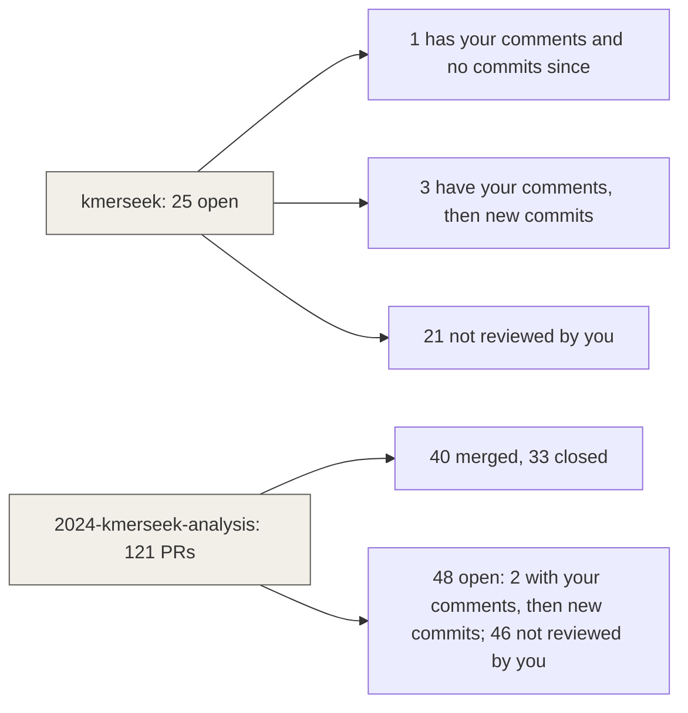

# Weekly PR status, 2026-W44 (Oct 26 to Nov 1)

Written by Claude Code (Opus 5.5) at Olga's request, from `pr_status.py --week 2026-W44`
and `review_comments.py --week 2026-W44`, run on 2026-11-01. A PR is listed if it was
opened, closed or merged this week, or is open now. Open PRs counted a second way
(`gh api .../pulls?state=open --paginate`): 25 in kmerseek, 48 here. Both match the tables.



**How "reviewed" was decided.** `gh` posts as olgabot, so the nightly Claude reviews and
Codex reviews show up as olgabot's reviews. The script counted them as yours, which made
almost every analysis PR look reviewed. These tables count a PR as reviewed by you only if
it has a comment from olgabot with text and without "Written by", "Generated by", "Codex",
"Claude" or "nightly" in it. Six open PRs pass: kmerseek 113, 133, 137, 152 and analysis
52, 119. A comment of yours that mentions Claude by name would be missed.

Review column legend: ✅ date = a /rustacean-review or /analysis-review comment names the
PR's current head commit. ⚠️ date, commits since = the review comment names an older commit.
☐ = no review comment. These skill reviews are not your review.

## Tables

### seanome/kmerseek: 0 merged, 25 open, 0 closed without merging

| PR | What it does | Status | rustacean-review | Why it's still open |
|---|---|---|---|---|
| [#113](https://github.com/seanome/kmerseek/pull/113) | Extend regions when there is no Karlin-Altschul fit, instead of … | Open | ⚠️ Sep 30, commits since | Your comments have no new commits after them yet. Its target `olgabot/run-evalue-v2` had PR #112 closed without merging, so there is no route into `main`. Only the formatting check ran, not the tests. |
| [#114](https://github.com/seanome/kmerseek/pull/114) | Extend matched regions by default when the index holds a … | Open | ⚠️ Sep 30, commits since | **Not reviewed.** Targets #113. Only the formatting check ran, not the tests. |
| [#130](https://github.com/seanome/kmerseek/pull/130) | Add the mid-p run E-value, and score the decoy test … | Open | ✅ Oct 21 | **Not reviewed.** Targets #114. Only the formatting check ran, not the tests. |
| [#133](https://github.com/seanome/kmerseek/pull/133) | Give every row a run E-value, and drop the Poisson … | Open | ✅ Oct 20 | **Your comments, then new commits; needs another look.** Merge conflicts. |
| [#134](https://github.com/seanome/kmerseek/pull/134) | Test the run E-value on random sequences and on dipeptide-shuffled … | Open | ⚠️ Oct 24, commits since | **Not reviewed.** Targets #133. Only the formatting check ran, not the tests. |
| [#137](https://github.com/seanome/kmerseek/pull/137) | Remove two unused ProteomeIndex fields; fail CI on dead_code allows | Open | ✅ Oct 23 | **Your comments, then new commits; needs another look.** Merge conflicts. Only the formatting check ran, not the tests. |
| [#141](https://github.com/seanome/kmerseek/pull/141) | Key index entries by their sequence, so a target's hits … | Open | ⚠️ Oct 18, commits since | **Not reviewed.** Its target `olgabot/release-0.4.0` had PR #64 closed without merging, so there is no route into `main`. Only the formatting check ran, not the tests. |
| [#142](https://github.com/seanome/kmerseek/pull/142) | Search report: draw rows with no run, --min-runs to leave … | Open | ☐ | **Not reviewed.** |
| [#143](https://github.com/seanome/kmerseek/pull/143) | Skills: rules from Olga's review comments, Oct 5-11 | Open | ⚠️ Oct 23, commits since | **Not reviewed.** |
| [#144](https://github.com/seanome/kmerseek/pull/144) | search: --ka-r-database, to search with a fit made on another … | Open | ⚠️ Oct 20, commits since | **Not reviewed.** |
| [#145](https://github.com/seanome/kmerseek/pull/145) | Add the cys2 alphabet: cysteine against every other residue | Open | ✅ Oct 21 | **Not reviewed.** Failing: Rust Coverage, Test Rust (1.82.0), Test Rust (stable). |
| [#146](https://github.com/seanome/kmerseek/pull/146) | Add aro_hyd_chg_pol4 and aro_hyd_arg_chg_pol5 (sticker and spacer alphabets) | Open | ✅ Oct 20 | **Not reviewed.** |
| [#147](https://github.com/seanome/kmerseek/pull/147) | Add the cys2 alphabet on the v0.4.0 release | Open | ✅ Oct 20 | **Not reviewed.** Its target `olgabot/release-0.4.0` had PR #64 closed without merging, so there is no route into `main`. Only the formatting check ran, not the tests. |
| [#148](https://github.com/seanome/kmerseek/pull/148) | Add hp_pbotc_1st_ed_hpc3 (cys_hp3), and let a cys2 index be searched | Open | ⚠️ Oct 16, commits since | **Not reviewed.** Targets #145. Merge conflicts. Only the formatting check ran, not the tests. |
| [#149](https://github.com/seanome/kmerseek/pull/149) | PR template: Olga's Why and What I learned, checked before … | Open | ⚠️ Oct 18, commits since | **Not reviewed.** Failing: notes. |
| [#150](https://github.com/seanome/kmerseek/pull/150) | Draw the three cysteine-aware readings of two toxins that share … | Open | ✅ Oct 20 | **Not reviewed.** Targets #148. |
| [#152](https://github.com/seanome/kmerseek/pull/152) | Key index entries by their sequence, not their k-mer set | Open | ⚠️ Oct 18, commits since | **Your comments, then new commits; needs another look.** |
| [#153](https://github.com/seanome/kmerseek/pull/153) | Skip a query's identical database entry in every search, and … | Open | ⚠️ Oct 20, commits since | **Not reviewed.** Merge conflicts. |
| [#154](https://github.com/seanome/kmerseek/pull/154) | Count Karlin-Altschul fit regions per score bin as they are … | Open | ⚠️ Oct 20, commits since | **Not reviewed.** Merge conflicts. |
| [#155](https://github.com/seanome/kmerseek/pull/155) | Build the "expected one of" alphabet lists from Alphabet::all() | Open (draft) | ✅ Oct 23 | **Not reviewed.** Failing: Rust Coverage. |
| [#156](https://github.com/seanome/kmerseek/pull/156) | Add massspec18: the 20 residues with I=L and Q=K merged, … | Open | ⚠️ Oct 24, commits since | **Not reviewed.** |
| [#157](https://github.com/seanome/kmerseek/pull/157) | Count Pr(same class) from each region, so low-complexity regions get … | Open | ✅ Oct 24 | **Not reviewed.** Targets #134. Merge conflicts. Only the formatting check ran, not the tests. |
| [#159](https://github.com/seanome/kmerseek/pull/159) | Read the inverted index in place from posting files (Swiss-Prot … | Open | ✅ Nov 1 | **Not reviewed.** |
| [#160](https://github.com/seanome/kmerseek/pull/160) | Name protein ID lists and the k-mer-to-protein index plainly | Open | ☐ | **Not reviewed.** Targets #159. Only the formatting check ran, not the tests. |
| [#161](https://github.com/seanome/kmerseek/pull/161) | Add --max-shared-kmer-pvalue: chance-based minimum shared k-mers, measured on Swiss-Prot | Open | ⚠️ Nov 1, commits since | **Not reviewed.** |

Issues opened or closed this week: 0

39 other open issues, none opened or closed this week.

### seanome/2024-kmerseek-analysis: 40 merged, 48 open, 33 closed without merging

| PR | What it does | Status | analysis-review | Why it's still open |
|---|---|---|---|---|
| [#54](https://github.com/seanome/2024-kmerseek-analysis/pull/54) | nb245: bits an exact reduced-alphabet seed carries against bits a … | Merged Nov 1 | ⚠️ Oct 23, commits since |  |
| [#63](https://github.com/seanome/2024-kmerseek-analysis/pull/63) | E3 detection-gap benchmark: notebook 340 and a pipeline for the … | Merged Nov 1 | ⚠️ Oct 23, commits since |  |
| [#67](https://github.com/seanome/2024-kmerseek-analysis/pull/67) | nb220: BCL2/Bcl-xL vs Ced9 across all six HP alphabets, k=15-25 | Merged Nov 1 | ⚠️ Oct 23, commits since |  |
| [#75](https://github.com/seanome/2024-kmerseek-analysis/pull/75) | Notebook 238 on the full midi-plus run | Merged Nov 1 | ✅ Oct 23 |  |
| [#76](https://github.com/seanome/2024-kmerseek-analysis/pull/76) | Search ten random 2-letter partitions beside the six H/P alphabets … | Merged Nov 1 | ✅ Oct 23 |  |
| [#84](https://github.com/seanome/2024-kmerseek-analysis/pull/84) | nb255: kmerseek ranking metrics against human Pfam, with region length … | Merged Nov 1 | ✅ Oct 23 |  |
| [#93](https://github.com/seanome/2024-kmerseek-analysis/pull/93) | Nb 271: which kmerseek region score to filter on (mini … | Merged Nov 1 | ⚠️ Oct 23, commits since |  |
| [#97](https://github.com/seanome/2024-kmerseek-analysis/pull/97) | Experiment inventory, claims page, and its GitHub Pages site | Merged Nov 1 | ☐ |  |
| [#113](https://github.com/seanome/2024-kmerseek-analysis/pull/113) | nb246: seeds that allow mismatches, on CED-9/BCL2 and P66/CD47 | Merged Nov 1 | ✅ Oct 23 |  |
| [#118](https://github.com/seanome/2024-kmerseek-analysis/pull/118) | 276: structure does not support P66 mimicking CD47 | Merged Nov 1 | ✅ Oct 23 |  |
| [#120](https://github.com/seanome/2024-kmerseek-analysis/pull/120) | nb279: dark proteins kmerseek reaches at E < 1 and … | Merged Nov 1 | ✅ Oct 23 |  |
| [#121](https://github.com/seanome/2024-kmerseek-analysis/pull/121) | nb 280: time-split test, Pfam 33.1 to 38.2 (P4 fails; … | Merged Nov 1 | ✅ Oct 23 |  |
| [#122](https://github.com/seanome/2024-kmerseek-analysis/pull/122) | nb282: set up the ohnolog split-or-narrow test with Botryllus (Stages … | Merged Nov 1 | ✅ Oct 23 |  |
| [#125](https://github.com/seanome/2024-kmerseek-analysis/pull/125) | nb284: do the 19 alphabets agree on BCL2's region? Only … | Merged Nov 1 | ✅ Oct 23 |  |
| [#126](https://github.com/seanome/2024-kmerseek-analysis/pull/126) | nb281: Botryllus links to MHC, histocompatibility and self/non-self proteins | Merged Nov 1 | ✅ Oct 23 |  |
| [#140](https://github.com/seanome/2024-kmerseek-analysis/pull/140) | nb 341: condensate exons, day 1 (data access, aro_hyd_chg_pol4, BuGZ … | Merged Nov 1 | ⚠️ Oct 23, commits since |  |
| [#141](https://github.com/seanome/2024-kmerseek-analysis/pull/141) | Convergence search kill test: ice-binding proteins FAIL, truth sets for … | Merged Nov 1 | ⚠️ Oct 23, commits since |  |
| [#143](https://github.com/seanome/2024-kmerseek-analysis/pull/143) | nb294: linked HP word pairs (strobemers) kill test: KILL; gain … | Merged Nov 1 | ⚠️ Oct 23, commits since |  |
| [#158](https://github.com/seanome/2024-kmerseek-analysis/pull/158) | No-search baselines as leaderboard rows: Kyte-Doolittle, IUPred, metapredict, SEG, Pfam … | Merged Nov 1 | ⚠️ Oct 23, commits since |  |
| [#160](https://github.com/seanome/2024-kmerseek-analysis/pull/160) | Annotator tools 1: DIAMOND and MMseqs2 best-hit transfer as leaderboard … | Merged Nov 1 | ✅ Oct 23 |  |
| [#166](https://github.com/seanome/2024-kmerseek-analysis/pull/166) | SCOPe40 hit lists for every Table 1 tool, scored per … | Merged Nov 1 | ✅ Oct 23 |  |
| [#169](https://github.com/seanome/2024-kmerseek-analysis/pull/169) | eDNA market: who pays, where DNA naming fails, would protein … | Merged Nov 1 | ⚠️ Oct 23, commits since |  |
| [#171](https://github.com/seanome/2024-kmerseek-analysis/pull/171) | Weekly PR status, 2026-W42 (Oct 12-18) | Merged Nov 1 | ☐ |  |
| [#172](https://github.com/seanome/2024-kmerseek-analysis/pull/172) | nb345: does one more proteome add new sequence? Pipeline and … | Merged Nov 1 | ⚠️ Oct 23, commits since |  |
| [#173](https://github.com/seanome/2024-kmerseek-analysis/pull/173) | nb343: same reduced k-mers, new order is possible only at … | Merged Nov 1 | ⚠️ Oct 23, commits since |  |
| [#176](https://github.com/seanome/2024-kmerseek-analysis/pull/176) | nb346: linked HP word pairs at database scale on known … | Merged Nov 1 | ⚠️ Oct 29, commits since |  |
| [#177](https://github.com/seanome/2024-kmerseek-analysis/pull/177) | nb347: mutations a reduced alphabet cannot see, PTEN abundance (VAMP-seq) | Merged Nov 1 | ⚠️ Nov 1, commits since |  |
| [#179](https://github.com/seanome/2024-kmerseek-analysis/pull/179) | nb350: kmerseek loses toxin-framework hits in ranking, not in seeds; … | Merged Nov 1 | ⚠️ Nov 1, commits since |  |
| [#183](https://github.com/seanome/2024-kmerseek-analysis/pull/183) | nb352: time kmerseek's index build and 1,000 queries at 1, … | Merged Nov 1 | ⚠️ Nov 1, commits since |  |
| [#186](https://github.com/seanome/2024-kmerseek-analysis/pull/186) | Construct insert check: frozen plan, templates, pipeline, INSUFFICIENT_EVIDENCE | Merged Nov 1 | ✅ Nov 1 |  |
| [#188](https://github.com/seanome/2024-kmerseek-analysis/pull/188) | nb353: does kmerseek find existing measurements faster? Pipeline built; no … | Merged Nov 1 | ⚠️ Nov 1, commits since |  |
| [#189](https://github.com/seanome/2024-kmerseek-analysis/pull/189) | nb355: construct-check kill test is NOT RUN, the 200 facility … | Merged Nov 1 | ✅ Nov 1 |  |
| [#190](https://github.com/seanome/2024-kmerseek-analysis/pull/190) | nb356: kmerseek lands on short exons ~3 points above a … | Merged Nov 1 | ⚠️ Nov 1, commits since |  |
| [#191](https://github.com/seanome/2024-kmerseek-analysis/pull/191) | nb 357: pre-registration, Stop 0 (P2 holds) and Stop 1 … | Merged Nov 1 | ⚠️ Nov 1, commits since |  |
| [#192](https://github.com/seanome/2024-kmerseek-analysis/pull/192) | nb358: peptide source lookup, reduced vs full alphabet; NovoBoard (PXD055277) … | Merged Nov 1 | ⚠️ Nov 1, commits since |  |
| [#193](https://github.com/seanome/2024-kmerseek-analysis/pull/193) | nb354: kill test, kmerseek massspec18 source lookup for de novo … | Merged Nov 1 | ✅ Nov 1 |  |
| [#194](https://github.com/seanome/2024-kmerseek-analysis/pull/194) | 241: search hp_lehninger_hpc3 k21 with exact regions, as recorded, and … | Merged Nov 1 | ⚠️ Nov 1, commits since |  |
| [#195](https://github.com/seanome/2024-kmerseek-analysis/pull/195) | nb 359: kill test, region calls on alternative exons that … | Merged Nov 1 | ⚠️ Nov 1, commits since |  |
| [#199](https://github.com/seanome/2024-kmerseek-analysis/pull/199) | nb300: peptide lookup gate, query set, and measured index-build plan | Merged Nov 1 | ⚠️ Nov 1, commits since |  |
| [#206](https://github.com/seanome/2024-kmerseek-analysis/pull/206) | Weekly PR status, 2026-W43 (Oct 19-25) | Merged Nov 1 | ✅ Nov 1 |  |
| [#52](https://github.com/seanome/2024-kmerseek-analysis/pull/52) | Region pipeline: ungapped kmerseek extension with an E-value, opened comparator … | Open | ✅ Oct 23 | **Your comments, then new commits; needs another look.** Merge conflicts. |
| [#53](https://github.com/seanome/2024-kmerseek-analysis/pull/53) | DisProt functional-region transfer benchmark: data, scoring with controls, notebook 251 | Open | ✅ Oct 23 | **Not reviewed.** Targets #52. Failing: black. |
| [#83](https://github.com/seanome/2024-kmerseek-analysis/pull/83) | 256: BHF against 300 dipeptide-shuffled copies of itself | Open | ✅ Oct 23 | **Not reviewed.** Its target branch is already in `main`; retarget to `main`. Merge conflicts. Failing: black. |
| [#85](https://github.com/seanome/2024-kmerseek-analysis/pull/85) | 257: rerun the 998-protein search with a newer kmerseek (every … | Open | ⚠️ Oct 23, commits since | **Not reviewed.** Merge conflicts. Failing: black. |
| [#96](https://github.com/seanome/2024-kmerseek-analysis/pull/96) | 245: where the P66/CD47 shared k-mers sit, and whether they … | Open | ⚠️ Oct 23, commits since | **Not reviewed.** Merge conflicts. Failing: black. |
| [#106](https://github.com/seanome/2024-kmerseek-analysis/pull/106) | Supplementary Figure 1 (alphabets, bits, k-sizes to test) and seed … | Open | ✅ Oct 23 | **Not reviewed.** Merge conflicts. |
| [#114](https://github.com/seanome/2024-kmerseek-analysis/pull/114) | Regions-index pilot: three indexes, full run, Pfam result | Open | ✅ Oct 23 | **Not reviewed.** |
| [#119](https://github.com/seanome/2024-kmerseek-analysis/pull/119) | nb278: no alphabet beats BLOSUM62, but H/P leads exact matching … | Open | ✅ Oct 23 | **Your comments, then new commits; needs another look.** Merge conflicts. |
| [#124](https://github.com/seanome/2024-kmerseek-analysis/pull/124) | 283: does BHF beat copies that keep its low-complexity stretches? … | Open | ⚠️ Oct 23, commits since | **Not reviewed.** Targets #83. |
| [#128](https://github.com/seanome/2024-kmerseek-analysis/pull/128) | nb285: pooling kmerseek calls across the BCL-2 family ranks it … | Open | ✅ Oct 23 | **Not reviewed.** |
| [#129](https://github.com/seanome/2024-kmerseek-analysis/pull/129) | 288: Ced9 → BCL2 and P66 → CD47 as pairwise … | Open | ✅ Oct 23 | **Not reviewed.** |
| [#130](https://github.com/seanome/2024-kmerseek-analysis/pull/130) | 286: can kmerseek reach BCL2 from Ced9 through a human … | Open | ✅ Oct 23 | **Not reviewed.** |
| [#131](https://github.com/seanome/2024-kmerseek-analysis/pull/131) | nb287: sum statistics do not rescue Ced9 → BCL2 or … | Open | ✅ Oct 23 | **Not reviewed.** |
| [#132](https://github.com/seanome/2024-kmerseek-analysis/pull/132) | 289: reverse search: the BCL-2 family ranks Ced9 30th of … | Open | ✅ Oct 23 | **Not reviewed.** Targets #124. Failing: black. |
| [#134](https://github.com/seanome/2024-kmerseek-analysis/pull/134) | 290: dark proteins kmerseek reaches against shuffled copies (Stop 1) | Open | ✅ Oct 23 | **Not reviewed.** |
| [#139](https://github.com/seanome/2024-kmerseek-analysis/pull/139) | nb284: what an exact k-mer counts that BLOSUM62 does not, … | Open | ⚠️ Oct 23, commits since | **Not reviewed.** Failing: check. |
| [#145](https://github.com/seanome/2024-kmerseek-analysis/pull/145) | cys-frameworks: cysteine-framework peptide pipeline; pilot runs on Sherlock | Open | ✅ Oct 23 | **Not reviewed.** |
| [#146](https://github.com/seanome/2024-kmerseek-analysis/pull/146) | make leaderboard-pileup: tables for the region pile-up figure | Open | ✅ Oct 23 | **Not reviewed.** Its target `olgabot/leaderboard-tables` had PR #144 closed without merging, so there is no route into `main`. Merge conflicts. |
| [#148](https://github.com/seanome/2024-kmerseek-analysis/pull/148) | leaderboard-tables: one long table of every finished benchmark | Open | ✅ Oct 23 | **Not reviewed.** Merge conflicts. |
| [#149](https://github.com/seanome/2024-kmerseek-analysis/pull/149) | Script to rewrite history so past figures are 256-colour PNGs | Open | ✅ Oct 23 | **Not reviewed.** Merge conflicts. |
| [#150](https://github.com/seanome/2024-kmerseek-analysis/pull/150) | PR template: Olga's Why and What I learned, checked before … | Open | ✅ Oct 23 | **Not reviewed.** |
| [#152](https://github.com/seanome/2024-kmerseek-analysis/pull/152) | nb342: exon function kill test, Stops 0-4: KILL on three … | Open | ✅ Oct 23 | **Not reviewed.** Merge conflicts. |
| [#154](https://github.com/seanome/2024-kmerseek-analysis/pull/154) | Leaderboard: read the Pfam pair benchmark, DisProt cost and k-mer … | Open | ✅ Oct 23 | **Not reviewed.** Targets #148. |
| [#156](https://github.com/seanome/2024-kmerseek-analysis/pull/156) | Submission guide: CONTRIBUTING.md for host-run tool modules, and a hits-format … | Open | ✅ Oct 23 | **Not reviewed.** |
| [#161](https://github.com/seanome/2024-kmerseek-analysis/pull/161) | Annotator tools 2: InterProScan and eggNOG-mapper as reference-database rows | Open | ✅ Oct 23 | **Not reviewed.** Failing: scoring, metrics and report. |
| [#162](https://github.com/seanome/2024-kmerseek-analysis/pull/162) | Annotator tools 3: TM-Vec and PLMSearch embedding search rows | Open | ✅ Oct 23 | **Not reviewed.** Targets #161. Failing: scoring, metrics and report. |
| [#164](https://github.com/seanome/2024-kmerseek-analysis/pull/164) | Leaderboard query strata: eight subsets an annotator can compute, for … | Open | ✅ Oct 23 | **Not reviewed.** Targets #148. |
| [#165](https://github.com/seanome/2024-kmerseek-analysis/pull/165) | Pfam-N recall: count only regions on the proteins each run … | Open | ✅ Oct 23 | **Not reviewed.** Targets #148. |
| [#167](https://github.com/seanome/2024-kmerseek-analysis/pull/167) | nb296: cysteine-framework pilot, Cnidaria, kmerseek vs phmmer and regex | Open | ✅ Oct 23 | **Not reviewed.** Targets #145. Failing: check. |
| [#168](https://github.com/seanome/2024-kmerseek-analysis/pull/168) | nb297: cys_hp3 phylum run, kmerseek vs phmmer and the cysteine … | Open | ✅ Oct 23 | **Not reviewed.** Targets #167. |
| [#174](https://github.com/seanome/2024-kmerseek-analysis/pull/174) | 344: kmerseek 0.4.0 region E-values fail calibration on 309,000 decoys … | Open | ✅ Oct 23 | **Not reviewed.** Merge conflicts. |
| [#175](https://github.com/seanome/2024-kmerseek-analysis/pull/175) | nb298: linked word pairs do not reach ice-binding proteins of … | Open | ✅ Oct 23 | **Not reviewed.** Merge conflicts. |
| [#180](https://github.com/seanome/2024-kmerseek-analysis/pull/180) | Venom-peptide retrieval: cysteine framework, fold and target are three questions | Open | ⚠️ Nov 1, commits since | **Not reviewed.** Targets #145. |
| [#182](https://github.com/seanome/2024-kmerseek-analysis/pull/182) | nb301: three short-feature settings give partial DROP; resume 16 memory … | Open | ⚠️ Nov 1, commits since | **Not reviewed.** Failing: check. |
| [#184](https://github.com/seanome/2024-kmerseek-analysis/pull/184) | nb353: short-stretch evidence lookup kill test: not run (no real … | Open | ⚠️ Nov 1, commits since | **Not reviewed.** |
| [#185](https://github.com/seanome/2024-kmerseek-analysis/pull/185) | 344 gate rerun on kmerseek PR 157 (Pr(same) from each … | Open | ✅ Nov 1 | **Not reviewed.** Targets #174. |
| [#196](https://github.com/seanome/2024-kmerseek-analysis/pull/196) | nb357: clade-grouped SPLASH experiment stopped; results preserved | Open | ⚠️ Oct 29, commits since | **Not reviewed.** Merge conflicts. Failing: black. |
| [#197](https://github.com/seanome/2024-kmerseek-analysis/pull/197) | Botryllus RNA-seq: nf-core/rnaseq pre-processing only, on Sherlock | Open | ⚠️ Nov 1, commits since | **Not reviewed.** Failing: check. |
| [#198](https://github.com/seanome/2024-kmerseek-analysis/pull/198) | Freeze RNA-seq kill-test rules and add pre-run checks | Open | ⚠️ Nov 1, commits since | **Not reviewed.** |
| [#201](https://github.com/seanome/2024-kmerseek-analysis/pull/201) | nb361: Domen et al. 2026 PEC RNA-seq without a genome … | Open | ⚠️ Nov 1, commits since | **Not reviewed.** |
| [#202](https://github.com/seanome/2024-kmerseek-analysis/pull/202) | Extend oyster anchors and validate corrected peptide migration | Open | ⚠️ Nov 1, commits since | **Not reviewed.** Failing: check. |
| [#203](https://github.com/seanome/2024-kmerseek-analysis/pull/203) | Recover Botryllus trimmed reads and migrate Shazam to Nextflow | Open | ⚠️ Nov 1, commits since | **Not reviewed.** |
| [#204](https://github.com/seanome/2024-kmerseek-analysis/pull/204) | Shazam for Biology: metro maps of the oyster and PEC … | Open | ⚠️ Nov 1, commits since | **Not reviewed.** Failing: check. |
| [#205](https://github.com/seanome/2024-kmerseek-analysis/pull/205) | Add standalone Rust Orpheum-style read screening | Open | ✅ Nov 1 | **Not reviewed.** Targets #202. |
| [#207](https://github.com/seanome/2024-kmerseek-analysis/pull/207) | Botryllus PEC young colonies: treated vs control per time window, … | Open | ⚠️ Nov 1, commits since | **Not reviewed.** |
| [#208](https://github.com/seanome/2024-kmerseek-analysis/pull/208) | Expression index: runs list, N-codon translation, k per alphabet | Open | ⚠️ Nov 1, commits since | **Not reviewed.** |
| [#209](https://github.com/seanome/2024-kmerseek-analysis/pull/209) | SRA and Logan protein sketch cost estimate, measured on Sherlock | Open | ⚠️ Nov 1, commits since | **Not reviewed.** |
| [#210](https://github.com/seanome/2024-kmerseek-analysis/pull/210) | Open PR triage, 2026-11-01: 29 merged, rest sorted by next … | Open | ☐ | **Not reviewed.** |
| [#30](https://github.com/seanome/2024-kmerseek-analysis/pull/30) | Measure the dark set: what conventional sequence search misses on … | Closed, not merged Nov 1 | ✅ Oct 23 |  |
| [#47](https://github.com/seanome/2024-kmerseek-analysis/pull/47) | Add Pfam profile annotations to the dark set | Closed, not merged Nov 1 | ✅ Oct 23 |  |
| [#49](https://github.com/seanome/2024-kmerseek-analysis/pull/49) | Add notebook 244: hero example candidates on the Swiss-Prot feature … | Closed, not merged Nov 1 | ✅ Oct 23 |  |
| [#51](https://github.com/seanome/2024-kmerseek-analysis/pull/51) | Add the ELM motif benchmark (notebook 250): Stage 0, target … | Closed, not merged Nov 1 | ✅ Oct 23 |  |
| [#57](https://github.com/seanome/2024-kmerseek-analysis/pull/57) | Dark set with kmerseek 0.4: the midi run, and a … | Closed, not merged Nov 1 | ✅ Oct 23 |  |
| [#58](https://github.com/seanome/2024-kmerseek-analysis/pull/58) | Score the ELM cover search: motif cover per arm, placement … | Closed, not merged Nov 1 | ✅ Oct 23 |  |
| [#59](https://github.com/seanome/2024-kmerseek-analysis/pull/59) | Give the Swiss-Prot identity axis a Pfam anchor | Closed, not merged Nov 1 | ✅ Oct 23 |  |
| [#64](https://github.com/seanome/2024-kmerseek-analysis/pull/64) | Run the family-AUC, RBH-F1 and leaderboard sweeps on Sherlock | Closed, not merged Nov 1 | ✅ Oct 23 |  |
| [#65](https://github.com/seanome/2024-kmerseek-analysis/pull/65) | nb24: k-mer spectra across all alphabets, with nine saved figures | Closed, not merged Nov 1 | ⚠️ Oct 23, commits since |  |
| [#66](https://github.com/seanome/2024-kmerseek-analysis/pull/66) | Pfam subdomain benchmark: split positive pairs into DIAMOND-hard and DIAMOND-easy | Closed, not merged Nov 1 | ✅ Oct 23 |  |
| [#69](https://github.com/seanome/2024-kmerseek-analysis/pull/69) | nb253: are ELM motifs put on position on the chicken … | Closed, not merged Nov 1 | ✅ Oct 23 |  |
| [#71](https://github.com/seanome/2024-kmerseek-analysis/pull/71) | kmerseek search: keep each query's best N targets, and pin … | Closed, not merged Nov 1 | ✅ Oct 23 |  |
| [#72](https://github.com/seanome/2024-kmerseek-analysis/pull/72) | ELM cover on seven more species: 19 arms chosen on … | Closed, not merged Nov 1 | ✅ Oct 23 |  |
| [#77](https://github.com/seanome/2024-kmerseek-analysis/pull/77) | nb254: seed extension loses notebook 244's short placements | Closed, not merged Nov 1 | ✅ Oct 23 |  |
| [#78](https://github.com/seanome/2024-kmerseek-analysis/pull/78) | nb244: figures, call coordinates, kmerseek pair and hits pages for … | Closed, not merged Nov 1 | ✅ Oct 23 |  |
| [#80](https://github.com/seanome/2024-kmerseek-analysis/pull/80) | Case gallery: reference pairs, other tools, and every shared k-mer | Closed, not merged Nov 1 | ✅ Oct 23 |  |
| [#82](https://github.com/seanome/2024-kmerseek-analysis/pull/82) | 244: two bonus cases, Ced-9/BCL2 and BHF | Closed, not merged Nov 1 | ✅ Oct 23 |  |
| [#87](https://github.com/seanome/2024-kmerseek-analysis/pull/87) | nb270: --scaled 1-10 on the mini set, with decoy queries | Closed, not merged Nov 1 | ⚠️ Oct 23, commits since |  |
| [#88](https://github.com/seanome/2024-kmerseek-analysis/pull/88) | midi-plus 0.4 with extension, and its shuffled-query twin (nb 260) | Closed, not merged Nov 1 | ✅ Oct 23 |  |
| [#92](https://github.com/seanome/2024-kmerseek-analysis/pull/92) | Figure: bits of information per letter for all 19 alphabets | Closed, not merged Nov 1 | ✅ Oct 23 |  |
| [#98](https://github.com/seanome/2024-kmerseek-analysis/pull/98) | nb261: combiner A, intersection of a fixed panel of alphabet-ksize … | Closed, not merged Nov 1 | ✅ Oct 23 |  |
| [#101](https://github.com/seanome/2024-kmerseek-analysis/pull/101) | 274: the k-sizes to test per alphabet, from k_min to … | Closed, not merged Nov 1 | ✅ Oct 23 |  |
| [#102](https://github.com/seanome/2024-kmerseek-analysis/pull/102) | nb262: combiner B, best of n alphabet-ksize pairs | Closed, not merged Nov 1 | ✅ Oct 23 |  |
| [#103](https://github.com/seanome/2024-kmerseek-analysis/pull/103) | nb263: combiner C, a consensus vote across alphabet-ksize pairs | Closed, not merged Nov 1 | ✅ Oct 23 |  |
| [#104](https://github.com/seanome/2024-kmerseek-analysis/pull/104) | nb264: the three combiners, the single best pair, phmmer and … | Closed, not merged Nov 1 | ✅ Oct 23 |  |
| [#107](https://github.com/seanome/2024-kmerseek-analysis/pull/107) | SCOPe40 family and superfamily sensitivity with kmerseek 0.4: 19 alphabets, … | Closed, not merged Nov 1 | ✅ Oct 23 |  |
| [#123](https://github.com/seanome/2024-kmerseek-analysis/pull/123) | Figures as 256-colour PNGs: pf.save, shrink_png, and 321 committed PNGs | Closed, not merged Nov 1 | ✅ Oct 23 |  |
| [#127](https://github.com/seanome/2024-kmerseek-analysis/pull/127) | Progress summary for readers without the local chats (2026-10-13) | Closed, not merged Nov 1 | ✅ Oct 23 |  |
| [#133](https://github.com/seanome/2024-kmerseek-analysis/pull/133) | Dark set: summary page for the 0.4 midi run (five … | Closed, not merged Nov 1 | ✅ Oct 23 |  |
| [#135](https://github.com/seanome/2024-kmerseek-analysis/pull/135) | make running: a task under its head's launch folder goes … | Closed, not merged Nov 1 | ✅ Oct 23 |  |
| [#144](https://github.com/seanome/2024-kmerseek-analysis/pull/144) | make leaderboard-tables: the tables the leaderboard site reads | Closed, not merged Nov 1 | ✅ Oct 23 |  |
| [#155](https://github.com/seanome/2024-kmerseek-analysis/pull/155) | Dark set: Foldseek and ProstT5 on every query, rules and … | Closed, not merged Nov 1 | ✅ Oct 23 |  |
| [#163](https://github.com/seanome/2024-kmerseek-analysis/pull/163) | Dark set: is a weak best hit right? Every tool … | Closed, not merged Nov 1 | ✅ Oct 23 |  |

Issues opened or closed this week: 0

5 other open issues, none opened or closed this week.
## What to review first

- **kmerseek PR 152**: you left 9 comments on Oct 30, and commits landed after them.
  Kmerseek PR 141 makes the same change ("key index entries by their sequence") on the
  0.4.0 release branch, whose PR was closed.
- **kmerseek PR 133, then 134, then 157**: analysis PR 185 (the 344 gate rerun) is waiting
  on kmerseek PR 157, and 157 sits on 134, which sits on 133. 133 has your comments and
  new commits since, and it conflicts with `main`.
- **The analysis focus PRs (201, 207, 197, 198, 203, 202, 205, 204, 208, 209)**: none has a
  comment from you. 201 is the nb361 run that is still going on Sherlock.
- **kmerseek PR 113 → 114 → 130**: their bottom branch had PR 112 closed without merging,
  so this stack has no way into `main` until 113 is moved onto it.

## To-do list for Notion

In review order: the PR others are built on first, then the PRs built on it, then the rest
by urgency.

```markdown
## kmerseek
- [ ] [#152](https://github.com/seanome/kmerseek/pull/152) Key index entries by their sequence, not their k-mer set: Your comments, then new commits; needs another look.
- [ ] [#133](https://github.com/seanome/kmerseek/pull/133) Give every row a run E-value, and drop the Poisson …: Your comments, then new commits; needs another look. Merge conflicts.
- [ ] [#134](https://github.com/seanome/kmerseek/pull/134) Test the run E-value on random sequences and on dipeptide-shuffled …: Not reviewed. Targets #133. Only the formatting check ran, not the tests.
- [ ] [#157](https://github.com/seanome/kmerseek/pull/157) Count Pr(same class) from each region, so low-complexity regions get …: Not reviewed. Targets #134. Merge conflicts. Only the formatting check ran, not the tests.
- [ ] [#145](https://github.com/seanome/kmerseek/pull/145) Add the cys2 alphabet: cysteine against every other residue: Not reviewed. Failing: Rust Coverage, Test Rust (1.82.0), Test Rust (stable).
- [ ] [#148](https://github.com/seanome/kmerseek/pull/148) Add hp_pbotc_1st_ed_hpc3 (cys_hp3), and let a cys2 index be searched: Not reviewed. Targets #145. Merge conflicts. Only the formatting check ran, not the tests.
- [ ] [#150](https://github.com/seanome/kmerseek/pull/150) Draw the three cysteine-aware readings of two toxins that share …: Not reviewed. Targets #148.
- [ ] [#159](https://github.com/seanome/kmerseek/pull/159) Read the inverted index in place from posting files (Swiss-Prot …: Not reviewed.
- [ ] [#160](https://github.com/seanome/kmerseek/pull/160) Name protein ID lists and the k-mer-to-protein index plainly: Not reviewed. Targets #159. Only the formatting check ran, not the tests.
- [ ] [#113](https://github.com/seanome/kmerseek/pull/113) Extend regions when there is no Karlin-Altschul fit, instead of …: Your comments have no new commits after them yet. Its target `olgabot/run-evalue-v2` had PR #112 closed without merging, so there is no route into `main`. Only the formatting check ran, not the tests.
- [ ] [#114](https://github.com/seanome/kmerseek/pull/114) Extend matched regions by default when the index holds a …: Not reviewed. Targets #113. Only the formatting check ran, not the tests.
- [ ] [#130](https://github.com/seanome/kmerseek/pull/130) Add the mid-p run E-value, and score the decoy test …: Not reviewed. Targets #114. Only the formatting check ran, not the tests.
- [ ] [#137](https://github.com/seanome/kmerseek/pull/137) Remove two unused ProteomeIndex fields; fail CI on dead_code allows: Your comments, then new commits; needs another look. Merge conflicts. Only the formatting check ran, not the tests.
- [ ] [#153](https://github.com/seanome/kmerseek/pull/153) Skip a query's identical database entry in every search, and …: Not reviewed. Merge conflicts.
- [ ] [#154](https://github.com/seanome/kmerseek/pull/154) Count Karlin-Altschul fit regions per score bin as they are …: Not reviewed. Merge conflicts.
- [ ] [#161](https://github.com/seanome/kmerseek/pull/161) Add --max-shared-kmer-pvalue: chance-based minimum shared k-mers, measured on Swiss-Prot: Not reviewed.
- [ ] [#142](https://github.com/seanome/kmerseek/pull/142) Search report: draw rows with no run, --min-runs to leave …: Not reviewed.
- [ ] [#144](https://github.com/seanome/kmerseek/pull/144) search: --ka-r-database, to search with a fit made on another …: Not reviewed.
- [ ] [#146](https://github.com/seanome/kmerseek/pull/146) Add aro_hyd_chg_pol4 and aro_hyd_arg_chg_pol5 (sticker and spacer alphabets): Not reviewed.
- [ ] [#156](https://github.com/seanome/kmerseek/pull/156) Add massspec18: the 20 residues with I=L and Q=K merged, …: Not reviewed.
- [ ] [#155](https://github.com/seanome/kmerseek/pull/155) Build the "expected one of" alphabet lists from Alphabet::all(): Not reviewed. Failing: Rust Coverage.
- [ ] [#143](https://github.com/seanome/kmerseek/pull/143) Skills: rules from Olga's review comments, Oct 5-11: Not reviewed.
- [ ] [#149](https://github.com/seanome/kmerseek/pull/149) PR template: Olga's Why and What I learned, checked before …: Not reviewed. Failing: notes.
- [ ] [#141](https://github.com/seanome/kmerseek/pull/141) Key index entries by their sequence, so a target's hits …: Not reviewed. Its target `olgabot/release-0.4.0` had PR #64 closed without merging, so there is no route into `main`. Only the formatting check ran, not the tests.
- [ ] [#147](https://github.com/seanome/kmerseek/pull/147) Add the cys2 alphabet on the v0.4.0 release: Not reviewed. Its target `olgabot/release-0.4.0` had PR #64 closed without merging, so there is no route into `main`. Only the formatting check ran, not the tests.

## 2024-kmerseek-analysis
- [ ] [#201](https://github.com/seanome/2024-kmerseek-analysis/pull/201) nb361: Domen et al. 2026 PEC RNA-seq without a genome …: Not reviewed.
- [ ] [#207](https://github.com/seanome/2024-kmerseek-analysis/pull/207) Botryllus PEC young colonies: treated vs control per time window, …: Not reviewed.
- [ ] [#197](https://github.com/seanome/2024-kmerseek-analysis/pull/197) Botryllus RNA-seq: nf-core/rnaseq pre-processing only, on Sherlock: Not reviewed. Failing: check.
- [ ] [#198](https://github.com/seanome/2024-kmerseek-analysis/pull/198) Freeze RNA-seq kill-test rules and add pre-run checks: Not reviewed.
- [ ] [#203](https://github.com/seanome/2024-kmerseek-analysis/pull/203) Recover Botryllus trimmed reads and migrate Shazam to Nextflow: Not reviewed.
- [ ] [#202](https://github.com/seanome/2024-kmerseek-analysis/pull/202) Extend oyster anchors and validate corrected peptide migration: Not reviewed. Failing: check.
- [ ] [#205](https://github.com/seanome/2024-kmerseek-analysis/pull/205) Add standalone Rust Orpheum-style read screening: Not reviewed. Targets #202.
- [ ] [#204](https://github.com/seanome/2024-kmerseek-analysis/pull/204) Shazam for Biology: metro maps of the oyster and PEC …: Not reviewed. Failing: check.
- [ ] [#208](https://github.com/seanome/2024-kmerseek-analysis/pull/208) Expression index: runs list, N-codon translation, k per alphabet: Not reviewed.
- [ ] [#209](https://github.com/seanome/2024-kmerseek-analysis/pull/209) SRA and Logan protein sketch cost estimate, measured on Sherlock: Not reviewed.
- [ ] [#210](https://github.com/seanome/2024-kmerseek-analysis/pull/210) Open PR triage, 2026-11-01: 29 merged, rest sorted by next …: Not reviewed.
- [ ] [#128](https://github.com/seanome/2024-kmerseek-analysis/pull/128) nb285: pooling kmerseek calls across the BCL-2 family ranks it …: Not reviewed.
- [ ] [#129](https://github.com/seanome/2024-kmerseek-analysis/pull/129) 288: Ced9 → BCL2 and P66 → CD47 as pairwise …: Not reviewed.
- [ ] [#130](https://github.com/seanome/2024-kmerseek-analysis/pull/130) 286: can kmerseek reach BCL2 from Ced9 through a human …: Not reviewed.
- [ ] [#131](https://github.com/seanome/2024-kmerseek-analysis/pull/131) nb287: sum statistics do not rescue Ced9 → BCL2 or …: Not reviewed.
- [ ] [#134](https://github.com/seanome/2024-kmerseek-analysis/pull/134) 290: dark proteins kmerseek reaches against shuffled copies (Stop 1): Not reviewed.
- [ ] [#184](https://github.com/seanome/2024-kmerseek-analysis/pull/184) nb353: short-stretch evidence lookup kill test: not run (no real …: Not reviewed.
- [ ] [#156](https://github.com/seanome/2024-kmerseek-analysis/pull/156) Submission guide: CONTRIBUTING.md for host-run tool modules, and a hits-format …: Not reviewed.
- [ ] [#145](https://github.com/seanome/2024-kmerseek-analysis/pull/145) cys-frameworks: cysteine-framework peptide pipeline; pilot runs on Sherlock: Not reviewed.
- [ ] [#167](https://github.com/seanome/2024-kmerseek-analysis/pull/167) nb296: cysteine-framework pilot, Cnidaria, kmerseek vs phmmer and regex: Not reviewed. Targets #145. Failing: check.
- [ ] [#168](https://github.com/seanome/2024-kmerseek-analysis/pull/168) nb297: cys_hp3 phylum run, kmerseek vs phmmer and the cysteine …: Not reviewed. Targets #167.
- [ ] [#180](https://github.com/seanome/2024-kmerseek-analysis/pull/180) Venom-peptide retrieval: cysteine framework, fold and target are three questions: Not reviewed. Targets #145.
- [ ] [#174](https://github.com/seanome/2024-kmerseek-analysis/pull/174) 344: kmerseek 0.4.0 region E-values fail calibration on 309,000 decoys …: Not reviewed. Merge conflicts.
- [ ] [#185](https://github.com/seanome/2024-kmerseek-analysis/pull/185) 344 gate rerun on kmerseek PR 157 (Pr(same) from each …: Not reviewed. Targets #174.
- [ ] [#182](https://github.com/seanome/2024-kmerseek-analysis/pull/182) nb301: three short-feature settings give partial DROP; resume 16 memory …: Not reviewed. Failing: check.
- [ ] [#52](https://github.com/seanome/2024-kmerseek-analysis/pull/52) Region pipeline: ungapped kmerseek extension with an E-value, opened comparator …: Your comments, then new commits; needs another look. Merge conflicts.
- [ ] [#53](https://github.com/seanome/2024-kmerseek-analysis/pull/53) DisProt functional-region transfer benchmark: data, scoring with controls, notebook 251: Not reviewed. Targets #52. Failing: black.
- [ ] [#119](https://github.com/seanome/2024-kmerseek-analysis/pull/119) nb278: no alphabet beats BLOSUM62, but H/P leads exact matching …: Your comments, then new commits; needs another look. Merge conflicts.
- [ ] [#139](https://github.com/seanome/2024-kmerseek-analysis/pull/139) nb284: what an exact k-mer counts that BLOSUM62 does not, …: Not reviewed. Failing: check.
- [ ] [#161](https://github.com/seanome/2024-kmerseek-analysis/pull/161) Annotator tools 2: InterProScan and eggNOG-mapper as reference-database rows: Not reviewed. Failing: scoring, metrics and report.
- [ ] [#162](https://github.com/seanome/2024-kmerseek-analysis/pull/162) Annotator tools 3: TM-Vec and PLMSearch embedding search rows: Not reviewed. Targets #161. Failing: scoring, metrics and report.
- [ ] [#148](https://github.com/seanome/2024-kmerseek-analysis/pull/148) leaderboard-tables: one long table of every finished benchmark: Not reviewed. Merge conflicts.
- [ ] [#154](https://github.com/seanome/2024-kmerseek-analysis/pull/154) Leaderboard: read the Pfam pair benchmark, DisProt cost and k-mer …: Not reviewed. Targets #148.
- [ ] [#164](https://github.com/seanome/2024-kmerseek-analysis/pull/164) Leaderboard query strata: eight subsets an annotator can compute, for …: Not reviewed. Targets #148.
- [ ] [#165](https://github.com/seanome/2024-kmerseek-analysis/pull/165) Pfam-N recall: count only regions on the proteins each run …: Not reviewed. Targets #148.
- [ ] [#83](https://github.com/seanome/2024-kmerseek-analysis/pull/83) 256: BHF against 300 dipeptide-shuffled copies of itself: Not reviewed. Its target branch is already in `main`; retarget to `main`. Merge conflicts. Failing: black.
- [ ] [#124](https://github.com/seanome/2024-kmerseek-analysis/pull/124) 283: does BHF beat copies that keep its low-complexity stretches? …: Not reviewed. Targets #83.
- [ ] [#132](https://github.com/seanome/2024-kmerseek-analysis/pull/132) 289: reverse search: the BCL-2 family ranks Ced9 30th of …: Not reviewed. Targets #124. Failing: black.
- [ ] [#85](https://github.com/seanome/2024-kmerseek-analysis/pull/85) 257: rerun the 998-protein search with a newer kmerseek (every …: Not reviewed. Merge conflicts. Failing: black.
- [ ] [#96](https://github.com/seanome/2024-kmerseek-analysis/pull/96) 245: where the P66/CD47 shared k-mers sit, and whether they …: Not reviewed. Merge conflicts. Failing: black.
- [ ] [#106](https://github.com/seanome/2024-kmerseek-analysis/pull/106) Supplementary Figure 1 (alphabets, bits, k-sizes to test) and seed …: Not reviewed. Merge conflicts.
- [ ] [#146](https://github.com/seanome/2024-kmerseek-analysis/pull/146) make leaderboard-pileup: tables for the region pile-up figure: Not reviewed. Its target `olgabot/leaderboard-tables` had PR #144 closed without merging, so there is no route into `main`. Merge conflicts.
- [ ] [#149](https://github.com/seanome/2024-kmerseek-analysis/pull/149) Script to rewrite history so past figures are 256-colour PNGs: Not reviewed. Merge conflicts.
- [ ] [#152](https://github.com/seanome/2024-kmerseek-analysis/pull/152) nb342: exon function kill test, Stops 0-4: KILL on three …: Not reviewed. Merge conflicts.
- [ ] [#175](https://github.com/seanome/2024-kmerseek-analysis/pull/175) nb298: linked word pairs do not reach ice-binding proteins of …: Not reviewed. Merge conflicts.
- [ ] [#196](https://github.com/seanome/2024-kmerseek-analysis/pull/196) nb357: clade-grouped SPLASH experiment stopped; results preserved: Not reviewed. Merge conflicts. Failing: black.
- [ ] [#114](https://github.com/seanome/2024-kmerseek-analysis/pull/114) Regions-index pilot: three indexes, full run, Pfam result: Not reviewed.
- [ ] [#150](https://github.com/seanome/2024-kmerseek-analysis/pull/150) PR template: Olga's Why and What I learned, checked before …: Not reviewed.
```

## Rules from this week's comments

You wrote 9 comments this week, all on kmerseek PR 152. `review_comments.py` returned 368.
The other 359 are Claude and Codex posts made from your account. Their footer reads
"Generated by Claude Code" or the note names Codex, and the script lets those through. It
needs the same filter used for the tables above.

Of the 9, six answer a question Claude asked ("yes, add that restructuring", "Yes do the
refactor", "in this PR", "Keep it here", "Can we just report both hits?", "Let's do only the
stored sequences"). The other three lead to rules that no skill has yet:

- `rustacean-review`: flag any step that makes adding n items cost O(n²), such as copying
  a whole buffer for every item added, and offer options.
  [PR 152, index.rs](https://github.com/seanome/kmerseek/pull/152#discussion_r4427507200)
- `rustacean-review`: when a design choice is one other search tools also face, say what
  BLAST, MMseqs2 and Foldseek do before choosing.
  [PR 152, search.rs](https://github.com/seanome/kmerseek/pull/152#discussion_r4427539079)
- `rustacean-review`: a change users will see gets a `CHANGELOG.md` entry under the next
  release. The skill asks this only for new docs pages.
  [PR 152, index.rs](https://github.com/seanome/kmerseek/pull/152#discussion_r4427545594)

The skills have not been edited; that waits for your yes.
