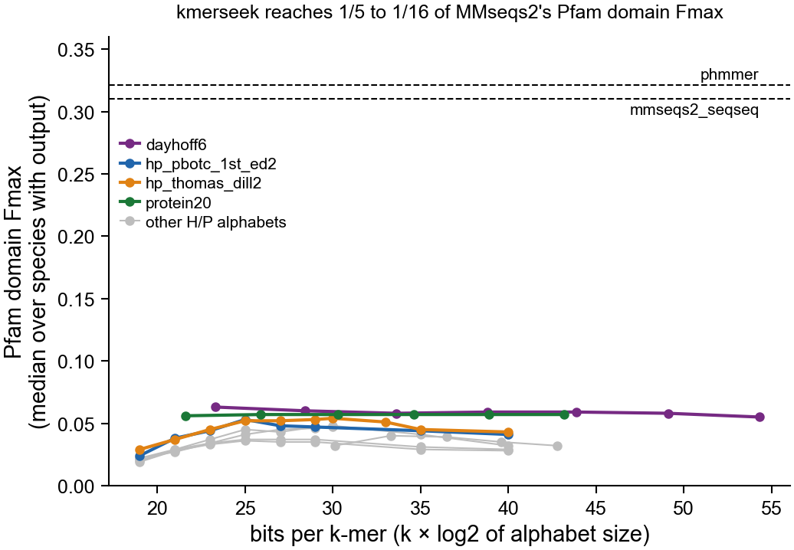
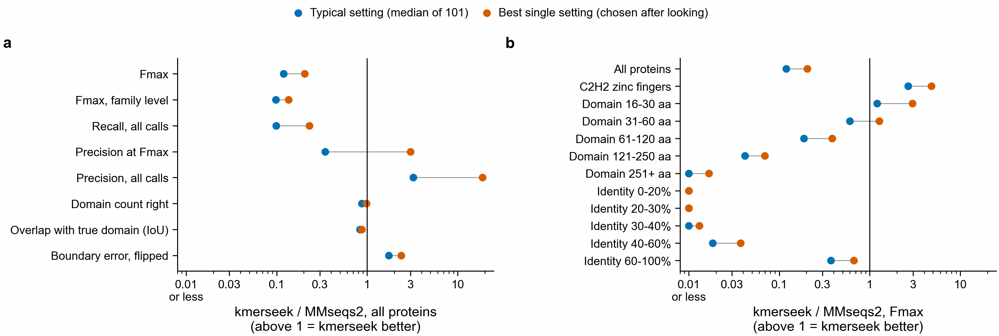
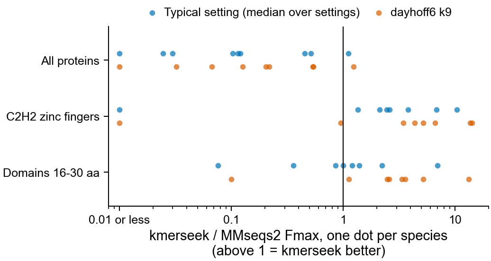

# QfO Pfam domain benchmark: protein20 k5-10, dayhoff6 k9-21, H/P k19-40

Asked 2026-11-08: how did these kmerseek settings do on the QfO data, and could the results
go to the Quest for Orthologs benchmark service?



The x axis is bits per k-mer, k × log2(alphabet size): 4.3 bits per protein20 letter, 2.6 per
dayhoff6 letter, 1.6 for the 3-letter hp_lehninger_hpc3 and 1 for the two-letter H/P alphabets.
On that scale protein20 k5-10 (22-43 bits), dayhoff6 k9-21 (23-54 bits) and H/P k25-40 cover
the same range, which is why H/P k25, 30, 35 and 40 were asked for as a follow-up.

## Answer

Every setting asked about scores far below the alignment tools. Median Pfam domain Fmax
(the best F1 over all score cut-offs) is 0.056-0.063 for protein20 and dayhoff6 and
0.019-0.054 for the H/P alphabets. MMseqs2 gets 0.31 and phmmer 0.32 on the same 9 species.
The best settings reach about 1/5 of MMseqs2 (dayhoff6 k9: 0.063, ratio 0.20). Changing k
barely moves protein20 (0.056-0.057) or dayhoff6 (0.055-0.063, k9-21). For H/P, Fmax rises
from k19 to k25-30 and then falls at k35 and k40: higher k buys precision and loses more
recall than it gains. hp_thomas_dill2 goes 0.052 (k25), 0.054 (k30), 0.045 (k35), 0.043 (k40).

At equal bits, H/P is no better than protein20 or dayhoff6: at 25 and 30 bits the best H/P
alphabet (hp_thomas_dill2) scores 0.052 and 0.054, against 0.057 for protein20 at 26 and 30 bits.

dayhoff6 k19-21 and H/P k35-40 come from a second run on 2026-11-08 (see "Follow-up run"
below). Not run: H/P k31. H/P k30 exists only for hp_thomas_dill2, hp_thomas_dill_no_c2 and
hp_kyte_doolittle2; k33 only for hp_thomas_dill2. hp_lehninger_hpc3 has no k35 or k40.

| alphabet | k | species with calls | median Fmax | median recall (reachable) | median precision at Fmax | Fmax / MMseqs2 |
|---|---|---|---|---|---|---|
| protein20 | 5-10 | 6 of 9 | 0.056-0.057 | 0.027-0.028 | 0.66-0.67 | 0.17 |
| dayhoff6 | 9 | 9 | 0.063 | 0.039 | 0.41 | 0.20 |
| dayhoff6 | 11, 13 | 9 | 0.060, 0.058 | 0.029, 0.026 | 0.56, 0.61 | 0.19 |
| dayhoff6 | 15, 17 | 8 | 0.059 | 0.026, 0.025 | 0.64, 0.69 | 0.18 |
| dayhoff6 | 19, 21 | 8 | 0.058, 0.055 | 0.024, 0.023 | 0.69, 0.70 | 0.18, 0.17 |
| hp_thomas_dill2 | 19 / 25 / 30 / 33 | 9 | 0.029 / 0.052 / 0.054 / 0.051 | 0.097 / 0.058 / 0.036 / 0.030 | 0.02 / 0.09 / 0.34 / 0.46 | 0.09 / 0.17 / 0.17 / 0.15 |
| hp_thomas_dill2 | 35 / 40 | 9 / 8 | 0.045 / 0.043 | 0.024 / 0.020 | 0.51 / 0.58 | 0.14 / 0.14 |
| other two-letter H/P | 35 / 40 | 9 / 8-9 | 0.029-0.044 / 0.028-0.041 | 0.016-0.027 / 0.014-0.020 | 0.31-0.63 / 0.53-0.67 | 0.09-0.13 / 0.08-0.13 |
| hp_pbotc_1st_ed2 | 19 / 25 / 29 | 9 | 0.024 / 0.053 / 0.047 | 0.085 / 0.047 / 0.029 | 0.02 / 0.14 / 0.42 | 0.08 / 0.17 / 0.15 |

Every row is in [kmerseek_requested_settings.csv](kmerseek_requested_settings.csv); the other
tools are in [other_tools.csv](other_tools.csv).

## What the numbers are

- Run: `qfo-pfam-region-benchmark`, midi-plus set: 998 human queries (chr6 plus the MHC-related
  genes) searched against 9 QfO 2020_04 proteomes (arabidopsis, chicken, ciona, ecoli, fly,
  mouse, worm, yeast, zebrafish). Searches from 2026-09-01, kmerseek image
  `2026-08-24-reduced-alphabets` (before 0.4), regions ranked by `region_poisson_score`.
- Each kmerseek region becomes a Pfam domain call by copying the Pfam family annotated on the
  matching target interval onto the human interval. A call counts only if it lands on a real
  human domain instance of that family. Truth set: Pfam; low-complexity masking off; no dedup.
- Medians are over species, using only species where the search gave at least one call.
  Recall is out of the domains the target proteome could have given (`recall_reachable`).
- 27 searches gave zero calls, listed in [empty_searches.csv](empty_searches.csv): protein20 at
  every k for arabidopsis, ecoli and yeast; dayhoff6 k15-21 for ecoli; and every two-letter
  H/P alphabet except hp_kyte_doolittle2 at k40 for ecoli. Their region
  files are not empty (yeast protein20 k7: 246 KB), so the zero is lost somewhere between the
  regions and the calls. The cause has not been found. Counting those zeros into the median
  would drop protein20 to 0.014.
- Two extra copies exist for protein20 k6-8 and hp_thomas_dill2 k27 and k33: the 2026-09-13
  ladder run rescored them on 15 species and overwrote the 9-species files for those settings.
  This table uses only the 9 species shared by every setting.

## Other metrics, and where kmerseek wins



Each dot is kmerseek's value divided by MMseqs2's on the same species and protein subset,
median over the 9 species, turned so that above 1 means kmerseek is better. Blue is the
median over all 115 kmerseek settings; orange is the single best setting, picked after
looking, so it is an upper bound. Built by `other_metrics.py`; all numbers are in
`kmerseek_vs_mmseqs2_all_metrics.csv`.

kmerseek is better than MMseqs2 in two places. Both were picked after looking. The
metrics table splits the proteins into 59 subsets with an Fmax for both tools (by gene set,
domain length, identity, disorder, pLDDT, MHC class and dN/dS). Ranked by kmerseek /
MMseqs2 Fmax, C2H2 zinc fingers come first and domains of 16-30 residues second. In every other
subset the typical setting is below 0.6 times MMseqs2. The full ranking is in
[fmax_ratio_every_subset.csv](fmax_ratio_every_subset.csv).

The C2H2 gene set was not made for this comparison. It is one of four gene sets the
pipeline tags on every query (`bin/build_query_covariates.py`). The other
zinc fingers do not follow C2H2: typical 0.28 times MMseqs2, best 0.69. Both tools move:
MMseqs2's Fmax drops from 0.31 on all proteins to 0.054 on C2H2, and kmerseek's typical
Fmax rises from about 0.037 to about 0.13 (typical ratio times MMseqs2's Fmax).
This is one gene set out of 59 subsets, picked after looking, with no random-protein null.
Treat it as a lead to test, not a result.

### Per species



C2H2 zinc fingers: the typical setting beats MMseqs2 in 7 of the 8 species that have a
ratio. Of those 7, worm is lowest at 1.35. Mouse (10.4) and zebrafish (6.8) are highest,
and that is where MMseqs2's C2H2 Fmax is lowest (0.032 and 0.030). In yeast (3.8) both are
near zero: 0.041 against 0.011. Arabidopsis is 0: the typical setting finds none of these
domains there. In E. coli MMseqs2 also scores 0, so there is no ratio.
For domains of 16-30 residues, 4 of 8 species are above 1 for the typical setting. dayhoff6
k9 is above 1 in 7 of 8, but it was chosen as the best setting after looking. Built by
`per_species.py`; numbers in [per_species_ratios.csv](per_species_ratios.csv).

### Random protein sets (set up, not yet run)

`subset_null.py` rescores random sets of 32 query proteins with the pipeline's own Fmax
code. It summarises each set the same way as the C2H2 number: ratio per setting and
species, median over species, median over settings. Two kinds of random set:

- any 32 of the 998 query proteins;
- 32 of the 52 proteins that have a 16-30 residue domain and are not C2H2 zinc fingers.

It also scores domains of 16-30 residues with the C2H2 proteins taken out. Before any
random set is scored, it checks that it reproduces the published Fmax for C2H2 and 16-30 aa.
On a test with 5 species and 2 settings, all 30 values matched. It scores 200 random sets
of each kind, enough to show a p of 0.005, over the 119 settings in the figure
([settings_in_figure.txt](settings_in_figure.txt); 115 of them have calls in 5 or more
species).

The first Sherlock run (job 51664847, 2026-11-09) sat for its full 2 hours and wrote
nothing. It scored all 222 settings in the call folder rather than the figure's 119.
Its worker processes were started by Linux's default `fork` after polars had started,
which can deadlock. The script now starts them with `spawn`, saves each block of results
as it finishes, and continues from the saved blocks when run again.

Decision rule, written before the run:

- C2H2 counts as a kmerseek strength only if its typical ratio is at or above the random
  sets' values in at most 1 of 100 draws (p of 0.01 or less, p = (1 + draws at or above)
  / (1 + draws)).
- If C2H2 also beats the short-domain random sets at p of 0.01 or less, the lead belongs to
  zinc fingers. If not, it is a short-domain effect that C2H2 proteins carry.
- The 16-30 aa lead stands on its own only if its ratio stays above 1 with the C2H2
  proteins taken out.

Limit, known before the run: the 32 C2H2 proteins carry 200 domains, more than a random 32
proteins do. A random set with fewer domains is not matched on that.

- **C2H2 zinc fingers** (32 of the 998 human query proteins, carrying 200 Pfam domain
  copies; the same 32 are scored against every species): the typical setting's Fmax is 2.5 times MMseqs2's, the best
  (dayhoff6 k9) 4.8 times, 0.26 against 0.054. phmmer also scores only 0.045 here.
- **Short domains, 16-30 residues**: typical 1.2 times MMseqs2's Fmax, best 3.0 times
  (0.18 against 0.057). At 31-60 residues it is about even; from 61 residues up
  MMseqs2 wins. At 61-120 residues its Fmax is 5.1 times kmerseek's for the typical setting and
  2.6 times for the best; at 121-250 it is 22.6 and 12 times; at 251+ the typical
  setting finds nothing and the best is 41 times lower.
Precision is not a win. kmerseek makes far fewer calls, so a larger share of them are right:
4.4 times MMseqs2's precision over all calls for the typical setting. Any method that makes
fewer calls scores higher on this. At the Fmax cutoff the typical setting is lower (0.46
times MMseqs2's); only the most precise settings, which find almost nothing, are higher. It
goes with the loss in recall below.

When kmerseek does find a domain, it places it about as well as MMseqs2: overlap with the
true domain 0.83 times MMseqs2's, domain count right 0.86 times, and the median distance
from the true edge smaller (MMseqs2's error is 1.6 times kmerseek's). This is measured only
on the domains each tool found, and kmerseek finds fewer, likely easier ones.

kmerseek loses on recall (0.09 times), Fmax (0.12) and family-level Fmax (0.10). By
query-target identity it is near zero below 40% and reaches 0.38 times MMseqs2 only at
60-100%. So it finds fewer of the Pfam domains transferred from close relatives, and short
repeats, and almost none from remote ones. This is a Pfam-transfer recall gap, not a
direct test of sensitivity.

Not checked: why MMseqs2 and phmmer do so badly on C2H2 zinc fingers. One possible reason
is that one alignment spans many repeats and so matches no single 22-residue domain well
enough; this has not been tested.

## Can it go to the QfO benchmark service?

No, not as it is. The service (https://orthology.benchmarkservice.org) scores **ortholog
pairs**: an OrthoXML file or a two-column list of UniProt accessions, predicted on one of its
reference proteome releases (2020_04 or 2022_02). It then tests those pairs against species
trees, SwissTree gene trees, and GO and EC conservation. These results are domain calls on
998 human proteins, not ortholog pairs, so there is nothing to upload.

The proteomes are already right: the pipeline uses `QfO_release_2020_04`, which the service
still accepts. A submission would need:

1. kmerseek searches all-vs-all over the 78 proteomes of 2020_04, not 998 human queries.
2. A rule that turns hits into orthologs, for example reciprocal best hits by a whole-protein
   score.
3. Output as OrthoXML or tab-separated UniProt accession pairs, submitted through OpenEBench.

The docs do not say whether a subset of species or proteins is accepted, or how partial
coverage would change the scores. kmerseek has not been tested on orthology; its Pfam domain
Fmax of 1/5 of MMseqs2 does not by itself say how an orthology submission would score.

## Rebuild

```
python summarize.py <metrics dir> <all_domain_metrics.parquet>
python other_metrics.py <metrics dir> <all_domain_metrics.parquet>
python per_species.py <metrics dir> <all_domain_metrics.parquet>
```

Both scripts read one `<metrics dir>`, so copy the `pfam.kmerseek.*_lcFalse.*.metrics.parquet`
files from both runs into one directory first (the file names differ by setting, so none
overwrite). The two sources are
`sherlock:/scratch/users/olgabot/2024-kmerseek-analysis/nextflow-runs/qfo-pfam-region-benchmark/data/midi-plus/results/metrics/`
(September run) and `.../data/midi-plus/results-hp-k35-k40/metrics/` (follow-up run: dayhoff6
k19, k21 and H/P k35, k40). Reading only the first drops those rows. `all_domain_metrics.parquet`
is in the first `results/` directory (md5 3080c0bf94816472dfe277ff7ee31b8c).

## Follow-up run: H/P k35 and k40, dayhoff6 k19 and k21

Ran 2026-11-08, 14:27-15:38 on Sherlock (head job 51586844). The first submission, 51585998,
landed on node sh04-18n27, which failed its health check during job setup, so the script
never started. Every index build, search and scoring task finished. The last step,
aggregateMetrics, refused to build the combined table because ciona has only 23 Swiss-Prot
annotated proteins (a check added after the September run). The Pfam numbers above come
from the 126 per-search files in `results-hp-k35-k40/metrics/`, which that step only reads.

Measured on this run: kmerseekIndex 0.76-6.9 GB, at most 48 s; kmerseekSearch 0.25-4.4 GB,
at most 84 s; scoreDomainCalls (63 tasks, one per species and alphabet) at most 0.3 GB, 29 s.
The plan below was written before the run.

`make run-midi-plus-hp-k35-k40` in `nextflow-runs/qfo-pfam-region-benchmark` runs the 14
missing settings on the same 9 species, image and queries: six two-letter H/P alphabets at
k35 and k40, and dayhoff6 at k19 and k21. That is 126 index builds and 126 searches. All
other tools are skipped. Output goes to `data/midi-plus/results-hp-k35-k40`, so
run-midi-plus's `all_domain_metrics.parquet` is not replaced. hp_lehninger_hpc3 is left out:
it has 3 letters, so k35 would be 55 bits.

Resources, measured on run-midi-plus at the nearest settings (H/P k27-33, dayhoff6 k15-17):

| step | tasks | peak memory measured | longest measured | first ask |
|---|---|---|---|---|
| kmerseekIndex | 126 | 0.9-6.7 GB | 30 s | 32 GB |
| kmerseekSearch | 126 | 0.6-11.1 GB | 3 min | 25-43 GB |
| scoreDomainCalls | 378 planned (3 truth sets); ran as 63 (one per species and alphabet) | 4.3 GB | 6 min | 8 GB or more |
| head job | 1 | | | 16 GB, 12 h |

The search asks are a floor in the pipeline and run 3-4 times what was measured. Higher k
shares fewer k-mers, so k35-40 should use less than these, not more.
