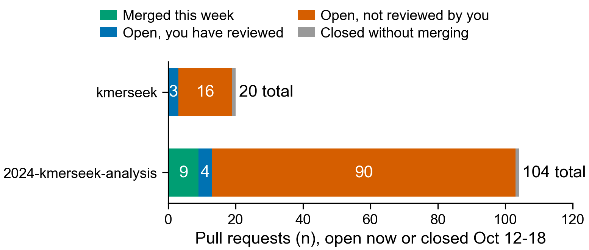

# Weekly PR and issue status, 2026-W42 (Oct 12-18)

Made by Claude Code with the `weekly-pr-status` skill on 2026-10-18, for seanome/kmerseek
and seanome/2024-kmerseek-analysis. A PR is listed if it is open now, or was opened, closed
or merged in the week. This report only reads GitHub; it changed nothing there.



Counts were checked against a second GitHub query: 19 open and 1 closed in kmerseek, 94
open and 10 closed (9 merged) in 2024-kmerseek-analysis.

## How "reviewed by you" was counted

Claude's nightly code reviews are posted from Olga's GitHub account and end in
"Generated by Claude Code", not the "Written by Claude Code" note. The status script
does not recognise that ending, so it counted those reviews as Olga's: by its count 19 of
19 open kmerseek PRs had her review. Recounted without them
(`2026-W42_recount_human_reviews.py`), 3 of 19 do (113, 133, 137), and 4 of 94 analysis
PRs do (52, 54, 97, 119). The tables use the recount.

The same problem fills this week's comment list: 149 comments are listed as Olga's, and
141 of them are Claude's nightly reviews. 8 are hers.

## Tables

Review column, one mark each:

- ✅ date: a review-skill comment names the PR's current head commit.
- ⚠️ date, commits since: the latest review-skill comment names an older commit.
- ☐: no review-skill comment found.

A /rustacean-review or /analysis-review is Claude's, not a human review. It sits in its own
column and does not change "Not reviewed".

### kmerseek

0 merged, 19 open, 1 closed without merging.

| PR | What it does | Status | rustacean-review | Why it's still open |
|---|---|---|---|---|
| [#113](https://github.com/seanome/kmerseek/pull/113) | Extend regions without a Karlin-Altschul fit instead of refusing | Open | ⚠️ Sep 30, commits since | Your Oct 3 question (is this needed, given PR 110?) has no reply. Its target `olgabot/run-evalue-v2` had PR 112 closed without merging, so there is no route into `main`. Only the formatting check ran, not the tests. |
| [#114](https://github.com/seanome/kmerseek/pull/114) | Extend matched regions by default when the index has a fit | Open | ⚠️ Sep 30, commits since | **Not reviewed.** Targets PR 113. Only the formatting check ran, not the tests. |
| [#130](https://github.com/seanome/kmerseek/pull/130) | Mid-p run E-value; decoy test on other proteins' shuffles | Open | ✅ Oct 17 | **Not reviewed.** Targets PR 114. Only the formatting check ran, not the tests. |
| [#133](https://github.com/seanome/kmerseek/pull/133) | Run E-value on every row; drop the Poisson E-value | Open | ✅ Oct 18 | **Your comments, then new commits; needs another look.** |
| [#134](https://github.com/seanome/kmerseek/pull/134) | Test run E-value on random and dipeptide-shuffled decoys | Open | ✅ Oct 18 | **Not reviewed.** Targets PR 133. Only the formatting check ran, not the tests. |
| [#137](https://github.com/seanome/kmerseek/pull/137) | Remove two unused index fields; CI fails on dead_code allows | Open | ✅ Oct 6 | Merge conflicts. |
| [#141](https://github.com/seanome/kmerseek/pull/141) | Key index entries by sequence so hits keep own coordinates | Open | ✅ Oct 18 | **Not reviewed.** Its target `olgabot/release-0.4.0` had PR 64 closed without merging, so there is no route into `main`. Only the formatting check ran, not the tests. |
| [#142](https://github.com/seanome/kmerseek/pull/142) | Search report: rows with no run, --min-runs, fitted dot-plot labels | Open | ☐ | **Not reviewed.** |
| [#143](https://github.com/seanome/kmerseek/pull/143) | Skill rules from Olga's Oct 5-11 review comments | Open | ☐ | **Not reviewed.** |
| [#144](https://github.com/seanome/kmerseek/pull/144) | --ka-r-database: search with a fit from another index | Open | ✅ Oct 18 | **Not reviewed.** |
| [#145](https://github.com/seanome/kmerseek/pull/145) | New cys2 alphabet: cysteine versus every other residue | Open | ✅ Oct 17 | **Not reviewed.** |
| [#146](https://github.com/seanome/kmerseek/pull/146) | Two sticker-and-spacer alphabets for condensate proteins | Open | ✅ Oct 18 | **Not reviewed.** |
| [#147](https://github.com/seanome/kmerseek/pull/147) | cys2 alphabet on the 0.4.0 release branch | Open | ✅ Oct 18 | **Not reviewed.** Its target `olgabot/release-0.4.0` had PR 64 closed without merging, so there is no route into `main`. Only the formatting check ran, not the tests. |
| [#148](https://github.com/seanome/kmerseek/pull/148) | cys_hp3 alphabet, and make cys2 indexes searchable | Open | ⚠️ Oct 16, commits since | **Not reviewed.** Targets PR 145. |
| [#149](https://github.com/seanome/kmerseek/pull/149) | PR template with Olga's Why and What I learned | Open | ⚠️ Oct 18, commits since | **Not reviewed.** CI fails: notes. |
| [#150](https://github.com/seanome/kmerseek/pull/150) | Figure: three cysteine-aware readings of two toxins | Open | ✅ Oct 18 | **Not reviewed.** Targets PR 148. |
| [#152](https://github.com/seanome/kmerseek/pull/152) | Key index entries by sequence, not by k-mer set | Open | ✅ Oct 18 | **Not reviewed.** |
| [#153](https://github.com/seanome/kmerseek/pull/153) | Skip a query's identical database entry in every search | Open | ✅ Oct 18 | **Not reviewed.** |
| [#154](https://github.com/seanome/kmerseek/pull/154) | Count Karlin-Altschul fit regions per score bin while found | Open | ✅ Oct 18 | **Not reviewed.** |
| [#112](https://github.com/seanome/kmerseek/pull/112) | Region E-value on every row, labelled by which statistic | Closed, not merged Oct 17 | ⚠️ Sep 30, commits since |  |

### 2024-kmerseek-analysis

9 merged, 94 open, 1 closed without merging.

| PR | What it does | Status | analysis-review | Why it's still open |
|---|---|---|---|---|
| [#46](https://github.com/seanome/2024-kmerseek-analysis/pull/46) | nb 241: what each alphabet sees on three hard pairs | Merged Oct 16 | ⚠️ Oct 16, commits since |  |
| [#48](https://github.com/seanome/2024-kmerseek-analysis/pull/48) | nb 242-243: combining alphabets does not lift BCL2 or CD47 | Merged Oct 17 into `olgabot/alphabet-ranking-three-cases` | ⚠️ Oct 16, commits since |  |
| [#55](https://github.com/seanome/2024-kmerseek-analysis/pull/55) | nb 252: label transfer on globins, lysozymes, cystatins | Merged Oct 13 | ☐ |  |
| [#95](https://github.com/seanome/2024-kmerseek-analysis/pull/95) | Figure 1: H/P runs and seed-length trade (nb 275) | Merged Oct 14 | ☐ |  |
| [#99](https://github.com/seanome/2024-kmerseek-analysis/pull/99) | nb 273: H/P agreement per 100 aligned positions | Merged Oct 15 | ⚠️ Oct 12, commits since |  |
| [#100](https://github.com/seanome/2024-kmerseek-analysis/pull/100) | nb 230: kappa and usable k for all 19 alphabets | Merged Oct 15 | ☐ |  |
| [#116](https://github.com/seanome/2024-kmerseek-analysis/pull/116) | Figure: the seven H/P alphabets differ on five residues | Merged Oct 13 | ⚠️ Oct 12, commits since |  |
| [#136](https://github.com/seanome/2024-kmerseek-analysis/pull/136) | Lint: pin black on old branches, install test packages | Merged Oct 13 | ☐ |  |
| [#137](https://github.com/seanome/2024-kmerseek-analysis/pull/137) | make running: find a head by its launch folder | Merged Oct 13 | ☐ |  |
| [#30](https://github.com/seanome/2024-kmerseek-analysis/pull/30) | Dark set: what standard search misses on invertebrate proteomes | Open | ☐ | **Not reviewed.** Its target branch is already in `main`; retarget to `main`. CI fails: pipeline definition parses. |
| [#47](https://github.com/seanome/2024-kmerseek-analysis/pull/47) | Pfam on the dark set: are these real proteins? | Open | ☐ | **Not reviewed.** Targets PR 57. |
| [#49](https://github.com/seanome/2024-kmerseek-analysis/pull/49) | nb 244: hero example candidates from Swiss-Prot features | Open | ☐ | **Not reviewed.** |
| [#51](https://github.com/seanome/2024-kmerseek-analysis/pull/51) | nb 250: ELM motif benchmark, stage 0 | Open | ☐ | **Not reviewed.** |
| [#52](https://github.com/seanome/2024-kmerseek-analysis/pull/52) | Region pipeline: ungapped extension with an E-value | Open | ☐ | **Your comments, then new commits; needs another look.** Its target branch is already in `main`; retarget to `main`. |
| [#53](https://github.com/seanome/2024-kmerseek-analysis/pull/53) | nb 251: DisProt functional-region transfer benchmark | Open | ☐ | **Not reviewed.** Targets PR 52. |
| [#54](https://github.com/seanome/2024-kmerseek-analysis/pull/54) | nb 245: seed bits carried versus bits a search needs | Open | ☐ | **Your comments, then new commits; needs another look.** |
| [#57](https://github.com/seanome/2024-kmerseek-analysis/pull/57) | Dark set with kmerseek 0.4: the midi run | Open | ☐ | **Not reviewed.** Targets PR 30. Merge conflicts. |
| [#58](https://github.com/seanome/2024-kmerseek-analysis/pull/58) | Score the ELM cover search, with a placement null | Open | ☐ | **Not reviewed.** Targets PR 51. |
| [#59](https://github.com/seanome/2024-kmerseek-analysis/pull/59) | Pfam anchor for the Swiss-Prot identity axis | Open | ☐ | **Not reviewed.** Merge conflicts. |
| [#63](https://github.com/seanome/2024-kmerseek-analysis/pull/63) | nb 340: E3 detection-gap benchmark and baseline pipeline | Open | ☐ | **Not reviewed.** |
| [#64](https://github.com/seanome/2024-kmerseek-analysis/pull/64) | Family-AUC, RBH-F1 and leaderboard sweeps on Sherlock | Open | ☐ | **Not reviewed.** Merge conflicts. |
| [#65](https://github.com/seanome/2024-kmerseek-analysis/pull/65) | nb 24: k-mer spectra across all alphabets | Open | ☐ | **Not reviewed.** CI fails: black, notebooks. |
| [#66](https://github.com/seanome/2024-kmerseek-analysis/pull/66) | Pfam subdomain benchmark: DIAMOND-hard versus DIAMOND-easy pairs | Open | ☐ | **Not reviewed.** Merge conflicts. |
| [#67](https://github.com/seanome/2024-kmerseek-analysis/pull/67) | nb 220: BCL2/Bcl-xL vs Ced9, six HP alphabets, k=15-25 | Open | ☐ | **Not reviewed.** CI fails: notebooks. |
| [#69](https://github.com/seanome/2024-kmerseek-analysis/pull/69) | nb 253: are ELM motifs in place on chicken orthologs? | Open | ☐ | **Not reviewed.** Targets PR 58. |
| [#71](https://github.com/seanome/2024-kmerseek-analysis/pull/71) | Search keeps each query's best N targets; one setting per alphabet | Open | ☐ | **Not reviewed.** Targets PR 58. |
| [#72](https://github.com/seanome/2024-kmerseek-analysis/pull/72) | ELM cover on seven more species | Open | ☐ | **Not reviewed.** Targets PR 71. |
| [#75](https://github.com/seanome/2024-kmerseek-analysis/pull/75) | nb 238 on the full midi-plus run | Open | ☐ | **Not reviewed.** |
| [#76](https://github.com/seanome/2024-kmerseek-analysis/pull/76) | nb 246: ten random 2-letter alphabets beside six H/P ones | Open | ☐ | **Not reviewed.** |
| [#77](https://github.com/seanome/2024-kmerseek-analysis/pull/77) | nb 254: seed extension loses nb 244's short placements | Open | ☐ | **Not reviewed.** Targets PR 49. |
| [#78](https://github.com/seanome/2024-kmerseek-analysis/pull/78) | nb 244: figures and hit pages for all 183 cases | Open | ☐ | **Not reviewed.** Targets PR 49. Merge conflicts. |
| [#80](https://github.com/seanome/2024-kmerseek-analysis/pull/80) | Case gallery: reference pairs, other tools, shared k-mers | Open | ☐ | **Not reviewed.** Targets PR 78. |
| [#82](https://github.com/seanome/2024-kmerseek-analysis/pull/82) | nb 244: two extra cases, Ced-9/BCL2 and BHF | Open | ☐ | **Not reviewed.** Targets PR 78. |
| [#83](https://github.com/seanome/2024-kmerseek-analysis/pull/83) | nb 256: BHF against 300 dipeptide-shuffled copies | Open | ☐ | **Not reviewed.** Its target branch is already in `main`; retarget to `main`. Merge conflicts. |
| [#84](https://github.com/seanome/2024-kmerseek-analysis/pull/84) | nb 255: ranking metrics against human Pfam, length control | Open | ☐ | **Not reviewed.** |
| [#85](https://github.com/seanome/2024-kmerseek-analysis/pull/85) | nb 257: rerun 998-protein search with E-values on every row | Open | ☐ | **Not reviewed.** Its target branch is already in `main`; retarget to `main`. Merge conflicts. |
| [#87](https://github.com/seanome/2024-kmerseek-analysis/pull/87) | nb 270: --scaled 1-10 on the mini set with decoys | Open | ☐ | **Not reviewed.** Targets PR 72. |
| [#88](https://github.com/seanome/2024-kmerseek-analysis/pull/88) | nb 260: midi-plus 0.4 with extension, and shuffled twin | Open | ☐ | **Not reviewed.** Targets PR 87. Merge conflicts. |
| [#91](https://github.com/seanome/2024-kmerseek-analysis/pull/91) | Shared figure helpers: header, alphabet axis, missing-value mark | Open | ☐ | **Not reviewed.** Merge conflicts. |
| [#92](https://github.com/seanome/2024-kmerseek-analysis/pull/92) | Figure: bits per letter for all 19 alphabets | Open | ☐ | **Not reviewed.** Targets PR 51. |
| [#93](https://github.com/seanome/2024-kmerseek-analysis/pull/93) | nb 271: which region score to filter on | Open | ☐ | **Not reviewed.** |
| [#96](https://github.com/seanome/2024-kmerseek-analysis/pull/96) | nb 245: where P66/CD47 shared k-mers sit | Open | ☐ | **Not reviewed.** Its target branch is already in `main`; retarget to `main`. Merge conflicts. |
| [#97](https://github.com/seanome/2024-kmerseek-analysis/pull/97) | Experiment inventory, claims page and GitHub Pages site | Open | ☐ | **Your comments, then new commits; needs another look.** |
| [#98](https://github.com/seanome/2024-kmerseek-analysis/pull/98) | nb 261: combiner A, intersection of fixed settings | Open | ☐ | **Not reviewed.** Targets PR 88. |
| [#101](https://github.com/seanome/2024-kmerseek-analysis/pull/101) | nb 274: k-sizes to test per alphabet, print figure | Open | ☐ | **Not reviewed.** Merge conflicts. |
| [#102](https://github.com/seanome/2024-kmerseek-analysis/pull/102) | nb 262: combiner B, best of n settings | Open | ☐ | **Not reviewed.** Targets PR 98. |
| [#103](https://github.com/seanome/2024-kmerseek-analysis/pull/103) | nb 263: combiner C, consensus vote across settings | Open | ☐ | **Not reviewed.** Targets PR 102. |
| [#104](https://github.com/seanome/2024-kmerseek-analysis/pull/104) | nb 264: three combiners versus best pair, phmmer, Kyte-Doolittle | Open | ☐ | **Not reviewed.** Targets PR 103. Merge conflicts. |
| [#106](https://github.com/seanome/2024-kmerseek-analysis/pull/106) | Supplementary Figure 1 and seed reach at k* | Open | ☐ | **Not reviewed.** Its target branch is already in `main`; retarget to `main`. Merge conflicts. |
| [#107](https://github.com/seanome/2024-kmerseek-analysis/pull/107) | SCOPe40 sensitivity, kmerseek 0.4, 19 alphabets | Open | ☐ | **Not reviewed.** Merge conflicts. |
| [#113](https://github.com/seanome/2024-kmerseek-analysis/pull/113) | nb 246: seeds that allow mismatches, two hard pairs | Open | ☐ | **Not reviewed.** |
| [#114](https://github.com/seanome/2024-kmerseek-analysis/pull/114) | Regions-index pilot inputs: queries, truth, indexes, decoys | Open | ☐ | **Not reviewed.** |
| [#115](https://github.com/seanome/2024-kmerseek-analysis/pull/115) | parse_disprot.py: read every DisProt page, consensus disorder | Open | ☐ | **Not reviewed.** |
| [#117](https://github.com/seanome/2024-kmerseek-analysis/pull/117) | nb 247: BCL-2 query panel vs CED-9 (stopped) | Open | ☐ | **Not reviewed.** |
| [#118](https://github.com/seanome/2024-kmerseek-analysis/pull/118) | nb 276: structure does not support P66 mimicking CD47 | Open | ☐ | **Not reviewed.** |
| [#119](https://github.com/seanome/2024-kmerseek-analysis/pull/119) | nb 278: no alphabet beats BLOSUM62; H/P leads exact matching | Open | ⚠️ Oct 14, commits since | **Your comments, then new commits; needs another look.** Its target branch is already in `main`; retarget to `main`. CI fails: black. |
| [#120](https://github.com/seanome/2024-kmerseek-analysis/pull/120) | nb 279: dark proteins kmerseek reaches at E<1 and E<10 | Open | ☐ | **Not reviewed.** |
| [#121](https://github.com/seanome/2024-kmerseek-analysis/pull/121) | nb 280: time-split test, Pfam 33.1 to 38.2 | Open | ☐ | **Not reviewed.** |
| [#122](https://github.com/seanome/2024-kmerseek-analysis/pull/122) | nb 282: ohnolog split-or-narrow test setup, Botryllus | Open | ☐ | **Not reviewed.** |
| [#123](https://github.com/seanome/2024-kmerseek-analysis/pull/123) | Figures saved as 256-colour PNGs | Open | ✅ Oct 15 | **Not reviewed.** |
| [#124](https://github.com/seanome/2024-kmerseek-analysis/pull/124) | nb 283: does BHF beat low-complexity-keeping shuffles? | Open | ☐ | **Not reviewed.** Targets PR 83. |
| [#125](https://github.com/seanome/2024-kmerseek-analysis/pull/125) | nb 284: do the 19 alphabets agree on BCL2's region? | Open | ☐ | **Not reviewed.** |
| [#126](https://github.com/seanome/2024-kmerseek-analysis/pull/126) | nb 281: Botryllus links to MHC and self/non-self proteins | Open | ☐ | **Not reviewed.** |
| [#127](https://github.com/seanome/2024-kmerseek-analysis/pull/127) | Progress summary for readers without the chats | Open | ☐ | **Not reviewed.** |
| [#128](https://github.com/seanome/2024-kmerseek-analysis/pull/128) | nb 285: pooling BCL-2 family calls ranks Ced9 39th | Open | ⚠️ Oct 13, commits since | **Not reviewed.** Targets PR 125. |
| [#129](https://github.com/seanome/2024-kmerseek-analysis/pull/129) | nb 288: Ced9-BCL2 and P66-CD47 as pairwise questions | Open | ☐ | **Not reviewed.** Targets PR 125. |
| [#130](https://github.com/seanome/2024-kmerseek-analysis/pull/130) | nb 286: reach BCL2 from Ced9 via a human protein (scripts) | Open | ☐ | **Not reviewed.** Targets PR 125. |
| [#131](https://github.com/seanome/2024-kmerseek-analysis/pull/131) | nb 287: sum statistics do not rescue the hard pairs | Open | ☐ | **Not reviewed.** Targets PR 125. |
| [#132](https://github.com/seanome/2024-kmerseek-analysis/pull/132) | nb 289: reverse search job scripts | Open | ☐ | **Not reviewed.** Targets PR 124. Merge conflicts. |
| [#133](https://github.com/seanome/2024-kmerseek-analysis/pull/133) | Dark set summary page for the 0.4 midi run | Open | ☐ | **Not reviewed.** Targets PR 57. |
| [#134](https://github.com/seanome/2024-kmerseek-analysis/pull/134) | nb 290: dark proteins reached against shuffled copies | Open | ☐ | **Not reviewed.** Targets PR 120. |
| [#135](https://github.com/seanome/2024-kmerseek-analysis/pull/135) | make running: match tasks to their head by launch folder | Open | ☐ | **Not reviewed.** Merge conflicts. |
| [#138](https://github.com/seanome/2024-kmerseek-analysis/pull/138) | Shared dipeptide shuffle for decoy queries | Open | ☐ | **Not reviewed.** |
| [#139](https://github.com/seanome/2024-kmerseek-analysis/pull/139) | nb 284: what exact k-mers count that BLOSUM62 does not | Open | ✅ Oct 17 | **Not reviewed.** Its target branch is already in `main`; retarget to `main`. |
| [#140](https://github.com/seanome/2024-kmerseek-analysis/pull/140) | nb 341: condensate exons, day 1 | Open | ☐ | **Not reviewed.** CI fails: check. |
| [#141](https://github.com/seanome/2024-kmerseek-analysis/pull/141) | Convergence search kill test: ice-binding proteins fail | Open | ☐ | **Not reviewed.** CI fails: check. |
| [#142](https://github.com/seanome/2024-kmerseek-analysis/pull/142) | nb 292: k-mer keep/eject rule for adaptive sampling | Open | ⚠️ Oct 15, commits since | **Not reviewed.** |
| [#143](https://github.com/seanome/2024-kmerseek-analysis/pull/143) | nb 294: linked HP word pairs kill test: KILL | Open | ⚠️ Oct 17, commits since | **Not reviewed.** |
| [#144](https://github.com/seanome/2024-kmerseek-analysis/pull/144) | make leaderboard-tables: tables the leaderboard site reads | Open | ☐ | **Not reviewed.** |
| [#145](https://github.com/seanome/2024-kmerseek-analysis/pull/145) | Cysteine-framework peptide pipeline; pilot runs on Sherlock | Open | ☐ | **Not reviewed.** Targets PR 138. |
| [#146](https://github.com/seanome/2024-kmerseek-analysis/pull/146) | make leaderboard-pileup: region pile-up figure tables | Open | ☐ | **Not reviewed.** Targets PR 144. Merge conflicts. |
| [#147](https://github.com/seanome/2024-kmerseek-analysis/pull/147) | Research: what a function annotation leaderboard needs | Open | ☐ | **Not reviewed.** |
| [#148](https://github.com/seanome/2024-kmerseek-analysis/pull/148) | One long table of every finished benchmark | Open | ✅ Oct 17 | **Not reviewed.** Targets PR 144. Merge conflicts. |
| [#149](https://github.com/seanome/2024-kmerseek-analysis/pull/149) | Script to rewrite history to 256-colour PNG figures | Open | ☐ | **Not reviewed.** Targets PR 123. |
| [#150](https://github.com/seanome/2024-kmerseek-analysis/pull/150) | PR template with Olga's Why and What I learned | Open | ☐ | **Not reviewed.** |
| [#152](https://github.com/seanome/2024-kmerseek-analysis/pull/152) | nb 342: exon function kill test, Stops 0-2 | Open | ☐ | **Not reviewed.** Targets PR 140. |
| [#153](https://github.com/seanome/2024-kmerseek-analysis/pull/153) | Figure style: mako colour map by default | Open | ☐ | **Not reviewed.** CI fails: check. |
| [#154](https://github.com/seanome/2024-kmerseek-analysis/pull/154) | Leaderboard reads Pfam pairs, DisProt cost, k-mer counts | Open | ☐ | **Not reviewed.** Targets PR 148. |
| [#155](https://github.com/seanome/2024-kmerseek-analysis/pull/155) | Dark set: Foldseek and ProstT5 on every query (plan) | Open | ☐ | **Not reviewed.** Targets PR 57. |
| [#156](https://github.com/seanome/2024-kmerseek-analysis/pull/156) | CONTRIBUTING.md for tool modules, and a hits-format check | Open | ☐ | **Not reviewed.** Targets PR 160. |
| [#158](https://github.com/seanome/2024-kmerseek-analysis/pull/158) | No-search baselines as leaderboard rows | Open | ☐ | **Not reviewed.** |
| [#159](https://github.com/seanome/2024-kmerseek-analysis/pull/159) | make leaderboard-alphabets: alphabet page tables | Open | ☐ | **Not reviewed.** |
| [#160](https://github.com/seanome/2024-kmerseek-analysis/pull/160) | Leaderboard rows for DIAMOND and MMseqs2 best-hit transfer | Open | ☐ | **Not reviewed.** |
| [#161](https://github.com/seanome/2024-kmerseek-analysis/pull/161) | Leaderboard rows for InterProScan and eggNOG-mapper | Open | ☐ | **Not reviewed.** Targets PR 160. CI fails: scoring, metrics and report. |
| [#162](https://github.com/seanome/2024-kmerseek-analysis/pull/162) | Leaderboard rows for TM-Vec and PLMSearch | Open | ☐ | **Not reviewed.** Targets PR 161. CI fails: scoring, metrics and report. |
| [#163](https://github.com/seanome/2024-kmerseek-analysis/pull/163) | Dark set: is a weak best hit right, by E-value band | Open | ☐ | **Not reviewed.** Targets PR 133. |
| [#164](https://github.com/seanome/2024-kmerseek-analysis/pull/164) | Eight leaderboard query subsets for 998 midi-plus queries | Open | ☐ | **Not reviewed.** Targets PR 148. CI fails: check. |
| [#165](https://github.com/seanome/2024-kmerseek-analysis/pull/165) | Pfam-N recall counts only regions on searched proteins | Open | ✅ Oct 18 | **Not reviewed.** Targets PR 148. CI fails: scoring, metrics and report. |
| [#166](https://github.com/seanome/2024-kmerseek-analysis/pull/166) | SCOPe40 hit lists for every Table 1 tool | Open (draft) | ☐ | **Not reviewed.** |
| [#167](https://github.com/seanome/2024-kmerseek-analysis/pull/167) | nb 296: cysteine-framework pilot, Cnidaria | Open | ✅ Oct 18 | **Not reviewed.** Targets PR 145. CI fails: check. |
| [#168](https://github.com/seanome/2024-kmerseek-analysis/pull/168) | nb 297: cys_hp3 phylum run vs phmmer and regex | Open | ⚠️ Oct 18, commits since | **Not reviewed.** Targets PR 167. |
| [#169](https://github.com/seanome/2024-kmerseek-analysis/pull/169) | eDNA market: who pays, would protein naming help | Open | ☐ | **Not reviewed.** CI fails: check. |
| [#170](https://github.com/seanome/2024-kmerseek-analysis/pull/170) | nb 299: OM-RGC sketch-search pilot plan, sourmash vs DIAMOND | Open | ☐ | **Not reviewed.** CI fails: check. |
| [#81](https://github.com/seanome/2024-kmerseek-analysis/pull/81) | nb 244 fixes: inclusive-interval IoU, relabelled rows, counts | Closed, not merged Oct 13 (draft) | ☐ |  |
## Issues

No issue was opened or closed in either repo this week. 39 other open issues in kmerseek
and 5 in 2024-kmerseek-analysis, none opened or closed this week.

## What to review first

- **kmerseek PR 133** (run E-value on every row). You wrote on Oct 10 "This is too many
  e-values… I don't know which one to use", and commits came after. PR 134 is built on it.
- **kmerseek PR 113, before 114 and 130.** Its target PR 112 was closed on Oct 17, so
  the stack 113 → 114 → 130 has no route into `main`. Your Oct 3 question on 113 ("Do we
  really need this if we have PR 110?") has no reply. That answer decides whether the
  other two are worth reading.
- **Two kmerseek pairs do the same thing on different bases.** PR 141 and PR 152 both key
  index entries by sequence; PR 145 and PR 147 both add cys2. 141 and 147 target
  `olgabot/release-0.4.0`, whose PR 64 was closed. Reading 152 and 145 first leaves one
  decision per pair.
- **Analysis: PR 51 holds up 11 PRs**, a stack ten deep (51 → 58 → 71 → 72 → 87 → 88 →
  98 → 102 → 103 → 104, plus 69 and 92), including the nb 260 midi-plus run and the
  three combiners. Separately, 8 PRs target a branch that is already in `main`
  (30, 52, 83, 85, 96, 106, 119, 139); PR 30 heads the dark-set stack of 6.

## To-do list for Notion

In review order: each PR that others are built on comes first, with the PRs built on it
indented below it in stack order. The rest follow, most urgent first.

```markdown
## kmerseek
- [ ] [#113](https://github.com/seanome/kmerseek/pull/113) Extend regions without a Karlin-Altschul fit instead of refusing: Your Oct 3 question (is this needed, given PR 110?) has no reply. Its target `olgabot/run-evalue-v2` had PR 112 closed without merging, so there is no route into `main`. Only the formatting check ran, not the tests.
  - [ ] [#114](https://github.com/seanome/kmerseek/pull/114) Extend matched regions by default when the index has a fit: Not reviewed. Targets PR 113. Only the formatting check ran, not the tests.
    - [ ] [#130](https://github.com/seanome/kmerseek/pull/130) Mid-p run E-value; decoy test on other proteins' shuffles: Not reviewed. Targets PR 114. Only the formatting check ran, not the tests.
- [ ] [#145](https://github.com/seanome/kmerseek/pull/145) New cys2 alphabet: cysteine versus every other residue: Not reviewed.
  - [ ] [#148](https://github.com/seanome/kmerseek/pull/148) cys_hp3 alphabet, and make cys2 indexes searchable: Not reviewed. Targets PR 145.
    - [ ] [#150](https://github.com/seanome/kmerseek/pull/150) Figure: three cysteine-aware readings of two toxins: Not reviewed. Targets PR 148.
- [ ] [#133](https://github.com/seanome/kmerseek/pull/133) Run E-value on every row; drop the Poisson E-value: Your comments, then new commits; needs another look.
  - [ ] [#134](https://github.com/seanome/kmerseek/pull/134) Test run E-value on random and dipeptide-shuffled decoys: Not reviewed. Targets PR 133. Only the formatting check ran, not the tests.
- [ ] [#137](https://github.com/seanome/kmerseek/pull/137) Remove two unused index fields; CI fails on dead_code allows: Merge conflicts.
- [ ] [#141](https://github.com/seanome/kmerseek/pull/141) Key index entries by sequence so hits keep own coordinates: Not reviewed. Its target `olgabot/release-0.4.0` had PR 64 closed without merging, so there is no route into `main`. Only the formatting check ran, not the tests.
- [ ] [#142](https://github.com/seanome/kmerseek/pull/142) Search report: rows with no run, --min-runs, fitted dot-plot labels: Not reviewed.
- [ ] [#143](https://github.com/seanome/kmerseek/pull/143) Skill rules from Olga's Oct 5-11 review comments: Not reviewed.
- [ ] [#144](https://github.com/seanome/kmerseek/pull/144) --ka-r-database: search with a fit from another index: Not reviewed.
- [ ] [#146](https://github.com/seanome/kmerseek/pull/146) Two sticker-and-spacer alphabets for condensate proteins: Not reviewed.
- [ ] [#147](https://github.com/seanome/kmerseek/pull/147) cys2 alphabet on the 0.4.0 release branch: Not reviewed. Its target `olgabot/release-0.4.0` had PR 64 closed without merging, so there is no route into `main`. Only the formatting check ran, not the tests.
- [ ] [#149](https://github.com/seanome/kmerseek/pull/149) PR template with Olga's Why and What I learned: Not reviewed. CI fails: notes.
- [ ] [#152](https://github.com/seanome/kmerseek/pull/152) Key index entries by sequence, not by k-mer set: Not reviewed.
- [ ] [#153](https://github.com/seanome/kmerseek/pull/153) Skip a query's identical database entry in every search: Not reviewed.
- [ ] [#154](https://github.com/seanome/kmerseek/pull/154) Count Karlin-Altschul fit regions per score bin while found: Not reviewed.

## 2024-kmerseek-analysis
- [ ] [#51](https://github.com/seanome/2024-kmerseek-analysis/pull/51) nb 250: ELM motif benchmark, stage 0: Not reviewed.
  - [ ] [#58](https://github.com/seanome/2024-kmerseek-analysis/pull/58) Score the ELM cover search, with a placement null: Not reviewed. Targets PR 51.
    - [ ] [#71](https://github.com/seanome/2024-kmerseek-analysis/pull/71) Search keeps each query's best N targets; one setting per alphabet: Not reviewed. Targets PR 58.
      - [ ] [#72](https://github.com/seanome/2024-kmerseek-analysis/pull/72) ELM cover on seven more species: Not reviewed. Targets PR 71.
        - [ ] [#87](https://github.com/seanome/2024-kmerseek-analysis/pull/87) nb 270: --scaled 1-10 on the mini set with decoys: Not reviewed. Targets PR 72.
          - [ ] [#88](https://github.com/seanome/2024-kmerseek-analysis/pull/88) nb 260: midi-plus 0.4 with extension, and shuffled twin: Not reviewed. Targets PR 87. Merge conflicts.
            - [ ] [#98](https://github.com/seanome/2024-kmerseek-analysis/pull/98) nb 261: combiner A, intersection of fixed settings: Not reviewed. Targets PR 88.
              - [ ] [#102](https://github.com/seanome/2024-kmerseek-analysis/pull/102) nb 262: combiner B, best of n settings: Not reviewed. Targets PR 98.
                - [ ] [#103](https://github.com/seanome/2024-kmerseek-analysis/pull/103) nb 263: combiner C, consensus vote across settings: Not reviewed. Targets PR 102.
                  - [ ] [#104](https://github.com/seanome/2024-kmerseek-analysis/pull/104) nb 264: three combiners versus best pair, phmmer, Kyte-Doolittle: Not reviewed. Targets PR 103. Merge conflicts.
    - [ ] [#69](https://github.com/seanome/2024-kmerseek-analysis/pull/69) nb 253: are ELM motifs in place on chicken orthologs?: Not reviewed. Targets PR 58.
  - [ ] [#92](https://github.com/seanome/2024-kmerseek-analysis/pull/92) Figure: bits per letter for all 19 alphabets: Not reviewed. Targets PR 51.
- [ ] [#30](https://github.com/seanome/2024-kmerseek-analysis/pull/30) Dark set: what standard search misses on invertebrate proteomes: Not reviewed. Its target branch is already in `main`; retarget to `main`. CI fails: pipeline definition parses.
  - [ ] [#57](https://github.com/seanome/2024-kmerseek-analysis/pull/57) Dark set with kmerseek 0.4: the midi run: Not reviewed. Targets PR 30. Merge conflicts.
    - [ ] [#133](https://github.com/seanome/2024-kmerseek-analysis/pull/133) Dark set summary page for the 0.4 midi run: Not reviewed. Targets PR 57.
      - [ ] [#163](https://github.com/seanome/2024-kmerseek-analysis/pull/163) Dark set: is a weak best hit right, by E-value band: Not reviewed. Targets PR 133.
    - [ ] [#47](https://github.com/seanome/2024-kmerseek-analysis/pull/47) Pfam on the dark set: are these real proteins?: Not reviewed. Targets PR 57.
    - [ ] [#155](https://github.com/seanome/2024-kmerseek-analysis/pull/155) Dark set: Foldseek and ProstT5 on every query (plan): Not reviewed. Targets PR 57.
- [ ] [#144](https://github.com/seanome/2024-kmerseek-analysis/pull/144) make leaderboard-tables: tables the leaderboard site reads: Not reviewed.
  - [ ] [#148](https://github.com/seanome/2024-kmerseek-analysis/pull/148) One long table of every finished benchmark: Not reviewed. Targets PR 144. Merge conflicts.
    - [ ] [#154](https://github.com/seanome/2024-kmerseek-analysis/pull/154) Leaderboard reads Pfam pairs, DisProt cost, k-mer counts: Not reviewed. Targets PR 148.
    - [ ] [#164](https://github.com/seanome/2024-kmerseek-analysis/pull/164) Eight leaderboard query subsets for 998 midi-plus queries: Not reviewed. Targets PR 148. CI fails: check.
    - [ ] [#165](https://github.com/seanome/2024-kmerseek-analysis/pull/165) Pfam-N recall counts only regions on searched proteins: Not reviewed. Targets PR 148. CI fails: scoring, metrics and report.
  - [ ] [#146](https://github.com/seanome/2024-kmerseek-analysis/pull/146) make leaderboard-pileup: region pile-up figure tables: Not reviewed. Targets PR 144. Merge conflicts.
- [ ] [#49](https://github.com/seanome/2024-kmerseek-analysis/pull/49) nb 244: hero example candidates from Swiss-Prot features: Not reviewed.
  - [ ] [#78](https://github.com/seanome/2024-kmerseek-analysis/pull/78) nb 244: figures and hit pages for all 183 cases: Not reviewed. Targets PR 49. Merge conflicts.
    - [ ] [#80](https://github.com/seanome/2024-kmerseek-analysis/pull/80) Case gallery: reference pairs, other tools, shared k-mers: Not reviewed. Targets PR 78.
    - [ ] [#82](https://github.com/seanome/2024-kmerseek-analysis/pull/82) nb 244: two extra cases, Ced-9/BCL2 and BHF: Not reviewed. Targets PR 78.
  - [ ] [#77](https://github.com/seanome/2024-kmerseek-analysis/pull/77) nb 254: seed extension loses nb 244's short placements: Not reviewed. Targets PR 49.
- [ ] [#125](https://github.com/seanome/2024-kmerseek-analysis/pull/125) nb 284: do the 19 alphabets agree on BCL2's region?: Not reviewed.
  - [ ] [#128](https://github.com/seanome/2024-kmerseek-analysis/pull/128) nb 285: pooling BCL-2 family calls ranks Ced9 39th: Not reviewed. Targets PR 125.
  - [ ] [#129](https://github.com/seanome/2024-kmerseek-analysis/pull/129) nb 288: Ced9-BCL2 and P66-CD47 as pairwise questions: Not reviewed. Targets PR 125.
  - [ ] [#130](https://github.com/seanome/2024-kmerseek-analysis/pull/130) nb 286: reach BCL2 from Ced9 via a human protein (scripts): Not reviewed. Targets PR 125.
  - [ ] [#131](https://github.com/seanome/2024-kmerseek-analysis/pull/131) nb 287: sum statistics do not rescue the hard pairs: Not reviewed. Targets PR 125.
- [ ] [#138](https://github.com/seanome/2024-kmerseek-analysis/pull/138) Shared dipeptide shuffle for decoy queries: Not reviewed.
  - [ ] [#145](https://github.com/seanome/2024-kmerseek-analysis/pull/145) Cysteine-framework peptide pipeline; pilot runs on Sherlock: Not reviewed. Targets PR 138.
    - [ ] [#167](https://github.com/seanome/2024-kmerseek-analysis/pull/167) nb 296: cysteine-framework pilot, Cnidaria: Not reviewed. Targets PR 145. CI fails: check.
      - [ ] [#168](https://github.com/seanome/2024-kmerseek-analysis/pull/168) nb 297: cys_hp3 phylum run vs phmmer and regex: Not reviewed. Targets PR 167.
- [ ] [#160](https://github.com/seanome/2024-kmerseek-analysis/pull/160) Leaderboard rows for DIAMOND and MMseqs2 best-hit transfer: Not reviewed.
  - [ ] [#161](https://github.com/seanome/2024-kmerseek-analysis/pull/161) Leaderboard rows for InterProScan and eggNOG-mapper: Not reviewed. Targets PR 160. CI fails: scoring, metrics and report.
    - [ ] [#162](https://github.com/seanome/2024-kmerseek-analysis/pull/162) Leaderboard rows for TM-Vec and PLMSearch: Not reviewed. Targets PR 161. CI fails: scoring, metrics and report.
  - [ ] [#156](https://github.com/seanome/2024-kmerseek-analysis/pull/156) CONTRIBUTING.md for tool modules, and a hits-format check: Not reviewed. Targets PR 160.
- [ ] [#83](https://github.com/seanome/2024-kmerseek-analysis/pull/83) nb 256: BHF against 300 dipeptide-shuffled copies: Not reviewed. Its target branch is already in `main`; retarget to `main`. Merge conflicts.
  - [ ] [#124](https://github.com/seanome/2024-kmerseek-analysis/pull/124) nb 283: does BHF beat low-complexity-keeping shuffles?: Not reviewed. Targets PR 83.
    - [ ] [#132](https://github.com/seanome/2024-kmerseek-analysis/pull/132) nb 289: reverse search job scripts: Not reviewed. Targets PR 124. Merge conflicts.
- [ ] [#52](https://github.com/seanome/2024-kmerseek-analysis/pull/52) Region pipeline: ungapped extension with an E-value: Your comments, then new commits; needs another look. Its target branch is already in `main`; retarget to `main`.
  - [ ] [#53](https://github.com/seanome/2024-kmerseek-analysis/pull/53) nb 251: DisProt functional-region transfer benchmark: Not reviewed. Targets PR 52.
- [ ] [#120](https://github.com/seanome/2024-kmerseek-analysis/pull/120) nb 279: dark proteins kmerseek reaches at E<1 and E<10: Not reviewed.
  - [ ] [#134](https://github.com/seanome/2024-kmerseek-analysis/pull/134) nb 290: dark proteins reached against shuffled copies: Not reviewed. Targets PR 120.
- [ ] [#123](https://github.com/seanome/2024-kmerseek-analysis/pull/123) Figures saved as 256-colour PNGs: Not reviewed.
  - [ ] [#149](https://github.com/seanome/2024-kmerseek-analysis/pull/149) Script to rewrite history to 256-colour PNG figures: Not reviewed. Targets PR 123.
- [ ] [#140](https://github.com/seanome/2024-kmerseek-analysis/pull/140) nb 341: condensate exons, day 1: Not reviewed. CI fails: check.
  - [ ] [#152](https://github.com/seanome/2024-kmerseek-analysis/pull/152) nb 342: exon function kill test, Stops 0-2: Not reviewed. Targets PR 140.
- [ ] [#54](https://github.com/seanome/2024-kmerseek-analysis/pull/54) nb 245: seed bits carried versus bits a search needs: Your comments, then new commits; needs another look.
- [ ] [#97](https://github.com/seanome/2024-kmerseek-analysis/pull/97) Experiment inventory, claims page and GitHub Pages site: Your comments, then new commits; needs another look.
- [ ] [#119](https://github.com/seanome/2024-kmerseek-analysis/pull/119) nb 278: no alphabet beats BLOSUM62; H/P leads exact matching: Your comments, then new commits; needs another look. Its target branch is already in `main`; retarget to `main`. CI fails: black.
- [ ] [#59](https://github.com/seanome/2024-kmerseek-analysis/pull/59) Pfam anchor for the Swiss-Prot identity axis: Not reviewed. Merge conflicts.
- [ ] [#63](https://github.com/seanome/2024-kmerseek-analysis/pull/63) nb 340: E3 detection-gap benchmark and baseline pipeline: Not reviewed.
- [ ] [#64](https://github.com/seanome/2024-kmerseek-analysis/pull/64) Family-AUC, RBH-F1 and leaderboard sweeps on Sherlock: Not reviewed. Merge conflicts.
- [ ] [#65](https://github.com/seanome/2024-kmerseek-analysis/pull/65) nb 24: k-mer spectra across all alphabets: Not reviewed. CI fails: black, notebooks.
- [ ] [#66](https://github.com/seanome/2024-kmerseek-analysis/pull/66) Pfam subdomain benchmark: DIAMOND-hard versus DIAMOND-easy pairs: Not reviewed. Merge conflicts.
- [ ] [#67](https://github.com/seanome/2024-kmerseek-analysis/pull/67) nb 220: BCL2/Bcl-xL vs Ced9, six HP alphabets, k=15-25: Not reviewed. CI fails: notebooks.
- [ ] [#75](https://github.com/seanome/2024-kmerseek-analysis/pull/75) nb 238 on the full midi-plus run: Not reviewed.
- [ ] [#76](https://github.com/seanome/2024-kmerseek-analysis/pull/76) nb 246: ten random 2-letter alphabets beside six H/P ones: Not reviewed.
- [ ] [#84](https://github.com/seanome/2024-kmerseek-analysis/pull/84) nb 255: ranking metrics against human Pfam, length control: Not reviewed.
- [ ] [#85](https://github.com/seanome/2024-kmerseek-analysis/pull/85) nb 257: rerun 998-protein search with E-values on every row: Not reviewed. Its target branch is already in `main`; retarget to `main`. Merge conflicts.
- [ ] [#91](https://github.com/seanome/2024-kmerseek-analysis/pull/91) Shared figure helpers: header, alphabet axis, missing-value mark: Not reviewed. Merge conflicts.
- [ ] [#93](https://github.com/seanome/2024-kmerseek-analysis/pull/93) nb 271: which region score to filter on: Not reviewed.
- [ ] [#96](https://github.com/seanome/2024-kmerseek-analysis/pull/96) nb 245: where P66/CD47 shared k-mers sit: Not reviewed. Its target branch is already in `main`; retarget to `main`. Merge conflicts.
- [ ] [#101](https://github.com/seanome/2024-kmerseek-analysis/pull/101) nb 274: k-sizes to test per alphabet, print figure: Not reviewed. Merge conflicts.
- [ ] [#106](https://github.com/seanome/2024-kmerseek-analysis/pull/106) Supplementary Figure 1 and seed reach at k*: Not reviewed. Its target branch is already in `main`; retarget to `main`. Merge conflicts.
- [ ] [#107](https://github.com/seanome/2024-kmerseek-analysis/pull/107) SCOPe40 sensitivity, kmerseek 0.4, 19 alphabets: Not reviewed. Merge conflicts.
- [ ] [#113](https://github.com/seanome/2024-kmerseek-analysis/pull/113) nb 246: seeds that allow mismatches, two hard pairs: Not reviewed.
- [ ] [#114](https://github.com/seanome/2024-kmerseek-analysis/pull/114) Regions-index pilot inputs: queries, truth, indexes, decoys: Not reviewed.
- [ ] [#115](https://github.com/seanome/2024-kmerseek-analysis/pull/115) parse_disprot.py: read every DisProt page, consensus disorder: Not reviewed.
- [ ] [#117](https://github.com/seanome/2024-kmerseek-analysis/pull/117) nb 247: BCL-2 query panel vs CED-9 (stopped): Not reviewed.
- [ ] [#118](https://github.com/seanome/2024-kmerseek-analysis/pull/118) nb 276: structure does not support P66 mimicking CD47: Not reviewed.
- [ ] [#121](https://github.com/seanome/2024-kmerseek-analysis/pull/121) nb 280: time-split test, Pfam 33.1 to 38.2: Not reviewed.
- [ ] [#122](https://github.com/seanome/2024-kmerseek-analysis/pull/122) nb 282: ohnolog split-or-narrow test setup, Botryllus: Not reviewed.
- [ ] [#126](https://github.com/seanome/2024-kmerseek-analysis/pull/126) nb 281: Botryllus links to MHC and self/non-self proteins: Not reviewed.
- [ ] [#127](https://github.com/seanome/2024-kmerseek-analysis/pull/127) Progress summary for readers without the chats: Not reviewed.
- [ ] [#135](https://github.com/seanome/2024-kmerseek-analysis/pull/135) make running: match tasks to their head by launch folder: Not reviewed. Merge conflicts.
- [ ] [#139](https://github.com/seanome/2024-kmerseek-analysis/pull/139) nb 284: what exact k-mers count that BLOSUM62 does not: Not reviewed. Its target branch is already in `main`; retarget to `main`.
- [ ] [#141](https://github.com/seanome/2024-kmerseek-analysis/pull/141) Convergence search kill test: ice-binding proteins fail: Not reviewed. CI fails: check.
- [ ] [#142](https://github.com/seanome/2024-kmerseek-analysis/pull/142) nb 292: k-mer keep/eject rule for adaptive sampling: Not reviewed.
- [ ] [#143](https://github.com/seanome/2024-kmerseek-analysis/pull/143) nb 294: linked HP word pairs kill test: KILL: Not reviewed.
- [ ] [#147](https://github.com/seanome/2024-kmerseek-analysis/pull/147) Research: what a function annotation leaderboard needs: Not reviewed.
- [ ] [#150](https://github.com/seanome/2024-kmerseek-analysis/pull/150) PR template with Olga's Why and What I learned: Not reviewed.
- [ ] [#153](https://github.com/seanome/2024-kmerseek-analysis/pull/153) Figure style: mako colour map by default: Not reviewed. CI fails: check.
- [ ] [#158](https://github.com/seanome/2024-kmerseek-analysis/pull/158) No-search baselines as leaderboard rows: Not reviewed.
- [ ] [#159](https://github.com/seanome/2024-kmerseek-analysis/pull/159) make leaderboard-alphabets: alphabet page tables: Not reviewed.
- [ ] [#166](https://github.com/seanome/2024-kmerseek-analysis/pull/166) SCOPe40 hit lists for every Table 1 tool: Not reviewed.
- [ ] [#169](https://github.com/seanome/2024-kmerseek-analysis/pull/169) eDNA market: who pays, would protein naming help: Not reviewed. CI fails: check.
- [ ] [#170](https://github.com/seanome/2024-kmerseek-analysis/pull/170) nb 299: OM-RGC sketch-search pilot plan, sourmash vs DIAMOND: Not reviewed. CI fails: check.
```

## Rules from this week's comments

8 comments are Olga's own (the other 141 are Claude's nightly reviews, see above).

- 4 are already covered: the two on PR 119's figures became `clear-figures` rules 7u, 7v
  and 7w on Oct 14; "show me the alignment examples" (PR 99) is in `analysis-notebooks`;
  "Can we see this for all alphabets?" (PR 99) is `clear-figures` 7k.
- 1 is Olga's own "Why this PR / What I learned" notes on PR 95, not a review rule.
- 1 asks again for a rule already written: "do we really have to bin by the domains? Could
  we show the raw data?" ([PR 95](https://github.com/seanome/2024-kmerseek-analysis/pull/95#discussion_r4263891643))
  is `clear-figures` 7i, written 2026-09-04. The Figure 1 work did not follow it; that needs
  a check, not more text.

New rules, approved by Olga on 2026-10-18 and added as `clear-figures` 7z, 7aa and 7ab in [olgabot/claude-skills PR 15](https://github.com/olgabot/claude-skills/pull/15). The third was meant for `nbt-paper-coach`, which is Anthropic-provided and not in that repo, so it is in `clear-figures` too:

| Skill | Proposed rule | Comment |
|---|---|---|
| `clear-figures` | When an axis stops short of the variable's full range (pLDDT 0-100), the caption says why: a filter, or no data there. | [PR 95](https://github.com/seanome/2024-kmerseek-analysis/pull/95#discussion_r4263891643): "why doesn't pLDDT go below 60?" |
| `clear-figures` | When a figure design is in question, draw the other option too and show both side by side, rather than replacing one with the other. | [PR 95](https://github.com/seanome/2024-kmerseek-analysis/pull/95#discussion_r4262137158): "let's see both" |
| `nbt-paper-coach` | A main-text figure shows a result or a new idea; a schematic of how k-mer matching works goes to a supplement or the explainer. | [PR 95](https://github.com/seanome/2024-kmerseek-analysis/pull/95#discussion_r4261928408): "too baby bioinformatics for nature biotech" |

## Problems found while making this report

- The nightly review job posts from Olga's account without the "Written by Claude Code"
  note that every Claude post must carry. The hook that enforces it only sees `gh`
  commands, and the nightly job posts another way.
- `pr_status.py` and `review_comments.py` in the `weekly-pr-status` skill do not treat
  "Generated by Claude Code" or `nightly-code-review` as Claude's, so they report Claude's
  reviews as Olga's. This report used a recount; the scripts are not fixed yet.
