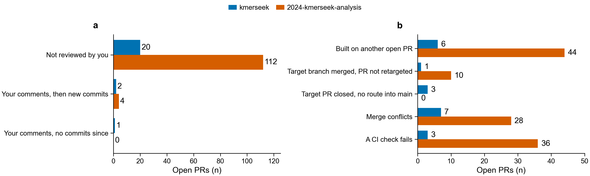

# Weekly PR and issue status, 2026-W43 (Oct 19-25)

> [!NOTE]
> Written by Claude Code (Opus 5.5) at olgabot's request.

Repos: seanome/kmerseek and seanome/2024-kmerseek-analysis. A PR is listed if it was opened,
closed or merged this week, or is open now. Data pulled 2026-10-25.

| | kmerseek | 2024-kmerseek-analysis |
|---|---|---|
| Open PRs | 23 | 116 |
| Merged this week | 1 | 11 |
| Closed, not merged, this week | 0 | 2 |
| Open PRs you have not reviewed | 20 | 112 |



**a**, open PRs by whether you have commented on them. **b**, open PRs by what else holds them
up; one PR can count in several rows. Blue = kmerseek, orange = 2024-kmerseek-analysis.

## How "reviewed" was counted

`pr_status.py` counts every comment from the olgabot account that lacks a "Written by Claude
Code" note as your review. This week that included the nightly review posts and the replies
to them, which carry "Generated by Claude Code" or "Written by Codex" instead. `2026-W43_recount_human_reviews.py` reads each open
PR's full comment history again and leaves out any post with "Written by Codex/Claude",
"Generated by Claude/Codex" or an HTML marker. 7 of 139 open PRs have a comment from you:
kmerseek 113, 133, 137 and 2024-kmerseek-analysis 52, 54, 97, 119. The newest is Oct 14.

## Tables

Review column (the repo's review skill: rustacean-review for kmerseek, analysis-review for
2024-kmerseek-analysis):

- ✅ date: a review comment names the PR's current head commit.
- ⚠️ date, commits since: the newest review comment names an older commit.
- ☐: no review comment found.

A review skill comment is not your review; "Not reviewed" in the last column means you have
not commented.

### seanome/kmerseek

| PR | What it does | Status | rustacean-review | Why it's still open |
|---|---|---|---|---|
| [#158](https://github.com/seanome/kmerseek/pull/158) | Time each search step; filter candidates before reading targets | Merged Oct 24 | ⚠️ Oct 24, commits since |  |
| [#113](https://github.com/seanome/kmerseek/pull/113) | Extend regions with no Karlin-Altschul fit, instead of refusing | Open | ⚠️ Sep 30, commits since | Your comments of Oct 3; no commits since. Its target `olgabot/run-evalue-v2` had PR [#112](https://github.com/seanome/kmerseek/pull/112) closed without merging, so there is no route into `main`. Only the formatting check ran, not the tests. |
| [#114](https://github.com/seanome/kmerseek/pull/114) | Extend matched regions by default when the index has a fit | Open | ⚠️ Sep 30, commits since | **Not reviewed.** Targets [#113](https://github.com/seanome/kmerseek/pull/113). Only the formatting check ran, not the tests. |
| [#130](https://github.com/seanome/kmerseek/pull/130) | Mid-p run E-value; decoy test on other proteins' shuffles | Open | ✅ Oct 21 | **Not reviewed.** Targets [#114](https://github.com/seanome/kmerseek/pull/114). Only the formatting check ran, not the tests. |
| [#133](https://github.com/seanome/kmerseek/pull/133) | Every row gets a run E-value; Poisson E-value dropped | Open | ✅ Oct 20 | **Your comments, then new commits; needs another look.** Merge conflicts. |
| [#134](https://github.com/seanome/kmerseek/pull/134) | Test the run E-value on random and shuffled sequences | Open | ⚠️ Oct 24, commits since | **Not reviewed.** Targets [#133](https://github.com/seanome/kmerseek/pull/133). Only the formatting check ran, not the tests. |
| [#137](https://github.com/seanome/kmerseek/pull/137) | Remove two unused ProteomeIndex fields; fail CI on dead_code allows | Open | ✅ Oct 23 | **Your comments, then new commits; needs another look.** Merge conflicts. Only the formatting check ran, not the tests. |
| [#141](https://github.com/seanome/kmerseek/pull/141) | Key index entries by sequence, so hits get own coordinates | Open | ⚠️ Oct 18, commits since | **Not reviewed.** Its target `olgabot/release-0.4.0` had PR [#64](https://github.com/seanome/kmerseek/pull/64) closed without merging, so there is no route into `main`. Only the formatting check ran, not the tests. |
| [#142](https://github.com/seanome/kmerseek/pull/142) | Search report: rows with no run, --min-runs, label fixes | Open | ☐ | **Not reviewed.** |
| [#143](https://github.com/seanome/kmerseek/pull/143) | Skills: rules from Olga's review comments, Oct 5-11 | Open | ⚠️ Oct 23, commits since | **Not reviewed.** |
| [#144](https://github.com/seanome/kmerseek/pull/144) | --ka-r-database: search with a fit from another index | Open | ⚠️ Oct 20, commits since | **Not reviewed.** |
| [#145](https://github.com/seanome/kmerseek/pull/145) | Add the cys2 alphabet: cysteine against every other residue | Open | ✅ Oct 21 | **Not reviewed.** Failing: Rust Coverage, Test Rust (1.82.0), Test Rust (stable). |
| [#146](https://github.com/seanome/kmerseek/pull/146) | Add aro_hyd_chg_pol4 and aro_hyd_arg_chg_pol5 | Open | ✅ Oct 20 | **Not reviewed.** |
| [#147](https://github.com/seanome/kmerseek/pull/147) | Add the cys2 alphabet on the v0.4.0 release | Open | ✅ Oct 20 | **Not reviewed.** Its target `olgabot/release-0.4.0` had PR [#64](https://github.com/seanome/kmerseek/pull/64) closed without merging, so there is no route into `main`. Only the formatting check ran, not the tests. |
| [#148](https://github.com/seanome/kmerseek/pull/148) | Add hp_pbotc_1st_ed_hpc3 (cys_hp3), and let a cys2 index be searched | Open | ⚠️ Oct 16, commits since | **Not reviewed.** Targets [#145](https://github.com/seanome/kmerseek/pull/145). Merge conflicts. Only the formatting check ran, not the tests. |
| [#149](https://github.com/seanome/kmerseek/pull/149) | PR template with Olga's Why and What I learned | Open | ⚠️ Oct 18, commits since | **Not reviewed.** Failing: notes. |
| [#150](https://github.com/seanome/kmerseek/pull/150) | Figure: three cysteine-aware readings of two toxins | Open | ✅ Oct 20 | **Not reviewed.** Targets [#148](https://github.com/seanome/kmerseek/pull/148). |
| [#152](https://github.com/seanome/kmerseek/pull/152) | Key index entries by their sequence, not their k-mer set | Open | ✅ Oct 18 | **Not reviewed.** Merge conflicts. |
| [#153](https://github.com/seanome/kmerseek/pull/153) | Skip a query's identical database entry in every search | Open | ⚠️ Oct 20, commits since | **Not reviewed.** Merge conflicts. |
| [#154](https://github.com/seanome/kmerseek/pull/154) | Count Karlin-Altschul fit regions per score bin as found | Open | ⚠️ Oct 20, commits since | **Not reviewed.** Merge conflicts. |
| [#155](https://github.com/seanome/kmerseek/pull/155) | Build the "expected one of" alphabet lists from Alphabet::all | Open (draft) | ✅ Oct 23 | **Not reviewed.** Failing: Rust Coverage. |
| [#156](https://github.com/seanome/kmerseek/pull/156) | massspec18 alphabet: I=L and Q=K merged, for peptides | Open | ⚠️ Oct 24, commits since | **Not reviewed.** |
| [#157](https://github.com/seanome/kmerseek/pull/157) | Pr(same class) from each region, for low-complexity E-values | Open | ✅ Oct 24 | **Not reviewed.** Targets [#134](https://github.com/seanome/kmerseek/pull/134). Merge conflicts. Only the formatting check ran, not the tests. |
| [#159](https://github.com/seanome/kmerseek/pull/159) | Read the inverted index in place from posting files | Open | ⚠️ Oct 24, commits since | **Not reviewed.** Its target branch is already in `main`; retarget to `main`. Only the formatting check ran, not the tests. |

### seanome/2024-kmerseek-analysis

| PR | What it does | Status | analysis-review | Why it's still open |
|---|---|---|---|---|
| [#91](https://github.com/seanome/2024-kmerseek-analysis/pull/91) | Shared figure helpers: header placement, alphabet axis, missing-value mark | Merged Oct 24 | ✅ Oct 23 |  |
| [#115](https://github.com/seanome/2024-kmerseek-analysis/pull/115) | parse_disprot.py: read every DisProt page, and only consensus disorder | Merged Oct 24 | ✅ Oct 23 |  |
| [#117](https://github.com/seanome/2024-kmerseek-analysis/pull/117) | Notebook 247: BCL-2 query panel vs CED-9 alone | Merged Oct 24 | ✅ Oct 23 |  |
| [#138](https://github.com/seanome/2024-kmerseek-analysis/pull/138) | Shared dipeptide shuffle for decoy queries: nextflow-runs/shared/decoys.py | Merged Oct 24 | ✅ Oct 23 |  |
| [#142](https://github.com/seanome/2024-kmerseek-analysis/pull/142) | nb292: k-mer keep/eject rule for adaptive sampling, tarantula venom | Merged Oct 24 | ✅ Oct 23 |  |
| [#147](https://github.com/seanome/2024-kmerseek-analysis/pull/147) | Research: what a protein function annotation leaderboard needs | Merged Oct 24 | ✅ Oct 23 |  |
| [#153](https://github.com/seanome/2024-kmerseek-analysis/pull/153) | Figure style: mako colour map by default | Merged Oct 24 | ✅ Oct 23 |  |
| [#159](https://github.com/seanome/2024-kmerseek-analysis/pull/159) | make leaderboard-alphabets: tables for the leaderboard's alphabet page | Merged Oct 24 | ✅ Oct 23 |  |
| [#170](https://github.com/seanome/2024-kmerseek-analysis/pull/170) | nb299: sourmash sketches vs DIAMOND on OM-RGC v2, dead | Merged Oct 23 | ✅ Oct 23 |  |
| [#178](https://github.com/seanome/2024-kmerseek-analysis/pull/178) | nb349: seedless alignment does not separate ice-binding proteins | Merged Oct 24 | ✅ Oct 23 |  |
| [#200](https://github.com/seanome/2024-kmerseek-analysis/pull/200) | Record open notebook PR review and remaining merge blockers | Merged Oct 24 | ☐ |  |
| [#30](https://github.com/seanome/2024-kmerseek-analysis/pull/30) | Dark set: what standard search misses on an invertebrate proteome | Open | ✅ Oct 23 | **Not reviewed.** Its target branch is already in `main`; retarget to `main`. Failing: pipeline definition parses. |
| [#47](https://github.com/seanome/2024-kmerseek-analysis/pull/47) | Add Pfam profile annotations to the dark set | Open | ✅ Oct 23 | **Not reviewed.** Targets [#57](https://github.com/seanome/2024-kmerseek-analysis/pull/57). |
| [#49](https://github.com/seanome/2024-kmerseek-analysis/pull/49) | nb244: hero example candidates on Swiss-Prot features | Open | ✅ Oct 23 | **Not reviewed.** Merge conflicts. |
| [#51](https://github.com/seanome/2024-kmerseek-analysis/pull/51) | nb250: ELM motif benchmark, Stage 0 and labels | Open | ✅ Oct 23 | **Not reviewed.** Merge conflicts. |
| [#52](https://github.com/seanome/2024-kmerseek-analysis/pull/52) | Region pipeline: ungapped kmerseek extension with an E-value | Open | ✅ Oct 23 | **Your comments, then new commits; needs another look.** Its target branch is already in `main`; retarget to `main`. |
| [#53](https://github.com/seanome/2024-kmerseek-analysis/pull/53) | DisProt functional-region transfer benchmark: data, scoring with controls, notebook 251 | Open | ✅ Oct 23 | **Not reviewed.** Targets [#52](https://github.com/seanome/2024-kmerseek-analysis/pull/52). Failing: black. |
| [#54](https://github.com/seanome/2024-kmerseek-analysis/pull/54) | nb245: bits a reduced-alphabet seed carries vs bits needed | Open | ✅ Oct 23 | **Your comments, then new commits; needs another look.** Failing: black, check. |
| [#57](https://github.com/seanome/2024-kmerseek-analysis/pull/57) | Dark set with kmerseek 0.4: the midi run | Open | ✅ Oct 23 | **Not reviewed.** Targets [#30](https://github.com/seanome/2024-kmerseek-analysis/pull/30). Merge conflicts. Failing: black. |
| [#58](https://github.com/seanome/2024-kmerseek-analysis/pull/58) | Score the ELM cover search, with a placement null | Open | ✅ Oct 23 | **Not reviewed.** Targets [#51](https://github.com/seanome/2024-kmerseek-analysis/pull/51). Merge conflicts. Failing: black. |
| [#59](https://github.com/seanome/2024-kmerseek-analysis/pull/59) | Give the Swiss-Prot identity axis a Pfam anchor | Open | ✅ Oct 23 | **Not reviewed.** Merge conflicts. Failing: pipeline definition parses. |
| [#63](https://github.com/seanome/2024-kmerseek-analysis/pull/63) | nb340: E3 detection-gap benchmark and missing baselines | Open | ✅ Oct 23 | **Not reviewed.** Failing: check. |
| [#64](https://github.com/seanome/2024-kmerseek-analysis/pull/64) | Run the family-AUC, RBH-F1 and leaderboard sweeps on Sherlock | Open | ✅ Oct 23 | **Not reviewed.** Merge conflicts. |
| [#65](https://github.com/seanome/2024-kmerseek-analysis/pull/65) | nb24: k-mer spectra across all alphabets, nine figures | Open | ⚠️ Oct 23, commits since | **Not reviewed.** Merge conflicts. |
| [#66](https://github.com/seanome/2024-kmerseek-analysis/pull/66) | Pfam subdomain benchmark: split positive pairs into DIAMOND-hard and DIAMOND-easy | Open | ✅ Oct 23 | **Not reviewed.** Merge conflicts. |
| [#67](https://github.com/seanome/2024-kmerseek-analysis/pull/67) | nb220: BCL2/Bcl-xL vs Ced9, six HP alphabets, k=15-25 | Open | ⚠️ Oct 23, commits since | **Not reviewed.** |
| [#69](https://github.com/seanome/2024-kmerseek-analysis/pull/69) | nb253: are ELM motifs placed right on the chicken ortholog? | Open | ✅ Oct 23 | **Not reviewed.** Targets [#58](https://github.com/seanome/2024-kmerseek-analysis/pull/58). Failing: black. |
| [#71](https://github.com/seanome/2024-kmerseek-analysis/pull/71) | kmerseek search: keep each query's best N targets | Open | ✅ Oct 23 | **Not reviewed.** Targets [#58](https://github.com/seanome/2024-kmerseek-analysis/pull/58). |
| [#72](https://github.com/seanome/2024-kmerseek-analysis/pull/72) | ELM cover on seven more species | Open | ✅ Oct 23 | **Not reviewed.** Targets [#71](https://github.com/seanome/2024-kmerseek-analysis/pull/71). |
| [#75](https://github.com/seanome/2024-kmerseek-analysis/pull/75) | Notebook 238 on the full midi-plus run | Open | ✅ Oct 23 | **Not reviewed.** |
| [#76](https://github.com/seanome/2024-kmerseek-analysis/pull/76) | nb246: ten random 2-letter alphabets beside six H/P ones | Open | ✅ Oct 23 | **Not reviewed.** |
| [#77](https://github.com/seanome/2024-kmerseek-analysis/pull/77) | nb254: seed extension loses nb244's short placements | Open | ✅ Oct 23 | **Not reviewed.** Targets [#49](https://github.com/seanome/2024-kmerseek-analysis/pull/49). Failing: black. |
| [#78](https://github.com/seanome/2024-kmerseek-analysis/pull/78) | nb244: figures and hit pages for all 183 cases | Open | ✅ Oct 23 | **Not reviewed.** Targets [#49](https://github.com/seanome/2024-kmerseek-analysis/pull/49). Merge conflicts. Failing: black. |
| [#80](https://github.com/seanome/2024-kmerseek-analysis/pull/80) | Case gallery: reference pairs, other tools, and every shared k-mer | Open | ✅ Oct 23 | **Not reviewed.** Targets [#78](https://github.com/seanome/2024-kmerseek-analysis/pull/78). Merge conflicts. |
| [#82](https://github.com/seanome/2024-kmerseek-analysis/pull/82) | 244: two bonus cases, Ced-9/BCL2 and BHF | Open | ✅ Oct 23 | **Not reviewed.** Targets [#78](https://github.com/seanome/2024-kmerseek-analysis/pull/78). Merge conflicts. |
| [#83](https://github.com/seanome/2024-kmerseek-analysis/pull/83) | 256: BHF against 300 dipeptide-shuffled copies of itself | Open | ✅ Oct 23 | **Not reviewed.** Its target `olgabot/alphabet-ranking-three-cases` was merged, but has 16 later commits not in `main`. Merge conflicts. Failing: black. |
| [#84](https://github.com/seanome/2024-kmerseek-analysis/pull/84) | nb255: kmerseek ranking vs human Pfam, region length control | Open | ✅ Oct 23 | **Not reviewed.** |
| [#85](https://github.com/seanome/2024-kmerseek-analysis/pull/85) | 257: rerun the 998-protein search with a newer kmerseek | Open | ⚠️ Oct 23, commits since | **Not reviewed.** Its target `olgabot/alphabet-ensemble` was merged, but has 15 later commits not in `main`. Merge conflicts. Failing: black. |
| [#87](https://github.com/seanome/2024-kmerseek-analysis/pull/87) | nb270: --scaled 1-10 on the mini set, with decoys | Open | ⚠️ Oct 23, commits since | **Not reviewed.** Targets [#72](https://github.com/seanome/2024-kmerseek-analysis/pull/72). Failing: black. |
| [#88](https://github.com/seanome/2024-kmerseek-analysis/pull/88) | midi-plus 0.4 with extension, and its shuffled-query twin | Open | ✅ Oct 23 | **Not reviewed.** Targets [#87](https://github.com/seanome/2024-kmerseek-analysis/pull/87). Merge conflicts. |
| [#92](https://github.com/seanome/2024-kmerseek-analysis/pull/92) | Figure: bits of information per letter for all 19 alphabets | Open | ✅ Oct 23 | **Not reviewed.** Targets [#51](https://github.com/seanome/2024-kmerseek-analysis/pull/51). Merge conflicts. |
| [#93](https://github.com/seanome/2024-kmerseek-analysis/pull/93) | Nb 271: which kmerseek region score to filter on | Open | ⚠️ Oct 23, commits since | **Not reviewed.** |
| [#96](https://github.com/seanome/2024-kmerseek-analysis/pull/96) | 245: where P66/CD47 shared k-mers sit vs SIRP-alpha residues | Open | ⚠️ Oct 23, commits since | **Not reviewed.** Its target `olgabot/alphabet-ensemble` was merged, but has 15 later commits not in `main`. Merge conflicts. Failing: black. |
| [#97](https://github.com/seanome/2024-kmerseek-analysis/pull/97) | Experiment inventory, claims page, and its GitHub Pages site | Open | ☐ | **Your comments, then new commits; needs another look.** |
| [#98](https://github.com/seanome/2024-kmerseek-analysis/pull/98) | nb261: combiner A, intersection of fixed alphabet-ksize pairs | Open | ✅ Oct 23 | **Not reviewed.** Targets [#88](https://github.com/seanome/2024-kmerseek-analysis/pull/88). Merge conflicts. Failing: black. |
| [#101](https://github.com/seanome/2024-kmerseek-analysis/pull/101) | 274: k-sizes to test per alphabet, k_min to k_max | Open | ✅ Oct 23 | **Not reviewed.** Merge conflicts. |
| [#102](https://github.com/seanome/2024-kmerseek-analysis/pull/102) | Notebook 262: combiner B, best of n alphabet-ksize pairs | Open | ✅ Oct 23 | **Not reviewed.** Targets [#98](https://github.com/seanome/2024-kmerseek-analysis/pull/98). Failing: black. |
| [#103](https://github.com/seanome/2024-kmerseek-analysis/pull/103) | Notebook 263: combiner C, a consensus vote across alphabet-ksize pairs | Open | ✅ Oct 23 | **Not reviewed.** Targets [#102](https://github.com/seanome/2024-kmerseek-analysis/pull/102). Merge conflicts. Failing: black. |
| [#104](https://github.com/seanome/2024-kmerseek-analysis/pull/104) | nb264: three combiners vs best pair, phmmer, Kyte-Doolittle | Open | ✅ Oct 23 | **Not reviewed.** Targets [#103](https://github.com/seanome/2024-kmerseek-analysis/pull/103). Merge conflicts. Failing: black. |
| [#106](https://github.com/seanome/2024-kmerseek-analysis/pull/106) | Supplementary Figure 1 (alphabets, bits, k-sizes) and seed reach | Open | ✅ Oct 23 | **Not reviewed.** Its target `olgabot/nb230-kappa-all-alphabets` was merged, but has 2 later commits not in `main`. Merge conflicts. |
| [#107](https://github.com/seanome/2024-kmerseek-analysis/pull/107) | SCOPe40 sensitivity with kmerseek 0.4, 19 alphabets | Open | ✅ Oct 23 | **Not reviewed.** Merge conflicts. |
| [#113](https://github.com/seanome/2024-kmerseek-analysis/pull/113) | Notebook 246: seeds that allow mismatches, on CED-9/BCL2 and P66/CD47 | Open | ✅ Oct 23 | **Not reviewed.** |
| [#114](https://github.com/seanome/2024-kmerseek-analysis/pull/114) | Regions-index pilot: three indexes, full run, Pfam result | Open | ✅ Oct 23 | **Not reviewed.** |
| [#118](https://github.com/seanome/2024-kmerseek-analysis/pull/118) | 276: structure does not support P66 mimicking CD47 | Open | ✅ Oct 23 | **Not reviewed.** |
| [#119](https://github.com/seanome/2024-kmerseek-analysis/pull/119) | nb278: no alphabet beats BLOSUM62; H/P leads exact matching | Open | ✅ Oct 23 | **Your comments, then new commits; needs another look.** Its target branch is already in `main`; retarget to `main`. |
| [#120](https://github.com/seanome/2024-kmerseek-analysis/pull/120) | nb279: dark proteins kmerseek reaches at E < 1, E < 10 | Open | ✅ Oct 23 | **Not reviewed.** |
| [#121](https://github.com/seanome/2024-kmerseek-analysis/pull/121) | nb 280: time-split test, Pfam 33.1 to 38.2 | Open | ✅ Oct 23 | **Not reviewed.** |
| [#122](https://github.com/seanome/2024-kmerseek-analysis/pull/122) | Notebook 282: set up the ohnolog split-or-narrow test with Botryllus | Open | ✅ Oct 23 | **Not reviewed.** |
| [#123](https://github.com/seanome/2024-kmerseek-analysis/pull/123) | Figures as 256-colour PNGs: pf.save, shrink_png, and 321 committed PNGs | Open | ✅ Oct 23 | **Not reviewed.** Merge conflicts. |
| [#124](https://github.com/seanome/2024-kmerseek-analysis/pull/124) | 283: does BHF beat copies that keep its low-complexity stretches? | Open | ⚠️ Oct 23, commits since | **Not reviewed.** Targets [#83](https://github.com/seanome/2024-kmerseek-analysis/pull/83). |
| [#125](https://github.com/seanome/2024-kmerseek-analysis/pull/125) | nb284: only 4 of 19 alphabets agree on BCL2's region | Open | ✅ Oct 23 | **Not reviewed.** |
| [#126](https://github.com/seanome/2024-kmerseek-analysis/pull/126) | Notebook 281: Botryllus links to MHC, histocompatibility and self/non-self proteins | Open | ✅ Oct 23 | **Not reviewed.** |
| [#127](https://github.com/seanome/2024-kmerseek-analysis/pull/127) | Progress summary for readers without the local chats | Open | ✅ Oct 23 | **Not reviewed.** |
| [#128](https://github.com/seanome/2024-kmerseek-analysis/pull/128) | nb285: pooling BCL-2 family calls ranks Ced9 39th | Open | ✅ Oct 23 | **Not reviewed.** Targets [#125](https://github.com/seanome/2024-kmerseek-analysis/pull/125). |
| [#129](https://github.com/seanome/2024-kmerseek-analysis/pull/129) | 288: Ced9-BCL2 and P66-CD47 as pairwise and two-step searches | Open | ✅ Oct 23 | **Not reviewed.** Targets [#125](https://github.com/seanome/2024-kmerseek-analysis/pull/125). |
| [#130](https://github.com/seanome/2024-kmerseek-analysis/pull/130) | 286: reach BCL2 from Ced9 through a human protein? | Open | ✅ Oct 23 | **Not reviewed.** Targets [#125](https://github.com/seanome/2024-kmerseek-analysis/pull/125). |
| [#131](https://github.com/seanome/2024-kmerseek-analysis/pull/131) | nb287: sum statistics do not rescue Ced9-BCL2 or P66-CD47 | Open | ✅ Oct 23 | **Not reviewed.** Targets [#125](https://github.com/seanome/2024-kmerseek-analysis/pull/125). |
| [#132](https://github.com/seanome/2024-kmerseek-analysis/pull/132) | 289: reverse search ranks Ced9 30th, P66 381st | Open | ✅ Oct 23 | **Not reviewed.** Targets [#124](https://github.com/seanome/2024-kmerseek-analysis/pull/124). Failing: black. |
| [#133](https://github.com/seanome/2024-kmerseek-analysis/pull/133) | Dark set: summary page for the 0.4 midi run | Open | ✅ Oct 23 | **Not reviewed.** Targets [#57](https://github.com/seanome/2024-kmerseek-analysis/pull/57). |
| [#134](https://github.com/seanome/2024-kmerseek-analysis/pull/134) | 290: dark proteins kmerseek reaches against shuffled copies | Open | ✅ Oct 23 | **Not reviewed.** Targets [#120](https://github.com/seanome/2024-kmerseek-analysis/pull/120). |
| [#135](https://github.com/seanome/2024-kmerseek-analysis/pull/135) | make running: group tasks under their head's launch folder | Open | ✅ Oct 23 | **Not reviewed.** Merge conflicts. |
| [#139](https://github.com/seanome/2024-kmerseek-analysis/pull/139) | nb284: what an exact k-mer counts that BLOSUM62 misses | Open | ⚠️ Oct 23, commits since | **Not reviewed.** Its target branch is already in `main`; retarget to `main`. |
| [#140](https://github.com/seanome/2024-kmerseek-analysis/pull/140) | nb 341: condensate exons, day 1 | Open | ✅ Oct 23 | **Not reviewed.** Failing: check. |
| [#141](https://github.com/seanome/2024-kmerseek-analysis/pull/141) | Convergence kill test: ice-binding proteins FAIL | Open | ✅ Oct 23 | **Not reviewed.** Failing: check. |
| [#143](https://github.com/seanome/2024-kmerseek-analysis/pull/143) | nb294: linked HP word pairs kill test: KILL | Open | ⚠️ Oct 23, commits since | **Not reviewed.** |
| [#144](https://github.com/seanome/2024-kmerseek-analysis/pull/144) | make leaderboard-tables: the tables the leaderboard site reads | Open | ✅ Oct 23 | **Not reviewed.** Merge conflicts. |
| [#145](https://github.com/seanome/2024-kmerseek-analysis/pull/145) | cys-frameworks: cysteine-framework peptide pipeline; pilot runs on Sherlock | Open | ✅ Oct 23 | **Not reviewed.** Its target branch is already in `main`; retarget to `main`. |
| [#146](https://github.com/seanome/2024-kmerseek-analysis/pull/146) | make leaderboard-pileup: tables for the region pile-up figure | Open | ✅ Oct 23 | **Not reviewed.** Targets [#144](https://github.com/seanome/2024-kmerseek-analysis/pull/144). Merge conflicts. |
| [#148](https://github.com/seanome/2024-kmerseek-analysis/pull/148) | leaderboard-tables: one long table of every finished benchmark | Open | ✅ Oct 23 | **Not reviewed.** Targets [#144](https://github.com/seanome/2024-kmerseek-analysis/pull/144). Merge conflicts. |
| [#149](https://github.com/seanome/2024-kmerseek-analysis/pull/149) | Script to rewrite history so past figures are 256-colour PNGs | Open | ✅ Oct 23 | **Not reviewed.** Targets [#123](https://github.com/seanome/2024-kmerseek-analysis/pull/123). |
| [#150](https://github.com/seanome/2024-kmerseek-analysis/pull/150) | PR template with Olga's Why and What I learned | Open | ✅ Oct 23 | **Not reviewed.** |
| [#152](https://github.com/seanome/2024-kmerseek-analysis/pull/152) | nb342: exon function kill test: KILL on three settings | Open | ✅ Oct 23 | **Not reviewed.** Targets [#140](https://github.com/seanome/2024-kmerseek-analysis/pull/140). |
| [#154](https://github.com/seanome/2024-kmerseek-analysis/pull/154) | Leaderboard reads Pfam pairs, DisProt cost, k-mer counts | Open | ✅ Oct 23 | **Not reviewed.** Targets [#148](https://github.com/seanome/2024-kmerseek-analysis/pull/148). |
| [#155](https://github.com/seanome/2024-kmerseek-analysis/pull/155) | Dark set: Foldseek and ProstT5 on every query | Open | ✅ Oct 23 | **Not reviewed.** Targets [#57](https://github.com/seanome/2024-kmerseek-analysis/pull/57). |
| [#156](https://github.com/seanome/2024-kmerseek-analysis/pull/156) | CONTRIBUTING.md for tool modules, and a hits-format check | Open | ✅ Oct 23 | **Not reviewed.** Targets [#160](https://github.com/seanome/2024-kmerseek-analysis/pull/160). |
| [#158](https://github.com/seanome/2024-kmerseek-analysis/pull/158) | No-search baselines (Kyte-Doolittle, IUPred, SEG...) as leaderboard rows | Open | ✅ Oct 23 | **Not reviewed.** |
| [#160](https://github.com/seanome/2024-kmerseek-analysis/pull/160) | DIAMOND and MMseqs2 best-hit transfer as leaderboard rows | Open | ✅ Oct 23 | **Not reviewed.** |
| [#161](https://github.com/seanome/2024-kmerseek-analysis/pull/161) | Annotator tools 2: InterProScan and eggNOG-mapper as reference-database rows | Open | ✅ Oct 23 | **Not reviewed.** Targets [#160](https://github.com/seanome/2024-kmerseek-analysis/pull/160). Failing: scoring, metrics and report. |
| [#162](https://github.com/seanome/2024-kmerseek-analysis/pull/162) | Annotator tools 3: TM-Vec and PLMSearch embedding search rows | Open | ✅ Oct 23 | **Not reviewed.** Targets [#161](https://github.com/seanome/2024-kmerseek-analysis/pull/161). Failing: scoring, metrics and report. |
| [#163](https://github.com/seanome/2024-kmerseek-analysis/pull/163) | Dark set: is a weak best hit right, by E-value band | Open | ✅ Oct 23 | **Not reviewed.** Targets [#133](https://github.com/seanome/2024-kmerseek-analysis/pull/133). |
| [#164](https://github.com/seanome/2024-kmerseek-analysis/pull/164) | Eight leaderboard query subsets for the 998 midi-plus queries | Open | ✅ Oct 23 | **Not reviewed.** Targets [#148](https://github.com/seanome/2024-kmerseek-analysis/pull/148). |
| [#165](https://github.com/seanome/2024-kmerseek-analysis/pull/165) | Pfam-N recall: count only regions on searched proteins | Open | ✅ Oct 23 | **Not reviewed.** Targets [#148](https://github.com/seanome/2024-kmerseek-analysis/pull/148). |
| [#166](https://github.com/seanome/2024-kmerseek-analysis/pull/166) | SCOPe40 hit lists for every Table 1 tool | Open | ✅ Oct 23 | **Not reviewed.** |
| [#167](https://github.com/seanome/2024-kmerseek-analysis/pull/167) | Notebook 296: cysteine-framework pilot, Cnidaria, kmerseek vs phmmer and regex | Open | ✅ Oct 23 | **Not reviewed.** Targets [#145](https://github.com/seanome/2024-kmerseek-analysis/pull/145). Failing: check. |
| [#168](https://github.com/seanome/2024-kmerseek-analysis/pull/168) | nb297: cys_hp3 phylum run vs phmmer and cysteine regex | Open | ✅ Oct 23 | **Not reviewed.** Targets [#167](https://github.com/seanome/2024-kmerseek-analysis/pull/167). |
| [#169](https://github.com/seanome/2024-kmerseek-analysis/pull/169) | eDNA market: who pays, would protein naming help | Open | ✅ Oct 23 | **Not reviewed.** Failing: check. |
| [#171](https://github.com/seanome/2024-kmerseek-analysis/pull/171) | Weekly PR status, 2026-W42 | Open | ☐ | **Not reviewed.** |
| [#172](https://github.com/seanome/2024-kmerseek-analysis/pull/172) | nb345: does one more proteome add new sequence? | Open | ✅ Oct 23 | **Not reviewed.** Failing: check. |
| [#173](https://github.com/seanome/2024-kmerseek-analysis/pull/173) | nb343: same reduced k-mers in new order, only at short k | Open | ✅ Oct 23 | **Not reviewed.** Failing: check. |
| [#174](https://github.com/seanome/2024-kmerseek-analysis/pull/174) | 344: kmerseek 0.4.0 region E-values fail calibration on 309,000 decoys | Open | ✅ Oct 23 | **Not reviewed.** Merge conflicts. |
| [#175](https://github.com/seanome/2024-kmerseek-analysis/pull/175) | nb298: linked word pairs miss other lineages' ice-binding proteins | Open | ✅ Oct 23 | **Not reviewed.** Targets [#141](https://github.com/seanome/2024-kmerseek-analysis/pull/141). |
| [#176](https://github.com/seanome/2024-kmerseek-analysis/pull/176) | nb346: linked HP word pairs at database scale: KILL | Open | ✅ Oct 23 | **Not reviewed.** Failing: check. |
| [#177](https://github.com/seanome/2024-kmerseek-analysis/pull/177) | nb347: mutations a reduced alphabet cannot see, PTEN abundance | Open | ☐ | **Not reviewed.** Failing: check. |
| [#179](https://github.com/seanome/2024-kmerseek-analysis/pull/179) | nb350: toxin-framework hits lost in ranking, not seeds | Open | ☐ | **Not reviewed.** |
| [#180](https://github.com/seanome/2024-kmerseek-analysis/pull/180) | Venom-peptide retrieval: cysteine framework, fold and target are three questions | Open | ☐ | **Not reviewed.** Targets [#145](https://github.com/seanome/2024-kmerseek-analysis/pull/145). |
| [#182](https://github.com/seanome/2024-kmerseek-analysis/pull/182) | nb301: short-feature settings partly drop; 16 memory failures | Open | ✅ Oct 23 | **Not reviewed.** Failing: check. |
| [#183](https://github.com/seanome/2024-kmerseek-analysis/pull/183) | nb352: time index build and 1,000 queries on UniParc | Open | ✅ Oct 23 | **Not reviewed.** |
| [#184](https://github.com/seanome/2024-kmerseek-analysis/pull/184) | nb353: short-stretch lookup kill test, not run | Open | ✅ Oct 23 | **Not reviewed.** Its target branch is already in `main`; retarget to `main`. |
| [#185](https://github.com/seanome/2024-kmerseek-analysis/pull/185) | 344 calibration rerun on kmerseek PR 157 | Open | ☐ | **Not reviewed.** Targets [#174](https://github.com/seanome/2024-kmerseek-analysis/pull/174). |
| [#186](https://github.com/seanome/2024-kmerseek-analysis/pull/186) | Construct insert check: frozen plan, templates, pipeline, INSUFFICIENT_EVIDENCE | Open | ☐ | **Not reviewed.** |
| [#188](https://github.com/seanome/2024-kmerseek-analysis/pull/188) | nb353: find existing measurements faster? Pipeline only, no queue | Open | ☐ | **Not reviewed.** |
| [#189](https://github.com/seanome/2024-kmerseek-analysis/pull/189) | nb355: construct-check kill test not run, no submissions | Open | ✅ Oct 23 | **Not reviewed.** |
| [#190](https://github.com/seanome/2024-kmerseek-analysis/pull/190) | nb356: kmerseek on short exons, ~3 points above null | Open | ✅ Oct 23 | **Not reviewed.** Failing: check. |
| [#191](https://github.com/seanome/2024-kmerseek-analysis/pull/191) | nb357: pre-registration, Stop 0 and Stop 1 scripts | Open | ✅ Oct 23 | **Not reviewed.** |
| [#192](https://github.com/seanome/2024-kmerseek-analysis/pull/192) | nb358: peptide source lookup, reduced vs full alphabet | Open | ☐ | **Not reviewed.** Failing: check. |
| [#193](https://github.com/seanome/2024-kmerseek-analysis/pull/193) | nb354: massspec18 peptide source lookup kill test: FAIL | Open | ✅ Oct 23 | **Not reviewed.** |
| [#194](https://github.com/seanome/2024-kmerseek-analysis/pull/194) | 241: rerun hp_lehninger_hpc3 k21 with exact regions | Open | ✅ Oct 23 | **Not reviewed.** Failing: check. |
| [#195](https://github.com/seanome/2024-kmerseek-analysis/pull/195) | nb359: region calls on blank alternative exons, not run | Open | ✅ Oct 23 | **Not reviewed.** |
| [#196](https://github.com/seanome/2024-kmerseek-analysis/pull/196) | Notebook 357: clade-grouped SPLASH experiment stopped; results preserved | Open | ✅ Oct 23 | **Not reviewed.** |
| [#197](https://github.com/seanome/2024-kmerseek-analysis/pull/197) | Botryllus RNA-seq: nf-core/rnaseq pre-processing only, on Sherlock | Open | ☐ | **Not reviewed.** Failing: check. |
| [#198](https://github.com/seanome/2024-kmerseek-analysis/pull/198) | Freeze RNA-seq kill-test rules and add pre-run checks | Open | ☐ | **Not reviewed.** |
| [#199](https://github.com/seanome/2024-kmerseek-analysis/pull/199) | nb300: peptide lookup gate, query set, and measured index-build plan | Open | ✅ Oct 23 | **Not reviewed.** |
| [#201](https://github.com/seanome/2024-kmerseek-analysis/pull/201) | nb361: Domen et al. 2026 PEC RNA-seq without a genome | Open | ☐ | **Not reviewed.** |
| [#202](https://github.com/seanome/2024-kmerseek-analysis/pull/202) | Extend significant oyster anchors and start public bivalve searches | Open | ⚠️ Oct 24, commits since | **Not reviewed.** Failing: check. |
| [#203](https://github.com/seanome/2024-kmerseek-analysis/pull/203) | Preserve Botryllus Shazam checkpoint and resume full-depth analysis | Open | ⚠️ Oct 24, commits since | **Not reviewed.** |
| [#204](https://github.com/seanome/2024-kmerseek-analysis/pull/204) | Metro maps of the oyster and PEC nb361 workflows | Open | ⚠️ Oct 24, commits since | **Not reviewed.** Failing: check. |
| [#205](https://github.com/seanome/2024-kmerseek-analysis/pull/205) | Standalone Rust read screening, Orpheum-style | Open | ☐ | **Not reviewed.** Targets [#202](https://github.com/seanome/2024-kmerseek-analysis/pull/202). |
| [#181](https://github.com/seanome/2024-kmerseek-analysis/pull/181) | Notebook 351: can kmerseek place short-feature boundaries? Prereg and data | Closed, not merged Oct 20 | ☐ |  |
| [#187](https://github.com/seanome/2024-kmerseek-analysis/pull/187) | Notebook 354: peptide source lookup, reduced vs full alphabet; INSUFFICIENT_EVIDENCE | Closed, not merged Oct 20 | ☐ |  |

## Issues

No issue was opened or closed this week in either repo. 39 open kmerseek issues and 5 open
2024-kmerseek-analysis issues; of those, only the FAIR Compliance Dashboard issues
(kmerseek issue 15, 2024-kmerseek-analysis issue 12) were updated, on Oct 24.

## What to review first

- **kmerseek 133, then 134, then 157.** 133 has your Oct 10 question ("too many e-values")
  and new commits since. 157 is what 2024-kmerseek-analysis PR 185 (the nb344 calibration
  rerun) runs on, so 185's result means nothing until this stack is read.
- **kmerseek 113, 114, 130 have no route into `main`.** 113 targets `olgabot/run-evalue-v2`,
  whose PR 112 was closed without merging. Your Oct 3 question on 113 (is it needed, given
  kmerseek PR 110?) has no reply. Decide that before reading 114 and 130.
- **2024-kmerseek-analysis 51 is the base of 12 PRs** (51, 58, 69, 71, 72, 87, 88, 92, 98, 102,
  103, 104), with merge conflicts at 51. None of the 11 above
  it can move until 51 is read. The dark-set stack (30, 47, 57, 133, 155, 163) sits on a
  branch already in `main`: 30 needs retargeting first.
- **kmerseek 159** (Swiss-Prot search 165 s to 1 s): its target, PR 158, merged Oct 24.
  Retarget to `main` so the tests run; only the formatting check has run on it.

## To-do list for Notion

In review order: the PR a stack is built on first, then the PRs built on it in stack
order; then PRs you have commented on; then the rest, newest commit first.

```markdown

## seanome/kmerseek

- [ ] [#113](https://github.com/seanome/kmerseek/pull/113) Extend regions with no Karlin-Altschul fit, instead of refusing: Your comments of Oct 3; no commits since. Its target `olgabot/run-evalue-v2` had PR [#112](https://github.com/seanome/kmerseek/pull/112) closed without merging, so there is no route into `main`. Only the formatting check ran, not the tests.
- [ ] [#114](https://github.com/seanome/kmerseek/pull/114) Extend matched regions by default when the index has a fit: Not reviewed. Targets [#113](https://github.com/seanome/kmerseek/pull/113). Only the formatting check ran, not the tests.
- [ ] [#130](https://github.com/seanome/kmerseek/pull/130) Mid-p run E-value; decoy test on other proteins' shuffles: Not reviewed. Targets [#114](https://github.com/seanome/kmerseek/pull/114). Only the formatting check ran, not the tests.
- [ ] [#133](https://github.com/seanome/kmerseek/pull/133) Every row gets a run E-value; Poisson E-value dropped: Your comments, then new commits; needs another look. Merge conflicts.
- [ ] [#134](https://github.com/seanome/kmerseek/pull/134) Test the run E-value on random and shuffled sequences: Not reviewed. Targets [#133](https://github.com/seanome/kmerseek/pull/133). Only the formatting check ran, not the tests.
- [ ] [#157](https://github.com/seanome/kmerseek/pull/157) Pr(same class) from each region, for low-complexity E-values: Not reviewed. Targets [#134](https://github.com/seanome/kmerseek/pull/134). Merge conflicts. Only the formatting check ran, not the tests.
- [ ] [#145](https://github.com/seanome/kmerseek/pull/145) Add the cys2 alphabet: cysteine against every other residue: Not reviewed. Failing: Rust Coverage, Test Rust (1.82.0), Test Rust (stable).
- [ ] [#148](https://github.com/seanome/kmerseek/pull/148) Add hp_pbotc_1st_ed_hpc3 (cys_hp3), and let a cys2 index be searched: Not reviewed. Targets [#145](https://github.com/seanome/kmerseek/pull/145). Merge conflicts. Only the formatting check ran, not the tests.
- [ ] [#150](https://github.com/seanome/kmerseek/pull/150) Figure: three cysteine-aware readings of two toxins: Not reviewed. Targets [#148](https://github.com/seanome/kmerseek/pull/148).
- [ ] [#137](https://github.com/seanome/kmerseek/pull/137) Remove two unused ProteomeIndex fields; fail CI on dead_code allows: Your comments, then new commits; needs another look. Merge conflicts. Only the formatting check ran, not the tests.
- [ ] [#141](https://github.com/seanome/kmerseek/pull/141) Key index entries by sequence, so hits get own coordinates: Not reviewed. Its target `olgabot/release-0.4.0` had PR [#64](https://github.com/seanome/kmerseek/pull/64) closed without merging, so there is no route into `main`. Only the formatting check ran, not the tests.
- [ ] [#143](https://github.com/seanome/kmerseek/pull/143) Skills: rules from Olga's review comments, Oct 5-11: Not reviewed.
- [ ] [#156](https://github.com/seanome/kmerseek/pull/156) massspec18 alphabet: I=L and Q=K merged, for peptides: Not reviewed.
- [ ] [#159](https://github.com/seanome/kmerseek/pull/159) Read the inverted index in place from posting files: Not reviewed. Its target branch is already in `main`; retarget to `main`. Only the formatting check ran, not the tests.
- [ ] [#144](https://github.com/seanome/kmerseek/pull/144) --ka-r-database: search with a fit from another index: Not reviewed.
- [ ] [#153](https://github.com/seanome/kmerseek/pull/153) Skip a query's identical database entry in every search: Not reviewed. Merge conflicts.
- [ ] [#154](https://github.com/seanome/kmerseek/pull/154) Count Karlin-Altschul fit regions per score bin as found: Not reviewed. Merge conflicts.
- [ ] [#146](https://github.com/seanome/kmerseek/pull/146) Add aro_hyd_chg_pol4 and aro_hyd_arg_chg_pol5: Not reviewed.
- [ ] [#147](https://github.com/seanome/kmerseek/pull/147) Add the cys2 alphabet on the v0.4.0 release: Not reviewed. Its target `olgabot/release-0.4.0` had PR [#64](https://github.com/seanome/kmerseek/pull/64) closed without merging, so there is no route into `main`. Only the formatting check ran, not the tests.
- [ ] [#155](https://github.com/seanome/kmerseek/pull/155) Build the "expected one of" alphabet lists from Alphabet::all: Not reviewed. Failing: Rust Coverage.
- [ ] [#142](https://github.com/seanome/kmerseek/pull/142) Search report: rows with no run, --min-runs, label fixes: Not reviewed.
- [ ] [#149](https://github.com/seanome/kmerseek/pull/149) PR template with Olga's Why and What I learned: Not reviewed. Failing: notes.
- [ ] [#152](https://github.com/seanome/kmerseek/pull/152) Key index entries by their sequence, not their k-mer set: Not reviewed. Merge conflicts.

## seanome/2024-kmerseek-analysis

- [ ] [#51](https://github.com/seanome/2024-kmerseek-analysis/pull/51) nb250: ELM motif benchmark, Stage 0 and labels: Not reviewed. Merge conflicts.
- [ ] [#58](https://github.com/seanome/2024-kmerseek-analysis/pull/58) Score the ELM cover search, with a placement null: Not reviewed. Targets [#51](https://github.com/seanome/2024-kmerseek-analysis/pull/51). Merge conflicts. Failing: black.
- [ ] [#69](https://github.com/seanome/2024-kmerseek-analysis/pull/69) nb253: are ELM motifs placed right on the chicken ortholog?: Not reviewed. Targets [#58](https://github.com/seanome/2024-kmerseek-analysis/pull/58). Failing: black.
- [ ] [#71](https://github.com/seanome/2024-kmerseek-analysis/pull/71) kmerseek search: keep each query's best N targets: Not reviewed. Targets [#58](https://github.com/seanome/2024-kmerseek-analysis/pull/58).
- [ ] [#72](https://github.com/seanome/2024-kmerseek-analysis/pull/72) ELM cover on seven more species: Not reviewed. Targets [#71](https://github.com/seanome/2024-kmerseek-analysis/pull/71).
- [ ] [#87](https://github.com/seanome/2024-kmerseek-analysis/pull/87) nb270: --scaled 1-10 on the mini set, with decoys: Not reviewed. Targets [#72](https://github.com/seanome/2024-kmerseek-analysis/pull/72). Failing: black.
- [ ] [#88](https://github.com/seanome/2024-kmerseek-analysis/pull/88) midi-plus 0.4 with extension, and its shuffled-query twin: Not reviewed. Targets [#87](https://github.com/seanome/2024-kmerseek-analysis/pull/87). Merge conflicts.
- [ ] [#98](https://github.com/seanome/2024-kmerseek-analysis/pull/98) nb261: combiner A, intersection of fixed alphabet-ksize pairs: Not reviewed. Targets [#88](https://github.com/seanome/2024-kmerseek-analysis/pull/88). Merge conflicts. Failing: black.
- [ ] [#102](https://github.com/seanome/2024-kmerseek-analysis/pull/102) Notebook 262: combiner B, best of n alphabet-ksize pairs: Not reviewed. Targets [#98](https://github.com/seanome/2024-kmerseek-analysis/pull/98). Failing: black.
- [ ] [#103](https://github.com/seanome/2024-kmerseek-analysis/pull/103) Notebook 263: combiner C, a consensus vote across alphabet-ksize pairs: Not reviewed. Targets [#102](https://github.com/seanome/2024-kmerseek-analysis/pull/102). Merge conflicts. Failing: black.
- [ ] [#104](https://github.com/seanome/2024-kmerseek-analysis/pull/104) nb264: three combiners vs best pair, phmmer, Kyte-Doolittle: Not reviewed. Targets [#103](https://github.com/seanome/2024-kmerseek-analysis/pull/103). Merge conflicts. Failing: black.
- [ ] [#92](https://github.com/seanome/2024-kmerseek-analysis/pull/92) Figure: bits of information per letter for all 19 alphabets: Not reviewed. Targets [#51](https://github.com/seanome/2024-kmerseek-analysis/pull/51). Merge conflicts.
- [ ] [#30](https://github.com/seanome/2024-kmerseek-analysis/pull/30) Dark set: what standard search misses on an invertebrate proteome: Not reviewed. Its target branch is already in `main`; retarget to `main`. Failing: pipeline definition parses.
- [ ] [#57](https://github.com/seanome/2024-kmerseek-analysis/pull/57) Dark set with kmerseek 0.4: the midi run: Not reviewed. Targets [#30](https://github.com/seanome/2024-kmerseek-analysis/pull/30). Merge conflicts. Failing: black.
- [ ] [#47](https://github.com/seanome/2024-kmerseek-analysis/pull/47) Add Pfam profile annotations to the dark set: Not reviewed. Targets [#57](https://github.com/seanome/2024-kmerseek-analysis/pull/57).
- [ ] [#133](https://github.com/seanome/2024-kmerseek-analysis/pull/133) Dark set: summary page for the 0.4 midi run: Not reviewed. Targets [#57](https://github.com/seanome/2024-kmerseek-analysis/pull/57).
- [ ] [#163](https://github.com/seanome/2024-kmerseek-analysis/pull/163) Dark set: is a weak best hit right, by E-value band: Not reviewed. Targets [#133](https://github.com/seanome/2024-kmerseek-analysis/pull/133).
- [ ] [#155](https://github.com/seanome/2024-kmerseek-analysis/pull/155) Dark set: Foldseek and ProstT5 on every query: Not reviewed. Targets [#57](https://github.com/seanome/2024-kmerseek-analysis/pull/57).
- [ ] [#144](https://github.com/seanome/2024-kmerseek-analysis/pull/144) make leaderboard-tables: the tables the leaderboard site reads: Not reviewed. Merge conflicts.
- [ ] [#146](https://github.com/seanome/2024-kmerseek-analysis/pull/146) make leaderboard-pileup: tables for the region pile-up figure: Not reviewed. Targets [#144](https://github.com/seanome/2024-kmerseek-analysis/pull/144). Merge conflicts.
- [ ] [#148](https://github.com/seanome/2024-kmerseek-analysis/pull/148) leaderboard-tables: one long table of every finished benchmark: Not reviewed. Targets [#144](https://github.com/seanome/2024-kmerseek-analysis/pull/144). Merge conflicts.
- [ ] [#154](https://github.com/seanome/2024-kmerseek-analysis/pull/154) Leaderboard reads Pfam pairs, DisProt cost, k-mer counts: Not reviewed. Targets [#148](https://github.com/seanome/2024-kmerseek-analysis/pull/148).
- [ ] [#164](https://github.com/seanome/2024-kmerseek-analysis/pull/164) Eight leaderboard query subsets for the 998 midi-plus queries: Not reviewed. Targets [#148](https://github.com/seanome/2024-kmerseek-analysis/pull/148).
- [ ] [#165](https://github.com/seanome/2024-kmerseek-analysis/pull/165) Pfam-N recall: count only regions on searched proteins: Not reviewed. Targets [#148](https://github.com/seanome/2024-kmerseek-analysis/pull/148).
- [ ] [#49](https://github.com/seanome/2024-kmerseek-analysis/pull/49) nb244: hero example candidates on Swiss-Prot features: Not reviewed. Merge conflicts.
- [ ] [#77](https://github.com/seanome/2024-kmerseek-analysis/pull/77) nb254: seed extension loses nb244's short placements: Not reviewed. Targets [#49](https://github.com/seanome/2024-kmerseek-analysis/pull/49). Failing: black.
- [ ] [#78](https://github.com/seanome/2024-kmerseek-analysis/pull/78) nb244: figures and hit pages for all 183 cases: Not reviewed. Targets [#49](https://github.com/seanome/2024-kmerseek-analysis/pull/49). Merge conflicts. Failing: black.
- [ ] [#80](https://github.com/seanome/2024-kmerseek-analysis/pull/80) Case gallery: reference pairs, other tools, and every shared k-mer: Not reviewed. Targets [#78](https://github.com/seanome/2024-kmerseek-analysis/pull/78). Merge conflicts.
- [ ] [#82](https://github.com/seanome/2024-kmerseek-analysis/pull/82) 244: two bonus cases, Ced-9/BCL2 and BHF: Not reviewed. Targets [#78](https://github.com/seanome/2024-kmerseek-analysis/pull/78). Merge conflicts.
- [ ] [#125](https://github.com/seanome/2024-kmerseek-analysis/pull/125) nb284: only 4 of 19 alphabets agree on BCL2's region: Not reviewed.
- [ ] [#128](https://github.com/seanome/2024-kmerseek-analysis/pull/128) nb285: pooling BCL-2 family calls ranks Ced9 39th: Not reviewed. Targets [#125](https://github.com/seanome/2024-kmerseek-analysis/pull/125).
- [ ] [#129](https://github.com/seanome/2024-kmerseek-analysis/pull/129) 288: Ced9-BCL2 and P66-CD47 as pairwise and two-step searches: Not reviewed. Targets [#125](https://github.com/seanome/2024-kmerseek-analysis/pull/125).
- [ ] [#130](https://github.com/seanome/2024-kmerseek-analysis/pull/130) 286: reach BCL2 from Ced9 through a human protein?: Not reviewed. Targets [#125](https://github.com/seanome/2024-kmerseek-analysis/pull/125).
- [ ] [#131](https://github.com/seanome/2024-kmerseek-analysis/pull/131) nb287: sum statistics do not rescue Ced9-BCL2 or P66-CD47: Not reviewed. Targets [#125](https://github.com/seanome/2024-kmerseek-analysis/pull/125).
- [ ] [#145](https://github.com/seanome/2024-kmerseek-analysis/pull/145) cys-frameworks: cysteine-framework peptide pipeline; pilot runs on Sherlock: Not reviewed. Its target branch is already in `main`; retarget to `main`.
- [ ] [#167](https://github.com/seanome/2024-kmerseek-analysis/pull/167) Notebook 296: cysteine-framework pilot, Cnidaria, kmerseek vs phmmer and regex: Not reviewed. Targets [#145](https://github.com/seanome/2024-kmerseek-analysis/pull/145). Failing: check.
- [ ] [#168](https://github.com/seanome/2024-kmerseek-analysis/pull/168) nb297: cys_hp3 phylum run vs phmmer and cysteine regex: Not reviewed. Targets [#167](https://github.com/seanome/2024-kmerseek-analysis/pull/167).
- [ ] [#180](https://github.com/seanome/2024-kmerseek-analysis/pull/180) Venom-peptide retrieval: cysteine framework, fold and target are three questions: Not reviewed. Targets [#145](https://github.com/seanome/2024-kmerseek-analysis/pull/145).
- [ ] [#160](https://github.com/seanome/2024-kmerseek-analysis/pull/160) DIAMOND and MMseqs2 best-hit transfer as leaderboard rows: Not reviewed.
- [ ] [#156](https://github.com/seanome/2024-kmerseek-analysis/pull/156) CONTRIBUTING.md for tool modules, and a hits-format check: Not reviewed. Targets [#160](https://github.com/seanome/2024-kmerseek-analysis/pull/160).
- [ ] [#161](https://github.com/seanome/2024-kmerseek-analysis/pull/161) Annotator tools 2: InterProScan and eggNOG-mapper as reference-database rows: Not reviewed. Targets [#160](https://github.com/seanome/2024-kmerseek-analysis/pull/160). Failing: scoring, metrics and report.
- [ ] [#162](https://github.com/seanome/2024-kmerseek-analysis/pull/162) Annotator tools 3: TM-Vec and PLMSearch embedding search rows: Not reviewed. Targets [#161](https://github.com/seanome/2024-kmerseek-analysis/pull/161). Failing: scoring, metrics and report.
- [ ] [#83](https://github.com/seanome/2024-kmerseek-analysis/pull/83) 256: BHF against 300 dipeptide-shuffled copies of itself: Not reviewed. Its target `olgabot/alphabet-ranking-three-cases` was merged, but has 16 later commits not in `main`. Merge conflicts. Failing: black.
- [ ] [#124](https://github.com/seanome/2024-kmerseek-analysis/pull/124) 283: does BHF beat copies that keep its low-complexity stretches?: Not reviewed. Targets [#83](https://github.com/seanome/2024-kmerseek-analysis/pull/83).
- [ ] [#132](https://github.com/seanome/2024-kmerseek-analysis/pull/132) 289: reverse search ranks Ced9 30th, P66 381st: Not reviewed. Targets [#124](https://github.com/seanome/2024-kmerseek-analysis/pull/124). Failing: black.
- [ ] [#52](https://github.com/seanome/2024-kmerseek-analysis/pull/52) Region pipeline: ungapped kmerseek extension with an E-value: Your comments, then new commits; needs another look. Its target branch is already in `main`; retarget to `main`.
- [ ] [#53](https://github.com/seanome/2024-kmerseek-analysis/pull/53) DisProt functional-region transfer benchmark: data, scoring with controls, notebook 251: Not reviewed. Targets [#52](https://github.com/seanome/2024-kmerseek-analysis/pull/52). Failing: black.
- [ ] [#120](https://github.com/seanome/2024-kmerseek-analysis/pull/120) nb279: dark proteins kmerseek reaches at E < 1, E < 10: Not reviewed.
- [ ] [#134](https://github.com/seanome/2024-kmerseek-analysis/pull/134) 290: dark proteins kmerseek reaches against shuffled copies: Not reviewed. Targets [#120](https://github.com/seanome/2024-kmerseek-analysis/pull/120).
- [ ] [#123](https://github.com/seanome/2024-kmerseek-analysis/pull/123) Figures as 256-colour PNGs: pf.save, shrink_png, and 321 committed PNGs: Not reviewed. Merge conflicts.
- [ ] [#149](https://github.com/seanome/2024-kmerseek-analysis/pull/149) Script to rewrite history so past figures are 256-colour PNGs: Not reviewed. Targets [#123](https://github.com/seanome/2024-kmerseek-analysis/pull/123).
- [ ] [#140](https://github.com/seanome/2024-kmerseek-analysis/pull/140) nb 341: condensate exons, day 1: Not reviewed. Failing: check.
- [ ] [#152](https://github.com/seanome/2024-kmerseek-analysis/pull/152) nb342: exon function kill test: KILL on three settings: Not reviewed. Targets [#140](https://github.com/seanome/2024-kmerseek-analysis/pull/140).
- [ ] [#141](https://github.com/seanome/2024-kmerseek-analysis/pull/141) Convergence kill test: ice-binding proteins FAIL: Not reviewed. Failing: check.
- [ ] [#175](https://github.com/seanome/2024-kmerseek-analysis/pull/175) nb298: linked word pairs miss other lineages' ice-binding proteins: Not reviewed. Targets [#141](https://github.com/seanome/2024-kmerseek-analysis/pull/141).
- [ ] [#174](https://github.com/seanome/2024-kmerseek-analysis/pull/174) 344: kmerseek 0.4.0 region E-values fail calibration on 309,000 decoys: Not reviewed. Merge conflicts.
- [ ] [#185](https://github.com/seanome/2024-kmerseek-analysis/pull/185) 344 calibration rerun on kmerseek PR 157: Not reviewed. Targets [#174](https://github.com/seanome/2024-kmerseek-analysis/pull/174).
- [ ] [#202](https://github.com/seanome/2024-kmerseek-analysis/pull/202) Extend significant oyster anchors and start public bivalve searches: Not reviewed. Failing: check.
- [ ] [#205](https://github.com/seanome/2024-kmerseek-analysis/pull/205) Standalone Rust read screening, Orpheum-style: Not reviewed. Targets [#202](https://github.com/seanome/2024-kmerseek-analysis/pull/202).
- [ ] [#54](https://github.com/seanome/2024-kmerseek-analysis/pull/54) nb245: bits a reduced-alphabet seed carries vs bits needed: Your comments, then new commits; needs another look. Failing: black, check.
- [ ] [#119](https://github.com/seanome/2024-kmerseek-analysis/pull/119) nb278: no alphabet beats BLOSUM62; H/P leads exact matching: Your comments, then new commits; needs another look. Its target branch is already in `main`; retarget to `main`.
- [ ] [#97](https://github.com/seanome/2024-kmerseek-analysis/pull/97) Experiment inventory, claims page, and its GitHub Pages site: Your comments, then new commits; needs another look.
- [ ] [#203](https://github.com/seanome/2024-kmerseek-analysis/pull/203) Preserve Botryllus Shazam checkpoint and resume full-depth analysis: Not reviewed.
- [ ] [#204](https://github.com/seanome/2024-kmerseek-analysis/pull/204) Metro maps of the oyster and PEC nb361 workflows: Not reviewed. Failing: check.
- [ ] [#59](https://github.com/seanome/2024-kmerseek-analysis/pull/59) Give the Swiss-Prot identity axis a Pfam anchor: Not reviewed. Merge conflicts. Failing: pipeline definition parses.
- [ ] [#63](https://github.com/seanome/2024-kmerseek-analysis/pull/63) nb340: E3 detection-gap benchmark and missing baselines: Not reviewed. Failing: check.
- [ ] [#64](https://github.com/seanome/2024-kmerseek-analysis/pull/64) Run the family-AUC, RBH-F1 and leaderboard sweeps on Sherlock: Not reviewed. Merge conflicts.
- [ ] [#65](https://github.com/seanome/2024-kmerseek-analysis/pull/65) nb24: k-mer spectra across all alphabets, nine figures: Not reviewed. Merge conflicts.
- [ ] [#66](https://github.com/seanome/2024-kmerseek-analysis/pull/66) Pfam subdomain benchmark: split positive pairs into DIAMOND-hard and DIAMOND-easy: Not reviewed. Merge conflicts.
- [ ] [#67](https://github.com/seanome/2024-kmerseek-analysis/pull/67) nb220: BCL2/Bcl-xL vs Ced9, six HP alphabets, k=15-25: Not reviewed.
- [ ] [#84](https://github.com/seanome/2024-kmerseek-analysis/pull/84) nb255: kmerseek ranking vs human Pfam, region length control: Not reviewed.
- [ ] [#85](https://github.com/seanome/2024-kmerseek-analysis/pull/85) 257: rerun the 998-protein search with a newer kmerseek: Not reviewed. Its target `olgabot/alphabet-ensemble` was merged, but has 15 later commits not in `main`. Merge conflicts. Failing: black.
- [ ] [#93](https://github.com/seanome/2024-kmerseek-analysis/pull/93) Nb 271: which kmerseek region score to filter on: Not reviewed.
- [ ] [#96](https://github.com/seanome/2024-kmerseek-analysis/pull/96) 245: where P66/CD47 shared k-mers sit vs SIRP-alpha residues: Not reviewed. Its target `olgabot/alphabet-ensemble` was merged, but has 15 later commits not in `main`. Merge conflicts. Failing: black.
- [ ] [#101](https://github.com/seanome/2024-kmerseek-analysis/pull/101) 274: k-sizes to test per alphabet, k_min to k_max: Not reviewed. Merge conflicts.
- [ ] [#106](https://github.com/seanome/2024-kmerseek-analysis/pull/106) Supplementary Figure 1 (alphabets, bits, k-sizes) and seed reach: Not reviewed. Its target `olgabot/nb230-kappa-all-alphabets` was merged, but has 2 later commits not in `main`. Merge conflicts.
- [ ] [#107](https://github.com/seanome/2024-kmerseek-analysis/pull/107) SCOPe40 sensitivity with kmerseek 0.4, 19 alphabets: Not reviewed. Merge conflicts.
- [ ] [#113](https://github.com/seanome/2024-kmerseek-analysis/pull/113) Notebook 246: seeds that allow mismatches, on CED-9/BCL2 and P66/CD47: Not reviewed.
- [ ] [#114](https://github.com/seanome/2024-kmerseek-analysis/pull/114) Regions-index pilot: three indexes, full run, Pfam result: Not reviewed.
- [ ] [#118](https://github.com/seanome/2024-kmerseek-analysis/pull/118) 276: structure does not support P66 mimicking CD47: Not reviewed.
- [ ] [#121](https://github.com/seanome/2024-kmerseek-analysis/pull/121) nb 280: time-split test, Pfam 33.1 to 38.2: Not reviewed.
- [ ] [#126](https://github.com/seanome/2024-kmerseek-analysis/pull/126) Notebook 281: Botryllus links to MHC, histocompatibility and self/non-self proteins: Not reviewed.
- [ ] [#139](https://github.com/seanome/2024-kmerseek-analysis/pull/139) nb284: what an exact k-mer counts that BLOSUM62 misses: Not reviewed. Its target branch is already in `main`; retarget to `main`.
- [ ] [#143](https://github.com/seanome/2024-kmerseek-analysis/pull/143) nb294: linked HP word pairs kill test: KILL: Not reviewed.
- [ ] [#166](https://github.com/seanome/2024-kmerseek-analysis/pull/166) SCOPe40 hit lists for every Table 1 tool: Not reviewed.
- [ ] [#171](https://github.com/seanome/2024-kmerseek-analysis/pull/171) Weekly PR status, 2026-W42: Not reviewed.
- [ ] [#172](https://github.com/seanome/2024-kmerseek-analysis/pull/172) nb345: does one more proteome add new sequence?: Not reviewed. Failing: check.
- [ ] [#173](https://github.com/seanome/2024-kmerseek-analysis/pull/173) nb343: same reduced k-mers in new order, only at short k: Not reviewed. Failing: check.
- [ ] [#176](https://github.com/seanome/2024-kmerseek-analysis/pull/176) nb346: linked HP word pairs at database scale: KILL: Not reviewed. Failing: check.
- [ ] [#182](https://github.com/seanome/2024-kmerseek-analysis/pull/182) nb301: short-feature settings partly drop; 16 memory failures: Not reviewed. Failing: check.
- [ ] [#183](https://github.com/seanome/2024-kmerseek-analysis/pull/183) nb352: time index build and 1,000 queries on UniParc: Not reviewed.
- [ ] [#184](https://github.com/seanome/2024-kmerseek-analysis/pull/184) nb353: short-stretch lookup kill test, not run: Not reviewed. Its target branch is already in `main`; retarget to `main`.
- [ ] [#189](https://github.com/seanome/2024-kmerseek-analysis/pull/189) nb355: construct-check kill test not run, no submissions: Not reviewed.
- [ ] [#190](https://github.com/seanome/2024-kmerseek-analysis/pull/190) nb356: kmerseek on short exons, ~3 points above null: Not reviewed. Failing: check.
- [ ] [#191](https://github.com/seanome/2024-kmerseek-analysis/pull/191) nb357: pre-registration, Stop 0 and Stop 1 scripts: Not reviewed.
- [ ] [#193](https://github.com/seanome/2024-kmerseek-analysis/pull/193) nb354: massspec18 peptide source lookup kill test: FAIL: Not reviewed.
- [ ] [#194](https://github.com/seanome/2024-kmerseek-analysis/pull/194) 241: rerun hp_lehninger_hpc3 k21 with exact regions: Not reviewed. Failing: check.
- [ ] [#195](https://github.com/seanome/2024-kmerseek-analysis/pull/195) nb359: region calls on blank alternative exons, not run: Not reviewed.
- [ ] [#196](https://github.com/seanome/2024-kmerseek-analysis/pull/196) Notebook 357: clade-grouped SPLASH experiment stopped; results preserved: Not reviewed.
- [ ] [#198](https://github.com/seanome/2024-kmerseek-analysis/pull/198) Freeze RNA-seq kill-test rules and add pre-run checks: Not reviewed.
- [ ] [#199](https://github.com/seanome/2024-kmerseek-analysis/pull/199) nb300: peptide lookup gate, query set, and measured index-build plan: Not reviewed.
- [ ] [#201](https://github.com/seanome/2024-kmerseek-analysis/pull/201) nb361: Domen et al. 2026 PEC RNA-seq without a genome: Not reviewed.
- [ ] [#197](https://github.com/seanome/2024-kmerseek-analysis/pull/197) Botryllus RNA-seq: nf-core/rnaseq pre-processing only, on Sherlock: Not reviewed. Failing: check.
- [ ] [#158](https://github.com/seanome/2024-kmerseek-analysis/pull/158) No-search baselines (Kyte-Doolittle, IUPred, SEG...) as leaderboard rows: Not reviewed.
- [ ] [#177](https://github.com/seanome/2024-kmerseek-analysis/pull/177) nb347: mutations a reduced alphabet cannot see, PTEN abundance: Not reviewed. Failing: check.
- [ ] [#186](https://github.com/seanome/2024-kmerseek-analysis/pull/186) Construct insert check: frozen plan, templates, pipeline, INSUFFICIENT_EVIDENCE: Not reviewed.
- [ ] [#188](https://github.com/seanome/2024-kmerseek-analysis/pull/188) nb353: find existing measurements faster? Pipeline only, no queue: Not reviewed.
- [ ] [#192](https://github.com/seanome/2024-kmerseek-analysis/pull/192) nb358: peptide source lookup, reduced vs full alphabet: Not reviewed. Failing: check.
- [ ] [#179](https://github.com/seanome/2024-kmerseek-analysis/pull/179) nb350: toxin-framework hits lost in ranking, not seeds: Not reviewed.
- [ ] [#169](https://github.com/seanome/2024-kmerseek-analysis/pull/169) eDNA market: who pays, would protein naming help: Not reviewed. Failing: check.
- [ ] [#150](https://github.com/seanome/2024-kmerseek-analysis/pull/150) PR template with Olga's Why and What I learned: Not reviewed.
- [ ] [#75](https://github.com/seanome/2024-kmerseek-analysis/pull/75) Notebook 238 on the full midi-plus run: Not reviewed.
- [ ] [#76](https://github.com/seanome/2024-kmerseek-analysis/pull/76) nb246: ten random 2-letter alphabets beside six H/P ones: Not reviewed.
- [ ] [#122](https://github.com/seanome/2024-kmerseek-analysis/pull/122) Notebook 282: set up the ohnolog split-or-narrow test with Botryllus: Not reviewed.
- [ ] [#127](https://github.com/seanome/2024-kmerseek-analysis/pull/127) Progress summary for readers without the local chats: Not reviewed.
- [ ] [#135](https://github.com/seanome/2024-kmerseek-analysis/pull/135) make running: group tasks under their head's launch folder: Not reviewed. Merge conflicts.
```

## Rules from this week's review comments

`review_comments.py` returned 398 comments from the olgabot account for Oct 19-25. All 398
are automated: 167 carry "Written by Codex", the rest are Claude Code nightly reviews and
replies ("Generated by Claude Code", or an HTML review marker). None was written by you, so
no new skill rule is proposed. The same filter gap as above applies: the script should leave
these out.
