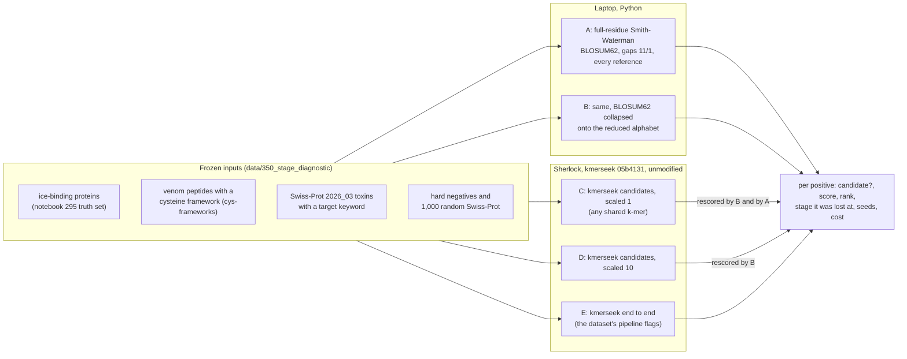

# kmerseek stage diagnostic (notebook number 350)

When kmerseek misses a true hit, which step lost it? This benchmark runs the same queries
against the same reference panel through five stages and records, for every true hit,
the first stage that dropped it.



## The three datasets, never pooled

| Dataset | Query | A true hit (positive) | Split (dev / held-out) by |
|---|---|---|---|
| `ice_binding` | 57 ice-binding proteins | an ice-binding protein of another origin (another invention of ice binding: UniProt family, else lineage) | origin |
| `toxin_scaffold` | 60 venom peptides, 10 frameworks | a peptide with the same cysteine framework | framework |
| `toxin_target` | 46 mature toxins, 4 target classes | a toxin with the same target keyword (Nav, Kv, Cav, nAChR) | toxin family |

Negatives keep their kind: annotated (another framework or target class), hard
(composition-matched or same-family non-ice-binding proteins; cysteine-rich non-toxins)
and background (random Swiss-Prot). None is an experimentally confirmed negative.
A query's own entry is left out of every metric and checked on its own (`self_hits.tsv`).
For ice binding, a protein of the query's own origin is a homolog, not convergence: it is
neither positive nor negative.

## Running it

```bash
P=~/anaconda3/envs/2025-kmerseek-analysis/bin/python
S=scripts/stage_diagnostic/stage_diagnostic.py
$P $S freeze                       # panels, labels, splits; writes MANIFEST.tsv
$P $S align                        # stages A and B, ~20 s on 12 cores
$P $S job --job-dir /tmp/nb350_job # Sherlock job for C, D, E and the fixtures
rsync -a /tmp/nb350_job/ sherlock:/scratch/users/olgabot/350_stage_diagnostic/v1/
# the whole job takes minutes; the dev partition starts at once but takes srun only
ssh sherlock 'cd /scratch/users/olgabot/350_stage_diagnostic/v1 && srun -p dev -A ayeletv -c 4 --mem=16G -t 01:00:00 bash run.sh'
# or, through the normal queue: sbatch --wait submit.sbatch
rsync -a --exclude idx sherlock:/scratch/users/olgabot/350_stage_diagnostic/v1/ /tmp/nb350_job/
$P $S collect --job-dir /tmp/nb350_job
$P $S evaluate
$P $S plot
$P $S report
```

`align` and `job` refuse to run if a frozen panel file changed since `freeze`
(`MANIFEST.tsv`). A change to the panels or the config is a new config version, not an
edit.

## Files

| Path | What |
|---|---|
| `config/stage_diagnostic_v1.yaml` | every setting, the false-hit budgets and the decision rules, written before any run |
| `panels.py`, `labels.py` | panel building; what each query-reference pair is |
| `scoring.py` | the A and B scorers |
| `seeds.py` | k-mers as kmerseek hashes them (checked against kmerseek on the fixtures) |
| `fixtures.py` | seven deterministic fixtures and what each stage must do with them |
| `kmerseek_job.py`, `collect.py` | the kmerseek adapter: writes the job, reads it back |
| `evaluate.py`, `plots.py`, `report.py` | metrics, figures, the decision report |
| `../../tests/test_stage_diagnostic.py` | unit tests |
