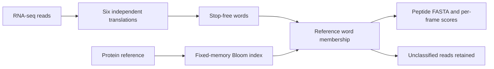

# orpheum-rs

A standalone Rust command-line tool for screening six-frame translations against a protein reference. It streams FASTA or four-line FASTQ, including concatenated gzip files. It does not assemble reads or align sequences.



This is an experimental reimplementation of the core [Orpheum](https://github.com/czbiohub-sf/orpheum) screening method, not a drop-in replacement. The upstream code calls its score Jaccard, but calculates the fraction of unique query words found in its reference Bloom filter. This tool calls that `membership_fraction`. A reference-supported frame is a candidate, not proof of coding sequence or a gene assignment.

The upstream source inspected was commit `a76c3f3e5c649894a5a8cd85738d5a7c78d6b1b8`. Its MIT license is retained in [LICENSE](LICENSE). This implementation uses a different Bloom hash scheme and index format. It cannot load khmer Bloom filters or sourmash signatures.

## Build and use

Rust 1.85 or later is declared; local checks used 1.89. The Linux benchmark requests the Sherlock 1.90 module. Dependency versions are locked in Cargo.lock.

```bash
cargo build --release --manifest-path tools/orpheum-rs/Cargo.toml
```

The binary has three commands:

| Command | Input | Output |
|---|---|---|
| `index` | Protein reference FASTA/FASTQ, plain or gzip | Reusable checksummed Bloom index |
| `translate` | Index and one or more nucleotide read files | Reference-supported peptide segments, optional per-frame TSV and unclassified-read FASTA |
| `sixframe` | Nucleotide read files | All stop-free peptide segments without a reference-dependent coding gate |

`index --alphabet protein`, `dayhoff`, and `hp` use default k 7, k 12, and k 30, respectively. K can be changed within 63 packed bits: protein≤12, Dayhoff≤21, HP≤63. All three alphabets use the same classes as upstream Orpheum. These packed words are internal lookup keys, not sourmash hashes.

An index uses 64 MiB by default. `--memory-mib` sets a different fixed allowance. The metadata reports occupied bits and an estimated false-positive probability. `translate` rejects indexes above `--max-index-fpr` (default 0.01). Increase index memory when that guard fails; reducing the guard is not an accuracy improvement. The reference fingerprint, settings and bit data are retained and checksummed.

`translate --threads 4` processes bounded batches and writes records in input order. The default score threshold is 0.5 for protein and Dayhoff, and 0.8 for HP, following upstream defaults. These thresholds are not validated for the oyster study. Multiple passing frames are retained; ties are not silently resolved. Unmatched reads are unclassified, not proven noncoding.

## Stop and ambiguity policies

`--stop-policy words` is the default requested for the oyster workflow. It removes individual words crossing a stop while retaining the other stretches of each frame. Peptide output is split at stops. `--stop-policy frame` rejects the entire stop-containing frame, matching that aspect of upstream Orpheum. These are different analyses and must remain separately labelled.

The standard nuclear genetic code is used. Ambiguous codons become X; words crossing X are excluded and peptide output is split there too. This is a conservative ambiguity rule and differs from upstream's resolution of some partially ambiguous codons. Mitochondrial or other genetic codes are not currently supported.

The nucleotide complexity screen uses adjacent-base changes divided by read length, with a 0.3 threshold. Peptide words must have more than half as many unique words as valid word windows. Stop-excluded windows do not enter that denominator. That denominator intentionally differs from the original full-frame length when words are removed.

## Checks and measurements

Six unit tests check codons, reverse-frame translation, residue classes, stop boundaries, membership and the distinction between word/frame stop policies. An independent Python exact-set calculation checks every scored frame (the script prints the count) across all three alphabets and both policies. It does not exercise the nucleotide low-complexity screen. It also checks gzip members, malformed FASTQ, corrupted indexes, refusal to overwrite indexes and thread-deterministic peptide output.

The independent check reproduces the membership statistic, not the complete Python Orpheum program or its Bloom false positives. End-to-end equivalence, correct-frame accuracy and speedup over Python Orpheum remain unmeasured.

The [Sherlock benchmark](benchmarks/sherlock.sbatch) was submitted as 49353228: 4 CPUs,16 GB,one hour. It builds the locked release binary, runs checks, builds a Swiss-Prot index and processes a fixed one-million-read prefix from DW 1 read 1. It compares one/four scoring threads, native sourmash stop-inclusive sketching and Rust stop-free translation piped into sourmash. It checks nested hash sets for protein/Dayhoff/HP at scaled 10. This is a diagnostic subset, not a replacement for the full-depth oyster analysis. Submission is not a completed benchmark; runtime and storage results are pending.

No production archive filter has been silently replaced by this tool. Existing stop-inclusive results remain historical. Reference-dependent frame selection can lose divergent real coding sequence and needs a separate sensitivity check before use as the primary discovery filter.
